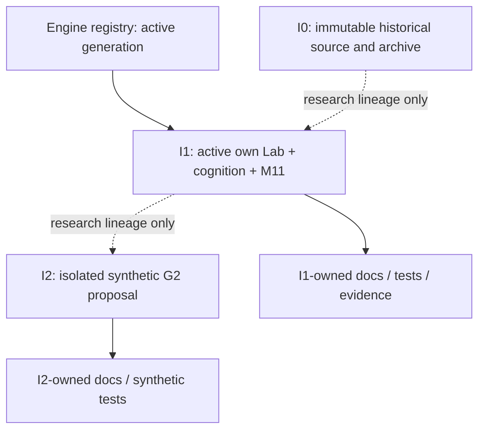
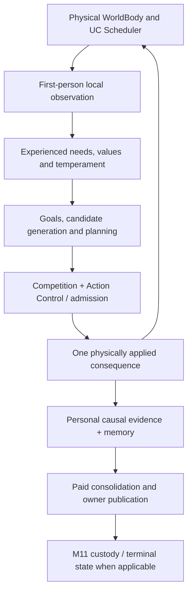

# Architecture atlas for development agents

**Scope:** navigation and intervention map, not a new runtime specification or proof of learning. Baseline: 31 October 2026. **Verify the live HEAD, registry and generation contracts before every change.** This index deliberately avoids restating the mechanisms documented beside source.

## 1. Find the owning generation in 30 seconds

| Generation | Current role at the recorded baseline | Canonical entrypoint | May execute a born individual? |
| --- | --- | --- | --- |
| I0 | Frozen reference and reproducible archive | [I0 source](../../src/i0/), [archive inventory](../../config/archives/i0-20261017.json) | Not an active engine |
| I1 | **Active** embodied artificial individual | [I1 engine contract](../../src/i1/engine.json), [handbook](../../src/i1/docs/README.md), [current status](../../src/i1/docs/STATUS.md) | Only by its declared, tested birth and M11 contracts |
| I2 | Independent research proposal with G2 **synthetic** fixtures | [I2 contract](../../src/i2/engine.json), [research handbook](../../src/i2/docs/README.md), [current status](../../src/i2/docs/STATUS.md) | **NO: not registered, executable or born** |

The [active registry](../../config/engine-registry.json) determines activation, not a folder name, experimental success or this table. The `parent` field records **comparative lineage**, never a live dependency. [ADR-0001](../decisions/ADR-0001-strict-generation-autonomy.md) requires each successor to own its cognition, Lab/WorldBody, UC, persistence, death and identity. The existing I1-specific generated `i1lab` namespace does not authorize importing an obsolete engine.

This is a **repository ownership map**, not a runtime call graph or a claim that I2 is registered.

## 2. The active I1 causal path (one lived step)

**Read first:** [I1 cognitive flow](../../src/i1/docs/COGNITIVE_FLOW.md) and [Stage/owner interface map](../../src/i1/docs/STAGES_AND_INTERFACES.md). The latter's *cooperative runtime inheritance/MRO* is **not** a chronological execution pipeline. Stage10 and Stage11 share one lower-world substrate; do not make two physical steps by instantiating two Stage paths.

The arrows express **causal responsibilities**, not a complete mandatory call order or proof every optional producer runs on every step. Hidden world state must stay outside the individual's first-person observations. Only authorized, UC-paid cognition and the genuine Action Control boundary may contribute to a physical action. Death is irreversible; no replay can turn an uncertain COMMIT into an authorized second action.

| If you need to change... | Verify the actual owner and code | Detailed scope and evidence |
| --- | --- | --- |
| World, bodily state, clock, observation | [I1 Lab world](../../src/i1/lab/world.py), [Stage4 boundary](../../src/i1/lab/stage4_runtime.py), [perception](../../src/i1/modules/perception.py) | [Cognitive flow](../../src/i1/docs/COGNITIVE_FLOW.md) and [data custody](../../src/i1/docs/DATA_CONTRACTS_AND_CUSTODY.md) |
| Needs, value, temperament | [Value/needs](../../src/i1/modules/value_needs.py) and [birth temperament](../../src/i1/runtime/i1_birth_temperament.py) | [Needs and action](../../src/i1/docs/NEEDS_AND_ACTION.md) |
| Candidate goals, options, planning | [Goal manager](../../src/i1/modules/goal_manager.py), real Stage callers | [Stage owner map](../../src/i1/docs/STAGES_AND_INTERFACES.md) |
| Competition, veto, action admission | [Competition](../../src/i1/modules/competition.py), [Action Control](../../src/i1/modules/action_control.py) | [Stage owner map](../../src/i1/docs/STAGES_AND_INTERFACES.md) |
| Episodic memory and lived learning | [I1 memory](../../src/i1/modules/memory.py), real read/write call sites | [Memory and learning](../../src/i1/docs/MEMORY_AND_LEARNING.md) |
| Sleep, consolidation and publication | Stage10/11 owners and candidate transaction on the real runtime | [Consolidation and publication](../../src/i1/docs/CONSOLIDATION_AND_PUBLICATION.md), [UC](../../src/i1/docs/UC_AND_SCHEDULING.md) |
| Birth, authenticated recovery, terminal seal | [I1 birth](../../src/i1/runtime/i1_birth.py), [mortal M11 owner](../../src/i1/runtime/m11_transactional_mortal.py) | [Mortality and M11](../../src/i1/docs/MORTALITY_AND_M11.md) |
| Runtime inheritance or integration | [Natural runtime](../../src/i1/runtime/i1_natural_runtime.py), [I1 contract](../../src/i1/engine.json) | [Capability integration](../../src/i1/docs/CAPABILITY_INTEGRATION.md) |

**Change rule:** do not edit a similarly named historical Stage file assuming it is invoked by natural I1. Trace constructor → method owner → observable effect → test. The generated `i1lab` output is disposable build output; I1's checked-in source remains authoritative.

## 3. I2 research: distinguish fixtures from life

The [I2 architecture](../../src/i2/docs/ARCHITECTURE.md) and [test plan](../../src/i2/docs/TEST_PLAN.md) describe **non-living software**. The [unified SQLite v5 cognitive cycle](../../src/i2/docs/COGNITIVE_CONTROL_UNIFIED.md), [intention continuity](../../src/i2/docs/INTENTION_CONTINUITY.md), [delayed-credit research](../../src/i2/docs/DELAYED_CREDIT_STUDY.md), [external witness](../../src/i2/docs/LIFECYCLE_EXTERNAL_WITNESS.md) and [G1 proposals](proposals/README.md) are not born-world integrations.

| Demonstrated in a synthetic test | **Not established or authorized** |
| --- | --- |
| Local journals, synthetic UC accounting, identity/terminal rejection cases, read-only witness comparisons | Real UC Scheduler/WorldBody, physiological consequence, independently authenticated M11 |
| Synthetic feedback/H2 replay and negative cases | Preregistered confirmatory adaptive advantage or a living recovery |
| Injected witness/challenge ports and some detected rollback conditions | Independent signer/provider, global anti-rollback, motor authority, retry, resurrection or promotion |

No I2 entrypoint appears in its engine contract; never call a fixture's success a real life. G1 review, G3 proof and G4–G6 science remain separate gates. See the [current proposal record](proposals/README.md) and the [promotion process](../engineering/ENGINE_PROMOTION.md). Older proposal diagrams may depict obsolete schemas; **their dates and review state matter**.

## 4. Select a validation layer, not a green badge

| Your question | What to inspect | What it **cannot** establish |
| --- | --- | --- |
| Is the component registered and callable? | [Registry](../../config/engine-registry.json), `engine.json` and actual code | Adaptive performance |
| Is a change structurally permitted? | [ADR-0001](../decisions/ADR-0001-strict-generation-autonomy.md), contracts and [promotion rules](../engineering/ENGINE_PROMOTION.md) | That it was executed |
| Does the implementation pass software tests? | [I1 test matrix](../../src/i1/docs/TEST_PLAN.md) or [I2 synthetic tests](../../src/i2/docs/TEST_PLAN.md), CI **on the exact SHA** | Scientific GO |
| Has meaningful behavior been observed? | [I1 evidence matrix](../../src/i1/docs/EVIDENCE_MATRIX.md), original traces, seed, identity, world and comparator | Generalization without controls |
| Is natural autonomous learning established? | Reviewed preregistered independent results and explicit scientific gate | Never infer from unit tests or an architecture diagram |

At the recorded baseline, **I1 general L3 adaptive benefit is NOT_ESTABLISHED**; the A1-C confirmatory result was a targeted NO_GO, and A2-R remained NOT_EXECUTED. Do not transfer that verdict or that experience into I2; verify the [living evidence index](../../src/i1/docs/EVIDENCE_MATRIX.md) for any later revision.

## 5. Agent intervention protocol

1. **Identify:** generation, live HEAD/branch SHA, issue or experiment, and source-owner entrypoint.
2. **Trace:** actual constructor, caller, first-person data boundary, UC charge, Action Control, physical consequence, M11 and dependent tests as applicable.
3. **Classify:** documentation only; behavior-preserving software correction; living behavioral change; or independent architectural proposal. Never silently change generation status.
4. **Verify:** the smallest relevant static/targeted suite first; execute heavy living CI only when required by the affected invariants. Record PASS, FAIL, NOT_RUN and their **exact** SHAs.
5. **Evidence:** distinguish implemented, software-verified, observed and scientifically established. Preserve adverse and inconclusive research.
6. **Handoff:** `generation | HEAD SHA | owning paths | changed contract | affected invariants | exact tests/results | scientific status | unresolved risks | issue/PR`.

The general [agent routing index](../engineering/AGENT_NAVIGATION.md) is the short entrypoint; this Atlas is the architecture view. Detailed contracts stay **next to their generation**, not duplicated here. The [versioned historical references](reference/README.md) and [dated proposals](proposals/README.md) remain searchable without being promoted into live authority.
