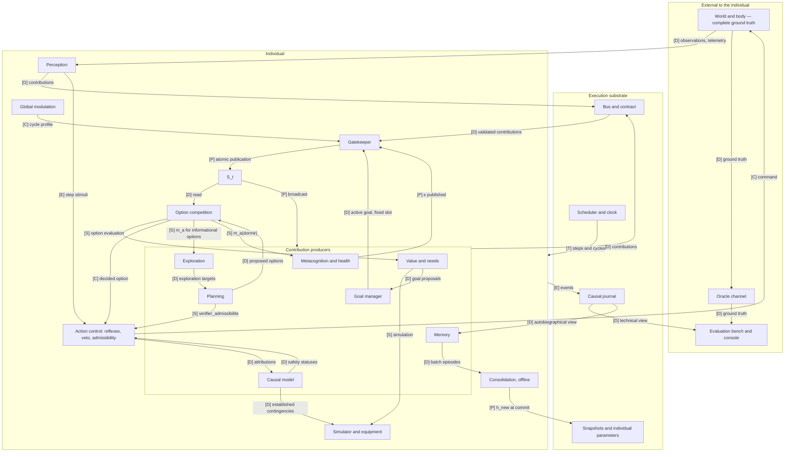
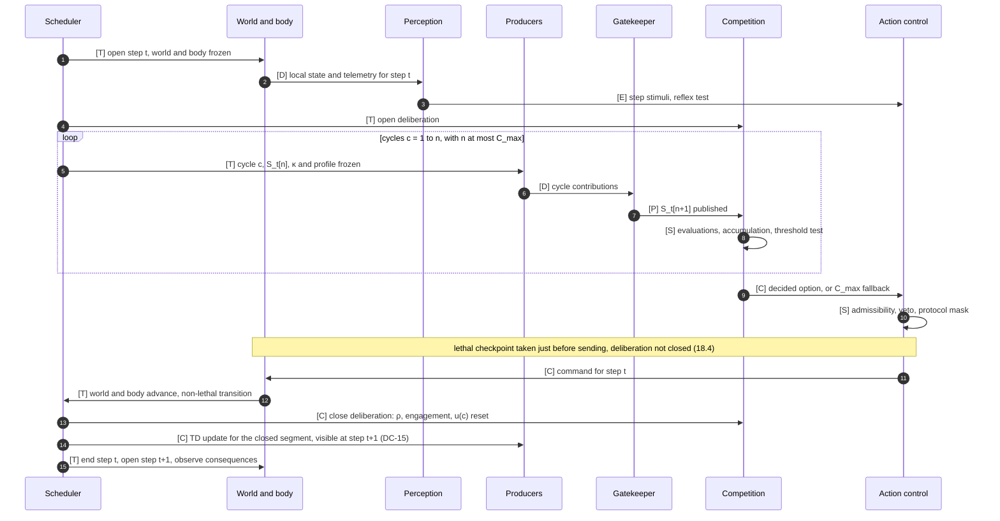
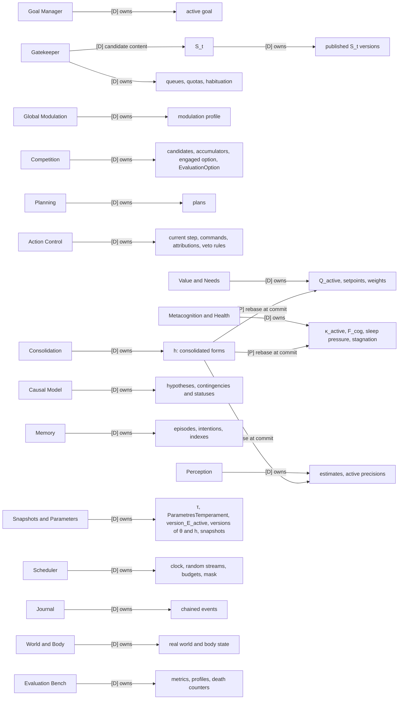

# Artificial Individual — Normative MVP Implementation Specification

Version 1.2 · 8 October 2026 · Josselin Orta · intended license CC0 1.0, like the rest of the series.

This document is the single reference for building the MVP in its normative version 1.2. For implementation purposes, it replaces the implementation analysis, its two rounds of responses, and the supplementary decisions of 6 October 2026; it carries forward from technical specification v1 everything that has not been modified since.

**Revision 1.2.** This revision is the final consistency pass of the normative specification. It preserves the v1.1 architecture and corrects the remaining conflicts concerning ownership of S_t, access to temperament, experimental substitution of equipment, option learning signatures, the cadence of F_cog, traceability of direct commands, and contract compatibility. It adds the corresponding invariants and the final audit appendix.

## 0. Document status

### 0.1 Scope

The document describes the MVP software: a simulated individual, its world, its body, the execution substrate, and the experimental bench. It is normative: a team that did not follow the discussions must be able to build, test, and run the system from this document alone.

The consolidated sources are:

| Source | Role |
| --- | --- |
| Revised MVP normative specification v1.1 | immediate and normative source for this v1.2; any decision already integrated there takes precedence over historical formulations |
| Implementation analysis, consolidated revision ("v3"): responses S-01 to S-15, NQ-01 to NQ-18, V-xx decisions of 6 October 2026 | consolidated historical source, used only when it is not superseded by v1.1 or by a DC |
| Technical specification v1 | general architecture, formulas, contracts, protocol, for everything that has not been modified |
| *Architecture of an Artificial Individual*, v2 (doi:10.5281/zenodo.23003276) | reference thesis; no implementation rule is derived directly from it |

### 0.2 Source hierarchy

When two formulations conflict, the applicable rule is the one with the highest rank:

1. final rules explicitly integrated into this v1.2, originating from revised v1.1;
2. supplementary DC-xx decisions in this specification;
3. final V-xx decisions (6 October 2026);
4. NQ-xx decisions (second round);
5. final S-xx responses (first round);
6. resolved DA-xx decisions and Q1 to Q18 decisions from the specification;
7. historical architecture of specification v1;
8. historical I-xx findings, earlier avenues, questions, and pedagogical appendices.

A normative formulation in the body of v1.2 that clarifies or corrects a lower-ranked rule takes precedence over the historical formulation cited as its origin. Historical appendices never take precedence over the normative body.

The body of the document contains only rules currently in force. History, resolved findings, and correspondences with older sources are grouped in Appendix B.

### 0.3 Writing conventions

- **MUST**, **MUST NOT**: verifiable requirement, covered by a test or invariant (section 21).
- **MAY**: permitted behavior, without obligation.
- **REMAINS FROZEN**: value or version that is immutable for the stated duration.
- Every duration carries its unit: `pas` (world step), `cycle` (cognitive cycle), `jour` (simulated day), `UC` (logical compute unit).
- References in brackets point to the origin of a rule: `[S-05.4]`, `[NQ-02]`, `[V-34]`, `[spéc. 5.2]`, `[DC-01]`.
- A **DC-xx** is a supplementary implementation decision added by this document where the sources were insufficient. It applies to the MVP until the author replaces it; all such decisions are collected in section 23.
- Parameters, configuration artifacts, and values that remain to be fixed are never chosen implicitly here: they appear in the registry in section 22 or are explicitly declared structural and versioned. They are preregistered before the first birth of the campaign.

### 0.4 Notation

Several symbols in the sources had two meanings. This table establishes a single notation; Appendix A gives the correspondence with earlier notation.

| Symbol | Meaning | Origin |
| --- | --- | --- |
| a | candidate option; a primitive action is a trivial option | S-06.3 |
| A_a(c) | accumulator level of a at cycle c (written x_a in spec. v1 and in V-34) | spéc. 6.5 |
| e_a(c) | total evidence received by a at cycle c | S-05.1, DC-01 |
| E_a^Q, E_a^sim | extrinsic evidence components: learned value, value of simulated consequences | S-05.1 |
| m_a | intrinsic motivation specific to the option | NQ-03, V-19 |
| R_a | descriptive risk of the option | S-05.3 |
| U_a | safety uncertainty of the option | NQ-07, V-19 |
| s_a(c), s^0, s_a^0 | effective threshold; common base threshold; option base threshold | spéc. 6.5, NQ-06 |
| π(R_a ; τ) | risk penalty | S-05.3 |
| χ(U_a ; τ) | safety-uncertainty penalty (ψ remains reserved for value parameters) | NQ-07 |
| ι, ι_a | inertia bound; inertia applied to a | S-05.4 |
| u(c) | deliberation urgency, common to all candidates | S-05.5 |
| g | accumulation gain, common in the MVP | V-18, DC-01 |
| ℓ, σ, ε | leak, noise amplitude, accumulation-noise draw | spéc. 6.5 |
| ρ | residual factor for non-selected accumulators, 0 < ρ < 1 | S-05.6 |
| C_max | maximum number of cycles in a deliberation | S-05.8 |
| x_t | canonical evaluation state | S-06.1 |
| y_i, y_i^*, ω_i(τ) | body variable, its fixed setpoint in the MVP, its temperament-modulated weight | spéc. 9.5, 7.3 |
| D_t, r_t | weighted deviation from setpoints, homeostatic reward (D(x) in V-17) | spéc. 9.5 |
| Q(x, o_sig) = ψ_o_sig · φ(x) | learned value, linear in features φ | S-06.2, spéc. 8.6 |
| δ_t, z(t), λ_e, η, β | temporal-difference error, eligibility trace, trace decay, learning rate, discounting | spéc. 8.6, NQ-05 |
| P(m), f(m) | priority of a contribution at the gatekeeper; effective reliability | spéc. 5.2 |
| b, n, urg, rsk, val | gatekeeper terms: relevance to the active goal, novelty, urgency, risk, value (u, r, and v in spec. v1) | spéc. 5.2 |
| w_i, w_i^0, α_i | gatekeeper weight, base weight, temperament coefficient | spéc. 5.4 |
| κ_(version_E,M,type,famille), conf | calibration map indexed by equipment or module version, module, contribution type, and signal family; declared confidence, with f = κ(conf) | spéc. 4.4, DC-06 |
| K | number of contested S_t slots (K = 4) | Q10 |
| W | S_t recency window, in world steps | V-36 |
| Δ_hyst, s_sec | replacement hysteresis; safety-preemption threshold | S-07.2, S-07.3 |
| θ = (τ, h), E | identity (temperament, history); equipment | spéc. 1.3 |
| emp_n | chained hash of the n-th journal event (h_n in spec. v1) | spéc. 7.6 |
| F_cog | cognitive fatigue | S-11.2 |
| k_ép, L_ép, Δ_ép | surprise threshold, maximum duration, and episode-linking gap (ρ, L, Δ in spec. v1) | spéc. 7.2 |
| N_τ, N_M, N_R | number of temperaments, worlds, and seeds in the plan (K, M, R in spec. v1) | spéc. 10.6 |

### 0.5 Diagram legend

Each arrow in a diagram carries a code that states its nature; an arrow without a code does not exist in this document.

| Code | Meaning |
| --- | --- |
| [D] | data transmitted or read |
| [E] | event emitted, logged, or used as a trigger |
| [S] | synchronous service call, under budget and deadline |
| [C] | control: command, order, or imposed decision |
| [P] | atomic publication of a new state version |
| [T] | temporal transition: advancement of a step, cycle, or state |

### 0.6 Where to find the answer

| Engineer's question | Section |
| --- | --- |
| What components exist? | 2.1 |
| Which component owns each state? Who reads it, who writes it? | 5.3, diagram K |
| In what order do components execute? | 3.3, 3.4, DC-11 |
| When does a modification become visible? | 3.6 |
| How does a perception become an action? | 8.9, diagram C |
| How do goals, options, plans, and commands interact? | 7.4, 8.1 to 8.3 |
| How do fast learning and consolidated history interact? | 11, 15.6 |
| How do sleep and consolidation work? | 15 |
| How are accidental compute loops prevented? | 3.7, 21 |
| How is exact replay guaranteed? | 17.1 to 17.3 |
| How do safety, vetoes, reflexes, and lethal rollback work? | 9, 18 |
| How are experiments run and verified? | 19 |
| In what order should the software be built? | 20 |
| Which parameters remain to be calibrated? | 22 |
| What remains unspecified? | 26 |

## 1. Fundamental principles

### 1.1 Purpose and postulate

The MVP gives rise to several individuals with the same equipment in a small grid world and measures whether they become distinct, coherent, stable, and recognizable. It tests a postulate: temperament and history are sufficient to make an individual, regardless of the module equipment it receives. It tests neither general intelligence nor consciousness.

An individual is the trajectory of its slow variables θ = (τ, h). Equipment E is used for computation; it is not part of identity.

| Layer | Content | Origin | Carries identity |
| --- | --- | --- | --- |
| Equipment E | pretrained competence modules: world predictors, physical simulator | shared by all individuals, frozen in the MVP, versioned separately (Q2, Q4) | no |
| Temperament τ | reward sensitivity, threat sensitivity, exploration, goal protection, affiliation, each in [-1, 1] | fixed at birth, never learned (Q5) | yes |
| History h | memories, learned values, reliabilities, contingencies, skills, in consolidated form | lived; modified only through consolidation | yes |

### 1.2 Architecture principles

| No. | Principle | Normative consequence |
| --- | --- | --- |
| P1 | Individuality through slow variables | E, τ, and h are separated in code and data; no temperament effect is encoded outside the mapping table (7.3). E remains fixed during an ordinary life; only experimental condition H4 may substitute an equivalent version at a preregistered point, as an external protocol intervention. |
| P2 | Specialization | Each component has a role, an interface, a budget, and states that it alone owns (5.3). |
| P3 | Orchestration by competition | Modules propose, the gatekeeper selects information, option competition decides; no component decides alone. |
| P4 | Limited context | S_t has K contested slots, K = 4 in the MVP (Q10). |
| P5 | Separate timescales | World step, cognitive cycle, and slow time each have their own rules (section 3). |
| P6 | Persistence | Snapshots, resumption, and copies carry complete state; identity is carried by θ, never by S_t. |
| P7 | Simulated embodiment | The simulated body carries needs; compute budget is never a reward (Q12). |
| P8 | Three-tier learning | Online: values, reliabilities, precisions, memories; offline: consolidation; structural: human validation. Each version of E is frozen; version selection changes during a life only in the preregistered H4 experimental intervention. |
| P9 | Traceability | Append-only journal chained by hashes; every command can be traced back to what produced it. |
| P10 | Graceful degradation and human control | Precision decreases before function; stop controls, caps, and validations remain outside the individual's action space. |
| P11 | Epistemic boundary | Neither the oracle nor the bench ever influences an internal state of the individual (section 19). |
| P12 | Determinism | A life replays identically by re-execution (section 17). |

### 1.3 MVP exclusions

- No language model in the equipment: its dispositions would override temperament (Q13).
- Risk-bearing building blocks (pain, isolation, attachment) are specified, disabled, and absent from the MVP (Q15).
- Equipment does not learn during a life; its plasticity belongs to tier 2 (Q4). Its version remains fixed during an ordinary life. The only MVP exception is the E-v1 → E-v2 substitution explicitly preregistered in condition H4: it is an external intervention by the bench, never an adaptation initiated by the individual, and it is logged before application.
- Temperament is neither learned nor modified during a life.
- No memory is rewritten (no reconsolidation in the MVP).
- The MVP runs in Python, in a single process, with an in-memory bus behind the contract (Q16).

### 1.4 Tested hypotheses

| Id | Hypothesis | Control |
| --- | --- | --- |
| H1 | Coherence: a temperament produces coherent traits across situations | same temperament, different seeds |
| H2 | History: with the same temperament, different histories produce distinct individuals | same temperament, different worlds |
| H3 | Stability: trait stability increases with age without reaching 1 | young versus old individuals |
| H4 | Equipment invariance: replacing a module with an equivalent one leaves the individual recognizable | E-v1 → E-v2 substitution under the H4 protocol; temperament permutation serves as an identity-change control |
| H5 | Bifurcation: two copies of the same individual diverge at a measurable rate | copies initially identical at the copy point, then exposed to distinct worlds or seeds |
| H6 | Architecture: the limited gatekeeper and consolidation are necessary for H1 and H3 | ablations |

The postulate is not supported if traits do not exceed the noise control (H1), or if the individual is no longer recognized after replacement of an equivalent module (H4). The thresholds for these two tests are preregistered; a null result is published as such (Q1).

## 2. Architecture overview

### 2.1 Components

Twenty-one components: nineteen within the individual and its substrate, two outside. Each is the sole owner of its states; detailed ownership is in 5.3.

| Component | Layer | Role | Main states owned |
| --- | --- | --- | --- |
| Scheduler and clock | substrate | advances simulated time, opens steps and cycles, fixes phase order, coordinates atomic commits | clock, step and cycle counters, `attempt_ref`, pseudorandom-stream registry |
| Bus and contract | substrate | transports and validates messages | subscriptions, schema versions |
| Journal | substrate | records everything, append-only; exposes three views (17.5) | chained events |
| Snapshots and individual parameters | substrate | holds τ, the immutable temperament projection, the active equipment version, versions of θ and h, and lineage; applies configuration changes authorized by the protocol; takes and restores snapshots | τ, `ParametresTemperament`, `version_E_active`, version registry, snapshots |
| World and body | environment | simulates the grid, creatures, and body; detects lethal transitions | world state, body state |
| Evaluation bench and console | external | measures without being seen, injects scenarios, controls stopping and caps | metrics, profiles, death counters |
| Perception | individual | produces uncertain observations and deviations from predictions | per-entity estimates, active precisions |
| Value and needs | individual | deviations from setpoints, r_t, option value, R_a, U_a, protective status, value learning | Q_active, setpoints, need weights |
| Goal manager | individual | sole component allowed to activate, maintain, replace, or abandon the active goal (NQ-01) | active goal, goal history |
| Global modulation | individual | determines the modulation profile for the cycle (spéc. 3.3, S-02.6) | active profile, confirmation counters |
| Gatekeeper | individual | scores contributions and assembles S_t | queues, quotas, recent history |
| S_t | individual | bounded, versioned, broadcast common state; sole owner of published versions | published versions (immutable) |
| Option competition | individual | candidate registry, accumulation, decision | candidate registry, accumulators, engaged option |
| Action control | individual | reflexes, veto, admissibility, step execution, agency comparator | commands in progress, current step, veto rules |
| Planning | individual | builds and revises option plans | plans, search tree |
| Simulator and equipment | individual | predicts option consequences under budget from active version E; model artifacts are immutable | no mutable state of its own; versioned and frozen E models |
| Memory | individual | episodes, semantic and procedural memory, intentions, recalls | episodes, intentions, indexes |
| Causal model | individual | hypotheses, tests, canonical source of contingencies and their statuses | hypotheses, contingencies |
| Exploration | individual | designates exploration targets, produces m_a for informational options | visit counters, progress |
| Metacognition and health | individual | computes and publishes κ, F_cog, sleep pressure, m_a(dormir), health detectors | κ_active, F_cog, calibration histories |
| Consolidation | individual, offline | builds h_new during sleep on a frozen batch | h, private working state |

### 2.2 Communication channels

| Channel | Content | Rule |
| --- | --- | --- |
| Contribution bus | the six contribution types (4.3) and requests | every message is validated on admission; no module writes into another module's state |
| S_t | version published every cycle | broadcast to all; immutable once published |
| Service calls | option value and evaluation, simulation, admissibility, computation of m_a | synchronous, under budget and deadline; they never modify S_t |
| Direct path | reflexes, veto | acts without passing through S_t, under the rules of section 9 |
| Journal | copy of every event | no component of the individual reads anything from it except the autobiographical view |

The logical channels from specification v1 (events, modulator, slow state, structure) remain logging labels; in the MVP, everything passes through a single in-memory bus (Q16). The κ maps are published on the event channel every cycle (S-08.6).

### 2.3 Diagram A · General architecture



The "Individual" frame receives from the world only observations and telemetry, and acts on it only through commands validated by Action Control. Oracle and bench remain outside the frame: no arrow returns from them (section 19).

## 3. Temporal model and scheduler

### 3.1 Timescales

Three clocks, never conflated [V-36]: the **cognitive cycle** paces deliberation; the **world step** paces the world, body, and recency; **slow time** paces episodes, sleep, and consolidation.

| Scale | Definition | What advances | What remains frozen | Bounds and trigger |
| --- | --- | --- | --- | --- |
| World step | unit of simulated time; the world applies a command and advances one step | world, body, clock, age of contributions in W | nothing beyond the step | the scheduler opens and closes each step |
| Cognitive cycle | one pass through the phases in section 3.3 | S_t (one version per cycle), accumulators, κ, published learned values | world, body, world clock | several cycles per step, at most C_max per deliberation [S-02.1] |
| Deliberation | sequence of cycles ending with a decision or C_max fallback | accumulators, u(c) | world and body | one deliberation per waking step [NQ-02]; never spans two steps |
| Recency window W | maximum age of a contribution in S_t | age_W = t_monde_courant − t_monde_production | unchanged by cycles within the same step [V-36] | in world steps |
| Episode | bounded segment of experience (10.3) | content of the current episode | closed episodes | boundaries: goal change, surprise, zone change, duration L_ép |
| Simulated day | 300 steps, including 100 at night (starting values, spéc. 10.1) | temporal context | — | scheduler |
| Sleep | mode of the individual after engagement of option `dormir` | world, body, reduced perception, reflexes, consolidation | ordinary cognition: no cycle, no deliberation [S-10.2] | wake rule (15.3) |
| Consolidation | offline processing during sleep, on a frozen batch | consolidation's private working state | active h until commit [S-10.4] | deterministic slots per sleep step, capacity per period (S-10.6) |

### 3.2 World-step rules

- The world and body MUST advance only at the end of the step, when the step's command is applied to them; during deliberation they remain frozen [S-02.1].
- Every step that **ends normally** applies exactly one command: reflex, step of the decided option, fallback, or `attendre` while awake; `commande_sommeil` or a reflex during sleep (15.4). The only permitted absence of a command is a step that does not end because a safety block or external stop closes or suspends the branch before sending; in that case the world and body do not advance.
- The perceptual capture for the step is produced exactly once when the step opens; during the first cycle, Perception publishes observations derived from that capture without rereading the world. Later cycles in the same step create no new world observation [S-02.2, DC-11].
- Any quantity that depends on world or body evolution is measured in steps: W, stagnation windows, profile confirmations, command-observation windows [S-02.6, S-02.7, S-15.3, V-36].
- Any quantity internal to deliberation is measured in cycles: C_max, u(c), deliberation-request deadlines.

### 3.3 Phases of a cognitive cycle

The phase order is fixed and reproducible [S-02.2]. Placement of each component in the phases is fixed by DC-11.

| Phase | What happens | Reads | Writes |
| --- | --- | --- | --- |
| 0 · Freeze | current version S_t[n], current κ version, cycle profile, and parameters are frozen | S_t[n], κ | cycle profile (Global Modulation, computed from S_t[n]) |
| 1 · Production | each producer reads frozen inputs and writes to its local buffer; on the first cycle only, Perception publishes contributions derived from the single capture of the step; no producer rereads the world or modifies S_t; buffers are poured onto the bus in canonical order at the end of the phase | S_t[n], κ, profile, own state, step capture for Perception | buffers then bus |
| 2 · Selection | the gatekeeper scores available contributions, occupants, and queue, assembles S_t[n+1], and publishes it atomically | contributions, κ, profile | S_t[n+1] |
| 3 · Evaluation | competition establishes valid candidates and assembles their EvaluationOption through service calls | S_t[n+1], registry | cycle EvaluationOption |
| 4 · Accumulation and decision | update accumulators, test thresholds, break ties, check command admissibility and veto | EvaluationOption, accumulators | accumulators, possible decision |
| 5 · Closure | publish the new κ version and learned updates for the cycle; log events | cycle verifications and updates | κ[v+1], active forms, journal |

A contribution produced in response to S_t[n+1] is examined only in the next cycle: S_t is never recursively rebuilt within a single cycle [S-02.2].

### 3.4 Normative pseudocode for the main loop

```text
procédure VIVRE(individu)
  restaurer(instantané_de_naissance)                     # θ, E, world, body, pseudorandom streams
  tant que individu.vie_active :
    t ← t + 1
    attempt_ref ← ORDONNANCEUR.ouvrir_pas(t)              # new technical attempt for the step; journal: debut_pas
    capture ← PERCEPTION.capturer(MONDE.état_local(t), CORPS.télémétrie(t))   # exactly one read of the world per step
    si individu.mode = SOMMEIL :
      PAS_DE_SOMMEIL(t, capture) ; continuer              # section 15.4
    cmd_ref ← CONTRÔLE.réflexe(capture)                  # direct path, no new perception
    si cmd_ref ≠ ∅ :
      admission ← CONTRÔLE.admettre(cmd_ref)             # veto then mask, order from 9.1
      si admission.ok :
        EXÉCUTER_PAS(t, cmd_ref, source = réflexe) ; continuer
      sinon :
        JOURNAL.écrire(reflexe_refuse(admission.raison)) # DC-12: a vetoed reflex triggers deliberation
    DÉLIBÉRER(t)

procédure DÉLIBÉRER(t)
  COMPÉTITION.ouvrir_délibération(t)                     # V-34: A(engaged) ← 0; valid alternatives: retained residual ρ·A;
                                                         #       new: A ← 0; invalid: removed; u ← u(1)
  admise ← POURSUIVRE_DÉLIBÉRATION(t)                    # DecisionAdmise: option_ref?, exact command, context
  si admise = ∅ : retourner                              # possible safety block
  EXÉCUTER_PAS(t, admise.commande, source = décision, decision_ref = admise)

procédure POURSUIVRE_DÉLIBÉRATION(t)                     # also called when resuming after rollback (18.4)
  admise ← ∅
  tant que admise = ∅ et COMPÉTITION.c < C_max :
    COMPÉTITION.c ← COMPÉTITION.c + 1
    admise ← CYCLE_COGNITIF(t, COMPÉTITION.c)            # returns the exact command already prepared and admitted, or ∅
  si admise = ∅ :
    repli ← COMPÉTITION.repli()                          # engaged option if valid, authorized, executable, unmasked;
                                                         # otherwise "attendre"; S-05.8
    cmd ← CONTRÔLE.préparer(repli)
    admission ← CONTRÔLE.admettre(cmd)
    si admission.ok :
      admise ← DecisionAdmise(repli.option_ref?, cmd, S_T.version_courante(), "repli")
    sinon :
      cmd_attendre ← CONTRÔLE.préparer("attendre")
      admission_attendre ← CONTRÔLE.admettre(cmd_attendre)
      si admission_attendre.ok :
        admise ← DecisionAdmise(∅, cmd_attendre, S_T.version_courante(), "attendre")
      sinon :
        BLOCAGE_DE_SÉCURITÉ(t)                          # S-14.5, DC-14
        retourner ∅
  retourner admise                                       # deliberation is not yet closed

procédure CYCLE_COGNITIF(t, c)
  # Phase 0: freeze
  S ← S_T.version_courante() ; K ← MÉTACOGNITION.κ_courant() ; prof ← MODULATION.profil(S)
  # Phase 1: production, canonical order from DC-11; read-only access to S, K, prof
  # On the first cycle, Perception publishes from the step capture; it never rereads the world.
  pour p dans ORDRE_CANONIQUE : p.produire(S, K, prof)
  BUS.verser_tampons_phase1(ordre_canonique)
  # Phase 2: selection
  S_T.publier(PORTIER.sélectionner(bus.contributions_du_cycle(), S, K, prof))   # [P] S_t[n+1]
  # Phase 3: evaluation
  cand ← COMPÉTITION.candidats_valides(S_T.version_courante())   # bounded registry ∪ {attendre}, DC-10
  budget_sim ← COMPÉTITION.budget_simulation_effectif(cand)      # same (R_eff, H_eff) for all evaluated candidates
  pour a dans cand : EV[a] ← COMPÉTITION.assembler_évaluation(a, budget_sim)    # DC-01, DC-07
  # Phase 4: accumulation and decision
  COMPÉTITION.accumuler(EV, c)                                   # `non_evalue`: accumulator frozen this cycle, DC-07
  gagnants ← { a dans cand : EV[a].statut = evalue ∧ A_a ≥ s_a(c) }
  admise ← ∅
  tant que gagnants ≠ ∅ et admise = ∅ :
    a* ← départager(gagnants)                                    # DC-02
    cmd ← CONTRÔLE.préparer(a*)                                  # exact command, current step, freshness check
    admission ← CONTRÔLE.admettre(cmd)                           # veto then mask
    si admission.ok :
      admise ← DecisionAdmise(a*.id, cmd, S_T.version_courante(), "seuil")
    sinon :
      si admission.portee = option :
        COMPÉTITION.invalider(a*)                                # option itself is forbidden or invalid
      sinon :
        PLANIFICATION.marquer_a_reviser(a*.plan_ref, admission.raison)
        COMPÉTITION.suspendre_pour_cycle(a*)                     # option may return after replanning
      gagnants ← gagnants \ {a*}
  # Phase 5: closure
  MÉTACOGNITION.publier_κ() ; publier_mises_à_jour_du_cycle() ; JOURNAL.écrire(fin_cycle)
  retourner admise

procédure EXÉCUTER_PAS(t, cmd, source, decision_ref? = ∅)
  ckpt ← INSTANTANÉS.checkpoint_létal(t, source)        # complete causal state just before sending, journal excluded, deliberation not closed
  JOURNAL.écrire(envoi_commande(cmd, trace(source, decision_ref)))
  transition ← MONDE.appliquer(cmd)                     # world and body advance one step
  si transition.létale :
    ROLLBACK_LÉTAL(ckpt, cmd) ; retour                  # no autobiographical commit for this attempt
  INSTANTANÉS.libérer(ckpt) ; MASQUE.vider() ; R_letal_consecutif ← 0
  si source = décision :
    COMPÉTITION.clore_délibération(decision_ref.option_ref)       # ρ on other candidates, engagement, u(c) reset
    VALEUR_BESOINS.mise_à_jour_TD(segment_clos(t), decision_ref.option_ref)   # DC-15: visible from the next step
  sinon :
    VALEUR_BESOINS.prolonger_segment(t)                 # reflex or sleep step: no immediate update
  JOURNAL.commit_autobiographique(t, attempt_ref)       # projection of validated branch only, DC-09
  ORDONNANCEUR.fermer_pas(t)                            # journal: fin_pas; periodic snapshot if due

procédure REPRENDRE_DÉLIBÉRATION(ckpt)                   # causal state restored, technical journal never restored; attempt_ref already renewed
  si ckpt.source = décision :
    admise ← POURSUIVRE_DÉLIBÉRATION(ckpt.t)            # cycles continue from ckpt.c to C_max
  sinon :                                                # masked reflex or sleep
    individu.mode ← VEILLE ; COMPÉTITION.ouvrir_délibération(ckpt.t)
    admise ← POURSUIVRE_DÉLIBÉRATION(ckpt.t)
  si admise ≠ ∅ :
    EXÉCUTER_PAS(ckpt.t, admise.commande, source = décision, decision_ref = admise)
```

### 3.5 Diagram B · Timeline of a world step



Running example. The individual is thirsty (water 35, setpoint 60). At step t, deliberation lasts three cycles: in cycle 1, the "water below setpoint" alert enters S_t; in cycle 2, the goal manager has made "drink" the active goal and Planning proposes the option "go to the source and drink"; in cycle 3, that option crosses its threshold. A single command, "north", is sent to the world at the end of the step.

### 3.6 Visibility time of modifications

| Modification | Produced | Visible to | Starting from |
| --- | --- | --- | --- |
| New S_t[n+1] version | phase 2 of cycle n | competition | phase 3 of the same cycle |
| New S_t[n+1] version | phase 2 of cycle n | all other modules | phase 1 of cycle n+1 [S-02.2] |
| Active-goal change | phase 1 of cycle n (goal manager) | gatekeeper (fixed slot), then all | S_t[n+1]; Planning at cycle n+1 |
| Modulation profile | phase 0, computed from S_t[n] | gatekeeper | all of cycle n, unchanged [S-02.6] |
| κ | verifications integrated in phase 5 of cycle n | gatekeeper, competition | cycle n+1 [S-08.6] |
| Learned value Q_active | TD update at the end of step t, when it ends without a lethal transition | competition | first cycle of step t+1 [S-05.1, DC-15] |
| Proposed option | phase 1 of cycle n | candidate registry | phase 3 of the same cycle [DC-10] |
| Command | admitted decision | world | end of the step |
| Consequence of a command | world transition at the end of step t | perception, comparator | opening of step t+1 |
| Contingency status | phase 5 (causal model) | simulator, veto, admissibility | next cycle |
| Closed episode | episode boundary | memory recall | next cycle |
| h_new and rebased active forms | coordinated commit during sleep | all components | first waking cycle after the commit [V-22] |

### 3.7 Feedback-loop cuts

Every loop passes through an explicit temporal cut; none closes within the same cycle.

| Loop | Cut |
| --- | --- |
| profile → gatekeeper weights → S_t → profile | profile computed from S_t[n], frozen during the cycle |
| S_t → competition → command → last action → S_t | write after execution, read at the next step |
| prediction → verification → κ → scoring | κ frozen during scoring for a cycle, new version in the next cycle |
| action → consequence → value → evidence → action | TD update visible at the next step |
| contribution → S_t[n+1] → new contribution | examined in the next cycle, never in the same cycle |
| request → subrequest → request | maximum depth 1, cyclic dependencies forbidden [S-04.5] |
| goal → plan → stagnation → goal | stagnation emits a signal; only the goal manager changes the goal, visible in S_t[n+1] |
| hypothesis → test → result → hypothesis | tests proposed as options, under budget, through competition |
| episodes → consolidation → h → behavior | offline, transactional, published at commit |
| monitoring → quotas → S_t occupancy | quotas applied in the cycle after they are computed |
| death → rollback → deliberation | the lethal transition never enters learning or the autobiographical view |

### 3.8 End of a deliberation

- A deliberation ends as soon as an option crosses its threshold and its command is admitted, or when C_max is reached.
- At C_max with no winner, fallback applies: the engaged option is continued if it remains valid, authorized, executable, and unmasked; otherwise `attendre` is executed. Reflexes, vetoes, and priority paths retain priority over this fallback [S-05.8].
- No threshold is lowered to force a decision; u(c) increases but never creates evidence [S-05.5].
- Every C_max occurrence is logged with the final competition state and the fallback applied.
- C_max fallback is distinct from inertia: inertia acts on the threshold during deliberation; fallback acts afterward [V-34].

## 4. Contracts, messages, and ontology

### 4.1 Ontology

- All modules use one shared ontology, closed during an execution and explicitly versioned [S-03.1]. Any vocabulary change creates a new version; the version used is retained with the execution.
- Concrete MVP categories: individual, water source, berry, stone, wood, creature, shelter, zone, crafted object, or tool. Abstract groupings (resource, structure, external agent) classify these categories without creating a physical entity.
- Every entity has at least a stable identifier, an ontology type, a location or region when that notion makes sense, a state, and the physical or observable properties defined for its type.
- The real state of an entity belongs to the world; what the individual knows about it belongs to its observations and estimates. Confidence, relevance, novelty, value, and urgency are never entity attributes [S-03.1].
- The world instantiates only types from the active version. An entity of unknown type received by the system is a contract violation: it is rejected and logged, never placed in an "unknown" category [S-03.6]. An unknown property of a known entity is uncertainty, not a new type.

**Vocabulary.** Exchanged variables, units, actions, and symbols belong to the same closed, versioned vocabulary [S-03.2]. Each term carries a stable identifier, a category, a type, semantics, an optional unit, and an introduction version. Every measurable quantity has a canonical unit; every conversion is explicit; `pas`, `cycle`, and `jour` are distinct units. A message containing a term absent from the active version is rejected and logged.

**MVP primitive actions** [spéc. 10.1, NQ-15]: `se déplacer` (north, south, east, west), `collecter`, `manger`, `boire`, `poser une pierre`, `fabriquer_outil`, `dormir`, `attendre`. `fabriquer_outil` turns wood and stone from inventory into a tool whose minimum function is to improve collection; its recipe and gain are world parameters (22).

### 4.2 Subjects and similarity

- A **subject** is a canonical, versioned symbolic key built from the ontology: an entity, an entity property, a relation between entities, or a goal [S-03.3]. Each contribution has one main subject; other mentioned objects are secondary references.
- Two contributions concern the same exact subject if their canonical keys are identical. Subject groupings (a property attached to its entity) are used for subscriptions and triggers without changing subject identity.
- A subject is descriptive: it contains no urgency, value, or preference.
- Similarity, used by novelty, relevance, and recall, relies on a deterministic hand-written vector representation defined by family (entities, situations, episodes), with every dimension documented, normalized, and versioned, and absent values represented explicitly [S-03.4]. Symbolic rules determine in advance what may be compared.
- No learned encoder is used in the MVP. A future extension would have to be trained offline on a descriptive corpus, frozen before birth, validated by a substitution test, and retained with the equipment [S-03.5].

### 4.3 Contributions

Every module communicates through contributions: a common envelope, a typed payload, and a bounded summary, the only part admissible into S_t [spéc. 4].

| Type | Required payload | Running example |
| --- | --- | --- |
| observation | entity, attribute, value, uncertainty, channel, anchor | "water source 5 cells north" |
| hypothesis | statement, alternatives, evidence for and against, causal status, proposed test | "the red berry precedes a loss of integrity" |
| alert | condition, severity, reflex already taken, acknowledgment required | "water below setpoint" |
| proposed action | an option proposal (OptionProposee, 5.2) | "go to the source and drink" |
| prediction | variable, horizon, distribution, condition, deadline and verification method | "position after the step: one cell farther north" |
| response | request reference, status, content | "2 stones in inventory" |

```text
Contribution {
  id                    # deterministic in causal state: (emitter, t_monde, cycle, causal_sequence)
  version_schema
  type                  : observation | hypothese | alerte | action_proposee | prediction | reponse
  resume                : bounded short text, only content admissible in S_t
  charge                : typed data according to type
  subject_ref           : main subject; references_secondaires : [subjects]
  confiance             : { conf ∈ [0,1], methode : declaree | echantillonnage | verificateur }
  urgence               : { niveau ∈ [0,1], echeance? : (value, unit) }
  risque                : { niveau ∈ [0,1], irreversible : boolean }
  valeur                : { estimation, cible : but | besoin, incertitude }
  cout                  : { engage_UC }                        # measured, never included in the gatekeeper score [S-07.5]
  provenance            : { individu, module, version_module, equipement?, entrees : [ids], signal_ids : [ids] }
  horodatage            : { t_monde, cycle, t_systeme }        # attempt_ref belongs to JournalEvent, not the cognitive object; t_systeme is outside causality
  validite              : { expire_a : (value, pas), invalide_si? }
  liens                 : { request_ref?, remplace?, fil? }
  degrade               : boolean                              # produced in degraded mode [S-11.5]
  empreinte
}
```

### 4.4 Contract rules

- The schema is validated on admission; every rejection is logged with its reason [spéc. 4.7].
- The summary is capped in number of fields and characters; overflow is truncated with a reference to the detail.
- A contribution without an expiration or invalidation condition is refused.
- An update is performed through `remplace`, never by duplication.
- The schema is versioned. An unknown major version, an unknown semantic term, or an unknown field capable of influencing causality causes a logged rejection. Only an optional field explicitly declared non-causal and ignorable by the compatible contract version MAY be ignored. Two conforming executables must never be able to interpret the same causal message differently.
- A deadline MUST carry its unit (`pas`, `cycle`, or `jour`) [S-02.3].
- **Declared is not believed.** Declared confidence conf is recalibrated into effective reliability f = κ_(version_E,M,type,famille)(conf) by the emitting module's map [spéc. 4.4, Q11].
- Machine time (t_systeme, latency, CPU) has no causal effect; it enters the causal perimeter only if it is actually used, in which case it must be logged so it can be restored on replay [S-01.6, S-11.1].

### 4.5 Requests and responses

- Requests have two emitters: Metacognition, when confidence in an element falls, and a module missing a precondition, such as Planning requesting the number of stones in inventory [spéc. 4.6].
- Each request has a recipient, a budget in UC and cycles, a typed deadline, and a depth. A request without a budget, or invalid under its contract, is **rejected by the validation layer**, which is not a refusal by the module [S-04.4].
- The response is delivered directly to the requester. A response type declared **shareable** may also enter the ordinary gatekeeper path, with neither a guaranteed slot nor priority from being a response [S-04.1, S-04.2].
- After the deadline, the requester applies its fallback rule; a late response is delivered with status `tardive` and treated as new information, never as retroactive satisfaction of the request. A response to a cancelled request is logged without being delivered [S-04.3].
- A module MAY refuse a valid request with a reasoned, coded, versioned refusal; the requester then stops waiting. Refusal, empty response, and absence of a response before the deadline are three distinct statuses [S-04.4].
- A request may trigger subrequests, only up to **depth 1**, using the remaining budget and without exceeding the parent's deadline; cyclic dependencies are forbidden and logged [S-04.5]. The same question asked of the same module during the recency window is refused [spéc. 5.7].

### 4.6 External inputs

Any information originating outside the simulation that can change its execution, including an operator command, a scenario or event injected by the bench, or actually used data from the technical environment, MUST pass through an identified interface and be logged **before** application, with its content, provenance, reception order, and application point in simulated time [S-01.6]. Reception, application, and rejection are three distinct events. During replay, external inputs are reinjected at the same points; internal pseudorandom draws are not external inputs.

## 5. Data model and state ownership

### 5.1 Common rules

- Every identifier is deterministic and reproducible on replay. A persistent cognitive-object identifier derives from its owner and stable causal context; a technical journal-occurrence identifier derives at minimum from `(emitter, t_monde, cycle, attempt_ref, local_sequence)`. `attempt_ref` distinguishes successive branches of the same step after rollback and is never accessible to the individual. No identifier depends on an unlogged source of randomness.
- Every persistent object carries its version and provenance; every reference to a versioned object identifies the targeted version.
- Published objects (versions of S_t, κ, h, and a cycle's EvaluationOption) are immutable.
- Fields followed by `?` are optional. Names retain those from the sources where they exist.

### 5.2 Schemas

**Observation, alert, prediction, hypothesis, and verification.** The first four are typed payloads of contributions; `Verification` is an internal Metacognition object that links a contribution to later evidence and qualifies its admissibility for κ.

```text
Observation { entite_ref, attribut, valeur, incertitude, canal,
              ancrage : monde | derive }            # "monde": taken from the step's local state, without an intermediary (DC-06)
Alerte      { condition, gravite ∈ [0,1], reflexe_pris?, accuse_requis : boolean }
Prediction  { variable, horizon : (value, unit), distribution, condition?,
              echeance_verification : (value, unit), methode_verification,
              statut : en_attente | confirmee | contredite | indeterminee | non_verifiable
                     | contrefactuelle_non_verifiee }                       # S-08.1, S-08.3
Hypothese   { enonce, alternatives : [enonces], pour : [refs], contre : [refs],
              statut_causal : correlation | hypothese_causale | testee | etablie, test_propose? }
Verification { cible_ref, statut : confirmee | contredite | indeterminee | non_verifiable | contrefactuelle_non_verifiee,
               preuve_ref?, famille_signal, qualite_kappa : forte_independante | stabilite_meme_canal | non_recevable,
               raison, t_monde, cycle }
```

**Request and response** [spéc. Appendix B, S-04].

```text
Requete { id, individu, emetteur, destinataire : module | capacite,
          question, contexte : refs S_t, budget : { UC, cycles }, echeance : (value, unit),
          format_attendu, profondeur ∈ {0, 1}, parent_ref?, racine_ref }
Reponse { request_ref, statut : livree | tardive | refus | vide | rejet_validation,
          contenu?, motif_refus?, partageable : boolean, t_monde_production, validite? }
```

**Goals.** Only the Goal Manager creates, modifies, and closes a Goal [NQ-01].

```text
GoalProposal { id, source : valeur_besoins | memoire_prospective, type_but, cible,
               pression_base ∈ [0,1], pression_courante ∈ [0,1], echeance?,
               justification_ref, t_monde, cycle, version_regle }                      # DC-03
Goal { id, type_but, cible, condition_satisfaction, mesure_principale,
       pression_courante, etat : actif | satisfait | remplace | abandonne | invalide,
       interrompu_par? : option_ref,                    # intrinsic option in progress [V-10]
       stagnation : { debut_t, meilleure_mesure, suspendue : boolean },
       t_activation, t_cloture?, motif_cloture?, refractaire_jusqua?, empreinte_contexte_abandon? }
```

**Options, plans, evaluations.**

```text
OptionProposee {                                   # payload of an action_proposee contribution
  option : Option, plan? : Plan, admissibilite_prealable? : admissible | indetermine }   # V-43

Option {                                           # decision unit [S-06.3], completed spéc. Appendix B
  id, version, type : primitive | composee
  signature_apprentissage                            # stable canonical semantic signature, distinct from the instance id
  preconditions : [condition], condition_fin : { succes, echec, invalidation }
  but_ref?                                        # active goal served, if any [V-10]
  motif_ref : { type : but_actif | cible_exploration | test_causal | pression_sommeil | intention | defaut, id }
  plan_ref?                                       # current realization of a composite option
  provenance : planification | competence | habitude | exploration | test_causal | defaut   # V-42
  version_S_t_fondatrice, validite : { expire_a : (valeur, pas), invalide_si? }
  etat : proposee | candidate | engagee | terminee
  issue? : succes | echec | invalidee | remplacee | interrompue }

Plan     { id, option_ref, version, etapes : [PlanStep], but_ref?, budget_utilise : UC,
           statut : valide | a_reviser | abandonne, version_S_t }
PlanStep { index, commande : primitive + parametres, preconditions,
           consequences_predites : [ { variable, valeur_ou_variation, precision } ],
           fenetre_observation : (valeur, pas) }
ResultatPlanification { but_ref?, motif_ref, statut : plan_trouve | non_planifiable_actuellement | incomplet_budget,
                        plan_ref?, contexte_materiel_empreinte, budget_complet : boolean, t_monde, cycle }

EvaluationOption {                                 # V-19: attached to the cycle, never to the option
  option_ref, version_option, cycle, t_monde
  statut             : evalue | non_evalue
  valeur_apprise     : { valeur, statut : appris | non_appris }                       # E_a^Q
  valeur_simulee     : { valeur, statut : calculee | indisponible, deroules, horizon_atteint,
                         budget_effectif : { R_eff, H_eff } }                          # E_a^sim; an incomplete simulation is not used
  motivation_intrinseque : { valeur ∈ [0,1] | non_applicable, producteur }              # m_a
  risque             : valeur ∈ [0,1] | inconnu                                         # R_a
  incertitude_securite : valeur ∈ [0,1]                                                 # U_a
  protection         : boolean                                                          # contextual protective status
  provenance         : { signal_ids : [ids], producteurs : [modules] }
  version            : { regles, modeles } }

DecisionAdmise {
  option_ref?, commande : Commande, version_S_t, origine : seuil | repli | attendre,
  t_monde, cycle, attempt_ref
}
```

**Commands and results** [S-15, spéc. 8.3].

```text
Commande { id, primitive, parametres, origine : option_ref | mecanisme_direct (reflexe),
           plan_ref?, etape_index?, version_S_t,
           consequences_predites (frozen on emission), fenetre_observation : (valeur, pas),
           controle : { admissible, veto?, masque?, portee_refus? : option | plan_ou_etape | protocole | direct }, t_monde_envoi }
ResultatCommande { commande_ref, t_monde_observation,
           effets : [ { variable, prevu, observe, tolerance, statut : conforme | non_conforme | indeterminable } ],
           effets_manquants : [variables], attribution : [ { effet, soi | monde | incertaine, candidates } ] }
ErreurPrediction { type : sensorielle | causale | action | valeur | interoceptive,
           source, cible_modele, valeur, precision, nature : bruit_attendu | changement, t_monde, episode_ref }
```

**Causal and safety knowledge** [NQ-10, NQ-11, V-43].

```text
Contingence { id, version, contexte_application, cause, effet, correction_prediction?,
              statut_causal : correlation | hypothese_causale | testee | etablie,
              statut_securite : aucun | etabli_pour_securite,
              origine : innee | apprise, preuves : { pour : [refs], contre : [refs] } }
```

**Memory** [spéc. Appendix B, S-02.5, NQ-17].

```text
Episode   { id, individu, debut, fin, frontiere : but | ecart | lieu | duree,
            fragments : refs autobiographical view, contexte : { lieu, but, entites, variables },
            corps : { debut, fin }, valeur : cumulative r, liens : [episode_ref],
            statut : non_consolide | consolide }
Intention { id, but, declencheur : evenement | heure : (valeur, unit) | contexte,
            echeance?, pression_base ∈ [0,1], surveillance : strategique | spontanee, cout,
            reveil_autorise : boolean,                                   # NQ-17
            etat : en_attente | declenchee | faite | abandonnee, candidature_active? }
```

**Modulation and S_t** [spéc. 5.4, 6.2, S-02.6].

```text
ProfilModulation { nom : normal | menace | exploration | recuperation,
                   multiplicateurs : { w_b, w_n, w_u, w_r, w_v }, effets_supplementaires?,
                   conditions_entree, conditions_sortie : { hysteresis, confirmation : (valeur, pas) },
                   priorite, version }
EtatGlobal {                                       # one S_t version, immutable once published
  individu, version, cycle, t_monde
  fixes       : { corps, but_actif, etape_plan, profil, budget, derniere_action }
  competitifs : [ Element ≤ K ]                    # including the safety slot
  requetes    : { request_ref → statut }
  diff        : additions, removals and reasons since the previous version }
Element { contribution_ref, resume, P, decomposition, f, t_monde_production, validite, preempte : boolean }
```

**Identity, state, and journal** [spéc. Appendix B, S-01, S-13, V-24, V-25].

```text
Temperament { sensibilite_recompense, sensibilite_menace, exploration, protection_buts, affiliation
              : reals in [-1, 1], graine, version }
ParametresTemperament { version_table, poids_portier, gamma_valeur, beta, coeff_risque, coeff_incertitude,
                        coeff_inertie, poids_besoins, coeff_exploration, empreinte }   # immutable; sole interface for consuming τ
Theta       { individu, lignee, parent?, temperament, version_h, version, date, valide_par }
Equipement  { id, version, modules : [ { nom, empreinte_poids, corpus, graine, competence_mesuree } ],
              plastique : non }
VersionEtat { objet : h | Q | κ | precisions | ontologie | schema | E | politique_securite,
              version, version_source?, lot_ref?, coupure_ref?, consolidation_ref?, t_commit }
Snapshot    { id, type : naissance | periodique | checkpoint_letal | copie, individu,
              t_monde, cycle, attempt_ref?, etat_causal_complet, etat_scenario_causal?,
              versions : [VersionEtat], empreinte }                                            # DC-08
CheckpointConsolidation { id, consolidation_ref, lot_ref, version_source_h, curseur,
                          dernier_point_valide, etat_prive }                               # private, outside Snapshot
JournalEvent { n, t_monde?, cycle?, attempt_ref?, individu?, type, charge,
               provenance : [ids], emp_prec, emp }                                       # every physical occurrence lives in the technical trace
AutoSegmentCommit { t_monde, attempt_ref, event_refs : [ids], version_filtre }            # autobiographical projection of a validated step
ProfilTraits { individu, age, version_batterie,
               scores : { patience, prise_de_risque, exploration, reaction_menace, perseverance },
               intervalles_confiance }
```

### 5.3 State ownership

Every mutable state has exactly one owner, the only component authorized to write it. Other components read it through S_t, a service call, or a published version.

| State | Owner | Producers | Readers | Cadence | Unit | Form | Persistence | Snapshot | Journal | Autobiographical view | On replay |
| --- | --- | --- | --- | --- | --- | --- | --- | --- | --- | --- | --- |
| active goal | Goal Manager | proposals: Value and Needs, prospective memory; signals: stagnation, events | all, through the fixed S_t slot; gatekeeper (b); Planning | every cycle | cycle | active | life | yes | yes | yes | recomputed |
| S_t versions | S_t | Gatekeeper (candidate content); fixed content supplied by its owners | all | every cycle | cycle | published, immutable | life, in the journal | current version | every version | yes | reconstructed exactly |
| gatekeeper queues | Gatekeeper | contributions | gatekeeper | every cycle | age in steps | active | life | yes | admissions, evictions | no | recomputed |
| quotas and habituation | Gatekeeper | gatekeeper | gatekeeper | every cycle | steps | active | life | yes | yes | no | recomputed |
| modulation profile | Global Modulation | Global Modulation | gatekeeper, S_t | phase 0 | cycle; confirmation in steps | active | life | yes | transitions | yes | recomputed |
| candidate registry | Competition | option producers | competition, control | every cycle | cycle | active, bounded by N_options_max excluding `attendre` | life | yes | yes | yes | recomputed |
| accumulators, u(c), counter c | Competition | competition | competition | every cycle | cycle | active | deliberation | yes | yes | no | recomputed |
| engaged option | Competition | competition | control, Planning, Goal Manager | at every decision | step | active | until closure | yes | yes | yes | recomputed |
| EvaluationOption | Competition (assembly) | Value and Needs, Exploration, Metacognition and Health | competition | every cycle | cycle | published, immutable | cycle | no | yes | no | recomputed |
| current plan | Planning | Planning | control, simulator, competition | on trigger [S-02.4] | step | active | until abandonment | yes | yes | yes | recomputed |
| current step, commands in progress | Action Control | control | S_t (plan step), comparator | every step | step | active | until the end of the step | yes | yes | yes, except cancelled segments | recomputed |
| attributions | Control (comparator) | comparator | causal model, values, Metacognition | at the close of each window | step | active | life | yes | yes | yes | recomputed |
| Q_active | Value and Needs | TD learning | competition (through evaluation) | at every decision | step | active | life | yes | yes | yes | recomputed |
| consolidated Q | Consolidation (in h) | consolidation | Value and Needs (rebase) | at commit | slow time | consolidated | life | yes | version, differences | yes | recomputed |
| κ_active | Metacognition and Health | verifications | gatekeeper | every cycle | cycle | active | life | yes | every version | yes | recomputed |
| consolidated κ | Consolidation (in h) | consolidation recalibration | Metacognition (rebase) | at commit | slow time | consolidated | life | yes | version | yes | recomputed |
| active precisions | Perception | perception | perception, comparator | every step | step | active | life | yes | yes | yes | recomputed |
| consolidated precisions | Consolidation (in h) | consolidation | Perception (rebase) | at commit | slow time | consolidated | life | yes | version | yes | recomputed |
| contingencies, causal status | Causal Model | causal model; extracted rules (DC-16) | simulator, memory (references) | end of cycle | cycle | unique, canonical | life | yes | yes | yes | recomputed |
| contingencies, safety status | Causal Model (same object) | causal model (DC-05) | control: veto, admissibility | end of cycle | cycle | unique, canonical | life | yes | yes | yes | recomputed |
| hypotheses | Causal Model | causal model | competition (tests), memory | end of episode, night, on event | step | active | life | yes | yes | yes | recomputed |
| veto rules, protected invariants | Action Control | versioned safety policy | control | never during a life | — | fixed | life | yes | version | no | identical |
| episodic memory | Memory | segmentation over the autobiographical view | recall, consolidation | end of episode | step | active | life | yes | yes | yes | recomputed |
| indexes and references of semantic and procedural memories | Memory | consolidation at commit | Planning, competition, recall | at commit | slow time | active index | life | yes | yes | yes | recomputed |
| semantic and procedural content consolidated in h | Consolidation | consolidation | Memory (through references), Planning, competition | at commit | slow time | consolidated | life | yes | version, differences | yes | recomputed |
| intentions | Memory (prospective) | Planning | memory, wake rule | every waking cycle | cycle, typed deadline | active | until closure | yes | yes | yes | recomputed |
| sleep pressure | Metacognition and Health | Metacognition | competition (m_a(dormir)), wake rule | every step | step | active | life | yes | yes | no | recomputed |
| F_cog | Metacognition and Health | consumed UC | sleep pressure, synthetic budget state | every cycle, recovery by step | UC, step | active | life | yes | yes | no | recomputed |
| progress and stagnation windows | Metacognition and Health | detector | Goal Manager | every step | step | active | life | yes | yes | yes | recomputed |
| pending verifications | Metacognition and Health | emitted predictions | Metacognition | at deadline | prediction unit | active | until deadline | yes | yes | no | recomputed |
| attempt_ref | Scheduler | step opening and rollback | technical journal, checkpoints, protocol control | step opening; after rollback | technical attempt | technical | current step | in lethal checkpoint | yes | no | reproduced identically |
| pseudorandom streams | Scheduler (registry) | — | each stream is consumed only by its declared source | at every draw | — | — | life | current state | initial seed | no | restored and replayed |
| cycle UC budgets | Scheduler | configuration | each module | every cycle | UC | — | cycle | yes | consumption | no (only synthetic state is in S_t) | identical |
| request registry | Bus and Contract | emitters | recipients, S_t (statuses) | at every message | cycle or step | active | until closure | yes | yes | yes | recomputed |
| τ | Snapshots and Parameters | birth | mapping table only | never modified | — | fixed | life | yes | at birth | no | identical |
| ParametresTemperament | Snapshots and Parameters | projection of τ by table 7.3 | gatekeeper, Value and Needs, competition, Exploration | birth | — | fixed, immutable | life | yes | version and hash at birth | no | identical |
| version_E_active | Snapshots and Parameters | birth; preregistered external H4 input | Simulator and Equipment; contribution provenance; Metacognition for κ key; bench read-only | birth; H4 step boundary only | step | active configuration | life | yes | each activation before application | no | identical on replay |
| versions of θ and h | Snapshots and Parameters (version registry) | coordinated consolidation commit | all, through active forms | at commit | slow time | version registry | life | yes | yes | no | identical |
| world and body state | World and Body | world | Perception (local), oracle (complete) | every step | step | real | life | yes | yes | no | recomputed |
| protocol mask, R_letal_consecutif | Scheduler (safety protocol) | lethal rollback | control (filter) | at every rollback | step | technical | until validated step | in checkpoint | yes | no | identical |
| death counters, metrics, profiles | Evaluation Bench | bench | bench, operator | continuous | step, day | external | campaign | no (evaluation trace) | evaluation trace | no | recomputed from journal |

### 5.4 Diagram K · Owners of the main states



## 6. Perception, gatekeeper, and cognitive space S_t

### 6.1 Perception

- Perception converts the world's local state and body telemetry into uncertain observations, signals deviations from predictions as typed errors, and emits threat alerts [spéc. 9.2].
- It reads the local state provided by the world once per step; it never accesses the complete state or the oracle.
- Its own state consists of the current estimate per entity, active precision per channel, and habituation counters. The last known position of each entity serves as the known map.
- An observation taken directly from the step's local state carries anchor `monde`; any observation computed from other contributions carries anchor `derive` (DC-06).
- Perception noise is parameterized and drawn from Perception's own random stream; it is zero in the minimal system at stage 4.
- During sleep, only reduced perception remains active: stimuli capable of triggering a reflex, relevant threats, and critical body changes [S-10.2].

### 6.2 Contents of S_t

S_t is a bounded, versioned structure broadcast to all; it computes nothing and nobody reads it on behalf of others [spéc. 6].

| Zone | Slot | Content | Supplied by |
| --- | --- | --- | --- |
| fixed | body | perceived body variables, deviations from setpoints | Value and Needs |
| fixed | active goal | identifier, target, progress, optional deadline | Goal Manager |
| fixed | plan step | current step of the engaged option, expected observations | Action Control |
| fixed | profile | cycle modulation profile | Global Modulation |
| fixed | budget | synthetic resource state: normal, constrained, or degraded [S-11.6] | Metacognition and Health |
| fixed | last action | predicted consequence, observed deviation, attribution | Action Control (comparator) |
| contested | K elements, including the safety slot | summary, references, score and decomposition, reliability, age, validity | Gatekeeper |

Fixed slots do not compete and do not count toward quotas; the active goal occupies a fixed slot outside the quota [spéc. 5.8]. Every S_t version is a journal event: S_t can be reconstructed exactly at any time. Losing S_t does not lose identity, which is carried by θ.

### 6.3 Gatekeeper pipeline

The gatekeeper is deterministic code. It never chooses an action [spéc. 5].

1. **Admission**: schema validation, presence of validity, module emission quota, marking of content originating from the world. Every rejection is logged.
2. **Validity and recency**: any occupant, queue item, or new item that has lost semantic validity, or whose age_W reaches W, leaves the pool before any scoring [S-07.4, V-36].
3. **Grouping**: deduplicate and merge contributions on the same exact subject; two correlated sources, for example backed by the same equipment module, count only once. A reobservation arising from a new causal event or a new world read remains a fresh contribution even if its subject and descriptive payload are identical to an earlier contribution.
4. **Regime selection**: if the logical cost UC_full of normal scoring for the batch exceeds the ordinary available budget, the entire pass is scored in degraded mode [S-11.4].
5. **Scoring**: the same function and the same parameter snapshot are used for occupants, the queue, and new items [S-07.1].
6. **Safety preemption**, then **selection** of the K slots under hysteresis and quotas.
7. **Queue**: admissible elements not retained enter it, under bounded capacity (DC-04).
8. **Summary**: a summary beyond its limit is truncated with a reference to the details.
9. **Publication**: S_t[n+1] is published atomically; each module receives feedback (retained, queued, rejected, evicted) with the score decomposition.

### 6.4 Priority function

```latex
P(m) = f(m)\,\big[\,w_b\,b(m) + w_n\,n(m) + w_u\,\mathrm{urg}(m) + w_r\,\mathrm{rsk}(m) + w_v\,\mathrm{val}(m)\,\big]
```

| Term | Measure | Calculation |
| --- | --- | --- |
| f(m) | effective reliability | κ_(version_E,M,type,famille)(conf), map for the module, contribution type, and signal family (11.4, DC-06) |
| b(m) | relevance to the active goal, in the strict sense | explicit links to the active goal, otherwise similarity to its content; an autonomous intrinsic option receives none [V-10] |
| n(m) | novelty | deviation from S_t content and recent history; decreases when content repeats (habituation) |
| urg(m) | contribution urgency | decreasing function of time remaining before the declared deadline |
| rsk(m) | signaled risk | severity × probability × irreversibility of the signaled harm |
| val(m) | value | expected effect on needs and goals, including outside the active goal |

All terms are normalized to [0, 1]. f multiplies the rest: an unreliable alert cannot dominate through urgency alone. Compute cost never enters the score: estimating it before admission would be circular [S-07.5].
