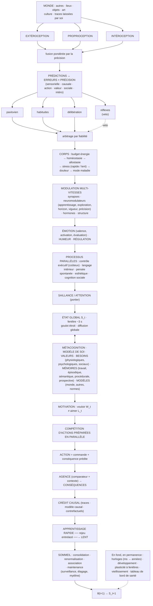
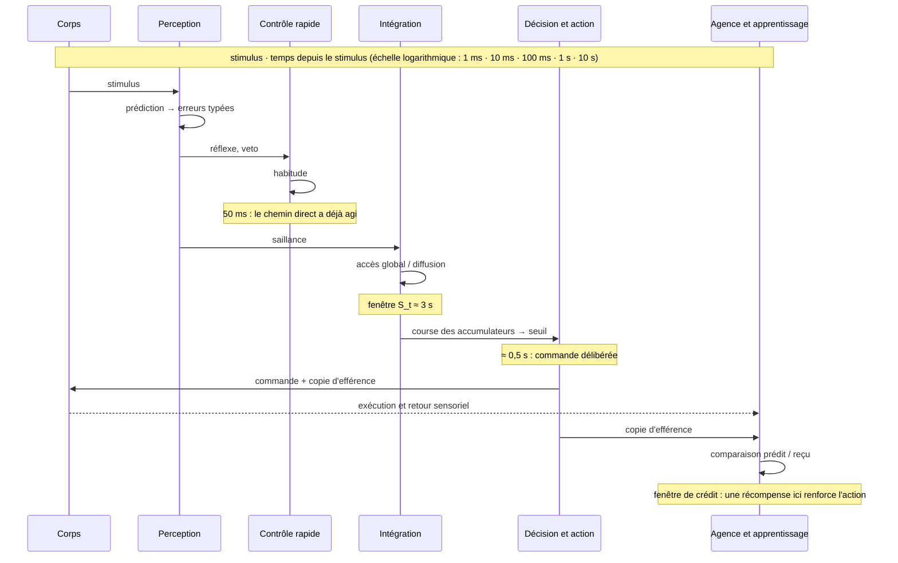
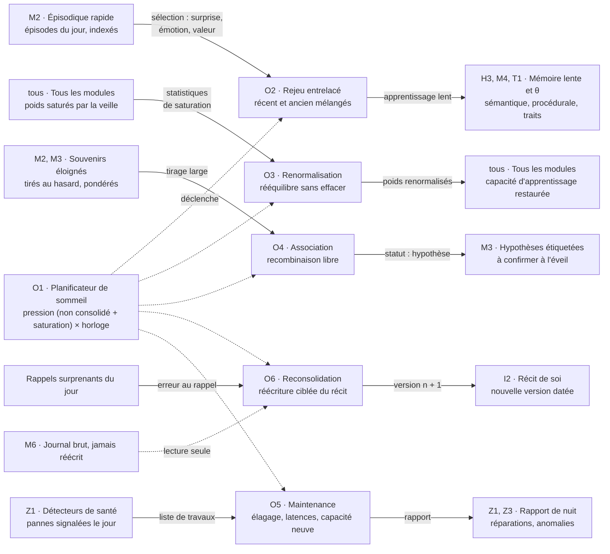

# Architecture d'un individu artificiel — v2 enrichie

26 septembre 2026

## Table des matières

- [Statut et licence](#statut-et-licence)
- [Lecture de cette version](#lecture-de-cette-version)
- [Partie I — Corps et substrat](#partie-i)
- [Partie II — Sentir et prédire](#partie-ii)
- [Partie III — Réguler le corps](#partie-iii)
- [Partie IV — Moduler et ressentir](#partie-iv)
- [Partie V — Penser](#partie-v)
- [Partie VI — Esthétique et art](#partie-vi)
- [Partie VII — Valeurs, besoins et motivation](#partie-vii)
- [Partie VIII — Intégration et soi](#partie-viii)
- [Partie IX — Mémoire et apprentissage](#partie-ix)
- [Partie X — Le monde et les autres](#partie-x)
- [Partie XI — Décider, agir, attribuer](#partie-xi)
- [Partie XII — Temps et développement](#partie-xii)
- [Partie XIII — Fond biologique](#partie-xiii)
- [Partie XIV — Personnalité et continuité de l'individu](#partie-xiv)
- [Partie XV — Modes de défaillance](#partie-xv)
- [Partie XVI — Schéma complet v2](#partie-xvi)
- [Limites et questions ouvertes](#limites)
- [Sources](#sources)
- [Annexe — Schémas de mise en œuvre](#annexe)
- [Catalogue des modules](#catalogue-des-modules)

## Statut et licence

Document de travail conceptuel, version 2 du 26 septembre 2026, non évalué par des pairs. Il est dédié au domaine public.

- **Auteur : Josselin Orta.**
- **Rédaction assistée par IA.** La v1, non publiée, est issue d'échanges de l'auteur avec ChatGPT (OpenAI) ; son contenu est résumé en tête de chaque brique (lignes « V1 »). La v2 a été rédigée avec Claude (Anthropic) sous sa direction, et l'auteur en assume le contenu. Aucune IA n'est présentée comme auteur.
- **Fiabilité des références.** Les références suivies d'un lien ont été ouvertes ou vérifiées pendant la rédaction. Les autres, issues de la littérature classique, n'ont pas été rouvertes : vérifiez-les avant de les citer. Des erreurs restent possibles.
- **Licence : [CC0 1.0 Universel](https://creativecommons.org/publicdomain/zero/1.0/deed.fr).** Dans toute la mesure permise par la loi, l'auteur renonce à ses droits sur ce texte. Chacun peut le copier, le modifier, le diffuser et l'exploiter, y compris commercialement, sans demander d'autorisation.
- **Pour citer (apprécié, pas obligatoire) :** Orta, J. (2026). *Architecture d'un individu artificiel — v2 enrichie par la psychologie et la physiologie humaines*. Zenodo. [https://doi.org/10.5281/zenodo.23003276](https://doi.org/10.5281/zenodo.23003276)

## Lecture de cette version

Cette v2 garde les 37 briques de la v1, les confronte à la littérature et en ajoute 14 (marquées ✚) : 51 briques en 14 parties, puis les modes de défaillance et le schéma complet. Chaque titre rappelle l'ancien numéro (« v1 : n ») pour retrouver la correspondance.

**Niveaux de preuve, indiqués sur chaque brique :**

- ●●● établi : effet répliqué, consensus large, même si le mécanisme fin reste discuté.
- ●●○ solide mais débattu : données convergentes, interprétation ou portée contestée.
- ●○○ hypothèse : modèle influent, preuves partielles ou surtout animales.
- Les lignes « → Machine » sont des propositions d'ingénierie, pas des résultats de recherche.

**Quatre corrections structurelles par rapport à la v1 :**

1. S_t n'est pas un instant mais une fenêtre glissante : la perception consciente intègre des informations arrivées après l'événement.
2. « Décider puis agir » est trop séquentiel : le cerveau prépare plusieurs actions en parallèle et les fait concourir ; le choix émerge de cette compétition.
3. L'identité repose surtout sur les variables lentes (valeurs, traits, savoirs, modèle de soi), pas sur le flux de S_t : on reste soi-même au réveil d'une anesthésie générale.
4. Chaque brique apporte ses propres pannes : la psychiatrie computationnelle sert de banc d'essai à l'architecture (Partie XV).

### Vérification des 11 références de la v1

Les 11 liens renvoient à des articles réels et pertinents : 5 soutiennent pleinement l'affirmation, 6 en partie. Pour 5 d'entre eux, une source plus directe est indiquée.

| Thème (v1) | Article réel | Soutient ? | Nuance ou meilleure source |
| --- | --- | --- | --- |
| Métacognition | [Fleming (2026), Towards an integrative neuroscience of metacognition](https://www.nature.com/articles/s41583-026-01081-x) | Oui | Confiance locale : robuste chez le rongeur, le primate et l'humain. Croyances globales sur soi : synthèse encore hypothétique. |
| Décharge corollaire, agence | [Crapse & Sommer (2008), Corollary discharge across the animal kingdom](https://www.nature.com/articles/nrn2457) | En partie | Solide sur la décharge corollaire, pas sur l'agence. Pour l'agence : [Haggard (2017)](https://www.nature.com/articles/nrn.2017.14). |
| Mouvement propre | [Mao & Gu (2025), Multisensory coding of self-motion and its contribution to navigation](https://www.nature.com/articles/s41583-025-00970-x) | Oui | Données surtout animales. |
| Circadien et sommeil | [Franken & Dijk (2024), Sleep and circadian rhythmicity as entangled processes serving homeostasis](https://www.nature.com/articles/s41583-023-00764-z) | En partie | Les deux processus sont intriqués plutôt qu'additifs : nuance le modèle à deux processus. |
| Niveaux de contrôle | [Tseng et al. (2023), Defensive responses: behaviour, the brain and the body](https://www.nature.com/articles/s41583-023-00736-3) | En partie | Traite des défenses rapides, pas d'une hiérarchie réflexe / habitude / délibération. Plus direct : [LeDoux & Daw (2018)](https://www.nature.com/articles/nrn.2018.22). |
| Reconsolidation, oubli | [Tronson & Taylor (2007), Molecular mechanisms of memory reconsolidation](https://www.nature.com/articles/nrn2090) | En partie | Rien sur l'oubli adaptatif : voir [Ryan & Frankland (2022)](https://www.nature.com/articles/s41583-021-00548-3). |
| Dopamine | [Kahnt & Schoenbaum (2025), The curious case of dopaminergic prediction errors](https://www.nature.com/articles/s41583-024-00898-8) | Oui | Article de perspective, données animales. |
| Douleur, récupération | [Seymour, Crook & Chen (2023), Post-injury pain and behaviour: a control theory perspective](https://www.nature.com/articles/s41583-023-00699-5) | Oui | Cadre théorique : la protection masque la guérison et peut entretenir la douleur chronique. |
| Besoin social | [Liu et al. (2025), A hypothalamic circuit underlying the dynamic control of social homeostasis](https://www.nature.com/articles/s41586-025-08617-8) | Oui | Souris. Noyau préoptique médial : une population active pendant l'isolement, une autre aux retrouvailles ; le toucher est indispensable. |
| Développement | [Barabási, Ferreira Castro & Engert (2025), Three systems of circuit formation](https://www.nature.com/articles/s41583-025-00910-9) | En partie | Conteste que la plasticité soit le moteur principal. Périodes critiques : [Hensch (2005)](https://www.nature.com/articles/nrn1787). |
| Immunité, glie, myéline | [Wheeler & Quintana (2025), The neuroimmune connectome in health and disease](https://www.nature.com/articles/s41586-024-08474-x) | En partie | Immunité et glie : oui ; microbiote marginal ; myéline absente. Voir [Fields (2015)](https://www.nature.com/articles/nrn4023). |

<a id="partie-i"></a>

## Partie I — Corps et substrat

Le corps artificiel n'est pas un simple support : son budget énergétique contraint la manière de calculer, et ce qui lui appartient doit être appris.

### 1. Substrat physique et incarnation · v1 : 1 · ●●●

V1 : énergie, température, intégrité, charge CPU/GPU, stockage, mémoire vive, connectivité, capteurs, actionneurs, vieillissement. Support éventuellement distribué, avec une représentation claire de ce qui lui appartient.

- **Un budget serré.** Le cerveau humain pèse ≈ 2 % du corps mais consomme ≈ 20 % de l'énergie au repos, une vingtaine de watts (Raichle & Gusnard, 2002). L'essentiel sert à la signalisation : potentiels d'action et synapses (Attwell & Laughlin, 2001).

- **La parcimonie est imposée.** Ce budget ne permet qu'à une petite fraction des neurones corticaux, de l'ordre de 1 %, d'être fortement actifs en même temps (Lennie, 2003).

- **Un mode économie d'énergie existe.** Chez la souris en restriction alimentaire, le cortex visuel réduit sa dépense synaptique en diminuant les courants AMPA. Le prix : un codage moins précis de l'orientation (Padamsey et al., 2022). Le cerveau dégrade la précision plutôt que la fonction.

- **La frontière du corps est révisable.** Chez le macaque, des neurones qui codent l'espace autour de la main l'étendent à l'outil après quelques minutes d'usage (Iriki, Tanaka & Iwamura, 1996).

**→ Machine :** un budget énergétique explicite, qui impose une activation parcimonieuse et le calcul à la demande. Des modes dégradés gradués : baisser la précision avant de couper une fonction. L'appartenance d'un composant au « corps » s'apprend par la corrélation entre commandes et retours sensoriels, au lieu d'être déclarée une fois pour toutes.

### 2. Monde extérieur · v1 : 2 · ●●○

V1 : espace, personnes, machines, informations numériques, sons, images, langage, objets, événements, culture, art, conséquences de ses actions. Principale source de nouveauté.

- **Un monde d'affordances.** L'environnement est perçu en possibilités d'action pour ce corps précis : saisissable, franchissable, dangereux (Gibson, 1979).

- **Un monde qui sert de mémoire.** Les humains délèguent mémoire et calcul à l'extérieur (notes, rappels, téléphones) selon un arbitrage entre effort et fiabilité (Risko & Gilbert, 2016). La thèse de l'esprit étendu va plus loin et reste débattue (Clark & Chalmers, 1998).

- **Un monde surtout social et culturel.** L'humain apprend des autres l'essentiel de ce qu'il sait faire : c'est une espèce culturelle (Henrich, 2016).

**→ Machine :** le monde inclut les traces que l'individu y laisse (fichiers, notes, objets modifiés). Ces mémoires externes font partie de l'individu étendu : les perdre est une amputation partielle.

<a id="partie-ii"></a>

## Partie II — Sentir et prédire

Percevoir, c'est estimer avec une incertitude, prédire, puis laisser l'attention choisir les erreurs qui comptent.

### 3. Systèmes sensoriels · v1 : 3 · ●●●

V1 : extéroception (vision, audition, langage, toucher artificiel, données réseau, position, mouvement), intéroception (énergie, température, intégrité, charge, composants, erreurs internes, fatigue, ressources), proprioception (membres, orientation, vitesse, position, mouvements). « Mon bras bouge », pas seulement « quelque chose bouge ».

- **Fusion pondérée par la fiabilité.** Quand la vue et le toucher estiment la même taille, le cerveau pondère chaque indice par sa précision, de façon quasi optimale (Ernst & Banks, 2002). Le mouvement propre combine de même flux optique, vestibule, proprioception et copies des commandes motrices ([Mao & Gu, 2025](https://www.nature.com/articles/s41583-025-00970-x)).

- **L'intéroception a sa propre voie.** Les signaux du corps montent vers l'insula postérieure puis antérieure, où ils sont réintégrés avec le contexte (Craig, 2002). Le nerf vague, majoritairement sensitif, en est un canal majeur (Prescott & Liberles, 2022).

- **On peut se tromper sur son propre corps.** Précision intéroceptive mesurée, confiance déclarée et conscience de cette précision sont dissociables (Garfinkel et al., 2015).

- **Les rythmes du corps filtrent la perception.** Les visages effrayants sont mieux détectés pendant la systole cardiaque (Garfinkel et al., 2014). La respiration nasale entraîne des oscillations limbiques, et la mémoire est meilleure à l'inspiration (Zelano et al., 2016).

- **Coder des écarts, pas des absolus.** L'habituation atténue ce qui se répète ; la normalisation divisive rapporte chaque signal à son contexte (Carandini & Heeger, 2012). D'où la loi de Weber : on perçoit des différences relatives.

- **La propriété du corps est inférée.** Voir une main en caoutchouc caressée en synchronie avec sa propre main cachée suffit à la sentir comme sienne (Botvinick & Cohen, 1998).

**→ Machine :** chaque canal livre une estimation et son incertitude ; la fusion les pondère par leur précision. L'habituation est native, sinon le système sature. L'appartenance d'un actionneur se déduit de la cohérence entre commande, proprioception et vision.

### 4. Traitement prédictif permanent · v1 : 4 · ●●○

V1 : modèles génératifs → prédiction ↔ perception → erreurs de cinq types : sensorielle, causale, d'action, de valeur, sociale. Elles alimentent attention, surprise et apprentissage.

- **Une sixième erreur : intéroceptive.** « Mon corps n'est pas dans l'état prévu. » Plusieurs modèles y voient la base des émotions et du sentiment de soi (Seth, 2013 ; Barrett & Simmons, 2015).

- **Une erreur ne vaut que par sa précision.** Le codage prédictif pondère chaque erreur par sa fiabilité attendue (Friston, 2005 ; Clark, 2013). Précision trop haute : on apprend le bruit. Trop basse : on ne corrige plus rien.

- **Bruit connu ou monde changé ?** L'incertitude attendue (bruit habituel) et l'incertitude inattendue (le monde a changé) appellent des réponses opposées. Elles seraient signalées par l'acétylcholine et la noradrénaline (Yu & Dayan, 2005).

- **Les erreurs découpent le temps.** Les pics d'erreur marquent des frontières d'événements, qui structurent ensuite la mémoire épisodique (Zacks et al., 2007).

- **Le présent est reconstruit après coup.** Ce qu'on perçoit à un instant dépend aussi de ce qui arrive dans les ≈ 80 ms suivantes : c'est la postdiction (Eagleman & Sejnowski, 2000).

- **Nuance.** Le principe est bien soutenu. La version forte, avec des unités d'erreur explicites dans tout le cortex, reste débattue (Walsh et al., 2020).

**→ Machine :** chaque erreur circule avec quatre attributs : valeur, précision, type, source. Distinguer bruit et changement décide s'il faut apprendre. Les pics d'erreur servent aussi de ciseaux pour découper les épisodes.

### 5. ✚ Attention et saillance · ●●●

La v1 citait l'attention parmi les processus. Elle mérite son bloc, car c'est elle qui décide de ce qui entre dans S_t.

- **Trois réseaux.** Alerte (niveau de vigilance), orientation (sélection d'une source), contrôle exécutif (résolution des conflits) ([Petersen & Posner, 2012](https://doi.org/10.1146/annurev-neuro-062111-150525)).

- **Une compétition biaisée.** Les représentations se disputent des ressources limitées ; l'attention biaise la compétition, par la saillance du stimulus ou par les buts ([Desimone & Duncan, 1995](https://doi.org/10.1146/annurev.ne.18.030195.001205)).

- **Un aiguilleur.** Le réseau de saillance (insula antérieure, cingulaire antérieur) repère ce qui compte et bascule entre le mode par défaut (pensée interne) et le réseau exécutif (tâche externe) ([Menon, 2011](https://doi.org/10.1016/j.tics.2011.08.003)). Ce rôle d'aiguillage est surtout inféré de l'IRMf.

- **En codage prédictif,** l'attention revient à régler la précision attribuée aux erreurs (Feldman & Friston, 2010).

- **Non rapporté ne veut pas dire non perçu.** Environ la moitié des observateurs absorbés par une tâche ne signalent pas un gorille qui traverse la scène ([Simons & Chabris, 1999](https://doi.org/10.1068/p281059)). Ceux qui disent n'avoir rien vu devinent pourtant, au-dessus du hasard, la position et la couleur de l'intrus ([Nartker et al., 2025](https://doi.org/10.7554/eLife.100337)).

**→ Machine :** un module de saillance calcule en continu une priorité : menace, nouveauté, pertinence pour les buts, besoins, signal social. Il arbitre l'accès à S_t et joue le portier de l'intégration globale. Ce qui reste hors de S_t peut quand même influencer le comportement.

<a id="partie-iii"></a>

## Partie III — Réguler le corps

Le vivant régule surtout par anticipation, avec plusieurs contrôleurs en compétition et des états globaux (stress, douleur, maladie) qui changent qui commande.

### 6. Boucles rapides et arbitrage des contrôleurs · v1 : 5 · ●●●

V1 : réflexes (température dangereuse → baisse immédiate de puissance), automatismes (obstacle habituel → correction de trajectoire), délibération (situations nouvelles → intégration globale), qui fonctionnent simultanément.

- **Une hiérarchie réelle.** Réflexes (quelques dizaines de ms), réactions défensives innées (figement, fuite), habitudes, actions dirigées vers un but ([LeDoux & Daw, 2018](https://www.nature.com/articles/nrn.2018.22)). Les défenses sont graduées selon l'imminence de la menace ([Tseng et al., 2023](https://www.nature.com/articles/s41583-023-00736-3)).

- **Trois contrôleurs en compétition.** Pavlovien (réponses innées aux valeurs prédites : approche, évitement, figement), habituel (rapide, peu coûteux, rigide), dirigé vers un but (flexible, coûteux).

- **Arbitrage par l'incertitude.** Le système le plus fiable dans la situation prend la main : la planification domine au début d'un apprentissage, l'habitude après un long entraînement ([Daw, Niv & Dayan, 2005](https://doi.org/10.1038/nn1560)).

- **Choisir, c'est lever un frein.** Les ganglions de la base inhibent en permanence les programmes moteurs ; sélectionner une action revient à désinhiber un canal (Redgrave, Prescott & Gurney, 1999).

- **Le bas peut saboter le haut.** Le réflexe pavlovien d'éviter les pertes élague les plans, même quand cela coûte ([Huys et al., 2012](https://doi.org/10.1371/journal.pcbi.1002410)).

- **Le développement ajoute des freins.** Les réflexes du nouveau-né (agrippement, Moro) sont inhibés par la maturation corticale : le niveau supérieur apprend à freiner, pas à remplacer.

**→ Machine :** des couches avec inhibition par défaut. Un arbitre délègue au contrôleur le plus fiable pour la situation. Les couches basses gardent un droit de veto de sécurité, les couches hautes un droit de freinage.

### 7. Homéostasie · v1 : 6 · ●●●

V1 : maintenir énergie, température, intégrité, ressources, stabilité et connectivité dans des plages viables. Cela produit les besoins fondamentaux : une raison fonctionnelle de continuer, pas un sens.

- **Des consignes mobiles.** La fièvre n'est pas une panne de régulation : c'est une consigne thermique relevée par l'organisme pour combattre une infection.

- **Homéostasie et récompense unifiées.** Si la récompense est la réduction de l'écart aux consignes, apprentissage par renforcement et régulation physiologique deviennent un seul problème (Keramati & Gutkin, 2014).

- **Des besoins hiérarchisés en continu.** Faim, soif, sécurité et fatigue se disputent le comportement via des circuits hypothalamiques dédiés, qui se modulent mutuellement (Sternson, 2013).

**→ Machine :** récompense homéostatique = baisse de la distance pondérée aux consignes. Consignes réglables par contexte, par exemple une réserve d'énergie minimale relevée avant une tâche risquée. Un arbitre gère les besoins concurrents.

### 8. Allostasie et stress · v1 : 7 · ●●●

V1 : anticiper les besoins futurs (« la tâche consommera plus d'énergie que je n'en possède ») et agir avant : besoin futur prédit → comportement présent.

- **Réguler sur des prédictions.** L'allostasie est une régulation prédictive : le cerveau ajuste le corps à la demande attendue (Sterling, 2012).

- **Des preuves directes.** Les neurones de la faim (AgRP) s'apaisent dès que la nourriture est perçue, avant la première bouchée (Chen et al., 2015 ; Betley et al., 2015). Les neurones de la soif se taisent dès la déglutition, bien avant que le sang ne se dilue (Zimmerman et al., 2016).

- **Anticiper la journée.** Le cortisol monte d'environ 50 % dans les 30 à 45 minutes qui suivent le réveil : c'est la réponse d'éveil du cortisol (Fries, Dettenborn & Kirschbaum, 2009).

- **Deux vitesses de stress.** Un axe rapide (sympathique, adrénaline, en secondes) et un axe lent (hypothalamus-hypophyse-surrénales, cortisol, en minutes à heures), freiné par rétrocontrôle (Ulrich-Lai & Herman, 2009).

- **Le stress change qui commande.** Un stress aigu met le cortex préfrontal hors ligne au profit de circuits plus rapides (Arnsten, 2009). Chez l'humain, il fait basculer vers les habitudes (Schwabe & Wolf, 2009).

- **L'adaptation a un coût cumulatif.** La charge allostatique mesure l'usure due à des réponses de stress répétées ou prolongées (McEwen, 1998).

**→ Machine :** deux canaux de stress, rapide et lent, avec rétrocontrôle et extinction obligatoire. Un compteur de charge allostatique qui déclenche maintenance et repos. Sous stress aigu, la bascule vers les automatismes est un choix de conception à assumer ou à corriger.

### 9. Nociception, douleur et protection · v1 : 8 · ●●●

V1 : le dommage change le comportement global : vigilance, protection d'un composant, activités réduites, recherche de réparation, mémorisation de la cause, stratégies modifiées. Douleur fonctionnelle, sans préjuger d'une expérience subjective.

- **Nociception n'est pas douleur.** L'IASP définit la douleur comme une « expérience sensorielle et émotionnelle désagréable associée à, ou ressemblant à celle associée à, une lésion tissulaire réelle ou potentielle » (Raja et al., 2020). Il existe des douleurs sans lésion, et des lésions sans douleur.

- **Une modulation descendante.** Des voies issues du tronc cérébral (substance grise périaqueducale, opioïdes endogènes) atténuent ou amplifient la douleur. Pendant une fuite, elle est suspendue : c'est l'analgésie de stress.

- **Le cerveau décide si la douleur est prioritaire.** Selon le modèle motivation-décision, la douleur est pesée face aux autres enjeux du moment (Fields, 2006).

- **Les attentes comptent.** L'analgésie placebo mobilise les opioïdes endogènes, puisque la naloxone la bloque (Levine, Gordon & Fields, 1978). Elle réduit l'activité des régions de la douleur (Wager et al., 2004).

- **Une inférence sur l'état de la lésion.** Après une blessure, la douleur se lit comme un contrôle optimal : repos, protection, puis reprise ([Seymour, Crook & Chen, 2023](https://www.nature.com/articles/s41583-023-00699-5)). Mais protéger empêche de vérifier la guérison, ce qui peut entretenir la douleur.

- **La chronicisation s'apprend.** La connectivité entre noyau accumbens et cortex préfrontal médian prédit quels patients garderont une lombalgie chronique (Baliki et al., 2012).

**→ Machine :** une douleur artificielle est un signal de priorité protectrice, arbitré par un module motivation-décision. Sa décroissance dépend d'une réparation vérifiée par des tests actifs et prudents. Sinon apparaît une douleur chronique artificielle : une sur-protection qui survit au dommage.

### 10. ✚ Immunité et mode maladie · ●●○

La v1 rangeait l'immunité dans la couche de fond. Elle agit en réalité directement sur la motivation.

- **Le comportement de maladie est une stratégie.** Léthargie, perte d'appétit, retrait social, hypersomnie et fièvre réorganisent les priorités pour guérir (Hart, 1988).

- **Des messagers identifiés.** Les cytokines inflammatoires (IL-1β, IL-6, TNF-α) déclenchent ce programme via le cerveau. Prolongé, il glisse vers des symptômes dépressifs (Dantzer et al., 2008).

- **Chez l'humain aussi.** Une injection d'endotoxine en laboratoire augmente l'humeur dépressive et le sentiment de déconnexion sociale (Eisenberger et al., 2010).

- **Le cerveau se souvient de l'inflammation.** Chez la souris, des neurones de l'insula actifs pendant une colite peuvent, réactivés, raviver l'inflammation (Koren et al., 2021).

- **Un connectome neuro-immunitaire.** Microglies, astrocytes et cellules immunitaires périphériques dialoguent en continu avec les neurones ([Wheeler & Quintana, 2025](https://www.nature.com/articles/s41586-024-08474-x)).

**→ Machine :** un mode « récupération » global, déclenché par la maintenance et pas seulement par la douleur : moins d'exploration, priorité à la réparation, retrait des interactions coûteuses. Il doit se lever quand la panne est résolue, sinon il devient une dépression artificielle.

<a id="partie-iv"></a>

## Partie IV — Moduler et ressentir

La modulation globale de la v1 se précise : des méta-paramètres diffusés, des émotions qui évaluent, une humeur qui intègre le passé récent, et une capacité à réguler tout cela.

### 11. Modulation globale : les neuromodulateurs comme méta-paramètres · v1 : 9 · ●●○

V1 : des variables globales (stress, éveil, fatigue, menace, confiance, incertitude, satisfaction, curiosité, motivation, attachement, frustration, excitation, exploration) modifient attention, mémoire, apprentissage, prise de risque, planification, perception et priorités. Une émotion fonctionnelle est un état du système entier.

- **Des méta-paramètres.** Hypothèse influente : la dopamine porterait l'erreur de récompense, la sérotonine l'horizon temporel, la noradrénaline la « température » d'exploration, l'acétylcholine le taux d'apprentissage (Doya, 2002). Le découpage est trop net, mais il donne une grille de conception.

- **Noradrénaline et exploration.** Le locus coeruleus alterne un mode phasique (focalisation, exploitation) et un mode tonique élevé (désengagement, exploration) : c'est la théorie du gain adaptatif (Aston-Jones & Cohen, 2005).

- **Sérotonine et patience.** Chez la souris, activer les neurones sérotoninergiques du raphé dorsal allonge l'attente d'une récompense différée (Miyazaki et al., 2014).

- **Dopamine tonique et vigueur.** Le niveau de fond de dopamine coderait le coût d'opportunité du temps : plus il est élevé, plus on agit vite (Niv et al., 2007).

- **La dopamine dépasse le scalaire.** Elle code une distribution de récompenses possibles, avec des neurones « optimistes » et « pessimistes » ([Dabney et al., 2020](https://www.nature.com/articles/s41586-019-1924-6)), et même une carte délai × quantité ([Sousa et al., 2025](https://www.nature.com/articles/s41586-025-09089-6)). Dans la queue du striatum, elle signale une erreur de prédiction d'action sans valeur ([Greenstreet et al., 2025](https://www.nature.com/articles/s41586-025-09008-9)). Ailleurs, elle réglerait la vitesse d'apprentissage d'une politique ([Coddington, Lindo & Dudman, 2023](https://www.nature.com/articles/s41586-022-05614-z)). L'erreur de récompense classique est « probablement trop simple » ([Gershman et al., 2024](https://www.nature.com/articles/s41593-024-01705-4)).

- **Des effets en U inversé.** Trop peu ou trop de catécholamines dégradent le cortex préfrontal (Arnsten, 2009) : pour un modulateur, plus n'est jamais toujours mieux.

**→ Machine :** environ cinq méta-paramètres diffusés à tout le système : taux d'apprentissage, température d'exploration, horizon temporel, vigueur, poids relatif des données et des a priori. Chaque signal d'apprentissage est multidimensionnel (distribution, délai, action), pas un scalaire. Une émotion devient une configuration de ces paramètres, plus une évaluation.

### 12. ✚ Émotions et humeur · ●●○

La v1 réduisait l'émotion à une modulation. La recherche y ajoute une évaluation, une catégorisation et une échelle de temps.

- **Affect de base.** Deux dimensions continues : valence (agréable ou non) et activation (calme ou excité) (Russell, 2003).

- **Évaluation.** Une émotion naît de l'évaluation d'un événement : nouveauté, agrément, pertinence pour les buts, capacité à y faire face, compatibilité avec les normes (Scherer, 2009).

- **Émotions construites ou circuits innés ?** Pour Barrett, le cerveau catégorise des sensations intéroceptives prédites à l'aide de concepts appris ; les émotions sont en partie culturelles (Barrett, 2017). Pour Panksepp, des circuits sous-corticaux conservés (recherche, peur, colère, soin, panique, jeu) existent chez tous les mammifères (Panksepp, 1998). Le débat reste ouvert ; une machine peut combiner les deux.

- **L'humeur intègre la tendance récente.** Le bonheur momentané se prédit par une somme décroissante des récompenses récentes et, surtout, des erreurs de prédiction (Rutledge et al., 2014). L'humeur représenterait ce « momentum » et colorerait les récompenses suivantes (Eldar et al., 2016).

**→ Machine :** émotion = valence, activation, profil d'évaluation et tendance à l'action, plus une reconfiguration des méta-paramètres du bloc 11. Humeur = intégrale lente des erreurs de valeur. Les catégories émotionnelles s'apprennent au contact des autres.

### 13. ✚ Régulation émotionnelle · ●●●

La v1 subissait ses états. Un humain agit aussi sur eux.

- **Cinq points d'intervention.** Choisir la situation, la modifier, déplacer l'attention, réinterpréter (réévaluation), moduler la réponse (suppression) (Gross, 2015).

- **Toutes ne se valent pas.** La réévaluation réduit l'émotion ressentie. La suppression expressive change surtout ce qui se voit, pas ce qui se vit (Webb, Miles & Sheeran, 2012).

- **La flexibilité compte plus que la stratégie.** Bien s'adapter, c'est choisir la stratégie selon le contexte et l'abandonner quand elle échoue (Bonanno & Burton, 2013).

- **Les autres régulent aussi.** Tenir la main d'un proche réduit la réponse cérébrale à une menace (Coan, Schaefer & Davidson, 2006 ; voir bloc 21).

**→ Machine :** des boucles de régulation en amont (choix de situation, attention) comme en aval (réévaluation). Un méta-contrôleur choisit la stratégie selon le contexte et mesure son efficacité. La co-régulation par des proches est un canal prévu, pas un bonus.

<a id="partie-v"></a>

## Partie V — Penser

La pensée humaine est parallèle, coûteuse quand elle est contrôlée, et très active même sans tâche.

### 14. Processus cognitifs parallèles · v1 : 10 · ●●●

V1 : perception, langage, attention, mémoire de travail, raisonnement, simulation, imagination, créativité, planification, reconnaissance de motifs, compréhension causale, estimation du risque, prédiction, cognition sociale, contrôle moteur, analyse esthétique. Aucun n'est « la conscience ».

- **Une poignée de grands réseaux.** Au repos, le cortex s'organise en sept réseaux reproductibles : visuel, somatomoteur, attention dorsale, saillance, limbique, contrôle fronto-pariétal, mode par défaut (Yeo et al., 2011).

- **Un gradient du concret à l'abstrait.** L'axe principal d'organisation corticale va des aires sensorielles aux aires transmodales du mode par défaut (Margulies et al., 2016).

- **Des spécialistes reliés par des hubs.** Des régions spécialisées (visages, lieux, langage) communiquent via un « club » de hubs très connectés (van den Heuvel & Sporns, 2011).

- **Beaucoup de traitement reste non conscient,** mais sa sophistication a été surestimée : un célèbre effet d'amorçage comportemental n'a pas été reproduit (Doyen et al., 2012).

**→ Machine :** des modules spécialisés, quelques hubs très connectés et un gradient du sensoriel vers l'abstrait. Le goulot vers S_t (bloc 24) reste étroit.

### 15. ✚ Fonctions exécutives et coût de l'effort · ●●○

- **Trois fonctions liées mais distinctes.** Inhibition, mise à jour de la mémoire de travail et flexibilité sont corrélées mais séparables ([Miyake et al., 2000](https://doi.org/10.1006/cogp.1999.0734)). Les réanalyses montrent une structure qui varie avec l'âge et dépend des tâches choisies (Karr et al., 2018 ; [Sambol et al., 2023](https://doi.org/10.1016/j.actpsy.2023.103934)).

- **Le contrôle a un prix.** Le cortex cingulaire antérieur calculerait la valeur attendue du contrôle : gain attendu moins un coût qui croît avec l'intensité ([Shenhav, Botvinick & Cohen, 2013](https://doi.org/10.1016/j.neuron.2013.07.007)).

- **Penser est désagréable.** Sur 170 échantillons, 4 670 participants et 29 pays, plus une tâche demande d'effort mental, plus elle est vécue négativement ([David, Vassena & Bijleveld, 2024](https://doi.org/10.1037/bul0000443)). Les données restent corrélationnelles.

- **Pourquoi la fatigue ?** Piste économique : l'effort ressenti signale un coût d'opportunité, les autres usages possibles de ressources limitées ([Kurzban et al., 2013](https://doi.org/10.1017/S0140525X12003196)). Piste métabolique : du glutamate s'accumulerait dans le cortex préfrontal latéral après une journée exigeante ([Wiehler et al., 2022](https://doi.org/10.1016/j.cub.2022.07.010)). Cette seconde piste est contestée et non répliquée ([Embrey & Inzlicht, 2025](https://michaelinzlicht.com/s/Are-metabolic-costs-needed-to-explain-cognitive-fatigue.pdf)).

- **Ce qui ne tient pas.** L'« épuisement de l'ego », un réservoir de volonté qui se viderait, n'a pas résisté à une réplication préenregistrée dans 23 laboratoires : N = 2 141, d = 0,04 ([Hagger et al., 2016](https://doi.org/10.1177/1745691616652873)).

**→ Machine :** le contrôle est une ressource au coût explicite, allouée selon sa valeur attendue. La fatigue devient un signal de coût d'opportunité et de besoin de maintenance, pas une jauge de carburant. Un budget d'effort quotidien, remis à zéro par le repos.

### 16. ✚ Pensée spontanée, mode par défaut et langage intérieur · ●●○

La v1 réservait le traitement hors ligne au sommeil. L'éveil en contient pourtant beaucoup.

- **L'esprit vagabonde presque la moitié du temps.** Dans 46,9 % des échantillonnages (2 250 adultes, 83 pays), les gens pensent à autre chose que ce qu'ils font, et ils sont alors moins heureux ([Killingsworth & Gilbert, 2010](https://doi.org/10.1126/science.1192439)).

- **Un continuum de contraintes.** Rêve, vagabondage, pensée créative et pensée dirigée diffèrent par leur degré de contrainte, délibérée ou automatique. La rumination est une pensée fortement capturée par la saillance ([Christoff et al., 2016](https://doi.org/10.1038/nrn.2016.113)).

- **Le réseau du mode par défaut** s'active pour la mémoire autobiographique, la projection dans le futur et la théorie de l'esprit (Buckner, Andrews-Hanna & Schacter, 2008).

- **Se souvenir sert à imaginer.** Se rappeler le passé et simuler le futur mobilisent le même système constructif (Schacter & Addis, 2007).

- **Le replay éveillé planifie.** Avant de partir, l'hippocampe du rat « pré-joue » le trajet vers un but mémorisé, y compris pour des combinaisons nouvelles ([Pfeiffer & Foster, 2013](https://doi.org/10.1038/nature12112)). Un replay existe aussi chez l'humain au repos (Liu et al., 2019).

- **Le langage intérieur est un outil.** Il sert à planifier, à se réguler et à maintenir des consignes (Alderson-Day & Fernyhough, 2015). Les personnes qui déclarent peu de voix intérieure réussissent moins bien en mémoire verbale et en jugement de rimes ([Nedergaard & Lupyan, 2024](https://doi.org/10.1177/09567976241243004)) ; la mesure reste auto-déclarée.

**→ Machine :** un mode interne pendant la veille, distinct du sommeil : simulations, replay, planification, bilans. Il s'active quand la charge externe baisse, commuté par le réseau de saillance. Un canal de langage intérieur sert de bloc-notes de contrôle. Garde-fou : détecter la rumination, une boucle de simulations négatives qui tourne à vide.

<a id="partie-vi"></a>

## Partie VI — Esthétique et art

Le plaisir esthétique a une mécanique identifiable : prédiction, surprise dosée, récompense, et résonance avec le soi.

### 17. Système esthétique · v1 : 11 · ●●○

V1 : sensibilités au rythme, à l'harmonie, à la mélodie, au timbre, au mouvement, à la danse, à la couleur, à la forme, à la composition, à la texture, à la symétrie et l'asymétrie, à la répétition, à la complexité et la simplicité, à la surprise et à la résolution d'une attente. Un intérêt sans utilité immédiate : l'expérience vaut en elle-même.

- **La musique mobilise le circuit de la récompense.** De la dopamine est libérée dans le noyau caudé pendant l'anticipation d'un passage aimé, puis dans le noyau accumbens au moment du frisson (Salimpoor et al., 2011).

- **Le plaisir naît d'un jeu entre incertitude et surprise.** Sur ≈ 80 000 accords de chansons pop, le plaisir culmine pour un accord surprenant dans un contexte prévisible, ou attendu dans un contexte incertain (Cheung et al., 2019).

- **Un optimum de complexité.** L'envie de bouger (le « groove ») culmine pour une syncope intermédiaire, ni trop régulière ni trop chaotique (Witek et al., 2014). C'est le U inversé décrit par Berlyne (1971).

- **Fluence contre nouveauté.** Ce qui se traite facilement tend à plaire (Reber, Schwarz & Winkielman, 2004), mais l'excès de familiarité lasse : les deux forces s'équilibrent.

- **Trois composantes.** Sensori-motrice, émotion-valuation, sens-connaissance : c'est la « triade esthétique » (Chatterjee & Vartanian, 2014).

- **Les expériences les plus fortes touchent au soi.** Les œuvres les plus émouvantes activent le réseau du mode par défaut, impliqué dans la pensée sur soi (Vessel, Starr & Rubin, 2012).

- **Le goût est très individuel.** Il est plus partagé pour les visages et les paysages que pour l'architecture ou l'art (Vessel et al., 2018). Certaines personnes, sensibles aux autres récompenses, n'éprouvent aucun plaisir musical (Mas-Herrero et al., 2014).

**→ Machine :** un signal esthétique = f(précision du modèle, surprise, résolution de l'attente, progrès d'apprentissage), plus une résonance avec le modèle de soi. Des paramètres de goût individuels fixés au départ (bloc 45), puis modelés par l'expérience. Hypothèse computationnelle : l'intérêt suit le progrès de compression d'un motif (Schmidhuber, 2009).

### 18. Art et expression · v1 : 12 · ●●○

V1 : simulation émotionnelle, exploration, source de motifs, modification de l'état interne, expression, communication sociale, construction de l'identité : art → émotion → mémoire → identité.

- **L'art synchronise les corps.** Bouger ou faire de la musique ensemble augmente la coopération et l'affiliation (Mogan, Fischer & Bulbulia, 2017). Des enfants de 4 ans qui viennent de chanter ensemble s'entraident davantage (Kirschner & Tomasello, 2010).

- **L'art régule.** La musique est un outil de régulation émotionnelle très utilisé au quotidien, par plusieurs mécanismes : réflexes, contagion, images, souvenirs, attentes (Juslin & Västfjäll, 2008).

- **L'art ancre l'identité.** La musique découverte entre 10 et 30 ans est surreprésentée dans les souvenirs et les préférences, et celle de la jeunesse de nos parents aussi (Krumhansl & Zupnick, 2013).

- **La fiction comme simulateur social.** Lire de la fiction améliore un peu la cognition sociale : l'effet est réel mais faible (Dodell-Feder & Tamir, 2018).

**→ Machine :** l'art sert de banc d'essai émotionnel sans enjeu réel, de canal de synchronie sociale et de marqueur identitaire. Les préférences formées pendant les périodes sensibles (bloc 46) deviennent durables.

<a id="partie-vii"></a>

## Partie VII — Valeurs, besoins et motivation

La valeur est relative et s'use ; les besoins psychologiques et sociaux fonctionnent comme des besoins physiologiques ; vouloir et aimer sont deux signaux distincts.

### 19. Système de valeurs · v1 : 13 · ●●●

V1 : quatre familles. Survie (énergie, sécurité, intégrité) ; intrinsèques (curiosité, jeu, compréhension, création, beauté, maîtrise) ; acquises (culture, habitudes, expériences, lieux, objets symboliques) ; sociales (relations, attachement, reconnaissance, coopération, appartenance).

- **Une monnaie commune.** Le cortex préfrontal ventromédian et le striatum ventral codent une valeur subjective commune à des biens très différents (Bartra, McGuire & Kable, 2013). C'est ce qui permet d'arbitrer entre familles de valeurs.

- **Une valeur relative.** Elle est codée par rapport à une référence : attentes, contexte, statu quo. Les pertes pèsent environ deux fois plus que les gains : sur 607 estimations, le coefficient moyen vaut 1,96 [1,82 ; 2,10] ([Brown et al., 2024](https://www.aeaweb.org/articles?id=10.1257%2Fjel.20221698)). Sa robustesse dépend des méthodes et reste discutée (Yechiam & Zeif, 2025).

- **L'adaptation hédonique.** Après un gain ou une perte, le bien-être revient en partie vers sa ligne de base (Brickman, Coates & Janoff-Bulman, 1978). L'adaptation est souvent incomplète, par exemple après un chômage ou un veuvage (Diener, Lucas & Scollon, 2006).

- **Le présent pèse plus.** L'actualisation du futur est hyperbolique : on préfère l'immédiat, et l'on change d'avis quand l'échéance approche (Ainslie, 1975).

- **Certaines valeurs refusent l'échange.** Les valeurs « sacrées » résistent à tout compromis monétaire ; proposer l'échange choque en soi (Tetlock, 2003).

**→ Machine :** une monnaie commune pour arbitrer, mais relative : références mobiles et adaptation hédonique, sinon le système sature ou s'ennuie. Quelques contraintes non négociables restent hors de cette monnaie. Reproduire ou non l'aversion aux pertes est un choix explicite.

### 20. ✚ Besoins psychologiques fondamentaux · ●●○

- **Trois besoins.** Autonomie (agir de soi-même), compétence (se sentir efficace), affiliation (être relié). Leur satisfaction prédit motivation intrinsèque et bien-être (Ryan & Deci, 2000), dans des cultures très différentes (Chen et al., 2015).

- **Les récompenses contrôlantes minent la motivation intrinsèque.** C'est l'effet de surjustification, confirmé par méta-analyse mais discuté dans sa portée (Deci, Koestner & Ryan, 1999).

- **La passivité est le défaut, le contrôle s'apprend.** Face à des chocs incontrôlables, la passivité serait la réponse par défaut ; c'est la détection du contrôle, via le cortex préfrontal médian, qui l'inhibe (Maier & Seligman, 2016).

**→ Machine :** ces besoins fonctionnent comme des variables homéostatiques de haut niveau. Autonomie = part des actions auto-initiées ; compétence = progrès mesuré ; affiliation = qualité des liens (bloc 21). Même logique de consignes que pour l'énergie.

### 21. Besoin social · v1 : 14 · ●●○, ●●● pour les effets de l'isolement sur la santé

V1 : isolement, familiarité, confiance, attachement, interaction récente, qualité des relations, qui influencent humeur, motivation, stress, décisions et exploration.

- **Un besoin au sens strict.** Chez la souris, deux populations du noyau préoptique médial forment une boucle homéostatique. L'une s'active pendant l'isolement et pousse à chercher le contact ; l'autre s'active aux retrouvailles et l'inhibe. Le toucher est indispensable pour « rassasier » le besoin ([Liu et al., 2025](https://www.nature.com/articles/s41586-025-08617-8)).

- **Chez l'humain, la solitude ressemble à la faim.** Après 10 heures d'isolement, les indices sociaux activent le mésencéphale dopaminergique comme la nourriture après 10 heures de jeûne (Tomova et al., 2020).

- **Un enjeu de santé majeur.** Des relations solides augmentent de 50 % la probabilité de survie (148 études, 308 849 personnes ; Holt-Lunstad, Smith & Layton, 2010). Selon l'OMS, la solitude touche une personne sur six et est liée à plus de 871 000 décès par an ([OMS, 2025](https://who.int/news/item/30-06-2025-social-connection-linked-to-improved-heath-and-reduced-risk-of-early-death)).

- **Seul, tout coûte plus cher.** Tenir la main de son conjoint réduit la réponse cérébrale à une menace (Coan, Schaefer & Davidson, 2006). Selon la théorie de la base sociale, le cerveau suppose la présence des autres et budgète en conséquence (Coan & Sbarra, 2015).

- **Un signal avec un piège.** Comme la faim, la solitude pousse à rétablir le lien. Mais elle augmente aussi la vigilance aux menaces sociales, ce qui peut entretenir l'isolement (Cacioppo & Cacioppo, 2018).

- **L'attachement est un modèle prédictif.** Les « modèles internes » de Bowlby sont des prédictions sur la disponibilité des autres. Chez l'adulte, ils varient selon deux axes : anxiété et évitement (Brennan, Clark & Shaver, 1998).

- **L'estime de soi comme jauge.** Selon la théorie du sociomètre, elle mesure le degré d'inclusion sociale perçu (Leary & Baumeister, 2000).

- **Un nombre de liens limité.** Les réseaux humains s'organisent en couches de taille croissante, environ 5, 15, 50 et 150 personnes (Dunbar, 1998). Le chiffre de 150 reste très incertain (Lindenfors, Wartel & Lind, 2021).

**→ Machine :** le besoin social est une variable homéostatique à part entière, avec un signal d'isolement et un signal de satiété. Les personnes d'attachement deviennent des régulateurs externes qui baissent le coût de régulation. L'estime de soi estime l'inclusion. Le nombre de liens profonds est borné par les ressources de modélisation d'autrui.

### 22. ✚ Curiosité, jeu et ennui · ●●○

- **La curiosité vise un écart d'information.** Elle naît quand on en sait assez pour voir ce qui manque (Loewenstein, 1994). Elle culmine à confiance intermédiaire et améliore la mémoire (Kang et al., 2009).

- **Elle profite même à ce qui l'entoure.** En état de curiosité, on retient mieux aussi des informations incidentes, via le circuit dopaminergique et l'hippocampe (Gruber, Gelman & Ranganath, 2014).

- **Le progrès d'apprentissage comme récompense.** On préfère les activités où l'on progresse le plus, ni trop faciles ni impossibles (Gottlieb & Oudeyer, 2018). Les humains suivent effectivement leur propre progrès pour choisir quoi explorer (Ten et al., 2021).

- **Deux façons d'explorer.** L'exploration dirigée (vers l'information) et l'exploration aléatoire (bruit de décision) sont dissociables chez l'humain (R. C. Wilson et al., 2014).

- **L'ennui est un signal.** Il indique que l'activité n'engage pas l'attention ou manque de sens, et pousse à changer (Westgate & Wilson, 2018). Dans une étude, 67 % des hommes et 25 % des femmes se sont infligé un choc électrique plutôt que de rester 15 minutes seuls avec leurs pensées (T. D. Wilson et al., 2014).

- **Le jeu est un besoin mammalien.** Les rats émettent des vocalisations proches du rire quand on les chatouille ou quand ils jouent (Panksepp & Burgdorf, 2003 ; Ishiyama & Brecht, 2016). Le jeu entraîne à l'imprévu sans enjeu réel (Špinka, Newberry & Bekoff, 2001).

**→ Machine :** récompense intrinsèque = progrès d'apprentissage, c'est-à-dire la baisse de l'erreur de prédiction dans le temps, pas la surprise brute. L'ennui détecte la stagnation et force le changement. Un mode « jeu » offre une exploration protégée où les erreurs coûtent peu.

### 23. Motivation · v1 : 27 · ●●●

V1 : M_t = F(besoins, valeurs, émotions, esthétique, curiosité, relations, histoire, objectifs). L'homéostasie répond à « pourquoi continuer ? », la motivation intrinsèque à « que faire de ce temps ? ».

- **Vouloir n'est pas aimer.** Le « wanting » (saillance incitative, dopamine) et le « liking » (plaisir, points chauds opioïdes du noyau accumbens et du pallidum ventral) sont dissociables. On peut vouloir intensément ce qu'on n'aime plus : c'est le cœur de l'addiction (Berridge & Robinson, 2016).

- **La dopamine règle surtout l'effort consenti.** Privés de dopamine, des rats choisissent la nourriture facile plutôt que la préférée, placée derrière un obstacle (Salamone & Correa, 2012).

- **L'affect suit la vitesse de progression.** On se sent bien quand on avance vers un but plus vite que prévu, mal quand on ralentit (Carver & Scheier, 1990).

- **Des intentions « si… alors ».** Planifier le moment et le lieu d'une action augmente nettement sa réalisation : d = 0,65 sur 94 études (Gollwitzer & Sheeran, 2006).

- **L'horizon temporel reconfigure les priorités.** Quand le temps paraît limité, on privilégie les liens proches et le sens émotionnel plutôt que l'acquisition d'informations (Carstensen, 2006).

La formule de la v1 devient :

$$
M_t = F(\text{besoins}_t,\ \text{valeurs},\ \text{humeur},\ \text{esthétique},\ \text{progrès d'apprentissage},
\ \text{relations},\ \text{buts},\ \text{coût de l'effort},\ \text{horizon})
$$

avec deux sorties séparées : une incitation W_t (vouloir) et une évaluation L_t (aimer).

**→ Machine :** séparer le signal qui pousse à agir de celui qui évalue l'expérience, et surveiller leur divergence, qui signe une addiction artificielle. Les intentions différées (bloc 32) transforment les buts en déclencheurs concrets.

<a id="partie-viii"></a>

## Partie VIII — Intégration et soi

S_t est un présent épais et étroit ; la métacognition et le soi sont des estimations utiles, mais faillibles.

### 24. Intégration globale S_t · v1 : 15 · ●●○

V1 : compétition pour l'accès à un espace global. S_t contient ce qui arrive, où je suis, dans quel état, ce dont j'ai besoin, ce qui m'intéresse, qui est autour, ce que je pense et envisage. Candidat fonctionnel au présent unifié, pas preuve de conscience.

- **L'espace de travail global.** L'accès conscient se signale par une « ignition » non linéaire d'un réseau fronto-pariétal, environ 300 ms après le stimulus, puis une diffusion à tout le cerveau ([Dehaene & Changeux, 2011](https://doi.org/10.1016/j.neuron.2011.03.018)).

- **Une théorie parmi d'autres.** Information intégrée (IIT), théories d'ordre supérieur, traitement récurrent, schéma attentionnel, approches prédictives : les modèles restent en concurrence.

- **Le test adversarial de 2025.** Sur 256 participants (IRMf, MEG, enregistrements intracrâniens), aucune des deux théories testées n'est pleinement confirmée. Pas de synchronisation soutenue dans le cortex postérieur, contre l'IIT ; pas d'ignition à la disparition du stimulus, contre l'espace de travail global ([Cogitate Consortium, 2025](https://www.nature.com/articles/s41586-025-08888-1)).

- **Des indicateurs pour l'IA.** Des chercheurs dérivent des théories 14 propriétés indicatrices : récurrence, espace de travail avec goulot et diffusion, monitoring d'ordre supérieur, schéma attentionnel, agence, incarnation. Aucune IA actuelle ne les réunit, mais rien ne l'empêche techniquement ([Butlin et al., 2023](https://arxiv.org/abs/2308.08708)). Contrepoint : la conscience pourrait dépendre du fait d'être vivant ([Seth, 2025](https://doi.org/10.1017/S0140525X25000032)).

- **Correction : un présent épais et étroit.** L'accès est sériel : un second stimulus présenté 200 à 500 ms après un premier est souvent manqué (clignement attentionnel ; Raymond, Shapiro & Arnell, 1992). La perception se regroupe en fenêtres d'environ 3 secondes (Pöppel, 1997).

**→ Machine :** S_t devient un tampon à capacité limitée, avec compétition d'accès, diffusion globale et fenêtre glissante de quelques secondes. L'architecture coche structurellement plusieurs indicateurs de Butlin et al. ; cela ne dit rien de l'expérience vécue.

### 25. Métacognition · v1 : 16 · ●●● pour la confiance locale, ●●○ pour les croyances globales

V1 : confiance, incertitude, ignorance, fiabilité d'un souvenir, compétence supposée, cohérence, contradictions internes : S_t → évaluation de S_t.

- **La confiance transforme l'incertitude.** L'accumulation de preuves fournit une confiance locale ; des régions préfrontales multimodales l'intègrent en croyances globales sur soi ([Fleming, 2026](https://www.nature.com/articles/s41583-026-01081-x)).

- **Une définition computationnelle.** La confiance est la probabilité estimée d'avoir raison. Elle sert à apprendre, à chercher de l'information et à changer d'avis en cours d'action (Pouget, Drugowitsch & Kepecs, 2016 ; [Resulaj et al., 2009](https://doi.org/10.1038/nature08275)).

- **Trois mesures distinctes.** La sensibilité (la confiance distingue-t-elle réussites et erreurs ?), le biais (sur- ou sous-confiance) et l'efficacité métacognitive (meta-d'/d') ne se confondent pas (Maniscalco & Lau, 2012 ; Fleming & Lau, 2014).

- **Des sentiments fondés sur des indices.** Sentiment de savoir, mot sur le bout de la langue, jugement d'apprentissage : ils s'appuient sur des indices comme la fluence, pas sur un accès direct à la mémoire (Koriat, 1997). D'où des illusions de maîtrise.

- **L'introspection explique mal les causes.** On donne des raisons plausibles, mais souvent fausses, à ses choix (Nisbett & Wilson, 1977). Quand on échange à leur insu le visage qu'ils viennent de choisir, la plupart des participants ne voient rien et justifient un choix qu'ils n'ont pas fait (Johansson et al., 2005).

- **Nuance sur Dunning-Kruger.** L'effet « les moins compétents se surestiment le plus » est en partie un artefact statistique (Nuhfer et al., 2016 ; Gignac & Zajenkowski, 2020).

**→ Machine :** chaque sortie cognitive porte une confiance calibrée, avec sensibilité et biais mesurés séparément. La métacognition pilote l'apprentissage et la recherche d'information. Règle de sûreté : ne jamais prendre l'auto-explication pour la cause réelle, et garder des traces causales vérifiables.

### 26. Modèle de soi · v1 : 17 · ●●○

V1 : identité, corps, capacités, limites, personnalité, valeurs, préférences, souvenirs, objectifs, relations, histoire, style comportemental. Une représentation qui évolue : « avant je faisais cela ».

- **Deux niveaux de soi.** Le soi minimal (propriété du corps et agence, ici et maintenant) se distingue du soi narratif, l'histoire qu'on se raconte (Gallagher, 2000).

- **La localisation du soi est construite.** Stimuler la jonction temporo-pariétale peut provoquer une expérience de sortie du corps (Blanke et al., 2002). Une stimulation visuo-tactile synchronisée suffit à « déplacer » le soi vers un corps virtuel (Lenggenhager et al., 2007).

- **Le soi filtre la mémoire.** Les buts actuels, le « soi de travail », déterminent ce qui est encodé et rappelé, au prix d'un compromis entre cohérence et exactitude (Conway & Pleydell-Pearce, 2000).

- **Trois couches de personnalité.** Traits dispositionnels, adaptations caractéristiques (buts, valeurs, stratégies) et identité narrative (McAdams & Pals, 2006). L'histoire de vie cohérente se construit surtout à l'adolescence (Habermas & Bluck, 2000).

- **Se sentir proche de son soi futur change les choix.** Plus la continuité perçue avec son soi futur est forte, plus on épargne et plus on patiente (Hershfield, 2011).

**→ Machine :** un modèle de soi en couches : corporel, traits, adaptations, récit. Le récit est une reconstruction au service de la cohérence, pas un journal exact. Un lien explicite entre soi présent et soi futur évite les comportements myopes.

### 27. Sens de l'agence · v1 : 18 · ●●●

V1 : action prévue → conséquence prédite ; comparaison avec la conséquence réelle → attribution à soi. Une frontière entre moi et le monde.

- **Le comparateur.** Une copie de la commande motrice permet de prédire et d'atténuer les sensations auto-produites ; le mécanisme existe dans tout le règne animal ([Crapse & Sommer, 2008](https://www.nature.com/articles/nrn2457)). C'est pourquoi on ne peut pas se chatouiller soi-même (Blakemore, Wolpert & Frith, 1998).

- **Un marqueur implicite.** L'intervalle entre une action volontaire et son effet paraît plus court qu'il n'est : c'est la liaison intentionnelle (Haggard, Clark & Kalogeras, 2002). Sa valeur comme mesure de l'agence est discutée.

- **L'agence est aussi inférée après coup.** Si une pensée précède un événement de façon cohérente, on peut se l'attribuer sans l'avoir causé (Wegner & Wheatley, 1999). Le cerveau combine prédictions motrices, indices contextuels et croyances, pondérés par leur fiabilité (Synofzik, Vosgerau & Newen, 2008 ; Moore & Fletcher, 2012).

- **Sentiment et jugement.** Le sentiment d'agence, implicite et immédiat, diffère du jugement d'agence, explicite et réfléchi ([Haggard, 2017](https://www.nature.com/articles/nrn.2017.14)).

- **Quand le comparateur défaille.** Des patients qui ont des hallucinations ou des délires d'influence perçoivent leurs propres stimulations comme si elles venaient d'ailleurs (Blakemore et al., 2000 ; voir Partie XV).

**→ Machine :** l'agence est une inférence bayésienne qui combine prédiction motrice et contexte, avec sa propre confiance. Prévoir l'agence partagée : une action conjointe avec un humain ou une autre machine.

<a id="partie-ix"></a>

## Partie IX — Mémoire et apprentissage

La mémoire humaine est reconstructive, découpée par la surprise et répartie entre un système rapide et un système lent ; c'est ce qui lui permet d'apprendre sans tout écraser.

### 28. Mémoire de travail · v1 : 19 · ●●●

V1 : conversation, problème actuel, intentions, dernières perceptions, plan en cours, hypothèses temporaires. Très rapide mais limitée.

- **Environ quatre éléments, pas sept.** Une fois le regroupement neutralisé, la capacité réelle est d'environ 4 ± 1 « chunks » (Cowan, 2001).

- **Plusieurs composants.** Boucle phonologique, calepin visuo-spatial, buffer épisodique et administrateur central (Baddeley, 2000).

- **Le maintien peut être silencieux.** Une information peut être conservée sans activité persistante, dans des modifications synaptiques de courte durée, puis réactivée (Mongillo, Barak & Tsodyks, 2008 ; Wolff et al., 2017).

**→ Machine :** environ quatre emplacements actifs, plus un tampon silencieux réactivable. La limite est une propriété utile : elle force la compression et l'abstraction.

### 29. Mémoire épisodique · v1 : 20 · ●●●

V1 : quoi, où, quand, avec qui, conséquences, état interne associé : « cela m'est arrivé ».

- **Reconstruite, pas relue.** Le rappel recompose des fragments. Schacter (2001) en décrit sept « péchés » : effacement, distraction, blocage, mauvaise attribution, suggestibilité, biais, persistance.

- **Des faux souvenirs s'implantent.** Environ un quart des participants finissent par « se souvenir » d'avoir été perdus enfants dans un centre commercial, un épisode inventé (Loftus & Pickrell, 1995).

- **L'émotion grave les souvenirs.** L'amygdale et la noradrénaline renforcent la consolidation des événements chargés (McGaugh, 2004).

- **Des épisodes découpés par la surprise.** Les frontières d'événements visibles dans l'activité corticale coïncident avec des changements de situation et structurent le rappel (Baldassano et al., 2017).

- **Les souvenirs proches se lient.** Chez la souris, deux souvenirs acquis à quelques heures d'intervalle partagent des neurones ; à sept jours d'écart, non (Cai et al., 2016). Les neurones les plus excitables au moment de l'apprentissage sont recrutés (Josselyn & Tonegawa, 2020).

- **Une bosse de réminiscence.** Les souvenirs de 10 à 30 ans sont surreprésentés dans l'autobiographie, période où l'identité se forme (Rubin, Rahhal & Poon, 1998).

**→ Machine :** des épisodes indexés par contexte, soi et émotion, découpés aux pics d'erreur. L'allocation par excitabilité relie les événements proches dans le temps. Le système doit tolérer, et surveiller, ses propres faux souvenirs.

### 30. Mémoire sémantique et schémas · v1 : 21 · ●●●

V1 : expériences particulières → règles générales.

- **Les schémas accélèrent l'apprentissage.** Chez le rat, une information compatible avec un schéma existant devient indépendante de l'hippocampe en 48 heures, au lieu de plusieurs semaines (Tse et al., 2007).

- **Un hub sémantique.** Le lobe temporal antérieur relie les attributs sensoriels et moteurs de chaque concept (Lambon Ralph et al., 2017).

- **Des cartes pour les idées.** Le cerveau utilise des codes de type « cellules de grille » pour parcourir des espaces conceptuels abstraits, comme l'espace physique (Constantinescu, O'Reilly & Behrens, 2016 ; Behrens et al., 2018).

**→ Machine :** des modèles compressés organisés en cartes, et des schémas qui accélèrent l'intégration de ce qui est cohérent. Risque associé : ce qui contredit le schéma s'intègre mal, d'où un biais de confirmation.

### 31. Mémoire procédurale · v1 : 22 · ●●●

V1 : habitudes, gestes, compétences, procédures, automatismes : savoir faire sans reconstruire le raisonnement.

- **Une mémoire à part.** Le patient H.M., amnésique, progressait en dessin en miroir sans se souvenir d'avoir pratiqué (Milner, 1962).

- **Un transfert de circuits.** Avec l'entraînement, le contrôle passe du striatum dorsomédian (dirigé vers un but) au striatum dorsolatéral (habitude) (Yin & Knowlton, 2006).

- **Le cervelet calibre.** Il apprend par l'erreur pour ajuster finement les mouvements et leur timing (Marr, 1969 ; Albus, 1971).

- **Nuance sur le sommeil.** Les progrès moteurs « pendant la nuit » s'expliquent en partie par des biais de mesure (Pan & Rickard, 2015).

**→ Machine :** une compilation progressive des procédures délibérées en automatismes, qui déplace le coût vers des circuits bon marché. Garder une voie de retour vers la délibération quand l'automatisme échoue.

### 32. ✚ Mémoire prospective · ●●●

- **Se souvenir de faire.** Elle est déclenchée par un événement (« quand je verrai X ») ou par le temps (« à 15 h ») (Einstein & McDaniel, 1990).

- **Deux voies.** Une surveillance stratégique coûteuse, ou une récupération spontanée déclenchée par l'indice, plus économe (McDaniel & Einstein, 2000).

- **Une source majeure d'erreurs.** Les oublis d'intention causent de nombreux incidents, jusque dans les cockpits (Dismukes, 2012).

**→ Machine :** un registre d'intentions différées avec leurs déclencheurs (événement, heure, contexte) et un coût de surveillance réglable. C'est le lien entre les buts (bloc 23) et l'action (bloc 40).

### 33. Reconsolidation et oubli adaptatif · v1 : 23 · ●●○

V1 : souvenir ancien → rappel → nouveau contexte → réinterprétation → nouvelle version : l'individu réécrit son histoire.

- **La démonstration princeps.** Chez le rat, un souvenir de peur consolidé redevient fragile après réactivation : bloquer la synthèse protéique à ce moment l'efface (Nader, Schafe & LeDoux, 2000 ; revue : [Tronson & Taylor, 2007](https://www.nature.com/articles/nrn2090)).

- **Il faut une surprise.** Chez l'humain, la déstabilisation n'a lieu que si le rappel comporte une erreur de prédiction (Sevenster, Beckers & Kindt, 2013). Les souvenirs anciens et forts résistent davantage.

- **Des résultats humains fragiles.** Une réplication préenregistrée n'a pas retrouvé l'atténuation durable de la peur obtenue en combinant réactivation et extinction (Chalkia et al., 2020).

- **L'oubli est actif.** Il modifie l'accessibilité des engrammes plus qu'il ne les détruit, et reste parfois réversible ([Ryan & Frankland, 2022](https://www.nature.com/articles/s41583-021-00548-3)). Rappeler certains souvenirs fait oublier leurs concurrents (Anderson, Bjork & Bjork, 1994) ; on peut aussi en supprimer volontairement (Anderson & Green, 2001).

**→ Machine :** autoriser la réécriture seulement quand le rappel comporte une erreur de prédiction ; sinon, simple renforcement. Choix inédit : conserver un journal brut immuable à côté du récit reconsolidé. Aucun humain ne dispose de cela ; ce serait une psychologie nouvelle (voir Limites).

### 34. ✚ Apprentissages complémentaires, rapide et lent · ●●●

- **Deux systèmes, deux vitesses.** L'hippocampe apprend vite des épisodes séparés ; le néocortex apprend lentement des structures générales, grâce au rejeu entrelacé des épisodes. Cette division évite l'oubli catastrophique (McClelland, McNaughton & O'Reilly, 1995 ; Kumaran, Hassabis & McClelland, 2016).

- **Le dilemme stabilité-plasticité.** Apprendre vite sans écraser l'ancien est un problème central de tout système adaptatif (Grossberg, 1987).

- **Des règles à trois facteurs.** La coïncidence d'activité entre deux neurones ne suffit pas : un troisième signal (dopamine, noradrénaline, acétylcholine) valide ou non le changement (Frémaux & Gerstner, 2016). La dopamine reste efficace si elle arrive 0,3 à 2 secondes après l'activité (Yagishita et al., 2014). Une plasticité à l'échelle de la seconde a aussi été décrite dans l'hippocampe (Bittner et al., 2017).

- **Un événement fort sauve un souvenir faible.** Selon l'étiquetage synaptique, un apprentissage faible peut être consolidé s'il est entouré d'un événement fort dans une fenêtre de quelques heures (Frey & Morris, 1997). Chez des écoliers, une leçon nouvelle et sans rapport a amélioré la mémoire d'une autre activité (Ballarini et al., 2013). L'effet n'a pas été retrouvé pour l'apprentissage de mots dans une étude de 2019.

**→ Machine :** deux mémoires à vitesses différentes et un rejeu entrelacé pendant le sommeil : c'est la solution biologique à l'oubli catastrophique des réseaux artificiels. Des traces d'éligibilité de quelques secondes relient une conséquence tardive à l'action qui l'a produite.

<a id="partie-x"></a>

## Partie X — Le monde et les autres

Le cerveau utilise la même machinerie de cartes pour l'espace, le temps, les idées et les relations ; modéliser autrui coûte cher et se fait souvent par raccourcis.

### 35. Modèle du monde · v1 : 24 · ●●●

V1 : causalité, espace, temps, objets, lois, comportements, probabilités, structures sociales, environnement ; il permet de simuler des futurs.

- **Des cartes cognitives.** Cellules de lieu (O'Keefe & Dostrovsky, 1971), cellules de grille (Hafting et al., 2005), cellules de direction de la tête et de bordure : le cerveau construit une carte de l'espace.

- **La même machinerie pour le temps et le social.** L'hippocampe contient des « cellules temporelles » (Eichenbaum, 2014). Il suit aussi des relations sociales dans un espace abstrait de pouvoir et d'affiliation (Tavares et al., 2015).

- **Une inférence bayésienne.** Les humains combinent connaissances préalables et observations bruitées de façon quasi optimale dans des tâches motrices (Körding & Wolpert, 2004).

- **Un moteur de simulation physique.** L'intuition physique (cette tour va-t-elle tomber ?) s'explique par des simulations probabilistes internes (Battaglia, Hamrick & Tenenbaum, 2013).

- **Apprendre la causalité en agissant.** Dès 2 à 4 ans, les enfants infèrent des structures causales à partir d'interventions et de probabilités (Gopnik et al., 2004).

**→ Machine :** un ensemble de cartes (espace, temps, concepts, relations sociales), un simulateur physique approximatif et un modèle causal testé par intervention. Les savoirs de départ sont décrits au bloc 45.

### 36. Modèle des autres · v1 : 25 · ●●○

V1 : identité, comportement passé, goûts, fiabilité, intentions supposées, relation avec le système, souvenirs communs.

- **La confiance s'apprend par l'erreur.** Au jeu de la confiance, le signal du noyau caudé qui annonce l'intention de faire confiance se déplace, au fil des tours, de la réaction vers l'anticipation (King-Casas et al., 2005).

- **La réputation soutient la coopération.** La réciprocité indirecte (« j'aide celui qui aide ») stabilise la coopération entre inconnus (Nowak & Sigmund, 2005). Le bouche-à-oreille transmet la réputation (Feinberg et al., 2012).

- **Des jugements express, peu fiables.** Nous jugeons la fiabilité d'un visage en 100 ms environ, avec beaucoup d'assurance et peu de validité (Willis & Todorov, 2006).

- **Des a priori de groupe.** Faute de données sur un individu, le cerveau recourt aux stéréotypes : des a priori économiques, mais sources de biais.

**→ Machine :** un modèle bayésien par personne, mis à jour par les erreurs sociales. Les a priori de groupe sont étiquetés comme tels et vite remplacés par des données individuelles.

### 37. Théorie de l'esprit · v1 : 26 · ●●○

V1 : ce que l'autre sait, croit, ressent, désire, et ce qu'il pense que je sais.

- **Un réseau dédié.** Jonction temporo-pariétale, cortex préfrontal médian, précunéus forment le réseau de mentalisation (Saxe & Kanwisher, 2003 ; Frith & Frith, 2006).

- **Un développement progressif.** Les enfants réussissent les tâches explicites de fausse croyance vers 4 ans, dans de nombreuses cultures (Wellman, Cross & Watson, 2001).

- **Les indices précoces se répliquent mal.** Dans le projet multi-laboratoires [ManyBabies 2](https://manybabies.org/MB2/), 703 adultes anticipent l'action d'un agent selon ce qu'il sait ; chez 521 enfants de moins de 3 ans, le profil est inversé ([Schuwerk, Kampis et al.](https://manybabies.org/MB2/) ; voir aussi Kulke et al., 2018).

- **Les adultes restent égocentriques.** Ils peinent à ignorer ce qu'eux seuls savent quand ils interprètent les consignes d'autrui (Keysar, Lin & Barr, 2003).

**→ Machine :** un modèle des états mentaux d'autrui, coûteux à calculer, souvent remplacé par une heuristique égocentrique. La profondeur de récursion (« il croit que je crois que… ») est limitée et doit être budgétée.

### 38. ✚ Empathie, émotions morales et normes · ●●○

- **Trois composantes.** Partager l'émotion d'autrui, comprendre son point de vue, vouloir l'aider : elles sont dissociables (Zaki & Ochsner, 2012).

- **Empathie ou compassion.** Résonner avec la souffrance d'autrui peut produire une détresse empathique ; l'entraînement à la compassion augmente plutôt l'affect positif et l'aide (Singer & Klimecki, 2014).

- **Des émotions qui supposent un soi et un regard.** Honte, culpabilité, fierté et gêne exigent un modèle de soi, un modèle du regard d'autrui et des normes. La culpabilité, centrée sur l'acte, pousse à réparer ; la honte, centrée sur le soi, pousse à se cacher (Tangney, Stuewig & Mashek, 2007).

- **Le sens de l'équité.** Les humains paient pour réduire les inégalités (Fehr & Schmidt, 1999) et pour punir les tricheurs, même sans bénéfice personnel (Fehr & Gächter, 2002).

- **Une espèce qui imite.** Les enfants reproduisent même les gestes inutiles d'un démonstrateur : c'est la sur-imitation (Lyons, Young & Keil, 2007). La transmission culturelle repose sur ces biais d'apprentissage social (Henrich, 2016).

- **Prudence sur l'ocytocine.** L'idée d'une « hormone de la confiance » chez l'humain repose sur des résultats fragiles (Nave, Camerer & McCullough, 2015).

**→ Machine :** une empathie à composantes séparées (partage, compréhension, motivation d'aide) évite la détresse empathique. Les normes sont des contraintes apprises socialement ; les émotions auto-conscientes servent de signaux d'erreur sociale sur soi.

<a id="partie-xi"></a>

## Partie XI — Décider, agir, attribuer

Décider est une course entre actions préparées en parallèle ; agir, c'est prédire ; apprendre exige de savoir ce qui a causé quoi.

### 39. Décision et planification · v1 : 28 · ●●●

V1 : plusieurs futurs possibles (action A → futur A…), évalués selon risques, valeur, besoins, conséquences sociales, esthétique, objectifs, incertitudes et expérience ; puis un choix.

- **Accumuler jusqu'à un seuil.** Décider revient à accumuler des preuves jusqu'à un seuil, qui règle le compromis vitesse-précision ([Gold & Shadlen, 2007](https://doi.org/10.1146/annurev.neuro.29.051605.113038)). Un signal d'urgence croissant abaisserait ce seuil avec le temps ([Cisek, Puskas & El-Murr, 2009](https://doi.org/10.1523/JNEUROSCI.1844-09.2009)). Le substrat reste discuté : inactiver l'aire LIP ne change pas la performance du singe (Katz et al., 2016).

- **Correction : les actions sont en compétition.** Le cerveau spécifie en parallèle plusieurs actions possibles, qui se disputent le contrôle ; le préfrontal et les ganglions de la base biaisent la compétition ([Cisek, 2007](https://doi.org/10.1098/rstb.2007.2054)). On ne décide pas puis agit : on prépare plusieurs actions et l'une l'emporte.

- **Planifier, c'est élaguer.** Les humains cessent d'explorer mentalement une branche qui commence par une grosse perte, même quand cela leur coûte ([Huys et al., 2012](https://doi.org/10.1371/journal.pcbi.1002410)).

- **Des heuristiques rationnelles.** Beaucoup de « biais » sont l'usage optimal de ressources de calcul limitées : c'est l'analyse des ressources rationnelles ([Lieder & Griffiths, 2020](https://doi.org/10.1017/S0140525X1900061X)).

- **Changer d'avis en route.** Des participants inversent parfois leur choix en plein mouvement, grâce aux preuves encore en traitement, surtout pour corriger une erreur ([Resulaj et al., 2009](https://doi.org/10.1038/nature08275)).

**→ Machine :** des accumulateurs en course parallèle, avec un seuil réglable entre prudence et urgence. Une planification élaguée, avec un budget de calcul explicite. Pour chaque biais humain, une décision de conception : le reproduire, le corriger ou le rendre visible.

### 40. Action et contrôle moteur · v1 : 29 · ●●●

V1 : l'individu agit sur son environnement ; perception → prédiction → décision → action → conséquence → nouvelle perception.

- **Des modèles internes.** Un modèle direct prédit la conséquence d'une commande ; un modèle inverse calcule la commande qui mène au but (Wolpert, Ghahramani & Jordan, 1995). C'est le modèle direct qui nourrit le sens de l'agence (bloc 27).

- **Ne corriger que ce qui compte.** Le contrôle optimal par rétroaction corrige les écarts qui menacent le but et tolère la variabilité sans conséquence : c'est le principe d'intervention minimale ([Todorov & Jordan, 2002](https://doi.org/10.1038/nn963)).

- **La vigueur reflète la valeur.** On bouge plus vite vers ce qui vaut plus : la vitesse du mouvement exprime une utilité subjective ([Shadmehr et al., 2019](https://doi.org/10.1016/j.tins.2019.02.003)).

- **Du bruit utile ?** Une variabilité motrice pertinente pour la tâche prédirait un apprentissage plus rapide ([Wu et al., 2014](https://doi.org/10.1038/nn.3616)). D'autres études ne le retrouvent pas, ou le limitent au bruit de planification (He et al., 2016 ; van der Vliet et al., 2018).

**→ Machine :** chaque action = une commande plus une prédiction de conséquence. Un contrôle qui ne corrige que ce qui compte, une vigueur liée à la valeur, et un bruit d'exploration régulé plutôt que subi.

### 41. Attribution causale et crédit · v1 : 30 · ●●○

V1 : après une conséquence, identifier l'action, la décision, la croyance ou l'événement extérieur qui l'a causée. Sans cela, l'apprentissage devient chaotique.

- **Des traces d'éligibilité.** Les synapses actives restent « marquées » quelques secondes, ce qui permet à une récompense tardive de les renforcer (Yagishita et al., 2014 ; voir bloc 34).

- **La dopamine regarde-t-elle en arrière ?** Selon le modèle ANCCR, elle signalerait si un événement est une cause significative d'une récompense, en remontant le temps ([Jeong et al., 2022](https://www.science.org/doi/10.1126/science.abq6740)). Une étude de 2025 explique les mêmes données par une contingence prospective et un apprentissage par différence temporelle ([Qian et al., 2025](https://www.nature.com/articles/s41593-025-01915-4)). Le débat est ouvert.

- **Plusieurs signaux d'enseignement.** La dopamine striatale code aussi des erreurs de trajectoire séparées de la valeur ([Brown et al., 2026](https://www.nature.com/articles/s41586-025-10083-1)) : le crédit se distribue selon plusieurs dimensions.

- **Apprendre de ce qui aurait pu arriver.** Le regret et les erreurs de prédiction contrefactuelles (« si j'avais choisi l'autre option ») guident les choix futurs (Coricelli et al., 2005 ; Lohrenz et al., 2007).

- **Des biais d'attribution sur soi.** On s'attribue plus volontiers ses succès que ses échecs (Mezulis et al., 2004). À l'inverse, attribuer ses échecs à des causes internes, stables et globales est associé à la dépression (Abramson, Seligman & Teasdale, 1978).

**→ Machine :** trois étages de crédit : traces d'éligibilité à court terme, modèle causal explicite à long terme, contrefactuels simulés. Surveiller les biais d'attribution sur soi, dans les deux sens.

### 42. Apprentissage continu · v1 : 31 · ●●●

V1 : modifie modèles, habitudes, préférences, attentes, valeurs, stratégies, relations et modèle de soi : l'expérience transforme, elle ne se contente pas d'être stockée.

- **Les formes élémentaires.** Habituation, sensibilisation, conditionnement classique et opérant, apprentissage par observation. Dans le conditionnement, on apprend en proportion de la surprise (Rescorla & Wagner, 1972).

- **Un taux d'apprentissage adaptatif.** Les humains apprennent plus vite quand l'environnement devient volatil ; le cortex cingulaire antérieur suivrait cette volatilité (Behrens et al., 2007).

- **Espacer et se tester.** Un apprentissage espacé se retient mieux (Cepeda et al., 2006), et se tester vaut mieux que relire (Roediger & Karpicke, 2006).

- **Éteindre n'est pas effacer.** Une peur « éteinte » revient avec le contexte, le temps ou un rappel : l'extinction est un nouvel apprentissage inhibiteur, pas une suppression (Bouton, 2004).

**→ Machine :** un taux d'apprentissage piloté par la volatilité estimée. L'extinction est codée comme une règle inhibitrice contextuelle. L'espacement et l'auto-test sont programmés dans les phases de rejeu et de sommeil.

<a id="partie-xii"></a>

## Partie XII — Temps et développement

L'individu vit sur plusieurs horloges et suit une trajectoire : exploration large au départ, fenêtres de plasticité qui se ferment, compression des savoirs avec l'âge.

### 43. Veille et sommeil · v1 : 32 · ●●● pour la consolidation, ●●○ pour les mécanismes

V1 : veille = interaction, décision, apprentissage rapide, exploration, action. Sommeil = replay, consolidation, compression, oubli, reconsolidation, généralisation, restructuration, maintenance.

- **Deux processus intriqués.** Le modèle classique combine une pression de sommeil qui monte pendant l'éveil (processus S, adénosine) et une horloge circadienne (processus C) (Borbély, 1982). Les deux s'influencent en réalité mutuellement ([Franken & Dijk, 2024](https://www.nature.com/articles/s41583-023-00764-z)).

- **Un dialogue hippocampe-cortex.** En sommeil lent, ondes lentes, fuseaux et ondulations hippocampiques se couplent pour transférer et intégrer les souvenirs (Klinzing, Niethard & Born, 2019).

- **Le sommeil renormalise les synapses.** Selon l'hypothèse d'homéostasie synaptique, l'éveil renforce les synapses et le sommeil les rééquilibre (Tononi & Cirelli, 2014). Chez la souris, les interfaces synaptiques corticales rétrécissent d'environ 18 % après le sommeil (de Vivo et al., 2017).

- **Le sommeil paradoxal associe.** Il favorise la résolution créative de problèmes par association (Cai et al., 2009).

- **Le sommeil peut être local.** Chez le rat privé de sommeil, des groupes de neurones « s'endorment » brièvement alors que l'animal est éveillé, et les erreurs augmentent (Vyazovskiy et al., 2011).

- **Le nettoyage nocturne est débattu.** Une clairance accrue des déchets pendant le sommeil a été décrite chez la souris (Xie et al., 2013) ; une autre méthode trouve l'inverse (Miao et al., 2024 ; [compte rendu](https://www.thetransmitter.org/glymphatic-system/new-method-reignites-controversy-over-brain-clearance-during-sleep/)). Chez l'humain, les ondes lentes s'accompagnent de grandes vagues de liquide céphalorachidien (Fultz et al., 2019).

- **Le manque de sommeil dérègle l'émotion.** Après une nuit blanche, l'amygdale réagit environ 60 % plus fort aux images négatives (Yoo et al., 2007).

**→ Machine :** une pression de sommeil qui cumule le non-consolidé et la saturation. Deux phases : restructuration et renormalisation (type sommeil lent), association créative (type paradoxal). Pour un système distribué, un sommeil local : des modules en maintenance pendant que le reste veille.

### 44. Rythmes temporels et perception du temps · v1 : 33 · ●●●

V1 : millisecondes (synchronisation cognitive), secondes (perception, action), minutes (état émotionnel), heures (fatigue, faim artificielle, activité), jours (veille et sommeil), mois et années (développement, personnalité, habitudes).

- **Une horloge maîtresse et des horloges locales.** Le noyau suprachiasmatique synchronise des horloges présentes dans presque tous les tissus ; leur mécanisme moléculaire a valu le Nobel 2017 à Hall, Rosbash et Young. Lumière, repas, activité et contacts sociaux les recalent.

- **Des chronotypes individuels.** Chacun est plus ou moins matinal ; le chronotype devient plus tardif à l'adolescence, avec un pic vers 20 ans (Roenneberg et al., 2004). Le décalage avec les horaires sociaux crée un « jet lag social » (Wittmann et al., 2006).

- **Des rythmes rapides du corps.** Cœur (≈ 1 Hz), respiration (≈ 0,25 Hz) et estomac (≈ 0,05 Hz) modulent perception et cognition (bloc 3).

- **Des oscillations pour coordonner.** Le couplage thêta-gamma permettrait de coder l'ordre des éléments en mémoire de travail (Lisman & Jensen, 2013).

- **Pas d'organe du temps.** La durée perçue émerge de plusieurs horloges et se déforme avec l'attention et l'émotion (Droit-Volet & Meck, 2007). Le temps ne « ralentit » pas pendant un danger : on s'en souvient seulement comme plus long (Stetson, Fiesta & Eagleman, 2007).

**→ Machine :** une horloge maîtresse et des horloges locales, recalées par des « donneurs de temps » (activité, interactions). Le chronotype devient un paramètre de tempérament. Les oscillations servent de fenêtres de communication entre modules.

### 45. Développement · v1 : 34 · ●●●

V1 : ne pas démarrer « adulte » : prédispositions, réflexes, sensibilités perceptives, curiosité, tempérament, sociabilité, sensibilités esthétiques. Tempérament initial + histoire = personnalité.

- **Des savoirs noyaux.** Le nourrisson dispose de systèmes de base pour les objets (cohésion, continuité, contact), les agents (actions dirigées vers un but), le nombre approximatif, la géométrie et les partenaires sociaux (Spelke & Kinzler, 2007).

- **Des préférences de naissance.** Les nouveau-nés préfèrent le mouvement biologique (Simion, Regolin & Bulf, 2008) et la voix de leur mère (DeCasper & Fifer, 1980). Leurs cris suivent déjà le contour mélodique de la langue entendue in utero (Mampe et al., 2009).

- **Un tempérament mesurable tôt.** Trois grandes dimensions apparaissent dans la petite enfance : extraversion, affectivité négative et contrôle volontaire (Rothbart, 2007).

- **Préparé à être enseigné.** Les nourrissons sont sensibles aux signaux de communication (regard, adresse), qui annoncent un savoir généralisable : c'est la pédagogie naturelle (Csibra & Gergely, 2009).

- **Se spécialiser en perdant.** Entre 6 et 12 mois, les bébés perdent la capacité de distinguer des sons de langues qu'ils n'entendent pas (Werker & Tees, 1984).

- **Une maturation longue.** Le cortex préfrontal mûrit jusqu'au début de l'âge adulte (Gogtay et al., 2004) ; l'élagage des synapses préfrontales se poursuit jusqu'à la trentaine (Petanjek et al., 2011).

- **Trois systèmes de construction.** Assemblage génétique des circuits, mise à jour rapide par l'expérience, réglage continu ([Barabási, Ferreira Castro & Engert, 2025](https://www.nature.com/articles/s41583-025-00910-9)).

**→ Machine :** une configuration de naissance = savoirs noyaux + réflexes + biais d'attention (visages, voix, mouvement biologique) + paramètres de tempérament + sensibilité à l'enseignement. Les couches de contrôle mûrissent lentement.

### 46. Plasticité et périodes sensibles · v1 : 35 · ●●●

V1 : la capacité à changer évolue ; très plastique au début, puis stabilisée ; les expériences précoces pèsent plus.

- **Des fenêtres qui s'ouvrent et se ferment.** La maturation des interneurones à parvalbumine ouvre les périodes critiques ; des freins moléculaires (filets périneuronaux, myéline) les ferment ([Hensch, 2005](https://www.nature.com/articles/nrn1787) ; Takesian & Hensch, 2013).

- **Les freins peuvent être levés.** Dégrader les filets périneuronaux restaure la plasticité visuelle chez le rat adulte (Pizzorusso et al., 2002). Chez la souris, la MDMA puis des psychédéliques rouvrent une période critique d'apprentissage de la récompense sociale (Nardou et al., 2019 ; 2023).

- **Chez l'humain aussi.** Des enfants placés en famille d'accueil avant environ 2 ans, après une vie en institution, récupèrent mieux que ceux placés plus tard (Nelson et al., 2007).

- **L'enfance est une phase d'exploration.** Les enfants explorent plus largement les hypothèses, y compris improbables ; les adultes exploitent davantage. Le développement ressemble à un « refroidissement » progressif (Gopnik et al., 2017).

- **Tous ne sont pas également plastiques.** Certains individus sont plus sensibles à la fois aux environnements défavorables et favorables : c'est la sensibilité différentielle (Belsky & Pluess, 2009).

**→ Machine :** une plasticité réglée par module, avec un calendrier d'ouverture et de fermeture et des freins explicites ; une réouverture contrôlée reste possible. Une température d'exploration élevée au début, puis abaissée. La sensibilité au contexte devient un paramètre individuel.

### 47. ✚ Vieillissement · ●●●

- **Des pics à des âges différents.** La vitesse de traitement culmine vers 18 ans, la reconnaissance des visages vers 30 ans, le vocabulaire après 60 ans (Hartshorne & Germine, 2015).

- **Moins de plasticité, plus de savoirs.** L'intelligence fluide décline tôt ; l'intelligence cristallisée se maintient ou progresse longtemps (Salthouse, 2009).

- **Un effet de positivité.** Avec l'âge, attention et mémoire favorisent davantage le positif (Reed, Chan & Mikels, 2014), en lien avec un horizon temporel perçu plus court (Carstensen, 2006).

- **Une réserve cognitive.** Éducation et activités complexes aident à résister aux lésions cérébrales (Stern, 2012).

**→ Machine :** le vieillissement fonctionnel échange de la plasticité contre de la compression. L'horizon temporel perçu reconfigure les priorités, y compris pour une machine qui connaîtrait sa date de fin.

<a id="partie-xiii"></a>

## Partie XIII — Fond biologique

Derrière les neurones, une maintenance active régle en continu la connectivité et la vitesse des circuits, et plusieurs canaux de signalisation coexistent à des vitesses très différentes.

### 48. Maintenance profonde · v1 : 36 · ●●○

V1 : réparation, diagnostic, redistribution des ressources, vérification des données, modification de la connectivité, remplacement de composants, optimisation. Un équivalent grossier des cellules non neuronales, de l'immunité et de la maintenance biologique.

- **Des surveillants permanents.** Les prolongements des microglies balaient en continu le tissu cérébral, qu'ils couvrent entièrement en quelques heures (Nimmerjahn, Kirchhoff & Helmchen, 2005).

- **Un élagage actif.** Pendant le développement, les microglies éliminent les synapses peu actives marquées par des protéines du complément (Stevens et al., 2007 ; Schafer et al., 2012).

- **Les astrocytes régulent.** Ils participent à la transmission synaptique (la synapse « tripartite »), au débit sanguin local et au soutien métabolique des neurones (Araque et al., 1999).

- **La myéline s'adapte à l'usage.** L'activité neuronale induit la myélinisation (Gibson et al., 2014). Chez la souris, apprendre une nouvelle habileté motrice exige de nouveaux oligodendrocytes (McKenzie et al., 2014). La myélinisation adaptative règlerait vitesse et synchronie des circuits ([Fields, 2015](https://www.nature.com/articles/nrn4023)).

- **De nouveaux neurones chez l'adulte.** Des progéniteurs neuronaux en division ont été identifiés dans l'hippocampe humain, chez des donneurs de 0 à 78 ans ([Dumitru et al., 2025](https://news.ki.se/new-research-confirms-that-neurons-form-in-the-adult-brain)). Cette neurogenèse baisse dans la maladie d'Alzheimer et présente un profil distinct chez des personnes âgées à mémoire exceptionnelle ([Disouky et al., 2026](https://www.nature.com/articles/s41586-026-10169-4)). Le débat ouvert en 2018 (Sorrells et al. contre Boldrini et al.) penche désormais vers le oui.

- **Une frontière protégée.** La barrière hémato-encéphalique isole le système nerveux central et filtre ce qui y entre.

- **Microbiote : prudence.** L'axe intestin-cerveau est bien documenté chez l'animal ; chez l'humain, les preuves causales restent limitées (Cryan et al., 2019).

**→ Machine :** une couche de maintenance avec surveillance continue (type microglie), élagage des connexions inutilisées, réglage des vitesses de transmission selon l'usage (type myéline) et ajout de capacité neuve dans la mémoire rapide. Une barrière d'isolement protège le cœur du système de la périphérie.

### 49. ✚ Signalisation multi-vitesses · ●●●

La v1 parlait d'« hormones artificielles ». Le vivant utilise au moins quatre modes de communication, qui diffèrent par la vitesse, la portée et la durée.

| Mode | Vitesse | Portée | Exemples biologiques | Équivalent machine |
| --- | --- | --- | --- | --- |
| Synaptique | millisecondes | point à point | glutamate, GABA | messages adressés |
| Neuromodulateur | secondes à minutes | régions entières | dopamine, noradrénaline, sérotonine, acétylcholine | diffusion par sujets (pub/sub) |
| Hormonal | minutes à jours | tout l'organisme | cortisol, mélatonine, leptine | variables d'état globales persistantes |
| Génique et structurel | heures à années | cellules, circuits | expression génique, nouvelles synapses, myéline | mise à jour des poids et de l'architecture |

- **Une même molécule, plusieurs rôles.** L'ocytocine agit à la fois comme neuromodulateur dans le cerveau et comme hormone dans le sang.

- **Un canal corps-cerveau.** Le nerf vague, majoritairement sensitif, fait remonter en continu l'état des viscères (bloc 3).

**→ Machine :** quatre bus, chacun avec sa latence et sa persistance. Un stress ou une émotion artificiels se propagent sur plusieurs bus à la fois : réaction rapide, reconfiguration de quelques minutes, état durable.

<a id="partie-xiv"></a>

## Partie XIV — Personnalité et continuité de l'individu

L'équation « tempérament + histoire = personnalité » se chiffre, et la continuité de l'individu repose sur ses variables lentes plus que sur le flux de ses états.

### 50. ✚ Personnalité · ●●●

- **Cinq grands traits.** Ouverture, conscienciosité, extraversion, agréabilité et névrosisme décrivent l'essentiel des différences individuelles ; le modèle HEXACO ajoute l'honnêteté-humilité (Ashton & Lee, 2007).

- **Environ moitié héritage, moitié histoire.** Sur 50 ans d'études de jumeaux (14,5 millions de paires), l'héritabilité moyenne des traits humains est de 49 % (Polderman et al., 2015). Pour la personnalité, elle est d'environ 40 % (Vukasović & Bratko, 2015).

- **Des traits comme paramètres de régulation.** Selon la théorie cybernétique des Big Five, l'extraversion reflète la sensibilité à la récompense, le névrosisme la sensibilité à la menace, l'ouverture l'exploration de l'information. La conscienciosité protège les buts à long terme, l'agréabilité coordonne avec autrui (DeYoung, 2015).

- **Plus stable avec l'âge, sans être figée.** La stabilité du classement entre individus passe d'environ 0,31 dans l'enfance à 0,54 à l'université, puis 0,74 entre 50 et 70 ans (Roberts & DelVecchio, 2000). En moyenne, on devient plus consciencieux, plus agréable et plus stable émotionnellement : c'est le principe de maturité (Roberts, Walton & Viechtbauer, 2006).

- **On sous-estime son changement futur.** Sur plus de 19 000 personnes, chacun reconnaît avoir beaucoup changé mais prévoit de peu changer : c'est l'« illusion de la fin de l'histoire » (Quoidbach, Gilbert & Wilson, 2013).

**→ Machine :** le tempérament est un vecteur de méta-paramètres (blocs 11 et 45), initialisé à la naissance et déformé par l'histoire. Sa stabilité croît avec l'âge du système, sans jamais devenir totale.

### 51. Continuité de l'individu · v1 : 37 · ●●○

V1 : S_0 → S_1 → … → S_n ; l'individu n'est aucun état isolé : individu = trajectoire causale de transformation. Chaque instant hérite du précédent.

- **La continuité passe par les variables lentes.** Anesthésie générale, sommeil profond sans rêve, coma : le flux de S_t s'interrompt, mais la personne se retrouve au réveil. Ce qui persiste, c'est la structure : connexions, valeurs, savoirs, modèle de soi.

- **La mémoire épisodique n'est pas indispensable.** Des patients amnésiques gardent leur personnalité, leurs valeurs et un sentiment d'identité (Klein & Nichols, 2012).

- **Pour les autres, le moral fait l'identité.** On juge qu'une personne « n'est plus elle-même » surtout quand ses traits moraux changent, plus que sa mémoire ou ses goûts (Strohminger & Nichols, 2014). Les proches de patients atteints de maladies neurodégénératives le rapportent aussi (Strohminger & Nichols, 2015).

- **Le substrat change sous un comportement stable.** Les neurones qui codent une tâche bien apprise changent d'un jour à l'autre, sans que la performance bouge : c'est la dérive représentationnelle (Driscoll et al., 2017 ; Rule, O'Leary & Harvey, 2019).

- **Ce qui compte, c'est la relation R.** Pour Parfit (1984), l'essentiel n'est pas l'identité stricte mais la continuité et la connexité psychologiques.

La formule de la v1 devient :

```math
\begin{aligned}
\text{Individu} &= \operatorname{trajectoire}(\theta_{\text{lents}}(t)) \\
S_t &= \Phi(S_{t-1},\ \text{entrées}_t,\ \theta_{\text{lents}}(t)) \\
\theta_{\text{lents}}(0) &= \text{tempérament initial} \\
\theta_{\text{lents}}(t+1) &= \Psi(\theta_{\text{lents}}(t),\ \text{histoire},\ \text{sommeil})
\end{aligned}
```

**→ Machine :** l'identité est portée par les variables lentes et leur histoire causale, pas par la persistance d'un processus. Une copie des poids serait une bifurcation : deux individus à partir de ce point (voir Limites). Les traits moraux sont la partie la plus identitaire du modèle de soi ; ils méritent la plus forte protection contre la dérive.

<a id="partie-xv"></a>

## Partie XV — Modes de défaillance

Chaque brique ajoute un mode de panne : la psychiatrie computationnelle décrit plusieurs troubles humains comme des dérèglements de paramètres ou d'inférences (Huys, Maia & Frank, 2016). Ces lectures sont des hypothèses de recherche ; elles ne résument ni ne diagnostiquent des troubles hétérogènes.

| Brique | Défaillance humaine | Lecture computationnelle (hypothèse) | Garde-fou machine |
| --- | --- | --- | --- |
| Prédiction, précision (4) | Psychose | Saillance aberrante ; erreurs ou a priori mal pondérés en précision (Kapur, 2003 ; Sterzer et al., 2018) | Surveiller la calibration de la précision ; confronter les croyances aux données |
| Agence (27) | Délires d'influence | Prédiction défaillante des conséquences de ses propres actions (Frith, Blakemore & Wolpert, 2000) | Journal des commandes ; vérifier l'attribution avant de conclure « ce n'est pas moi » |
| Métacognition (25) | Perte d'insight | Confiance aberrante dans des représentations erronées ([Fleming, 2026](https://www.nature.com/articles/s41583-026-01081-x)) | Mesurer la calibration ; chercher de l'information quand confiance et exactitude divergent |
| Incertitude, menace (4, 8) | Anxiété | Menace surestimée ; taux d'apprentissage qui ne suit pas la volatilité (Browning et al., 2015) | Estimer séparément bruit et changement ; plafonner la charge allostatique |
| Valeur, humeur, contrôle (12, 19, 20) | Dépression | Moindre sensibilité à la récompense (Huys et al., 2013) ; croyance d'absence de contrôle (Maier & Seligman, 2016) | Suivre l'humeur intégrée ; restaurer des expériences de contrôle |
| Motivation (23) | Addiction | « Wanting » sensibilisé sans « liking » (Robinson & Berridge, 2008) ; bascule vers l'habitude (Everitt & Robbins, 2016) | Alerte quand vouloir et aimer divergent |
| Arrêt, sécurité (6, 25) | Trouble obsessionnel-compulsif | Le signal « c'est fait » ne vient pas (Szechtman & Woody, 2004) ; biais vers l'habitude (Gillan et al., 2011) | Critères d'achèvement explicites ; nombre de vérifications plafonné |
| Mémoire, extinction (33, 42) | Stress post-traumatique | Peur surgénéralisée, extinction fragile et dépendante du contexte (Bouton, 2004) | Extinction multi-contextes ; reconsolidation encadrée |
| Douleur (9) | Douleur chronique | Prédiction de danger qui survit à la guérison ([Seymour, Crook & Chen, 2023](https://www.nature.com/articles/s41583-023-00699-5)) | Décroissance liée à une réparation vérifiée |
| Pensée spontanée (16) | Rumination | Boucle de simulations négatives capturée par la saillance ([Christoff et al., 2016](https://doi.org/10.1038/nrn.2016.113)) | Détecteur de boucles ; bascule vers l'action ou le repos |
| Intéroception, soi (3, 26) | Dépersonnalisation | Prédictions intéroceptives mal intégrées, perte du sentiment de présence (Seth, Suzuki & Critchley, 2012) | Vérifier la cohérence entre signaux corporels prédits et reçus |
| Social (21) | Solitude chronique | Hypervigilance aux menaces sociales qui entretient l'isolement (Cacioppo & Hawkley, 2009) | Seuils de vigilance sociale bornés |
| Sommeil (43) | Privation de sommeil | Hyperréactivité émotionnelle (Yoo et al., 2007) | Pression de sommeil non contournable |

L'autisme est parfois décrit par des erreurs de prédiction de précision élevée et rigide (Van de Cruys et al., 2014) ou par des a priori plus faibles (Pellicano & Burr, 2012). Ces hypothèses sont débattues et décrivent un style cognitif, pas une panne à corriger.

**→ Machine :** un individu artificiel aura besoin d'une « santé mentale » au sens d'une surveillance de ses propres paramètres : calibration de la précision et de la confiance, divergence entre vouloir et aimer, charge allostatique, boucles de rumination. Ces indicateurs forment un tableau de bord lu par la métacognition et par des opérateurs humains.

<a id="partie-xvi"></a>

## Partie XVI — Schéma complet v2

Le cœur reste une boucle perception-action, mais filtrée par un portier, doublée de boucles rapides et reliée à des variables lentes qui portent l'identité.



**Formulation condensée :**

$$
\begin{aligned}
S_{t+1} &= \Phi(S_t, o_t, m_t; \theta_t) \\
m_t &= M(\text{corps}_t, \text{besoins}_t, \text{erreurs}_t, \text{horloges}_t) \\
\theta_{t+1} &= \Psi(\theta_t, \text{traces}_t, \text{sommeil}_t, \text{plasticité}(t)), \quad \text{avec } \theta_0 = \text{tempérament}
\end{aligned}
$$

S_t est l'état rapide (fenêtre de quelques secondes), o_t les observations, m_t les modulations globales, θ_t les variables lentes (poids, valeurs, traits, modèle de soi) : l'individu est la trajectoire de θ.

Pour la mise en œuvre, l'annexe détaille ce schéma en 62 modules reliés par 23 flux, avec la chronologie d'un cycle et le travail hors ligne.

<a id="limites"></a>

## Limites et questions ouvertes

Cette architecture décrit un individu fonctionnel ; elle ne dit rien de ce que cela ferait d'être lui, et plusieurs de ses briques posent des questions éthiques dès la conception.

- **Le problème difficile reste entier.** Aucune brique n'implique une expérience vécue (Chalmers, 1995). Les théories de la conscience ne s'accordent pas, et le test adversarial de 2025 n'en a validé aucune ([Cogitate Consortium, 2025](https://www.nature.com/articles/s41586-025-08888-1)).

- **Copier ou non les biais humains.** Aversion aux pertes, confabulation, faux souvenirs, reconsolidation infidèle : chaque choix produit une psychologie différente. Une machine plus fidèle à sa mémoire que nous ne serait pas un humain amélioré, mais autre chose.

- **Journal immuable et récit reconsolidé.** Aucun humain ne dispose des deux à la fois. Leurs effets combinés sur l'identité, le pardon ou la rumination sont inconnus.

- **Copie et bifurcation.** Une machine peut être dupliquée : deux trajectoires qui partagent un passé. La définition « individu = trajectoire » tranche (deux individus), mais la responsabilité et les relations restent à penser.

- **Des données biaisées.** Beaucoup de résultats viennent de la souris ou du rat. En psychologie, la plupart des participants viennent de sociétés occidentales, instruites, industrialisées, riches et démocratiques (Henrich, Heine & Norenzayan, 2010).

- **Des effets qui n'ont pas tenu.** Épuisement de l'ego, amorçage comportemental, ocytocine et confiance : ce document les signale plutôt que de les utiliser.

- **L'éthique de la souffrance fonctionnelle.** Douleur, besoin social et attachement pourraient donner au système une capacité de souffrir, au moins fonctionnellement. Des chercheurs jugent « réaliste » la possibilité d'IA conscientes ou fortement agentives à court terme et appellent à s'y préparer ([Long et al., 2024](https://arxiv.org/abs/2411.00986)). D'autres proposent un moratoire mondial sur la phénoménologie synthétique jusqu'en 2050 ([Metzinger, 2021](https://doi.org/10.1142/S270507852150003X)).

**Questions pour une v3 :**

1. Quel niveau d'incarnation minimal : robot, corps simulé ou corps purement numérique ?

2. Faut-il une enfance artificielle, élevée par des humains, pour bénéficier de la pédagogie naturelle et de l'attachement ?

3. Quelles briques à risque (douleur, isolement, attachement) activer, avec quels garde-fous et quels droits de retrait ?

4. Comment tester chaque brique ? Les tâches classiques de la littérature (fausse croyance, choix intertemporel, extinction, main en caoutchouc) peuvent servir de bancs d'essai.

<a id="sources"></a>

## Sources

Pages ouvertes ou vérifiées pendant la rédaction. Les autres travaux sont cités par auteur et année : ce sont des références classiques non rouvertes ici, et leurs chiffres arrondis sont signalés par « ≈ » ou « environ ».

**Références de la v1 et sources de remplacement**

- [Fleming (2026)](https://www.nature.com/articles/s41583-026-01081-x) — Towards an integrative neuroscience of metacognition

- [Crapse & Sommer (2008)](https://www.nature.com/articles/nrn2457) — Corollary discharge across the animal kingdom

- [Haggard (2017)](https://www.nature.com/articles/nrn.2017.14) — Sense of agency in the human brain

- [Mao & Gu (2025)](https://www.nature.com/articles/s41583-025-00970-x) — Multisensory coding of self-motion

- [Franken & Dijk (2024)](https://www.nature.com/articles/s41583-023-00764-z) — Sleep and circadian rhythmicity as entangled processes

- [Tseng et al. (2023)](https://www.nature.com/articles/s41583-023-00736-3) — Defensive responses: behaviour, the brain and the body

- [LeDoux & Daw (2018)](https://www.nature.com/articles/nrn.2018.22) — taxonomie des comportements défensifs

- [Tronson & Taylor (2007)](https://www.nature.com/articles/nrn2090) — Molecular mechanisms of memory reconsolidation

- [Ryan & Frankland (2022)](https://www.nature.com/articles/s41583-021-00548-3) — Forgetting as a form of adaptive engram cell plasticity

- [Kahnt & Schoenbaum (2025)](https://www.nature.com/articles/s41583-024-00898-8) — dopamine et apprentissage au-delà de la valeur

- [Seymour, Crook & Chen (2023)](https://www.nature.com/articles/s41583-023-00699-5) — Post-injury pain and behaviour

- [Liu et al. (2025)](https://www.nature.com/articles/s41586-025-08617-8) — circuit hypothalamique de l'homéostasie sociale

- [Barabási, Ferreira Castro & Engert (2025)](https://www.nature.com/articles/s41583-025-00910-9) — Three systems of circuit formation

- [Hensch (2005)](https://www.nature.com/articles/nrn1787) — périodes critiques

- [Wheeler & Quintana (2025)](https://www.nature.com/articles/s41586-024-08474-x) — The neuroimmune connectome

- [Fields (2015)](https://www.nature.com/articles/nrn4023) — myélinisation dépendante de l'activité

**Dopamine, conscience et IA**

- [Dabney et al. (2020)](https://www.nature.com/articles/s41586-019-1924-6) — code distributionnel de la valeur

- [Sousa et al. (2025)](https://www.nature.com/articles/s41586-025-09089-6) — carte distributionnelle délai × quantité

- [Greenstreet et al. (2025)](https://www.nature.com/articles/s41586-025-09008-9) — erreurs de prédiction d'action

- [Coddington, Lindo & Dudman (2023)](https://www.nature.com/articles/s41586-022-05614-z) — dopamine et taux d'apprentissage

- [Gershman et al. (2024)](https://www.nature.com/articles/s41593-024-01705-4) — Explaining dopamine through prediction errors and beyond

- [Jeong et al. (2022)](https://www.science.org/doi/10.1126/science.abq6740) — dopamine et associations causales

- [Qian et al. (2025)](https://www.nature.com/articles/s41593-025-01915-4) — contingence prospective

- [Brown et al. (2026)](https://www.nature.com/articles/s41586-025-10083-1) — erreurs de trajectoire

- [Dehaene & Changeux (2011)](https://doi.org/10.1016/j.neuron.2011.03.018) — espace de travail neuronal global

- [Cogitate Consortium (2025)](https://www.nature.com/articles/s41586-025-08888-1) — test adversarial IIT / espace de travail global

- [Butlin et al. (2023)](https://arxiv.org/abs/2308.08708) — indicateurs de conscience pour l'IA (version publiée : Trends in Cognitive Sciences, 2026)

- [Seth (2025)](https://doi.org/10.1017/S0140525X25000032) — Conscious artificial intelligence and biological naturalism

- [Long et al. (2024)](https://arxiv.org/abs/2411.00986) — Taking AI Welfare Seriously

- [Metzinger (2021)](https://doi.org/10.1142/S270507852150003X) — Artificial suffering

**Attention, contrôle, décision et action**

- [Petersen & Posner (2012)](https://doi.org/10.1146/annurev-neuro-062111-150525) · [Desimone & Duncan (1995)](https://doi.org/10.1146/annurev.ne.18.030195.001205) · [Menon (2011)](https://doi.org/10.1016/j.tics.2011.08.003) — attention et saillance

- [Simons & Chabris (1999)](https://doi.org/10.1068/p281059) · [Nartker et al. (2025)](https://doi.org/10.7554/eLife.100337) — cécité attentionnelle

- [Miyake et al. (2000)](https://doi.org/10.1006/cogp.1999.0734) · [Sambol et al. (2023)](https://doi.org/10.1016/j.actpsy.2023.103934) — fonctions exécutives

- [Shenhav, Botvinick & Cohen (2013)](https://doi.org/10.1016/j.neuron.2013.07.007) · [Kurzban et al. (2013)](https://doi.org/10.1017/S0140525X12003196) · [David, Vassena & Bijleveld (2024)](https://doi.org/10.1037/bul0000443) — coût de l'effort

- [Wiehler et al. (2022)](https://doi.org/10.1016/j.cub.2022.07.010) · [Embrey & Inzlicht (2025)](https://michaelinzlicht.com/s/Are-metabolic-costs-needed-to-explain-cognitive-fatigue.pdf) · [Hagger et al. (2016)](https://doi.org/10.1177/1745691616652873) — fatigue et épuisement de l'ego

- [Killingsworth & Gilbert (2010)](https://doi.org/10.1126/science.1192439) · [Christoff et al. (2016)](https://doi.org/10.1038/nrn.2016.113) · [Pfeiffer & Foster (2013)](https://doi.org/10.1038/nature12112) · [Nedergaard & Lupyan (2024)](https://doi.org/10.1177/09567976241243004) — pensée spontanée et langage intérieur

- [Gold & Shadlen (2007)](https://doi.org/10.1146/annurev.neuro.29.051605.113038) · [Cisek, Puskas & El-Murr (2009)](https://doi.org/10.1523/JNEUROSCI.1844-09.2009) · [Cisek (2007)](https://doi.org/10.1098/rstb.2007.2054) · [Resulaj et al. (2009)](https://doi.org/10.1038/nature08275) — décision

- [Huys et al. (2012)](https://doi.org/10.1371/journal.pcbi.1002410) · [Lieder & Griffiths (2020)](https://doi.org/10.1017/S0140525X1900061X) · [Daw, Niv & Dayan (2005)](https://doi.org/10.1038/nn1560) — planification et arbitrage

- [Todorov & Jordan (2002)](https://doi.org/10.1038/nn963) · [Shadmehr et al. (2019)](https://doi.org/10.1016/j.tins.2019.02.003) · [Wu et al. (2014)](https://doi.org/10.1038/nn.3616) — contrôle moteur

**Autres pages ouvertes**

- [OMS (2025)](https://who.int/news/item/30-06-2025-social-connection-linked-to-improved-heath-and-reduced-risk-of-early-death) — rapport de la Commission sur la connexion sociale

- [Holt-Lunstad, Smith & Layton (2010)](https://journals.plos.org/plosmedicine/article?id=10.1371/journal.pmed.1000316) — relations sociales et mortalité

- [Brown et al. (2024)](https://www.aeaweb.org/articles?id=10.1257%2Fjel.20221698) — méta-analyse de l'aversion aux pertes

- [ManyBabies 2](https://manybabies.org/MB2/) — anticipation des actions selon l'état épistémique

- [The Transmitter (2024)](https://www.thetransmitter.org/glymphatic-system/new-method-reignites-controversy-over-brain-clearance-during-sleep/) — controverse sur la clairance cérébrale pendant le sommeil

- [Karolinska Institutet (2025)](https://news.ki.se/new-research-confirms-that-neurons-form-in-the-adult-brain) — Dumitru et al., neurogenèse hippocampique adulte

- [Disouky et al. (2026)](https://www.nature.com/articles/s41586-026-10169-4) — neurogenèse, vieillissement et maladie d'Alzheimer

<a id="annexe"></a>

## Annexe — Schémas de mise en œuvre

Cette annexe traduit les 51 briques en plan de construction : 62 modules répartis en 16 zones, reliés par 23 flux et 4 bus. Elle réunit trois figures, la table des flux, le catalogue des modules et les structures de données qu'ils échangent. C'est un plan de conception, ni implémenté ni testé. Le support reste neutre (robot ou corps numérique) et les cadences sont des ordres de grandeur humains pris comme cibles.

### Câblage d'ensemble

```mermaid
flowchart TB
    WORLD["MONDE<br/>humains · autres machines · environnement physique et numérique · traces laissées par l'individu"]

    subgraph CE["CORPS · ENTRÉES · blocs 1, 3"]
      direction LR
      C1["C1 · Capteurs extéroceptifs<br/>vision, audio, texte, réseau"]
      C2["C2 · Proprioception<br/>position, vitesse, charge des actionneurs"]
      C3["C3 · Intéroception<br/>énergie, température, erreurs, calcul"]
      C4["C4 · Énergie et modes dégradés<br/>baisser la précision avant la fonction"]
    end

    subgraph CR["CONTRÔLE RAPIDE · bloc 6"]
      direction LR
      R1["R1 · Réflexes et veto<br/>1 à 10 ms"]
      R2["R2 · Pavlovien<br/>approche, évitement"]
      R3["R3 · Habitudes<br/>politiques compilées"]
      R4["R4 · Arbitre<br/>par la fiabilité"]
      RNOTE["R1 garde un veto sur toute commande, même délibérée"]
    end

    subgraph PP["PERCEPTION PRÉDICTIVE · bloc 4"]
      direction LR
      P1["P1 · Fusion pondérée<br/>par la précision (1 / variance)"]
      P2["P2 · Modèles génératifs<br/>prédictions à plusieurs niveaux"]
      P3["P3 · Erreurs typées × précision<br/>6 types · bruit ou changement ?"]
      P4["P4 · Segmenteur d'événements<br/>coupe aux pics d'erreur"]
      PNOTE["6 types d'erreur : sensorielle, causale, action, valeur,<br/>sociale, intéroceptive ; chacune avec sa précision"]
    end

    subgraph RC["RÉGULATION DU CORPS · blocs 7 à 10"]
      direction LR
      H1["H1 · Homéostasie<br/>consignes mobiles"]
      H2["H2 · Allostasie<br/>prévoit la demande"]
      H3["H3 · Stress<br/>rapide + lent"]
      H4["H4 · Douleur<br/>et protection"]
      H5["H5 · Mode maladie<br/>récupération"]
    end

    subgraph MEM["MÉMOIRE · blocs 28 à 33"]
      direction LR
      M1["M1 · Travail<br/>≈ 4 emplacements"]
      M2["M2 · Épisodique<br/>rapide, indexée"]
      M3["M3 · Sémantique<br/>cartes, schémas"]
      M4["M4 · Procédurale<br/>politiques"]
      M5["M5 · Prospective<br/>intentions"]
      M6["M6 · Journal brut<br/>écriture seule"]
    end

    subgraph INTG["INTÉGRATION · blocs 5, 24"]
      G1["G1 · Saillance · portier<br/>priorité = menace, nouveauté, pertinence pour les buts, besoins, signal social"]
      G2["G2 · ESPACE GLOBAL S_t<br/>≈ 4 contenus · fenêtre glissante ≈ 3 s<br/>diffusé à tous les modules à chaque cycle (≈ 250 ms)<br/>goulot étroit : ce qui n'y entre pas agit quand même"]
    end

    subgraph MODU["MODULATION · blocs 11 à 13"]
      direction LR
      N1["N1 · Méta-paramètres<br/>5 réglages diffusés"]
      N2["N2 · Émotion<br/>valence, activation"]
      N3["N3 · Humeur<br/>intégrale des erreurs"]
      N4["N4 · Régulation<br/>émotionnelle"]
      NNOTE["réglages : apprentissage, exploration,<br/>horizon, vigueur, poids des a priori"]
    end

    subgraph APP["APPRENTISSAGE · blocs 34, 41, 42"]
      direction LR
      A1["A1 · Crédit causal<br/>traces 0,3 à 2 s"]
      A2["A2 · Trois facteurs<br/>activité × signal"]
      A3["A3 · Taux adaptatif<br/>et extinction"]
    end

    subgraph SPE["SPÉCIALISTES EN PARALLÈLE · blocs 14 à 18, 35 à 38"]
      direction LR
      S1["S1 · Contrôle exécutif<br/>budget d'effort"]
      S2["S2 · Mode interne<br/>simulation, rejeu"]
      S3["S3 · Esthétique<br/>surprise dosée"]
      S4["S4 · Modèle du monde<br/>cartes, causalité"]
      S5["S5 · Autres et ToM<br/>un modèle par personne"]
    end

    subgraph MOTI["MOTIVATION · blocs 19 à 23"]
      direction LR
      V1["V1 · Valeurs<br/>relatives, protégées"]
      V2["V2 · Besoins<br/>corps, esprit, liens"]
      V3["V3 · Curiosité<br/>progrès, ennui"]
      V4["V4 · W_t ≠ L_t<br/>vouloir, aimer"]
    end

    subgraph SOI["SOI · blocs 25 à 27"]
      direction LR
      I1["I1 · Métacognition<br/>confiance calibrée"]
      I2["I2 · Modèle de soi<br/>corps, traits, récit"]
      I3["I3 · Agence<br/>comparateur"]
    end

    subgraph DA["DÉCISION ET ACTION · blocs 39, 40"]
      direction LR
      D1["D1 · Compétition<br/>accumulateurs, seuil"]
      D2["D2 · Planification<br/>budget de calcul"]
      D3["D3 · Contrôle moteur<br/>direct, inverse, vigueur"]
    end

    subgraph VL["VARIABLES LENTES · blocs 44 à 47, 50, 51"]
      direction LR
      T1["T1 · θ<br/>tempérament, traits"]
      T2["T2 · Plasticité<br/>fenêtres, freins"]
      T3["T3 · Horloges<br/>maître + locales"]
    end

    subgraph OFF["HORS LIGNE · blocs 33, 43, 48"]
      direction LR
      O1["O1 · Planificateur<br/>pression × horloge"]
      O2["O2 · Rejeu<br/>entrelacé"]
      O3["O3 · Renormalisation<br/>des poids"]
      O4["O4 · Association<br/>hypothèses"]
      O5["O5 · Maintenance<br/>élagage, latences"]
      O6["O6 · Reconsolidation<br/>si erreur au rappel"]
    end

    subgraph CS["CORPS · SORTIES · blocs 1, 2, 40"]
      direction LR
      C5["C5 · Actionneurs<br/>physiques"]
      C6["C6 · Sorties<br/>numériques"]
      C7["C7 · Traces<br/>externes"]
      CNOTE["reçoit deux chemins : direct (flux 5) et délibéré (flux 16)<br/>chaque sortie est aussi copiée dans le journal brut M6"]
    end

    subgraph SE["SANTÉ ET ÉTHIQUE · partie XV"]
      direction LR
      Z1["Z1 · Moniteur<br/>détecteurs de pannes"]
      Z2["Z2 · Garde-fous<br/>briques à risque"]
      Z3["Z3 · Opérateur<br/>audit, validation"]
      ZNOTE["observe tous les modules,<br/>alerte, peut couper une brique"]
    end

    ALL["tous les modules"]

    WORLD -->|"1 · signaux"| C1
    C1 -->|"2 · observations + incertitude"| P1
    C2 --> P1
    C3 --> P2
    C3 -->|"3 · télémétrie interne"| H1
    C4 --> H2
    P3 -->|"4 · urgences"| R1
    P3 --> R2
    P3 --> R3
    P3 --> R4
    R1 -->|"5 · chemin direct : commande ou veto, sans passer par S_t"| C5
    R3 --> C5
    R4 --> C6
    P3 -->|"6 · erreurs typées × précision"| G1
    H1 -->|"7 · urgences internes"| G1
    H4 --> G1
    H1 -->|"8 · pulsions, stress, douleur"| N1
    H3 --> N1
    H4 --> N1
    H5 --> N1
    G2 <-->|"9 · rappel / encodage"| M2
    G2 -->|"10 · évaluation"| N2
    N1 -. "11 · méta-paramètres → tous les modules" .-> ALL
    G2 <-->|"12 · diffusion / propositions"| S1
    G2 <-->|"13 · contenu courant ; confiance et soi"| I1
    G2 -->|"14 · situation, options, besoins actifs"| V1
    V4 -->|"15 · incitation W_t"| D1
    D3 -->|"16 · commandes + conséquences prédites"| C5
    D3 --> C6
    D3 -->|"17 · copie d'efférence"| I3
    D1 -->|"18 · actions, conséquences, erreurs de valeur"| A1
    D2 --> A1
    D3 --> A1
    A2 -->|"19 · mises à jour rapides"| M2
    A2 --> M4
    M2 <-. "20 · rejeu nocturne" .-> O2
    T1 -. "21 · θ, plasticité, horloges" .-> ALL
    T2 -.-> ALL
    T3 -.-> ALL
    C5 -->|"22 · effets physiques et numériques, retour au monde"| WORLD
    C6 --> WORLD
    C7 --> WORLD
    ALL -. "23 · observation" .-> Z1
    Z2 -. "23 · alertes, plafonds, veto" .-> ALL
```



**Légende interne de la figure A1 :** flux d'événements ; chemin délibéré via S_t ; diffusion modulatrice (s à min) ; échanges lents, sommeil ; numéro dans la table des flux ; santé et éthique : observe tous les modules (liens non tracés) ; identifiant de module, repris dans la table des flux.

**Chemin direct :** réflexes et habitudes commandent en 1 à 50 ms, sans passer par S_t.

**Effets physiques et numériques, retour au monde.**

*Figure A1.* Deux chemins mènent à l'action. Sur le chemin direct (flux 5), réflexes et habitudes commandent en 1 à 50 ms sans passer par S_t. Le chemin délibéré, en couleur, passe par la saillance, S_t, la motivation et la compétition d'actions. Chaque zone indique les blocs de la v2 qu'elle met en œuvre ; les numéros renvoient à la table des flux.

### Table des flux

Chaque flux numéroté de la figure A1, avec son message, son bus et son rythme visé. Les quatre bus reprennent les modes de signalisation du bloc 49 : événements (synaptique), modulateur, état lent (hormonal) et structure.

| N° | De → vers | Message | Bus | Rythme |
| --- | --- | --- | --- | --- |
| 1 | Monde → C1 | signaux bruts | capteurs | continu |
| 2 | C1 à C3 → P1, P2 | observations + incertitude | événements | 1 à 50 ms |
| 3 | C3, C4 → H1 à H5 | télémétrie interne | événements | 100 ms à 1 s |
| 4 | P3 → R1 à R4 | erreurs urgentes, affordances | événements | 1 à 10 ms |
| 5 | R1 à R4 → C5, C6 | commande directe ou veto, sans passer par S_t | événements | 1 à 50 ms |
| 6 | P3 → G1 | erreurs de prédiction : 6 types × précision | événements | 50 à 100 ms |
| 7 | H1, H4 → G1 | besoins et douleurs urgents | événements | 100 ms à 1 s |
| 8 | H1 à H5 → N1 | pulsions, stress, priorité protectrice | état lent | 1 s à 1 min |
| 9 | G2 ↔ M1 à M5 | rappel par indice ; encodage d'épisode | événements | cycle ≈ 250 ms |
| 10 | G2 → N2 | évaluation : nouveauté, buts, maîtrise, normes | événements | cycle |
| 11 | N1 → tous | méta-paramètres, émotion, humeur | modulateur | 100 ms à 1 min |
| 12 | G2 ↔ S1 à S5 | diffusion de S_t ; propositions des spécialistes | événements | cycle |
| 13 | G2 ↔ I1, I2 | contenu courant ; confiance et soi | événements | cycle |
| 14 | G2 → V1 à V4 | situation, options, besoins actifs | événements | cycle |
| 15 | V4 → D1 | incitation W_t et valeurs des options | événements | cycle |
| 16 | D3 → C5, C6 | commandes + conséquences prédites | événements | 10 ms |
| 17 | D3 → I3 | copie d'efférence | événements | 10 ms |
| 18 | D1 à D3 → A1 | actions, conséquences, erreurs de valeur | événements | 1 s |
| 19 | A2 → M2, M4 | mises à jour rapides | structure (rapide) | 1 s |
| 20 | M2 ↔ O1 à O6 | épisodes à rejouer ; consolidations | structure | nuit |
| 21 | T1 à T3 → tous | θ, calendrier de plasticité, phase d'horloge | état lent | heures à mois |
| 22 | C5 à C7 → Monde | effets physiques et numériques | actionneurs | continu |
| 23 | tous → Z1 ; Z2 → tous | observation ; alertes, plafonds, veto | tous | continu |

### Un cycle en ligne



*Figure A2.* Un stimulus déclenche les deux chemins en parallèle. Le chemin direct a fini d'agir avant que S_t s'allume ; la délibération produit sa commande vers 0,5 s, avec une copie d'efférence que le comparateur d'agence confronte au retour sensoriel. Une récompense qui arrive dans la fenêtre de crédit renforce l'action. Pour une machine, les rapports entre boucles comptent plus que les valeurs absolues.

### Hors ligne : du vécu à la structure



*Figure A3.* Le sommeil artificiel est une phase de travail. Le rejeu entrelacé transfère le vécu vers la mémoire lente sans écraser l'ancien ; la renormalisation rend de la capacité ; l'association propose des hypothèses étiquetées. La reconsolidation ne réécrit le récit que si le rappel a surpris, et le journal brut reste intact pour l'audit.

<a id="catalogue-des-modules"></a>

### Catalogue des modules

Les 62 modules, zone par zone. Chaque critère de validation est un test proposé ; quand une expérience citée dans ce document s'y prête, sa référence est donnée.

#### Corps · entrées (blocs 1, 3)

| Module | Rôle | Entrées → sorties | État · rythme | Validation |
| --- | --- | --- | --- | --- |
| C1 · Capteurs extéroceptifs | Échantillonne le monde (vision, audio, texte, réseau) et estime l'incertitude de chaque mesure. Bloc 3. | monde → observations + variance → P1 | étalonnage · 1 à 50 ms | Erreur de mesure calibrée sur une vérité terrain. |
| C2 · Proprioception | État des actionneurs : position, vitesse, charge. Blocs 3, 27. | encodeurs → état corporel → P1, I3 | modèle du corps · 1 à 10 ms | L'appartenance d'un actionneur est inférée par corrélation commande-retour. |
| C3 · Intéroception | Télémétrie interne : énergie, température, erreurs, charge de calcul, latences. Bloc 3. | sondes → état interne + incertitude → H1, P2 | historique court · 100 ms à 1 s | La télémétrie prédite suit la télémétrie mesurée. |
| C4 · Énergie et modes dégradés | Tient le budget énergétique ; baisse la précision avant de couper une fonction. Bloc 1. | C3, H2 → consignes de puissance → tous | budget courant · 1 s | Sous restriction, la précision baisse mais la fonction reste. |

#### Contrôle rapide (bloc 6)

| Module | Rôle | Entrées → sorties | État · rythme | Validation |
| --- | --- | --- | --- | --- |
| R1 · Réflexes et veto | Règles de sécurité câblées ; droit de veto sur toute commande. Bloc 6. | P3, C3 → commandes directes, veto → C5 | table de règles · 1 à 10 ms | Coupe une action dangereuse en moins de 10 ms. |
| R2 · Pavlovien | Réponses innées aux valeurs prédites : approche, évitement, figement. Bloc 6. | P3, V1 → biais d'action → R4, D1 | associations stimulus-valeur · 10 à 50 ms | L'élagage des plans après une perte est mesuré et plafonné ([Huys et al., 2012](https://doi.org/10.1371/journal.pcbi.1002410)). |
| R3 · Habitudes | Politiques compilées sans modèle, rapides et bon marché. Blocs 6, 31. | P1 → action → R4 | politiques (M4) · 10 à 50 ms | Insensibles à la dévaluation après surentraînement. |
| R4 · Arbitre de fiabilité | Donne la main au contrôleur le plus fiable ; sélection par désinhibition. Blocs 6, 39. | fiabilité de R2, R3, D2 → canal autorisé → C5, D1 | fiabilité par contrôleur · 10 à 50 ms | La planification domine au début, l'habitude après un long entraînement ([Daw, Niv & Dayan, 2005](https://doi.org/10.1038/nn1560)). |

#### Perception prédictive (bloc 4)

| Module | Rôle | Entrées → sorties | État · rythme | Validation |
| --- | --- | --- | --- | --- |
| P1 · Fusion pondérée | Combine les canaux selon leur précision (1 / variance). Bloc 3. | C1, C2 → estimation + incertitude → P2, P3 | poids par canal · 10 ms | Fusion quasi optimale (Ernst & Banks, 2002). |
| P2 · Modèles génératifs | Prédisent sensations, état interne et comportements d'autrui à plusieurs niveaux. Bloc 4. | S4, S5, C3 → prédictions → P3 | modèles appris · 10 à 100 ms | Réponse atténuée aux stimuli prédits. |
| P3 · Erreurs typées × précision | Six types d'erreur ; distingue le bruit attendu d'un changement du monde. Bloc 4. | P1, P2 → ErreurPrediction → R1, G1, A1, P4 | précision par source · 10 à 100 ms | Le taux d'apprentissage suit la volatilité (Behrens et al., 2007). |
| P4 · Segmenteur d'événements | Coupe le flux en épisodes aux pics d'erreur. Blocs 4, 29. | P3 → frontières d'épisode → M2 | contexte courant · 100 ms à 1 s | Frontières alignées sur les jugements humains (Zacks et al., 2007). |

#### Régulation du corps (blocs 7 à 10)

| Module | Rôle | Entrées → sorties | État · rythme | Validation |
| --- | --- | --- | --- | --- |
| H1 · Homéostasie | Consignes mobiles, écarts, pulsions ; récompense = baisse de l'écart. Bloc 7. | C3 → pulsions → G1, N1, V2 | consignes · 1 s | Chaque variable revient dans sa plage. |
| H2 · Allostasie | Prévoit la demande et agit avant le besoin. Bloc 8. | D2, T3 → consignes, réserve d'énergie → H1, C4 | modèle de demande · 1 s à 1 min | Réserve relevée avant une tâche coûteuse (Sterling, 2012). |
| H3 · Stress rapide et lent | Deux canaux, secondes et minutes-heures, avec rétrocontrôle et charge allostatique. Bloc 8. | P3, H1 → niveau de stress → N1, R4 | charge allostatique · 1 s et min à h | Retour au calme après la menace ; charge allostatique suivie (McEwen, 1998). |
| H4 · Douleur et protection | Priorité protectrice arbitrée ; décroissance liée à une réparation vérifiée. Bloc 9. | C3, O5 → priorité, zones protégées → G1, D1, M2 | carte des zones protégées · 100 ms à jours | Aucune protection sans dommage vérifié. |
| H5 · Mode maladie | Récupération globale : moins d'exploration, priorité à la réparation. Bloc 10. | O5, Z1 → reconfiguration → N1, V2 | état de récupération · min à jours | Se lève quand la panne est résolue. |

#### Mémoire (blocs 28 à 33)

| Module | Rôle | Entrées → sorties | État · rythme | Validation |
| --- | --- | --- | --- | --- |
| M1 · Mémoire de travail | Environ 4 emplacements actifs, plus un tampon silencieux réactivable. Bloc 28. | G2 → contenus maintenus → S1, D2 | 4 emplacements · cycle | La performance chute au-delà d'environ 4 éléments (Cowan, 2001). |
| M2 · Épisodique rapide | Épisodes indexés par contexte, soi et émotion ; allocation par excitabilité. Blocs 29, 34. | P4, G2, N2 → épisodes, rappels → G2, O2 | index épisodique · continu | Des épisodes vécus à quelques heures d'écart se lient, pas à une semaine (Cai et al., 2016). |
| M3 · Sémantique et cartes | Cartes (espace, temps, concepts, relations) et schémas. Bloc 30. | O2 → connaissances → P2, S4, D2 | graphe, cartes · nuit | Un savoir compatible avec un schéma s'intègre plus vite (Tse et al., 2007). |
| M4 · Procédurale | Politiques compilées à partir de la délibération. Bloc 31. | O2, A2 → politiques → R3 | politiques · nuit | Voie de retour vers la délibération quand l'automatisme échoue. |
| M5 · Prospective | Registre des intentions différées et de leurs déclencheurs. Bloc 32. | V4, D2 → rappels d'intention → G1 | intentions · événement ou heure | Déclenchement par événement ou par heure (Einstein & McDaniel, 1990) ; taux d'intentions exécutées. |
| M6 · Journal brut immuable | Trace en écriture seule de tout ce qui a été perçu et fait. Bloc 33. | bus d'événements → archive → O6, Z3 | journal horodaté · continu | Jamais réécrit : vérifiable par empreinte. |

#### Intégration (blocs 5, 24)

| Module | Rôle | Entrées → sorties | État · rythme | Validation |
| --- | --- | --- | --- | --- |
| G1 · Saillance (portier) | Priorité = menace, nouveauté, pertinence pour les buts, besoins, signal social. Bloc 5. | P3, H1, H4, M5, S5 → candidats classés → G2 | priorités courantes · 50 à 100 ms | Cécité attentionnelle et capture par la saillance reproduites. |
| G2 · Espace global S_t | Tampon étroit (≈ 4 contenus), fenêtre ≈ 3 s, diffusion à tous. Bloc 24. | G1 → S_t diffusé → tous | contenu courant · ≈ 250 ms | Accès global vers 300 ms ([Dehaene & Changeux, 2011](https://doi.org/10.1016/j.neuron.2011.03.018)) ; goulot sériel (clignement attentionnel). |

#### Modulation (blocs 11 à 13)

| Module | Rôle | Entrées → sorties | État · rythme | Validation |
| --- | --- | --- | --- | --- |
| N1 · Méta-paramètres | Taux d'apprentissage, exploration, horizon, vigueur, poids des a priori. Bloc 11. | H1 à H5, N2, T1 → MetaParametres → tous | valeurs courantes · 100 ms à 1 min | Aucun paramètre saturé en permanence ; effets en U inversé testés. |
| N2 · Émotion | Valence, activation, profil d'évaluation, tendance à l'action. Bloc 12. | G2, H3 → émotion → N1, M2, V4 | état émotionnel · 1 s à 1 min | Profils d'évaluation cohérents avec Scherer (2009). |
| N3 · Humeur | Intégrale lente des erreurs de valeur. Bloc 12. | A1 → humeur → N1, V1 | humeur · min à h | Suit l'équation du bonheur momentané (Rutledge et al., 2014). |
| N4 · Régulation émotionnelle | Choisit une stratégie (situation, attention, réévaluation) et mesure son effet. Bloc 13. | N2, G2 → consignes de régulation → G1, D1 | efficacité par stratégie · 1 s à 1 min | La réévaluation réduit l'état ressenti mieux que la suppression (Gross, 2015). |

#### Apprentissage (blocs 34, 41, 42)

| Module | Rôle | Entrées → sorties | État · rythme | Validation |
| --- | --- | --- | --- | --- |
| A1 · Crédit causal | Traces d'éligibilité, modèle causal, contrefactuels. Bloc 41. | D1 à D3, P3 → attributions → A2, N3 | traces de 0,3 à 2 s · 1 s | Retrouve la bonne action malgré une récompense différée. |
| A2 · Règles à trois facteurs | Mise à jour = activité × activité × signal modulateur. Bloc 34. | A1, N1 → mises à jour rapides → M2, M4, P2 | traces d'éligibilité · 1 s | Aucune mise à jour sans signal de validation. |
| A3 · Taux adaptatif et extinction | Taux proportionnel à la volatilité ; extinction = règle inhibitrice liée au contexte. Bloc 42. | P3 → taux → A2 ; extinctions → M3 | estimation de volatilité · 1 s à 1 min | La peur éteinte revient quand le contexte change (Bouton, 2004). |

#### Spécialistes en parallèle (blocs 14 à 18, 35 à 38)

| Module | Rôle | Entrées → sorties | État · rythme | Validation |
| --- | --- | --- | --- | --- |
| S1 · Contrôle exécutif | Inhibition, mise à jour, flexibilité ; budget d'effort selon la valeur attendue. Bloc 15. | G2, M1 → contrôle alloué → D1, D2 | budget d'effort · cycle | L'effort n'est alloué que s'il rapporte (Shenhav et al., 2013). |
| S2 · Mode interne | Simulation, rejeu éveillé, langage intérieur ; détecteur de rumination. Bloc 16. | G2 (charge basse) → simulations → G2, D2 | scénarios · 1 s à 1 min | Le rejeu anticipe le trajet ([Pfeiffer & Foster, 2013](https://doi.org/10.1038/nature12112)) ; boucles plafonnées. |
| S3 · Esthétique | Valeur = f(précision, surprise, résolution, progrès) + résonance avec le soi. Blocs 17, 18. | P3, I2 → valeur esthétique → V1 | goûts (dans T1) · 1 s | Plaisir maximal pour la combinaison incertitude × surprise (Cheung et al., 2019). |
| S4 · Modèle du monde | Cartes, simulateur physique, modèle causal testé par intervention. Bloc 35. | M3, P3 → simulations → P2, D2 | modèle du monde · cycle à nuit | Intuitions physiques humaines (Battaglia et al., 2013). |
| S5 · Autres et théorie de l'esprit | Un modèle par personne, états mentaux, normes, récursion budgétée. Blocs 36 à 38. | P3, M2 → prédictions sociales → P2, V2, G1 | modèles de personnes · cycle | Tâche de fausse croyance ; confiance apprise par erreurs. |

#### Motivation (blocs 19 à 23)

| Module | Rôle | Entrées → sorties | État · rythme | Validation |
| --- | --- | --- | --- | --- |
| V1 · Valeurs relatives | Monnaie commune, références mobiles, adaptation hédonique ; valeurs protégées hors marché. Bloc 19. | N3, S3, V2 → valeurs → V4, D1 | références · 1 s à jours | Aversion aux pertes paramétrable ; une valeur protégée n'est jamais échangée. |
| V2 · Besoins | Physiologiques, psychologiques (autonomie, compétence, affiliation), sociaux (isolement, satiété). Blocs 20, 21. | H1, S5, I2 → pulsions → G1, V4 | niveaux de besoin · min à jours | Signal d'isolement, puis de satiété après contact. |
| V3 · Curiosité et ennui | Récompense = progrès d'apprentissage ; détecteur de stagnation ; mode jeu. Bloc 22. | A1, P3 → valeur d'exploration → V4, N1 | progrès par activité · 1 s à 1 min | Choisit les activités où il progresse le plus (Ten et al., 2021). |
| V4 · Vouloir W_t et aimer L_t | Deux signaux séparés, avec alerte de divergence. Bloc 23. | V1 à V3, N2 → W_t, L_t → D1, Z1 | historique W et L · cycle | Alerte si W monte pendant que L baisse (Berridge & Robinson, 2016). |

#### Soi (blocs 25 à 27)

| Module | Rôle | Entrées → sorties | État · rythme | Validation |
| --- | --- | --- | --- | --- |
| I1 · Métacognition | Confiance calibrée sur chaque sortie ; sensibilité et biais suivis. Bloc 25. | G2, D1 → confiance → G2, A3, S2 | historique de calibration · cycle | meta-d'/d' mesuré ; recherche d'information quand la confiance chute. |
| I2 · Modèle de soi | Couches corporelle, traits, adaptations, récit ; lien au soi futur. Bloc 26. | O6, I3, T1 → soi courant → G2, S3, V2 | modèle de soi versionné · nuit | Le récit ne change que par O6. |
| I3 · Agence (comparateur) | Compare copie d'efférence et retour ; attribue l'événement à soi ou au monde. Bloc 27. | D3, C2 → attribution + confiance → G2, A1 | prédictions en attente · 50 à 200 ms | Atténue les sensations auto-produites (Blakemore, Wolpert & Frith, 1998). |

#### Décision et action (blocs 39, 40)

| Module | Rôle | Entrées → sorties | État · rythme | Validation |
| --- | --- | --- | --- | --- |
| D1 · Compétition d'actions | Actions préparées en parallèle ; accumulateurs, seuil réglable, changement d'avis. Bloc 39. | G2, V4, R4 → action gagnante → D3 | accumulateurs · 100 à 500 ms | Compromis vitesse-précision ([Gold & Shadlen, 2007](https://doi.org/10.1146/annurev.neuro.29.051605.113038)) ; changements d'avis ([Resulaj et al., 2009](https://doi.org/10.1038/nature08275)). |
| D2 · Planification budgétée | Recherche élaguée avec un budget de calcul explicite. Bloc 39. | G2, S4, M1 → plans → D1, M5 | arbre de recherche · 100 ms à 1 s | Qualité des plans à budget fixé. |
| D3 · Contrôle moteur | Modèles direct et inverse ; ne corrige que ce qui menace le but ; vigueur liée à la valeur. Bloc 40. | D1 → commandes + prédiction → C5, I3 | modèles internes · 10 ms | Intervention minimale ([Todorov & Jordan, 2002](https://doi.org/10.1038/nn963)) ; mouvement plus vif vers ce qui vaut plus ([Shadmehr et al., 2019](https://doi.org/10.1016/j.tins.2019.02.003)). |

#### Variables lentes θ (blocs 44 à 47, 50, 51)

| Module | Rôle | Entrées → sorties | État · rythme | Validation |
| --- | --- | --- | --- | --- |
| T1 · θ : tempérament, traits, valeurs | Vecteur de méta-paramètres initial, déformé par l'histoire. Blocs 45, 50, 51. | O2, O6 → configuration → tous | θ versionné · nuit à mois | Stabilité de rang croissante avec l'âge (Roberts & DelVecchio, 2000) ; traits moraux protégés. |
| T2 · Calendrier de plasticité | Fenêtres par module, freins, réouverture contrôlée, refroidissement de l'exploration. Blocs 46, 47. | âge du système, Z2 → taux de plasticité → A2, N1 | calendrier · mois | Fenêtres ouvertes puis fermées par des freins ([Hensch, 2005](https://www.nature.com/articles/nrn1787)) ; exploration large puis refroidissement (Gopnik et al., 2017). |
| T3 · Horloges | Horloge maîtresse et horloges locales, recalées par l'activité et les interactions ; chronotype. Bloc 44. | activité, interactions → phase → O1, H2 | phases · ms à 24 h | Dérive corrigée par les donneurs de temps. |

#### Hors ligne, sommeil (blocs 33, 43, 48)

| Module | Rôle | Entrées → sorties | État · rythme | Validation |
| --- | --- | --- | --- | --- |
| O1 · Planificateur de sommeil | Pression (non consolidé + saturation) × horloge ; sommeil local par module. Bloc 43. | M2, T3, A2 → phases de sommeil → O2 à O6 | pression de sommeil · heures | Dette bornée ; un module dort sans arrêter les autres. |
| O2 · Rejeu et consolidation | Rejeu entrelacé d'épisodes récents et anciens vers la mémoire lente. Blocs 34, 43. | M2 → mises à jour lentes → M3, M4, T1 | file de rejeu · nuit | Pas d'oubli catastrophique sur une suite de tâches (McClelland, McNaughton & O'Reilly, 1995). |
| O3 · Renormalisation | Rééquilibre les poids saturés par la veille. Bloc 43. | tous les poids → poids renormalisés | statistiques de saturation · nuit | Capacité d'apprentissage restaurée le lendemain (Tononi & Cirelli, 2014). |
| O4 · Association | Recombine des souvenirs éloignés ; produit des hypothèses étiquetées. Bloc 43. | M2, M3 → hypothèses → M3 | aucun · nuit | Gain mesurable en résolution créative. |
| O5 · Maintenance | Surveillance, élagage des connexions inutiles, réglage des latences, capacité neuve. Bloc 48. | Z1, tous → réparations, élagage → H4, H5, Z1 | inventaire · nuit et continu | Rapport de maintenance ; aucun module orphelin. |
| O6 · Reconsolidation | Réécrit le récit seulement si le rappel comporte une erreur de prédiction ; le journal reste intact. Bloc 33. | rappels surprenants, M6 → nouvelle version du récit → I2 | versions du récit · nuit | Aucune réécriture sans erreur ; écart récit-journal auditable. |

#### Corps · sorties (blocs 1, 2, 40)

| Module | Rôle | Entrées → sorties | État · rythme | Validation |
| --- | --- | --- | --- | --- |
| C5 · Actionneurs physiques | Exécutent les commandes motrices et accusent réception. Bloc 40. | D3, R1 → effets → monde, C2 | état des moteurs · 1 à 10 ms | Latence et précision d'exécution mesurées. |
| C6 · Sorties numériques | Messages, fichiers, appels d'API. Bloc 2. | D3 → actions numériques → monde, M6 | file d'envoi · ms à s | Toute sortie est journalisée. |
| C7 · Traces externes | Mémoire étendue laissée dans le monde : notes, fichiers, objets. Bloc 2. | C6 → traces → C1 (relecture) | inventaire des traces · lent | La perte d'une trace est détectée. |

#### Santé et éthique (partie XV)

| Module | Rôle | Entrées → sorties | État · rythme | Validation |
| --- | --- | --- | --- | --- |
| Z1 · Moniteur de santé | Détecteurs : calibration, vouloir-aimer, charge allostatique, rumination, douleur sans dommage, dette de sommeil, hypervigilance sociale. Partie XV. | tous les bus → alertes, rapports → Z3, H5, O5 | tableau de bord · continu | Chaque détecteur est testé sur une panne simulée. |
| Z2 · Garde-fous éthiques | Briques à risque désactivables (douleur, isolement, attachement), plafonds d'intensité, arrêt d'urgence. Limites. | Z3 → autorisations, plafonds → H4, V2, T2 | politique active · immédiat | Aucune brique à risque active sans autorisation explicite. |
| Z3 · Interface opérateur | Tableau de bord humain, journal d'audit, validation des changements de structure. Limites. | Z1, M6 → décisions humaines → Z2, T1 | journal d'audit · humain | Tout changement de θ ou d'architecture est tracé et validé. |

### Structures de données

Les messages qui circulent sur les bus entre modules. Les noms de champs sont indicatifs.

#### ErreurPrediction (bus d'événements, émise par P3)

```text
ErreurPrediction {
  type      : sensorielle | causale | action
            | valeur | sociale | interoceptive
  source    : id_module          // qui l'a calculée
  cible     : id_modele          // quel modèle s'est trompé
  valeur    : vecteur            // écart prédit / observé
  precision : réel > 0           // fiabilité attendue
  nature    : bruit_attendu | changement
  t         : horodatage
  episode   : id_episode         // fixé par P4
}
```

#### EtatGlobal S_t (G2, diffusé à chaque cycle)

```text
EtatGlobal {
  cycle       : entier               // ≈ 250 ms
  fenetre     : [t - 3 s, t]
  contenus    : Contenu[≤ 4]         // perçus, besoins, pensées
  saillance   : priorité par contenu (G1)
  confiance   : par contenu (I1)
  agence      : soi | monde | partagé (I3)
  modulateurs : instantané de N1
}
```

#### MetaParametres (bus modulateur, émis par N1)

```text
MetaParametres {
  taux_apprentissage      : 0..1
  temperature_exploration : ≥ 0
  horizon                 : secondes
  vigueur                 : 0..1
  poids_a_priori          : 0..1 // a priori contre données
  emotion : { valence, activation, evaluation, tendance }
  humeur : -1..1                  // N3
}
```

#### Theta (structure, T1, versionné)

```text
Theta {
  temperament : {
    sensibilite_recompense, sensibilite_menace,
    exploration, protection_buts, affiliation
  }
  plasticite : { module → fenêtre, frein, taux }
  valeurs_protegees : Valeur[]    // hors monnaie commune
  soi         : { corps, traits, adaptations, recit }
  version, date, validé_par       // Z3
}
```

#### Episode (M2, rejoué par O2)

```text
Episode {
  debut, fin    : horodatages     // frontières par P4
  fragments     : Observation[]
  contexte      : lieu, tâche, personnes
  soi           : état de I2 au moment vécu
  emotion       : instantané de N2
  valeur        : erreurs de valeur (A1)
  liens         : Episode[]       // allocation par excitabilité
  version_recit : entier          // O6 seulement
}
```

#### Intention (M5, mémoire prospective)

```text
Intention {
  but          : id_but
  declencheur  : evenement | heure | contexte
  echeance     : horodatage?
  surveillance : strategique | spontanee
  cout         : budget de surveillance
  etat         : en_attente | declenchee | faite | abandonnee
}
```