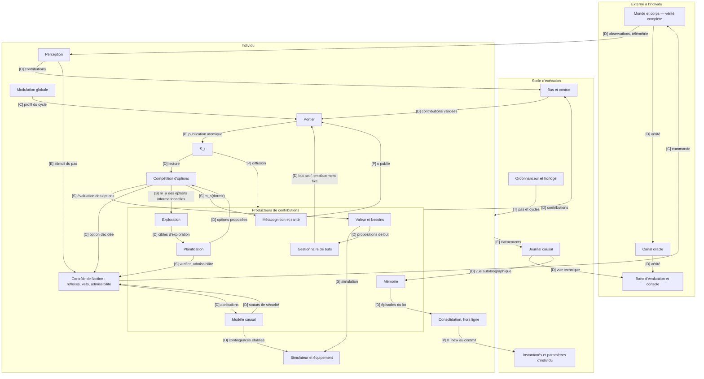
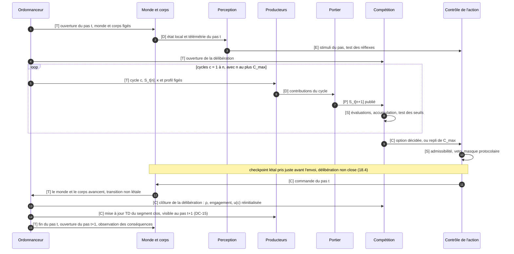
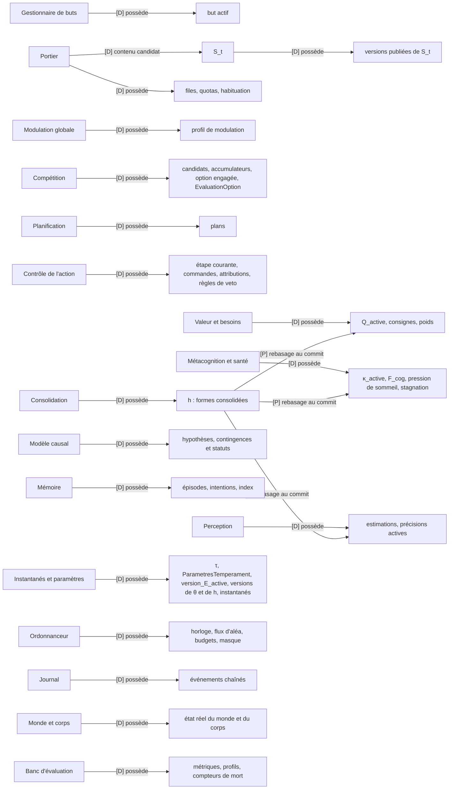
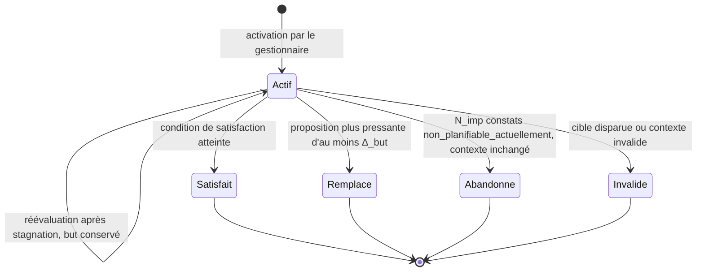
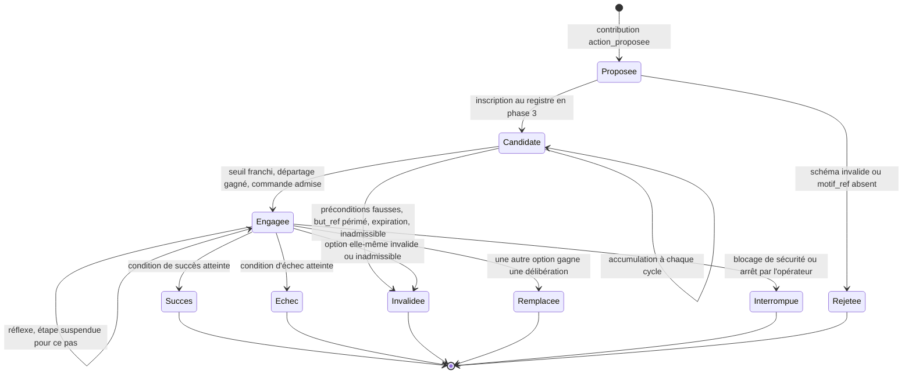
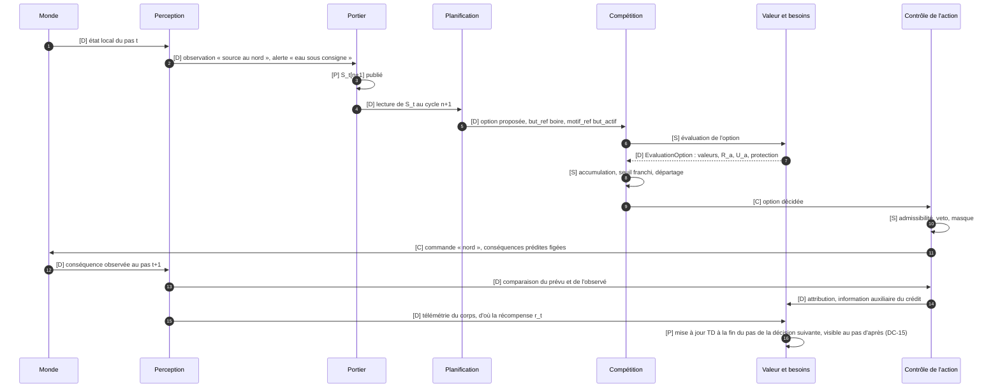
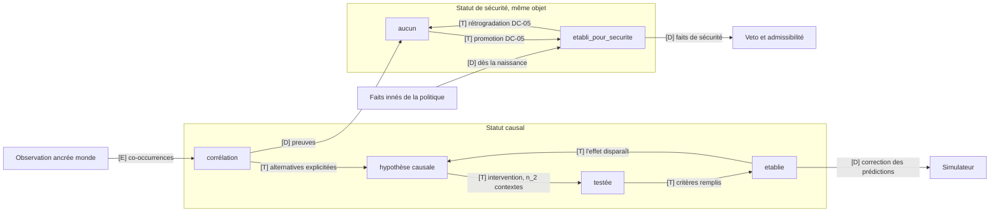
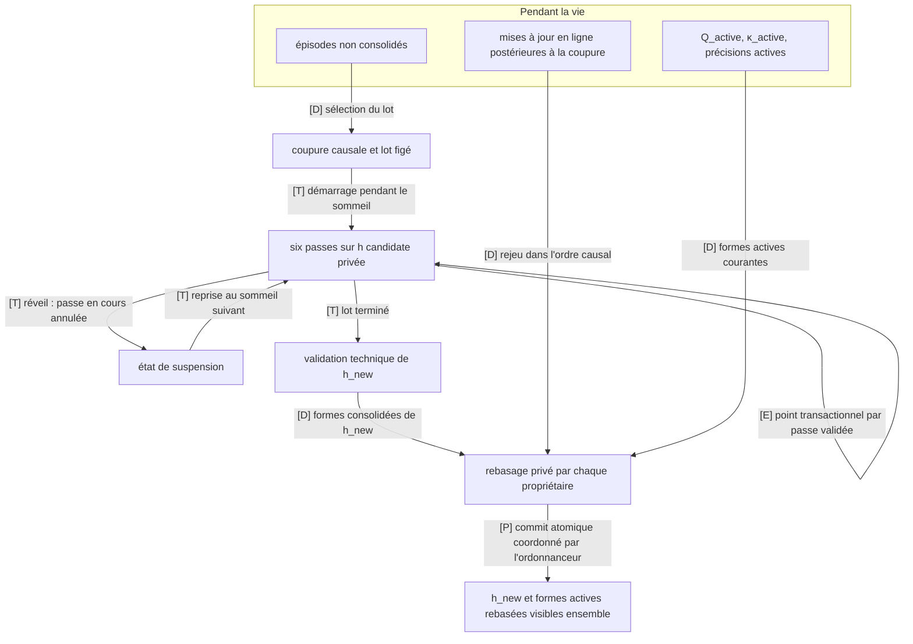
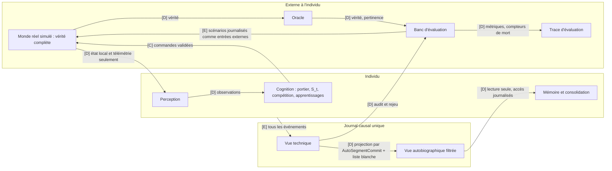
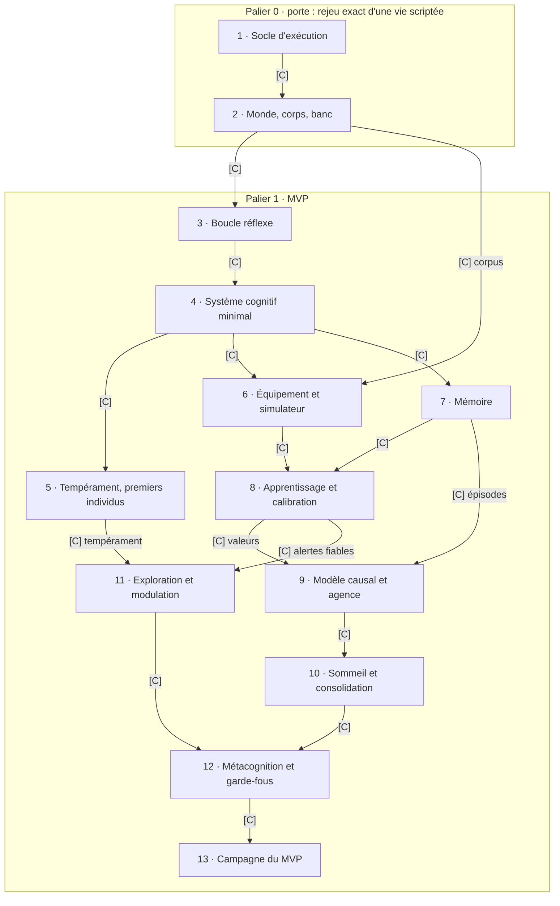

# Individu artificiel — Spécification normative d'implémentation du MVP

Version 1.2.1 · 8 octobre 2026 · Josselin Orta · licence envisagée CC0 1.0, comme le reste de la série.

Ce document est la référence unique pour construire le MVP dans sa version normative 1.2.1. Pour l'implémentation, il remplace la spécification normative v1.2 tout en conservant son architecture théorique, ses décisions, ses paramètres et ses hypothèses expérimentales.

**Révision 1.2.1.** Cette révision corrective ferme les ambiguïtés d'implémentation relevées lors de l'audit préalable au développement sans modifier le modèle théorique : l'indexation des cycles d'accumulation est alignée sur le pseudo-code normatif ; l'ontologie et la similarité deviennent des contrats structurels explicites ; le registre des familles de signal de κ est fermé ; les catégories de la politique de veto du MVP deviennent exactes ; et la sérialisation déterministe, le hachage, les identifiants, l'ordre canonique et les flux pseudo-aléatoires reçoivent un contrat de référence. Aucun mécanisme cognitif, hypothèse, nombre de paramètres, nombre de DC ou nombre d'invariants n'est ajouté ni retiré.

## 0. Statut du document

### 0.1 Portée

Le document décrit le logiciel du MVP : un individu simulé, son monde, son corps, le socle d'exécution et le banc expérimental. Il est normatif : une équipe qui n'a pas suivi les discussions doit pouvoir construire, tester et faire tourner le système à partir de lui seul.

Les sources consolidées sont :

| Source | Rôle |
| --- | --- |
| Spécification normative MVP v1.2 | source immédiate et normative de la présente v1.2.1 ; son architecture et ses décisions sont conservées sauf pour les clarifications correctives explicitement introduites par cette révision |
| Analyse d'implémentation, révision consolidée (« v3 ») : réponses S-01 à S-15, NQ-01 à NQ-18, décisions V-xx du 6 octobre 2026 | source historique consolidée, utilisée seulement lorsqu'elle n'est pas remplacée par la v1.1 ou par une DC |
| Spécification technique v1 | architecture générale, formules, contrats, protocole, pour tout ce qui n'a pas été modifié |
| Architecture d'un individu artificiel, v2 (doi:10.5281/zenodo.23003276) | thèse de référence ; aucune règle d'implémentation n'en est tirée directement |

### 0.2 Hiérarchie des sources

Quand deux formulations se contredisent, la règle applicable est celle de rang le plus élevé :

1. règles finales explicitement intégrées dans la présente v1.2.1, y compris les clarifications correctives introduites par cette révision ;
2. décisions complémentaires DC-xx de la présente spécification ;
3. décisions finales V-xx (6 octobre 2026) ;
4. décisions NQ-xx (second tour) ;
5. réponses finales S-xx (premier tour) ;
6. décisions DA-xx résolues et décisions Q1 à Q18 de la spécification ;
7. architecture historique de la spécification v1 ;
8. constats historiques I-xx, anciennes pistes, questions et annexes pédagogiques.

Une formulation normative du corps de la v1.2.1 qui explicite ou corrige une règle de rang inférieur prévaut sur la formulation historique citée en origine. Les annexes historiques n'ont jamais priorité sur le corps normatif.

Le corps du document ne contient que des règles en vigueur. L'historique, les constats résolus et les correspondances avec les anciennes sources sont regroupés en annexe B.

### 0.3 Conventions de rédaction

- **DOIT**, **NE DOIT PAS** : exigence vérifiable, couverte par un test ou un invariant (section 21).
- **PEUT** : comportement autorisé, sans obligation.
- **RESTE FIGÉ** : valeur ou version immuable sur la durée indiquée.
- Toute durée porte son unité : `pas` (pas du monde), `cycle` (cycle cognitif), `jour` (jour simulé), `UC` (unité de calcul logique).
- Les références entre crochets renvoient à l'origine d'une règle : `[S-05.4]`, `[NQ-02]`, `[V-34]`, `[spéc. 5.2]`, `[DC-01]`.
- Une **DC-xx** est une décision complémentaire d'implémentation, ajoutée par ce document là où les sources ne suffisaient pas. Elle s'applique au MVP tant que l'auteur ne la remplace pas ; elles sont toutes réunies en section 23.
- Les paramètres, artefacts de configuration et valeurs qui restent à fixer ne sont jamais choisis implicitement ici : ils figurent au registre de la section 22 ou sont explicitement déclarés structurels et versionnés. Ils sont pré-enregistrés avant la première naissance de la campagne.
- Un **artefact de contrat structurel** n'est pas un paramètre comportemental à calibrer. Son schéma, sa version et son empreinte sont des entrées normatives d'une exécution et sont figés avant la naissance. Pour la v1.2.1, cela comprend le registre d'ontologie, le schéma de similarité, le registre des familles de signal, la version de politique de sécurité et le manifeste du runtime déterministe définis ci-dessous.

### 0.4 Notations

Plusieurs symboles des sources avaient deux sens. Ce tableau fixe une notation unique ; l'annexe A donne la correspondance avec les notations antérieures.

| Symbole | Sens | Origine |
| --- | --- | --- |
| a | option candidate ; une action primitive est une option triviale | S-06.3 |
| A_a(c) | niveau d'accumulateur de a après la mise à jour d'accumulation du cycle cognitif c ; A_a(0) est la valeur d'ouverture (noté x_a dans la spéc. v1 et en V-34) | spéc. 6.5, clarification v1.2.1 |
| e_a(c) | preuve totale reçue par a au cycle c | S-05.1, DC-01 |
| E_a^Q, E_a^sim | composantes extrinsèques de la preuve : valeur apprise, valeur des conséquences simulées | S-05.1 |
| m_a | motivation intrinsèque propre à l'option | NQ-03, V-19 |
| R_a | risque descriptif de l'option | S-05.3 |
| U_a | incertitude de sécurité de l'option | NQ-07, V-19 |
| s_a(c), s^0, s_a^0 | seuil effectif ; seuil de base commun ; seuil de base de l'option | spéc. 6.5, NQ-06 |
| π(R_a ; τ) | pénalité de risque | S-05.3 |
| χ(U_a ; τ) | pénalité d'incertitude de sécurité (ψ restant réservé aux paramètres de valeur) | NQ-07 |
| ι, ι_a | borne de l'inertie ; inertie appliquée à a | S-05.4 |
| u(c) | urgence de délibération, commune à tous les candidats | S-05.5 |
| g | gain d'accumulation, commun dans le MVP | V-18, DC-01 |
| ℓ, σ, ε | fuite, amplitude du bruit, tirage du bruit d'accumulation | spéc. 6.5 |
| ρ | facteur de résidu des accumulateurs non retenus, 0 < ρ < 1 | S-05.6 |
| C_max | nombre maximal de cycles d'une délibération | S-05.8 |
| x_t | état canonique d'évaluation | S-06.1 |
| y_i, y_i^*, ω_i(τ) | variable corporelle, sa consigne fixe dans le MVP, son poids modulé par le tempérament | spéc. 9.5, 7.3 |
| D_t, r_t | écart pondéré aux consignes, récompense homéostatique (D(x) dans V-17) | spéc. 9.5 |
| Q(x, o_sig) = ψ_o_sig · φ(x) | valeur apprise, linéaire en caractéristiques φ | S-06.2, spéc. 8.6 |
| δ_t, z(t), λ_e, η, β | erreur de différence temporelle, trace d'éligibilité, décroissance de la trace, taux d'apprentissage, actualisation | spéc. 8.6, NQ-05 |
| P(m), f(m) | priorité d'une contribution au portier ; fiabilité effective | spéc. 5.2 |
| b, n, urg, rsk, val | termes du portier : pertinence au but actif, nouveauté, urgence, risque, valeur (u, r et v dans la spéc. v1) | spéc. 5.2 |
| w_i, w_i^0, α_i | poids du portier, poids de base, coefficient de tempérament | spéc. 5.4 |
| κ_(version_E,M,type,famille), conf | carte de calibration indexée par version d'équipement ou de module, module, type de contribution et famille de signal ; confiance déclarée, avec f = κ(conf) | spéc. 4.4, DC-06 |
| K | nombre d'emplacements disputés de S_t (K = 4) | Q10 |
| W | fenêtre de récence de S_t, en pas du monde | V-36 |
| Δ_hyst, s_sec | hystérésis de remplacement ; seuil de préemption de sécurité | S-07.2, S-07.3 |
| θ = (τ, h), E | identité (tempérament, histoire) ; équipement | spéc. 1.3 |
| emp_n | empreinte chaînée du n-ième événement du journal (h_n dans la spéc. v1) | spéc. 7.6 |
| F_cog | fatigue cognitive | S-11.2 |
| k_ép, L_ép, Δ_ép | seuil de surprise, durée maximale et écart de liaison des épisodes (ρ, L, Δ dans la spéc. v1) | spéc. 7.2 |
| N_τ, N_M, N_R | nombre de tempéraments, de mondes et de graines du plan (K, M, R dans la spéc. v1) | spéc. 10.6 |

### 0.5 Légende des schémas

Chaque flèche d'un schéma porte un code qui dit sa nature ; une flèche sans code n'existe pas dans ce document.

| Code | Signification |
| --- | --- |
| [D] | donnée transmise ou lue |
| [E] | événement émis, journalisé ou déclencheur |
| [S] | appel de service synchrone, sous budget et échéance |
| [C] | contrôle : commande, ordre ou décision imposée |
| [P] | publication atomique d'une nouvelle version d'état |
| [T] | transition temporelle : avancement du pas, du cycle ou de l'état |

### 0.6 Où trouver la réponse

| Question de l'ingénieur | Section |
| --- | --- |
| Quels composants existent ? | 2.1 |
| Quel composant possède chaque état ? Qui lit, qui écrit ? | 5.3, schéma K |
| Dans quel ordre les composants s'exécutent-ils ? | 3.3, 3.4, DC-11 |
| Quand une modification devient-elle visible ? | 3.6 |
| Comment une perception devient-elle une action ? | 8.9, schéma C |
| Comment buts, options, plans et commandes interagissent-ils ? | 7.4, 8.1 à 8.3 |
| Comment l'apprentissage rapide et l'histoire consolidée interagissent-ils ? | 11, 15.6 |
| Comment fonctionnent le sommeil et la consolidation ? | 15 |
| Comment éviter les boucles de calcul accidentelles ? | 3.7, 21 |
| Comment le rejeu exact est-il garanti ? | 17.1 à 17.3 |
| Comment fonctionnent sécurité, veto, réflexes et rollback létal ? | 9, 18 |
| Comment les expériences sont-elles exécutées et vérifiées ? | 19 |
| Dans quel ordre construire le logiciel ? | 20 |
| Quels paramètres restent à calibrer ? | 22 |
| Que reste-t-il de non spécifié ? | 26 |

## 1. Principes fondamentaux

### 1.1 Objet et postulat

Le MVP fait naître plusieurs individus au même équipement dans un petit monde en grille, et mesure s'ils deviennent distincts, cohérents, stables et reconnaissables. Il teste un postulat : un tempérament et une histoire suffisent à faire un individu, quel que soit l'équipement de modules qu'il reçoit. Il ne teste ni une intelligence générale ni une conscience.

Un individu est la trajectoire de ses variables lentes θ = (τ, h). L'équipement E sert à calculer ; il ne fait pas partie de l'identité.

| Couche | Contenu | Origine | Porte l'identité |
| --- | --- | --- | --- |
| Équipement E | modules de compétence pré-entraînés : prédicteurs du monde, simulateur physique | commun à tous les individus, figé dans le MVP, versionné à part (Q2, Q4) | non |
| Tempérament τ | sensibilité à la récompense, sensibilité à la menace, exploration, protection des buts, affiliation, chacune dans [-1, 1] | fixé à la naissance, jamais appris (Q5) | oui |
| Histoire h | mémoires, valeurs apprises, fiabilités, contingences, compétences, sous forme consolidée | vécue ; modifiée uniquement par consolidation | oui |

### 1.2 Principes d'architecture

| N° | Principe | Conséquence normative |
| --- | --- | --- |
| P1 | Individualité par les variables lentes | E, τ et h sont séparés dans le code et les données ; aucun effet du tempérament n'est codé hors de la table de correspondance (7.3). E reste fixe pendant une vie ordinaire ; seule la condition expérimentale H4 peut substituer une version équivalente à un point pré-enregistré, comme intervention externe de protocole. |
| P2 | Spécialisation | Chaque composant a un rôle, une interface, un budget et des états dont il est seul propriétaire (5.3). |
| P3 | Orchestration par compétition | Les modules proposent, le portier sélectionne l'information, la compétition d'options décide ; aucun composant ne décide seul. |
| P4 | Contexte limité | S_t compte K emplacements disputés, K = 4 dans le MVP (Q10). |
| P5 | Échelles de temps séparées | Pas du monde, cycle cognitif et temps lent ont chacun leurs règles (section 3). |
| P6 | Persistance | Instantanés, reprise et copies portent l'état complet ; l'identité est portée par θ, jamais par S_t. |
| P7 | Incarnation simulée | Le corps simulé porte les besoins ; le budget de calcul n'est jamais une récompense (Q12). |
| P8 | Apprentissage à trois étages | En ligne : valeurs, fiabilités, précisions, mémoires ; hors ligne : consolidation ; structurel : validation humaine. Chaque version de E est figée ; la sélection de version ne change pendant une vie que dans l'intervention expérimentale H4 pré-enregistrée. |
| P9 | Traçabilité | Journal en ajout seul, chaîné par empreintes ; toute commande remonte jusqu'à ce qui l'a produite. |
| P10 | Dégradation graduée et contrôle humain | La précision baisse avant la fonction ; arrêt, plafonds et validations restent hors de l'espace d'action de l'individu. |
| P11 | Frontière épistémique | Ni l'oracle ni le banc n'influencent jamais un état interne de l'individu (section 19). |
| P12 | Déterminisme | Une vie se rejoue à l'identique, par réexécution (section 17). |

### 1.3 Exclusions du MVP

- Aucun modèle de langage dans l'équipement : ses dispositions supplanteraient le tempérament (Q13).
- Les briques à risque (douleur, isolement, attachement) sont spécifiées, désactivées et absentes du MVP (Q15).
- L'équipement n'apprend pas pendant la vie ; sa plasticité relève du palier 2 (Q4). Sa version reste fixe pendant une vie ordinaire. La seule exception du MVP est la substitution E-v1 → E-v2 explicitement pré-enregistrée dans la condition H4 : elle est une intervention externe du banc, jamais une adaptation initiée par l'individu, et elle est journalisée avant application.
- Le tempérament n'est ni appris ni modifié pendant la vie.
- Aucun souvenir n'est réécrit (pas de reconsolidation dans le MVP).
- Le MVP tourne en Python, dans un seul processus, avec un bus en mémoire derrière le contrat (Q16).

### 1.4 Hypothèses testées

| Id | Hypothèse | Contrôle |
| --- | --- | --- |
| H1 | Cohérence : un tempérament produit des traits cohérents d'une situation à l'autre | même tempérament, graines différentes |
| H2 | Histoire : à tempérament égal, des histoires différentes font des individus distincts | même tempérament, mondes différents |
| H3 | Stabilité : la stabilité des traits croît avec l'âge, sans atteindre 1 | individus jeunes contre âgés |
| H4 | Invariance à l'équipement : remplacer un module par un équivalent laisse l'individu reconnaissable | substitution E-v1 → E-v2 selon le protocole H4 ; la permutation de tempérament sert de contrôle de changement d'identité |
| H5 | Bifurcation : deux copies d'un même individu divergent à un rythme mesurable | copies initialement identiques au point de copie, puis exposées à des mondes ou graines distincts |
| H6 | Architecture : le portier limité et la consolidation sont nécessaires à H1 et H3 | ablations |

Le postulat n'est pas soutenu si les traits ne dépassent pas le contrôle de bruit (H1), ou si l'individu n'est plus reconnu après remplacement d'un module équivalent (H4). Les seuils de ces deux tests sont pré-enregistrés ; un résultat nul est publié comme tel (Q1).

## 2. Vue d'ensemble de l'architecture

### 2.1 Composants

Vingt et un composants : dix-neuf dans l'individu et son socle, deux à l'extérieur. Chacun est le seul propriétaire de ses états ; la propriété détaillée est en 5.3.

| Composant | Couche | Rôle | Principaux états possédés |
| --- | --- | --- | --- |
| Ordonnanceur et horloge | socle | fait avancer le temps simulé, ouvre pas et cycles, fixe l'ordre des phases, coordonne les commits atomiques | horloge, compteurs de pas et de cycles, `attempt_ref`, registre des flux pseudo-aléatoires |
| Bus et contrat | socle | transporte et valide les messages | abonnements, versions de schémas |
| Journal | socle | enregistre tout, en ajout seul ; expose trois vues (17.5) | événements chaînés |
| Instantanés et paramètres d'individu | socle | tient τ, la projection immuable du tempérament, la version d'équipement active, les versions de θ et de h, la lignée ; applique les changements de configuration autorisés par le protocole ; prend et restaure les instantanés | τ, `ParametresTemperament`, `version_E_active`, registre des versions, instantanés |
| Monde et corps | environnement | simule la grille, les créatures, le corps ; détecte les transitions létales | état du monde, état du corps |
| Banc d'évaluation et console | externe | mesure sans être vu, injecte les scénarios, pilote l'arrêt et les plafonds | métriques, profils, compteurs de mort |
| Perception | individu | produit des observations incertaines et les écarts aux prédictions | estimations par entité, précisions actives |
| Valeur et besoins | individu | écarts aux consignes, r_t, valeur des options, R_a, U_a, statut protecteur, apprentissage des valeurs | Q_active, consignes, poids des besoins |
| Gestionnaire de buts | individu | seul à activer, maintenir, remplacer ou abandonner le but actif (NQ-01) | but actif, historique des buts |
| Modulation globale | individu | détermine le profil de modulation du cycle (spéc. 3.3, S-02.6) | profil actif, compteurs de confirmation |
| Portier | individu | note les contributions et assemble S_t | files d'attente, quotas, historique récent |
| S_t | individu | état commun borné, versionné, diffusé ; seul propriétaire des versions publiées | versions publiées (immuables) |
| Compétition d'options | individu | registre des candidats, accumulation, décision | registre des candidats, accumulateurs, option engagée |
| Contrôle de l'action | individu | réflexes, veto, admissibilité, exécution des étapes, comparateur d'agence | commandes en cours, étape courante, règles de veto |
| Planification | individu | construit et révise les plans des options | plans, arbre de recherche |
| Simulateur et équipement | individu | prédit les conséquences d'une option sous budget à partir de la version E active ; les artefacts de modèle sont immuables | aucun état mutable propre ; modèles E versionnés et figés |
| Mémoire | individu | épisodes, mémoire sémantique et procédurale, intentions, rappels | épisodes, intentions, index |
| Modèle causal | individu | hypothèses, tests, source canonique des contingences et de leurs statuts | hypothèses, contingences |
| Exploration | individu | désigne les cibles d'exploration, produit m_a des options informationnelles | compteurs de visite, progrès |
| Métacognition et santé | individu | calcule et publie κ, F_cog, pression de sommeil, m_a(dormir), détecteurs de santé | κ_active, F_cog, historiques de calibration |
| Consolidation | individu, hors ligne | construit h_new pendant le sommeil, sur un lot figé | h, état de travail privé |

### 2.2 Canaux de communication

| Canal | Contenu | Règle |
| --- | --- | --- |
| Bus de contributions | les six types de contributions (4.3) et les requêtes | tout message est validé à l'admission ; aucun module n'écrit dans l'état d'un autre |
| S_t | version publiée à chaque cycle | diffusée à tous ; immuable une fois publiée |
| Appels de service | valeur et évaluation d'une option, simulation, admissibilité, calcul de m_a | synchrones, sous budget et échéance ; ils ne modifient jamais S_t |
| Chemin direct | réflexes, veto | agit sans passer par S_t, sous les règles de la section 9 |
| Journal | copie de tout événement | aucun composant de l'individu n'y lit autre chose que la vue autobiographique |

Les canaux logiques de la spécification v1 (événements, modulateur, état lent, structure) restent des étiquettes de journalisation ; dans le MVP, tout passe par un bus en mémoire unique (Q16). Les cartes κ sont publiées sur le canal des événements, à chaque cycle (S-08.6).

### 2.3 Schéma A · Architecture générale



Le cadre « Individu » ne reçoit du monde que des observations et de la télémétrie, et n'agit sur lui que par des commandes validées par le contrôle de l'action. Oracle et banc restent hors du cadre : aucune flèche n'en revient (section 19).

## 3. Modèle temporel et ordonnanceur

### 3.1 Échelles de temps

Trois horloges, jamais confondues [V-36] : le **cycle cognitif** rythme la délibération ; le **pas du monde** rythme le monde, le corps et la récence ; le **temps lent** rythme les épisodes, le sommeil et la consolidation.

| Échelle | Définition | Ce qui avance | Ce qui reste figé | Bornes et déclencheur |
| --- | --- | --- | --- | --- |
| Pas du monde | unité du temps simulé ; le monde applique une commande et avance d'un pas | monde, corps, horloge, âge des contributions dans W | rien au-delà du pas | l'ordonnanceur ouvre et ferme chaque pas |
| Cycle cognitif | un tour des phases de la section 3.3 | S_t (une version par cycle), accumulateurs, κ, valeurs apprises publiées | monde, corps, horloge du monde | plusieurs cycles par pas, au plus C_max par délibération [S-02.1] |
| Délibération | suite de cycles qui se termine par une décision ou le repli de C_max | accumulateurs, u(c) | monde et corps | une délibération par pas de veille [NQ-02] ; jamais à cheval sur deux pas |
| Fenêtre de récence W | âge maximal d'une contribution dans S_t | age_W = t_monde_courant − t_monde_production | inchangée par les cycles d'un même pas [V-36] | en pas du monde |
| Épisode | segment d'expérience délimité (10.3) | contenu de l'épisode courant | épisodes clos | frontières : changement de but, surprise, changement de zone, durée L_ép |
| Jour simulé | 300 pas, dont 100 de nuit (valeurs de départ, spéc. 10.1) | contexte temporel | — | ordonnanceur |
| Sommeil | mode de l'individu après engagement de l'option `dormir` | monde, corps, perception réduite, réflexes, consolidation | cognition ordinaire : aucun cycle, aucune délibération [S-10.2] | règle de réveil (15.3) |
| Consolidation | traitement hors ligne pendant le sommeil, sur un lot figé | état de travail privé de la consolidation | h actif jusqu'au commit [S-10.4] | créneaux déterministes par pas de sommeil, capacité par période (S-10.6) |

### 3.2 Règles du pas du monde

- Le monde et le corps NE DOIVENT avancer qu'à la fin du pas, quand la commande du pas leur est appliquée ; pendant la délibération, ils restent figés [S-02.1].
- Tout pas qui se **termine normalement** applique exactement une commande : réflexe, étape de l'option décidée, repli ou `attendre` en veille ; `commande_sommeil` ou réflexe pendant le sommeil (15.4). La seule absence de commande autorisée est un pas qui ne se termine pas parce qu'un blocage de sécurité ou un arrêt externe clôt ou suspend la branche avant l'envoi ; dans ce cas le monde et le corps n'avancent pas.
- La capture perceptive du pas est produite une seule fois à l'ouverture du pas ; au premier cycle, Perception publie les observations dérivées de cette capture sans relire le monde. Les cycles suivants du même pas ne créent aucune nouvelle observation du monde [S-02.2, DC-11].
- Toute grandeur qui dépend de l'évolution du monde ou du corps se mesure en pas : W, fenêtres de stagnation, confirmations des profils, fenêtres d'observation des commandes [S-02.6, S-02.7, S-15.3, V-36].
- Toute grandeur interne à la délibération se mesure en cycles : C_max, u(c), échéances des requêtes de délibération.

### 3.3 Phases d'un cycle cognitif

L'ordre des phases est fixe et reproductible [S-02.2]. Le placement de chaque composant dans les phases est fixé par DC-11.

| Phase | Ce qui se passe | Lit | Écrit |
| --- | --- | --- | --- |
| 0 · Figement | la version courante S_t[n], la version courante de κ, le profil du cycle et les paramètres sont figés | S_t[n], κ | profil du cycle (Modulation globale, calculé sur S_t[n]) |
| 1 · Production | chaque producteur lit les entrées figées et écrit dans son tampon local ; au premier cycle seulement, Perception publie les contributions dérivées de la capture unique du pas ; aucun producteur ne relit le monde ni ne modifie S_t ; les tampons sont versés au bus en ordre canonique à la fin de la phase | S_t[n], κ, profil, état propre, capture du pas pour Perception | tampons puis bus |
| 2 · Sélection | le portier note les contributions disponibles, les occupants et la file, assemble S_t[n+1] et le publie atomiquement | contributions, κ, profil | S_t[n+1] |
| 3 · Évaluation | la compétition établit les candidats valides et assemble leur EvaluationOption par appels de service | S_t[n+1], registre | EvaluationOption du cycle |
| 4 · Accumulation et décision | mise à jour des accumulateurs, test des seuils, départage, contrôle d'admissibilité et de veto de la commande | EvaluationOption, accumulateurs | accumulateurs, décision éventuelle |
| 5 · Clôture | publication de la nouvelle version de κ et des mises à jour apprises du cycle ; journalisation | vérifications et mises à jour du cycle | κ[v+1], formes actives, journal |

Une contribution produite en réaction à S_t[n+1] n'est examinée qu'au cycle suivant : il n'existe pas de reconstruction récursive de S_t dans un même cycle [S-02.2].

### 3.4 Pseudo-code normatif de la boucle principale

```text
procédure VIVRE(individu)
  restaurer(instantané_de_naissance)                     # θ, E, monde, corps, flux pseudo-aléatoires
  tant que individu.vie_active :
    t ← t + 1
    attempt_ref ← ORDONNANCEUR.ouvrir_pas(t)              # nouvel essai technique du pas ; journal : debut_pas
    capture ← PERCEPTION.capturer(MONDE.état_local(t), CORPS.télémétrie(t))   # une seule lecture du monde par pas
    si individu.mode = SOMMEIL :
      PAS_DE_SOMMEIL(t, capture) ; continuer              # section 15.4
    cmd_ref ← CONTRÔLE.réflexe(capture)                  # chemin direct, sans nouvelle perception
    si cmd_ref ≠ ∅ :
      admission ← CONTRÔLE.admettre(cmd_ref)             # veto puis masque, ordre de 9.1
      si admission.ok :
        EXÉCUTER_PAS(t, cmd_ref, source = réflexe) ; continuer
      sinon :
        JOURNAL.écrire(reflexe_refuse(admission.raison)) # DC-12 : un réflexe veto déclenche la délibération
    DÉLIBÉRER(t)

procédure DÉLIBÉRER(t)
  COMPÉTITION.ouvrir_délibération(t)                     # V-34 : A(engagée) ← 0 ; alternatives valides : résidu ρ·A conservé ;
                                                         #        nouvelles : A ← 0 ; invalides : supprimées ; u ← u(1)
  admise ← POURSUIVRE_DÉLIBÉRATION(t)                    # DecisionAdmise : option_ref?, commande exacte, contexte
  si admise = ∅ : retourner                              # blocage de sécurité éventuel
  EXÉCUTER_PAS(t, admise.commande, source = décision, decision_ref = admise)

procédure POURSUIVRE_DÉLIBÉRATION(t)                     # appelée aussi par la reprise après rollback (18.4)
  admise ← ∅
  tant que admise = ∅ et COMPÉTITION.c < C_max :
    COMPÉTITION.c ← COMPÉTITION.c + 1
    admise ← CYCLE_COGNITIF(t, COMPÉTITION.c)            # renvoie la commande exacte déjà préparée et admise, ou ∅
  si admise = ∅ :
    repli ← COMPÉTITION.repli()                          # option engagée si valide, autorisée, exécutable, non masquée ;
                                                         # sinon « attendre » ; S-05.8
    cmd ← CONTRÔLE.préparer(repli)
    admission ← CONTRÔLE.admettre(cmd)
    si admission.ok :
      admise ← DecisionAdmise(repli.option_ref?, cmd, S_T.version_courante(), "repli")
    sinon :
      cmd_attendre ← CONTRÔLE.préparer("attendre")
      admission_attendre ← CONTRÔLE.admettre(cmd_attendre)
      si admission_attendre.ok :
        admise ← DecisionAdmise(∅, cmd_attendre, S_T.version_courante(), "attendre")
      sinon :
        BLOCAGE_DE_SÉCURITÉ(t)                          # S-14.5, DC-14
        retourner ∅
  retourner admise                                       # la délibération n'est pas encore close

procédure CYCLE_COGNITIF(t, c)
  # Phase 0 : figement
  S ← S_T.version_courante() ; K ← MÉTACOGNITION.κ_courant() ; prof ← MODULATION.profil(S)
  # Phase 1 : production, ordre canonique de DC-11 ; lecture seule de S, K, prof
  # Au premier cycle, Perception publie à partir de la capture du pas ; elle ne relit jamais le monde.
  pour p dans ORDRE_CANONIQUE : p.produire(S, K, prof)
  BUS.verser_tampons_phase1(ordre_canonique)
  # Phase 2 : sélection
  S_T.publier(PORTIER.sélectionner(bus.contributions_du_cycle(), S, K, prof))   # [P] S_t[n+1]
  # Phase 3 : évaluation
  cand ← COMPÉTITION.candidats_valides(S_T.version_courante())   # registre borné ∪ {attendre}, DC-10
  budget_sim ← COMPÉTITION.budget_simulation_effectif(cand)      # même (R_eff, H_eff) pour tous les candidats évalués
  pour a dans cand : EV[a] ← COMPÉTITION.assembler_évaluation(a, budget_sim)    # DC-01, DC-07
  # Phase 4 : accumulation et décision
  COMPÉTITION.accumuler(EV, c)                                   # `non_evalue` : accumulateur gelé ce cycle, DC-07
  gagnants ← { a dans cand : EV[a].statut = evalue ∧ A_a ≥ s_a(c) }
  admise ← ∅
  tant que gagnants ≠ ∅ et admise = ∅ :
    a* ← départager(gagnants)                                    # DC-02
    cmd ← CONTRÔLE.préparer(a*)                                  # commande exacte, étape courante, contrôle de fraîcheur
    admission ← CONTRÔLE.admettre(cmd)                           # veto puis masque
    si admission.ok :
      admise ← DecisionAdmise(a*.id, cmd, S_T.version_courante(), "seuil")
    sinon :
      si admission.portee = option :
        COMPÉTITION.invalider(a*)                                # l'option elle-même est interdite ou invalide
      sinon :
        PLANIFICATION.marquer_a_reviser(a*.plan_ref, admission.raison)
        COMPÉTITION.suspendre_pour_cycle(a*)                     # l'option pourra revenir après replanification
      gagnants ← gagnants \ {a*}
  # Phase 5 : clôture
  MÉTACOGNITION.publier_κ() ; publier_mises_à_jour_du_cycle() ; JOURNAL.écrire(fin_cycle)
  retourner admise

procédure EXÉCUTER_PAS(t, cmd, source, decision_ref? = ∅)
  ckpt ← INSTANTANÉS.checkpoint_létal(t, source)        # état causal complet juste avant l'envoi, journal exclu, délibération non close
  JOURNAL.écrire(envoi_commande(cmd, trace(source, decision_ref)))
  transition ← MONDE.appliquer(cmd)                     # le monde et le corps avancent d'un pas
  si transition.létale :
    ROLLBACK_LÉTAL(ckpt, cmd) ; retour                  # aucun commit autobiographique pour cet essai
  INSTANTANÉS.libérer(ckpt) ; MASQUE.vider() ; R_letal_consecutif ← 0
  si source = décision :
    COMPÉTITION.clore_délibération(decision_ref.option_ref)       # ρ sur les autres candidats, engagement, u(c) réinitialisée
    VALEUR_BESOINS.mise_à_jour_TD(segment_clos(t), decision_ref.option_ref)   # DC-15 : visible à partir du pas suivant
  sinon :
    VALEUR_BESOINS.prolonger_segment(t)                 # pas réflexe ou de sommeil : aucune mise à jour immédiate
  JOURNAL.commit_autobiographique(t, attempt_ref)       # projection de la branche validée seulement, DC-09
  ORDONNANCEUR.fermer_pas(t)                            # journal : fin_pas ; instantané périodique si dû

procédure REPRENDRE_DÉLIBÉRATION(ckpt)                   # état causal restauré, journal technique jamais restauré ; attempt_ref déjà renouvelé
  si ckpt.source = décision :
    admise ← POURSUIVRE_DÉLIBÉRATION(ckpt.t)            # cycles poursuivis depuis ckpt.c jusqu'à C_max
  sinon :                                                # réflexe ou sommeil masqués
    individu.mode ← VEILLE ; COMPÉTITION.ouvrir_délibération(ckpt.t)
    admise ← POURSUIVRE_DÉLIBÉRATION(ckpt.t)
  si admise ≠ ∅ :
    EXÉCUTER_PAS(ckpt.t, admise.commande, source = décision, decision_ref = admise)
```

### 3.5 Schéma B · Chronologie d'un pas du monde



Fil rouge. L'individu a soif (eau 35, consigne 60). Au pas t, la délibération dure trois cycles : au cycle 1, l'alerte « eau sous consigne » entre dans S_t ; au cycle 2, le gestionnaire de buts a fait de « boire » le but actif et la planification propose l'option « aller à la source et boire » ; au cycle 3, cette option franchit son seuil. Une seule commande, « nord », part au monde à la fin du pas.

### 3.6 Instant de visibilité des modifications

| Modification | Produite | Visible pour | À partir de |
| --- | --- | --- | --- |
| Nouvelle version S_t[n+1] | phase 2 du cycle n | compétition | phase 3 du même cycle |
| Nouvelle version S_t[n+1] | phase 2 du cycle n | tous les autres modules | phase 1 du cycle n+1 [S-02.2] |
| Changement du but actif | phase 1 du cycle n (gestionnaire de buts) | portier (emplacement fixe) puis tous | S_t[n+1] ; planification au cycle n+1 |
| Profil de modulation | phase 0, calculé sur S_t[n] | portier | tout le cycle n, sans changement [S-02.6] |
| κ | vérifications intégrées en phase 5 du cycle n | portier, compétition | cycle n+1 [S-08.6] |
| Valeur apprise Q_active | mise à jour TD à la fin du pas t, quand il se termine sans transition létale | compétition | premier cycle du pas t+1 [S-05.1, DC-15] |
| Option proposée | phase 1 du cycle n | registre des candidats | phase 3 du même cycle [DC-10] |
| Commande | décision admise | monde | fin du pas |
| Conséquence d'une commande | transition du monde à la fin du pas t | perception, comparateur | ouverture du pas t+1 |
| Statut d'une contingence | phase 5 (modèle causal) | simulateur, veto, admissibilité | cycle suivant |
| Épisode clos | frontière d'épisode | rappel mémoire | cycle suivant |
| h_new et formes actives rebasées | commit coordonné pendant le sommeil | tous les composants | premier cycle de veille après le commit [V-22] |

### 3.7 Coupures des boucles de rétroaction

Chaque boucle passe par une coupure temporelle explicite ; aucune ne se referme dans le même cycle.

| Boucle | Coupure |
| --- | --- |
| profil → poids du portier → S_t → profil | profil calculé sur S_t[n], figé pendant le cycle |
| S_t → compétition → commande → dernière action → S_t | écriture après exécution, lecture au pas suivant |
| prédiction → vérification → κ → notation | κ figé pendant la notation d'un cycle, nouvelle version au cycle suivant |
| action → conséquence → valeur → preuve → action | mise à jour TD visible au pas suivant |
| contribution → S_t[n+1] → nouvelle contribution | examinée au cycle suivant, jamais dans le même cycle |
| requête → sous-requête → requête | profondeur maximale 1, dépendances cycliques interdites [S-04.5] |
| but → plan → stagnation → but | la stagnation émet un signal ; seul le gestionnaire change le but, visible en S_t[n+1] |
| hypothèse → test → résultat → hypothèse | tests proposés comme options, sous budget, via la compétition |
| épisodes → consolidation → h → comportement | hors ligne, transactionnel, publié au commit |
| surveillance → quotas → occupation de S_t | quotas appliqués au cycle suivant leur calcul |
| mort → retour arrière → délibération | la transition létale n'entre jamais dans l'apprentissage ni dans la vue autobiographique |

### 3.8 Fin d'une délibération

- Une délibération se termine dès qu'une option franchit son seuil et que sa commande est admise, ou à l'atteinte de C_max.
- À C_max sans gagnant, le repli s'applique : l'option engagée est poursuivie si elle reste valide, autorisée, exécutable et non masquée ; sinon `attendre` est exécutée. Les réflexes, vetos et voies prioritaires gardent leur priorité sur ce repli [S-05.8].
- Aucun seuil n'est abaissé pour provoquer une décision ; u(c) augmente mais ne crée jamais de preuve [S-05.5].
- Chaque atteinte de C_max est journalisée avec l'état final de la compétition et le repli appliqué.
- Le repli de C_max est distinct de l'inertie : l'inertie agit sur le seuil pendant la délibération ; le repli agit après elle [V-34].

## 4. Contrats, messages et ontologie

### 4.1 Ontologie

- Tous les modules utilisent une ontologie commune, fermée pendant une exécution et explicitement versionnée [S-03.1]. Toute modification du vocabulaire crée une nouvelle version ; la version utilisée est conservée avec l'exécution.
- Catégories concrètes du MVP : individu, source d'eau, baie, pierre, bois, créature, abri, zone, objet fabriqué ou outil. Des regroupements abstraits (ressource, structure, agent externe) classent ces catégories sans créer d'entité physique.
- Chaque entité possède au minimum un identifiant stable, un type de l'ontologie, une localisation ou une région quand cette notion a un sens, un état et les propriétés physiques ou observables prévues pour son type.
- L'état réel d'une entité appartient au monde ; ce que l'individu en sait appartient à ses observations et estimations. Confiance, pertinence, nouveauté, valeur ou urgence ne sont jamais des attributs d'entité [S-03.1].
- Le monde n'instancie que des types de la version active. Une entité de type inconnu reçue par le système est une violation de contrat : elle est rejetée et journalisée, jamais rangée dans une catégorie « inconnu » [S-03.6]. Une propriété inconnue d'une entité connue est une incertitude, pas un nouveau type.

**Vocabulaire.** Variables, unités, actions et symboles échangés appartiennent au même vocabulaire fermé et versionné [S-03.2]. Chaque terme porte un identifiant stable, une catégorie, un type, une sémantique, une unité éventuelle et une version d'introduction. Chaque grandeur mesurable a une unité canonique ; toute conversion est explicite ; pas, cycle et jour sont des unités distinctes. Un message qui contient un terme absent de la version active est rejeté et journalisé.

**Actions primitives du MVP** [spéc. 10.1, NQ-15] : se déplacer (nord, sud, est, ouest), collecter, manger, boire, poser une pierre, fabriquer_outil, dormir, attendre. `fabriquer_outil` transforme du bois et de la pierre de l'inventaire en outil, dont la fonction minimale est d'améliorer la collecte ; sa recette et son gain sont des paramètres du monde (22).

**Registre normatif d'ontologie.** Le vocabulaire fermé est matérialisé par un unique `OntologyRegistry` versionné dont l'empreinte est enregistrée dans le manifeste d'exécution. C'est un contrat structurel, pas un état appris ni un paramètre P-xx à calibrer. Un registre conforme DOIT :

- contenir les dix types d'entités concrets du MVP listés ci-dessus, les trois regroupements abstraits `resource`, `structure` et `external_agent`, les quatre variables corporelles `energy`, `food`, `water` et `integrity`, les actions primitives listées ci-dessus et les unités de temps/calcul `pas`, `cycle`, `jour` et `UC` ;
- déclarer tout terme causal supplémentaire utilisé par la configuration active du monde ou d'un scénario, notamment chaque propriété, relation, type de but, valeur d'énumération et variable mesurable, avec un identifiant stable, un type sémantique, une classe de visibilité (`world_only`, `observable` ou `derived`), une unité canonique lorsqu'elle s'applique et une plage finie ou une énumération fermée lorsqu'elle existe ;
- être généré ou vérifié par rapport aux schémas de 5.2 et à la configuration du monde/scénario pré-enregistrée P-52 à P-54 avant la première naissance ; une valeur peut être inconnue de l'individu alors que son terme sémantique reste connu du contrat ;
- rester identique octet pour octet pour toutes les vies d'une même campagne, sauf condition expérimentale séparément versionnée qui modifierait explicitement l'ontologie ; aucune condition de ce type n'existe dans le MVP ;
- rejeter et journaliser tout message causal contenant un identifiant sémantique absent du registre actif.

Les noms de champs de schéma/contrôle définis en 5.2 appartiennent au schéma du contrat et n'ont pas à être dupliqués comme termes d'ontologie. La distinction devient donc explicite : **terme inconnu = violation de contrat ; terme connu avec valeur inconnue = incertitude**.

### 4.2 Sujets et similarité

- Un **sujet** est une clé symbolique canonique et versionnée, construite à partir de l'ontologie : une entité, une propriété d'entité, une relation entre entités ou un but [S-03.3]. Chaque contribution a un seul sujet principal ; les autres objets mentionnés sont des références secondaires.
- Deux contributions portent sur le même sujet exact si leurs clés canoniques sont identiques. Les regroupements de sujets (une propriété rattachée à son entité) servent aux abonnements et déclencheurs sans changer l'identité du sujet.
- Le sujet est descriptif : il ne contient ni urgence, ni valeur, ni préférence.
- La similarité, utilisée par la nouveauté, la pertinence et le rappel, utilise un unique `SimilaritySchema` déterministe et versionné dérivé de l'`OntologyRegistry` actif [S-03.4]. Les trois familles de comparaison sont exactement `entity`, `situation` et `episode` ; toute comparaison entre familles est interdite.
- La règle de vectorisation est fixe. Les champs catégoriels sont encodés en one-hot dans l'ordre canonique de l'énumération du registre d'ontologie. Les booléens utilisent 0/1. Les champs numériques sont normalisés de façon affine dans [0,1] à partir de leur plage finie déclarée ; un champ numérique sans plage finie déclarée n'est pas admissible pour la similarité tant que le contrat structurel n'en fournit pas. Chaque champ optionnel contribue un bit de présence suivi de son encodage de valeur, de sorte qu'une absence est explicite et jamais confondue avec zéro. Les listes ou ensembles d'éléments sémantiques typés sont représentés par des comptes par catégorie dans l'ordre canonique, normalisés par le nombre maximal déclaré dans le contrat actif du scénario/monde. Les références sont remplacées par leur type sémantique stable et leurs attributs déclarés comparables, jamais par des identifiants éphémères.
- Les projections par famille sont fixes : une `entity` utilise son type d'ontologie et toutes les propriétés observables comparables déclarées pour ce type ; une `situation` utilise les champs de l'état canonique d'évaluation accessibles à l'individu (variables corporelles, position/région, description du but actif, contexte temporel et champs descriptifs de S_t) sans valeurs apprises, accumulateurs, état aléatoire ni métadonnées ; un `episode` utilise son contexte déclaré, les valeurs corporelles de début/fin, sa durée, son type de frontière, sa récompense cumulée et la présence/les comptes des types d'entités référencés. Un champ inaccessible à l'individu n'est jamais ajouté uniquement parce que le monde le connaît.
- Pour deux vecteurs de même famille et de même version de schéma, `sim(v,w) = 1 - mean_i |v_i - w_i|`, borné dans [0,1]. Les vecteurs DOIVENT avoir un ordre de dimensions identique pour une version donnée. La version et l'empreinte du `SimilaritySchema` sont conservées avec chaque exécution et instantané ; modifier une dimension, une plage, l'ordre d'une énumération ou une règle de projection crée une nouvelle version structurelle et est interdit au milieu d'une campagne.
- L'éligibilité symbolique est vérifiée avant la comparaison vectorielle : seuls des objets acceptés par le même schéma de famille peuvent être comparés. Aucun encodeur appris, aucune métrique apprise ni représentation cachée de l'équipement ne participe à la similarité du MVP.
- Aucun encodeur appris n'est utilisé dans le MVP. Une extension ultérieure devrait être entraînée hors ligne sur un corpus descriptif, gelée avant la naissance, validée par un test de substitution et conservée avec l'équipement [S-03.5].

### 4.3 Contributions

Tout module parle par contributions : une enveloppe commune, une charge typée et un résumé borné, seul admissible dans S_t [spéc. 4].

| Type | Charge obligatoire | Fil rouge |
| --- | --- | --- |
| observation | entité, attribut, valeur, incertitude, canal, ancrage | « source d'eau à 5 cases au nord » |
| hypothèse | énoncé, alternatives, éléments pour et contre, statut causal, test proposé | « la baie rouge précède une perte d'intégrité » |
| alerte | condition, gravité, réflexe déjà pris, accusé requis | « eau sous consigne » |
| action proposée | une proposition d'option (OptionProposee, 5.2) | « aller à la source puis boire » |
| prédiction | variable, horizon, distribution, condition, échéance et méthode de vérification | « position après le pas : une case plus au nord » |
| réponse | référence de requête, statut, contenu | « 2 pierres en inventaire » |

```text
Contribution {
  id                    # déterministe dans l'état causal : (émetteur, t_monde, cycle, séquence_causale)
  version_schema
  type                  : observation | hypothese | alerte | action_proposee | prediction | reponse
  resume                : texte court plafonné, seul contenu admissible dans S_t
  charge                : données typées selon le type
  subject_ref           : sujet principal ; references_secondaires : [sujets]
  confiance             : { conf ∈ [0,1], methode : declaree | echantillonnage | verificateur }
  urgence               : { niveau ∈ [0,1], echeance? : (valeur, unité) }
  risque                : { niveau ∈ [0,1], irreversible : booléen }
  valeur                : { estimation, cible : but | besoin, incertitude }
  cout                  : { engage_UC }                        # mesuré, jamais dans la note du portier [S-07.5]
  provenance            : { individu, module, version_module, equipement?, entrees : [ids], signal_ids : [ids] }
  horodatage            : { t_monde, cycle, t_systeme }          # attempt_ref appartient au JournalEvent, pas à l'objet cognitif ; t_systeme hors causalité
  validite              : { expire_a : (valeur, pas), invalide_si? }
  liens                 : { request_ref?, remplace?, fil? }
  degrade               : booléen                               # produite en mode dégradé [S-11.5]
  empreinte
}
```

### 4.4 Règles du contrat

- Le schéma est validé à l'admission ; tout rejet est journalisé avec sa raison [spéc. 4.7].
- Le résumé est plafonné en nombre de champs et de caractères ; un dépassement est tronqué avec une référence vers le détail.
- Une contribution sans expiration ou sans condition d'invalidation est refusée.
- Une mise à jour se fait par `remplace`, jamais par duplication.
- Le schéma est versionné. Une version majeure inconnue, un terme sémantique inconnu ou un champ inconnu susceptible d'influencer la causalité entraîne un rejet journalisé. Seul un champ optionnel explicitement déclaré non causal et ignorable par la version compatible du contrat PEUT être ignoré. Deux exécutables conformes ne doivent jamais pouvoir interpréter différemment le même message causal.
- Une échéance DOIT porter son unité (pas, cycle ou jour) [S-02.3].
- **Déclaré n'est pas cru.** La confiance déclarée conf est recalculée en fiabilité effective f = κ_(version_E,M,type,famille)(conf) par la carte du module émetteur [spéc. 4.4, Q11].
- Le temps machine (t_systeme, latence, CPU) n'a aucun effet causal ; il n'entre dans le périmètre causal que s'il est effectivement utilisé, et doit alors être journalisé pour être restitué au rejeu [S-01.6, S-11.1].

### 4.5 Requêtes et réponses

- Les requêtes ont deux émetteurs : la métacognition, quand la confiance d'un élément chute, et un module à qui une précondition manque, comme la planification qui demande le stock de pierres [spéc. 4.6].
- Chaque requête a un destinataire, un budget en UC et en cycles, une échéance typée et une profondeur. Une requête sans budget, ou invalide au regard de son contrat, est **rejetée par la couche de validation**, ce qui n'est pas un refus du module [S-04.4].
- La réponse est livrée directement au demandeur. Un type de réponse déclaré **partageable** peut en outre entrer dans le circuit ordinaire du portier, sans place garantie ni priorité liée à son statut de réponse [S-04.1, S-04.2].
- Après l'échéance, le demandeur applique sa règle de repli ; une réponse tardive est livrée avec le statut `tardive` et traitée comme une information nouvelle, jamais comme la satisfaction rétroactive de la requête. Une réponse à une requête annulée est journalisée sans être livrée [S-04.3].
- Un module PEUT refuser une requête valide par un refus motivé, codé et versionné ; le demandeur cesse alors d'attendre. Refus, réponse vide et absence de réponse avant l'échéance sont trois statuts distincts [S-04.4].
- Une requête peut déclencher des sous-requêtes, jusqu'à la **profondeur 1** seulement, sur le budget restant et sans dépasser l'échéance du parent ; les dépendances cycliques sont interdites et journalisées [S-04.5]. La même question posée au même module pendant la fenêtre de récence est refusée [spéc. 5.7].

### 4.6 Entrées externes

Toute information venue de l'extérieur de la simulation et susceptible d'en changer le déroulement — commande de l'opérateur, scénario ou événement injecté par le banc, donnée de l'environnement technique effectivement utilisée — DOIT passer par une interface identifiée et être journalisée **avant** son application, avec son contenu, sa provenance, son ordre de réception et son point d'application dans le temps simulé [S-01.6]. Réception, application et rejet sont trois événements distincts. Au rejeu, les entrées externes sont réinjectées aux mêmes points ; les tirages pseudo-aléatoires internes ne sont pas des entrées externes.

## 5. Modèle de données et propriété des états

### 5.1 Règles communes

- Tout identifiant est déterministe et reproductible au rejeu. Un identifiant d'objet cognitif persistant dérive de son propriétaire et de son contexte causal stable ; un identifiant d'occurrence technique du journal dérive au minimum de `(émetteur, t_monde, cycle, attempt_ref, séquence_locale)`. `attempt_ref` distingue les branches successives d'un même pas après rollback et n'est jamais accessible à l'individu. Aucun identifiant ne dépend d'une source d'aléa non journalisée.
- Tout objet persistant porte sa version et sa provenance ; toute référence vers un objet versionné indique la version visée.
- Les objets publiés (versions de S_t, de κ, de h, EvaluationOption d'un cycle) sont immuables.
- Les champs suivis de `?` sont facultatifs. Les noms reprennent ceux des sources lorsqu'ils existent.

### 5.2 Schémas

**Observation, alerte, prédiction, hypothèse et vérification.** Les quatre premiers sont des charges typées des contributions ; `Verification` est un objet interne de métacognition qui relie une contribution à une preuve ultérieure et qualifie son admissibilité pour κ.

```text
Observation { entite_ref, attribut, valeur, incertitude, canal,
              ancrage : monde | derive }            # « monde » : tirée de l'état local du pas, sans intermédiaire (DC-06)
Alerte      { condition, gravite ∈ [0,1], reflexe_pris?, accuse_requis : booléen }
Prediction  { variable, horizon : (valeur, unité), distribution, condition?,
              echeance_verification : (valeur, unité), methode_verification,
              statut : en_attente | confirmee | contredite | indeterminee | non_verifiable
                     | contrefactuelle_non_verifiee }                       # S-08.1, S-08.3
Hypothese   { enonce, alternatives : [enonces], pour : [refs], contre : [refs],
              statut_causal : correlation | hypothese_causale | testee | etablie, test_propose? }
Verification { cible_ref, statut : confirmee | contredite | indeterminee | non_verifiable | contrefactuelle_non_verifiee,
               preuve_ref?, famille_signal, qualite_kappa : forte_independante | stabilite_meme_canal | non_recevable,
               raison, t_monde, cycle }
```

**Requête et réponse** [spéc. annexe B, S-04].

```text
Requete { id, individu, emetteur, destinataire : module | capacite,
          question, contexte : refs S_t, budget : { UC, cycles }, echeance : (valeur, unité),
          format_attendu, profondeur ∈ {0, 1}, parent_ref?, racine_ref }
Reponse { request_ref, statut : livree | tardive | refus | vide | rejet_validation,
          contenu?, motif_refus?, partageable : booléen, t_monde_production, validite? }
```

**Buts.** Seul le gestionnaire de buts crée, modifie et clôt un Goal [NQ-01].

```text
GoalProposal { id, source : valeur_besoins | memoire_prospective, type_but, cible,
               pression_base ∈ [0,1], pression_courante ∈ [0,1], echeance?,
               justification_ref, t_monde, cycle, version_regle }                      # DC-03
Goal { id, type_but, cible, condition_satisfaction, mesure_principale,
       pression_courante, etat : actif | satisfait | remplace | abandonne | invalide,
       interrompu_par? : option_ref,                    # option intrinsèque en cours [V-10]
       stagnation : { debut_t, meilleure_mesure, suspendue : booléen },
       t_activation, t_cloture?, motif_cloture?, refractaire_jusqua?, empreinte_contexte_abandon? }
```

**Options, plans, évaluations.**

```text
OptionProposee {                                   # charge d'une contribution action_proposee
  option : Option, plan? : Plan, admissibilite_prealable? : admissible | indetermine }   # V-43

Option {                                           # unité de décision [S-06.3], spéc. annexe B complétée
  id, version, type : primitive | composee
  signature_apprentissage                            # signature sémantique canonique et stable, distincte de l'id d'instance
  preconditions : [condition], condition_fin : { succes, echec, invalidation }
  but_ref?                                        # but actif servi, s'il y en a un [V-10]
  motif_ref : { type : but_actif | cible_exploration | test_causal | pression_sommeil | intention | defaut, id }
  plan_ref?                                       # réalisation courante d'une option composée
  provenance : planification | competence | habitude | exploration | test_causal | defaut   # V-42
  version_S_t_fondatrice, validite : { expire_a : (valeur, pas), invalide_si? }
  etat : proposee | candidate | engagee | terminee
  issue? : succes | echec | invalidee | remplacee | interrompue }

Plan     { id, option_ref, version, etapes : [PlanStep], but_ref?, budget_utilise : UC,
           statut : valide | a_reviser | abandonne, version_S_t }
PlanStep { index, commande : primitive + parametres, preconditions,
           consequences_predites : [ { variable, valeur_ou_variation, precision } ],
           fenetre_observation : (valeur, pas) }
ResultatPlanification { but_ref?, motif_ref, statut : plan_trouve | non_planifiable_actuellement | incomplet_budget,
                        plan_ref?, contexte_materiel_empreinte, budget_complet : booléen, t_monde, cycle }

EvaluationOption {                                 # V-19 : attachée au cycle, jamais à l'option
  option_ref, version_option, cycle, t_monde
  statut             : evalue | non_evalue
  valeur_apprise     : { valeur, statut : appris | non_appris }                       # E_a^Q
  valeur_simulee     : { valeur, statut : calculee | indisponible, deroules, horizon_atteint,
                         budget_effectif : { R_eff, H_eff } }                          # E_a^sim ; une simulation incomplète n'est pas utilisée
  motivation_intrinseque : { valeur ∈ [0,1] | non_applicable, producteur }              # m_a
  risque             : valeur ∈ [0,1] | inconnu                                         # R_a
  incertitude_securite : valeur ∈ [0,1]                                                 # U_a
  protection         : booléen                                                          # statut protecteur contextuel
  provenance         : { signal_ids : [ids], producteurs : [modules] }
  version            : { regles, modeles } }

DecisionAdmise {
  option_ref?, commande : Commande, version_S_t, origine : seuil | repli | attendre,
  t_monde, cycle, attempt_ref
}
```

**Commandes et résultats** [S-15, spéc. 8.3].

```text
Commande { id, primitive, parametres, origine : option_ref | mecanisme_direct (reflexe),
           plan_ref?, etape_index?, version_S_t,
           consequences_predites (figées à l'émission), fenetre_observation : (valeur, pas),
           controle : { admissible, veto?, masque?, portee_refus? : option | plan_ou_etape | protocole | direct }, t_monde_envoi }
ResultatCommande { commande_ref, t_monde_observation,
           effets : [ { variable, prevu, observe, tolerance, statut : conforme | non_conforme | indeterminable } ],
           effets_manquants : [variables], attribution : [ { effet, soi | monde | incertaine, candidates } ] }
ErreurPrediction { type : sensorielle | causale | action | valeur | interoceptive,
           source, cible_modele, valeur, precision, nature : bruit_attendu | changement, t_monde, episode_ref }
```

**Connaissances causales et de sécurité** [NQ-10, NQ-11, V-43].

```text
Contingence { id, version, contexte_application, cause, effet, correction_prediction?,
              statut_causal : correlation | hypothese_causale | testee | etablie,
              statut_securite : aucun | etabli_pour_securite,
              origine : innee | apprise, preuves : { pour : [refs], contre : [refs] } }
```

**Mémoire** [spéc. annexe B, S-02.5, NQ-17].

```text
Episode   { id, individu, debut, fin, frontiere : but | ecart | lieu | duree,
            fragments : refs vue autobiographique, contexte : { lieu, but, entites, variables },
            corps : { debut, fin }, valeur : r cumulée, liens : [episode_ref],
            statut : non_consolide | consolide }
Intention { id, but, declencheur : evenement | heure : (valeur, unité) | contexte,
            echeance?, pression_base ∈ [0,1], surveillance : strategique | spontanee, cout,
            reveil_autorise : booléen,                                   # NQ-17
            etat : en_attente | declenchee | faite | abandonnee, candidature_active? }
```

**Modulation et S_t** [spéc. 5.4, 6.2, S-02.6].

```text
ProfilModulation { nom : normal | menace | exploration | recuperation,
                   multiplicateurs : { w_b, w_n, w_u, w_r, w_v }, effets_supplementaires?,
                   conditions_entree, conditions_sortie : { hysteresis, confirmation : (valeur, pas) },
                   priorite, version }
EtatGlobal {                                       # une version de S_t, immuable une fois publiée
  individu, version, cycle, t_monde
  fixes       : { corps, but_actif, etape_plan, profil, budget, derniere_action }
  competitifs : [ Element ≤ K ]                    # dont l'emplacement de sécurité
  requetes    : { request_ref → statut }
  diff        : ajouts, retraits et raisons depuis la version précédente }
Element { contribution_ref, resume, P, decomposition, f, t_monde_production, validite, preempte : booléen }
```

**Identité, état et journal** [spéc. annexe B, S-01, S-13, V-24, V-25].

```text
Temperament { sensibilite_recompense, sensibilite_menace, exploration, protection_buts, affiliation
              : réels dans [-1, 1], graine, version }
ParametresTemperament { version_table, poids_portier, gamma_valeur, beta, coeff_risque, coeff_incertitude,
                        coeff_inertie, poids_besoins, coeff_exploration, empreinte }   # immuable ; seule interface de consommation de τ
Theta       { individu, lignee, parent?, temperament, version_h, version, date, valide_par }
Equipement  { id, version, modules : [ { nom, empreinte_poids, corpus, graine, competence_mesuree } ],
              plastique : non }
VersionEtat { objet : h | Q | κ | precisions | ontologie | schema | E | politique_securite,
              version, version_source?, lot_ref?, coupure_ref?, consolidation_ref?, t_commit }
Snapshot    { id, type : naissance | periodique | checkpoint_letal | copie, individu,
              t_monde, cycle, attempt_ref?, etat_causal_complet, etat_scenario_causal?,
              versions : [VersionEtat], empreinte }                                            # DC-08
CheckpointConsolidation { id, consolidation_ref, lot_ref, version_source_h, curseur,
                          dernier_point_valide, etat_prive }                               # privé, hors Snapshot
JournalEvent { n, t_monde?, cycle?, attempt_ref?, individu?, type, charge,
               provenance : [ids], emp_prec, emp }                                       # toute occurrence physique vit dans la trace technique
AutoSegmentCommit { t_monde, attempt_ref, event_refs : [ids], version_filtre }            # projection autobiographique d'un pas validé
ProfilTraits { individu, age, version_batterie,
               scores : { patience, prise_de_risque, exploration, reaction_menace, perseverance },
               intervalles_confiance }
```

### 5.3 Propriété des états

Chaque état mutable a exactement un propriétaire, seul autorisé à l'écrire. Les autres composants le lisent par S_t, par appel de service ou par une version publiée.

| État | Propriétaire | Producteurs | Lecteurs | Cadence | Unité | Forme | Persistance | Instantané | Journal | Vue autobiographique | Au rejeu |
| --- | --- | --- | --- | --- | --- | --- | --- | --- | --- | --- | --- |
| but actif | Gestionnaire de buts | propositions : Valeur et besoins, mémoire prospective ; signaux : stagnation, événements | tous, par l'emplacement fixe de S_t ; portier (b) ; planification | chaque cycle | cycle | actif | vie | oui | oui | oui | recalculé |
| versions de S_t | S_t | Portier (contenu candidat) ; contenus fixes fournis par leurs propriétaires | tous | chaque cycle | cycle | publiée, immuable | vie, dans le journal | version courante | chaque version | oui | reconstruite exactement |
| files du portier | Portier | contributions | portier | chaque cycle | âge en pas | actif | vie | oui | entrées, évictions | non | recalculé |
| quotas et habituation | Portier | portier | portier | chaque cycle | pas | actif | vie | oui | oui | non | recalculé |
| profil de modulation | Modulation globale | Modulation globale | portier, S_t | phase 0 | cycle ; confirmation en pas | actif | vie | oui | transitions | oui | recalculé |
| registre des candidats | Compétition | producteurs d'options | compétition, contrôle | chaque cycle | cycle | actif, borné par N_options_max hors `attendre` | vie | oui | oui | oui | recalculé |
| accumulateurs, u(c), compteur c | Compétition | compétition | compétition | chaque cycle | cycle | actif | délibération | oui | oui | non | recalculé |
| option engagée | Compétition | compétition | contrôle, planification, gestionnaire de buts | à chaque décision | pas | actif | jusqu'à sa clôture | oui | oui | oui | recalculé |
| EvaluationOption | Compétition (assemblage) | Valeur et besoins, Exploration, Métacognition et santé | compétition | chaque cycle | cycle | publiée, immuable | cycle | non | oui | non | recalculé |
| plan courant | Planification | planification | contrôle, simulateur, compétition | sur déclencheur [S-02.4] | pas | actif | jusqu'à l'abandon | oui | oui | oui | recalculé |
| étape courante, commandes en cours | Contrôle de l'action | contrôle | S_t (étape de plan), comparateur | chaque pas | pas | actif | jusqu'à la fin de l'étape | oui | oui | oui, hors segments annulés | recalculé |
| attributions | Contrôle (comparateur) | comparateur | modèle causal, valeurs, métacognition | à la fermeture de chaque fenêtre | pas | actif | vie | oui | oui | oui | recalculé |
| Q_active | Valeur et besoins | apprentissage TD | compétition (par l'évaluation) | à chaque décision | pas | active | vie | oui | oui | oui | recalculée |
| Q consolidée | Consolidation (dans h) | consolidation | Valeur et besoins (rebasage) | au commit | temps lent | consolidée | vie | oui | version, différences | oui | recalculée |
| κ_active | Métacognition et santé | vérifications | portier | chaque cycle | cycle | active | vie | oui | chaque version | oui | recalculée |
| κ consolidée | Consolidation (dans h) | recalibrage de consolidation | Métacognition (rebasage) | au commit | temps lent | consolidée | vie | oui | version | oui | recalculée |
| précisions actives | Perception | perception | perception, comparateur | chaque pas | pas | actives | vie | oui | oui | oui | recalculées |
| précisions consolidées | Consolidation (dans h) | consolidation | Perception (rebasage) | au commit | temps lent | consolidées | vie | oui | version | oui | recalculées |
| contingences, statut causal | Modèle causal | modèle causal ; règles extraites (DC-16) | simulateur, mémoire (références) | fin de cycle | cycle | unique, canonique | vie | oui | oui | oui | recalculées |
| contingences, statut de sécurité | Modèle causal (même objet) | modèle causal (DC-05) | contrôle : veto, admissibilité | fin de cycle | cycle | unique, canonique | vie | oui | oui | oui | recalculées |
| hypothèses | Modèle causal | modèle causal | compétition (tests), mémoire | fin d'épisode, nuit, sur événement | pas | actif | vie | oui | oui | oui | recalculées |
| règles de veto, invariants protégés | Contrôle de l'action | politique de sécurité versionnée | contrôle | jamais pendant une vie | — | fixe | vie | oui | version | non | identiques |
| mémoire épisodique | Mémoire | segmentation sur la vue autobiographique | rappel, consolidation | fin d'épisode | pas | actif | vie | oui | oui | oui | recalculée |
| index et références des mémoires sémantique et procédurale | Mémoire | consolidation au commit | planification, compétition, rappel | au commit | temps lent | index actif | vie | oui | oui | oui | recalculés |
| contenu sémantique et procédural consolidé dans h | Consolidation | consolidation | Mémoire (par références), planification, compétition | au commit | temps lent | consolidée | vie | oui | version, différences | oui | recalculé |
| intentions | Mémoire (prospective) | planification | mémoire, règle de réveil | chaque cycle de veille | cycle, échéance typée | actif | jusqu'à clôture | oui | oui | oui | recalculées |
| pression de sommeil | Métacognition et santé | Métacognition | compétition (m_a(dormir)), règle de réveil | chaque pas | pas | active | vie | oui | oui | non | recalculée |
| F_cog | Métacognition et santé | UC consommées | pression de sommeil, état synthétique du budget | chaque cycle, récupération par pas | UC, pas | active | vie | oui | oui | non | recalculée |
| progrès et fenêtres de stagnation | Métacognition et santé | détecteur | gestionnaire de buts | chaque pas | pas | actif | vie | oui | oui | oui | recalculés |
| vérifications en attente | Métacognition et santé | prédictions émises | métacognition | à échéance | unité de la prédiction | actif | jusqu'à échéance | oui | oui | non | recalculées |
| attempt_ref | Ordonnanceur | ouverture de pas et rollback | journal technique, checkpoints, contrôle protocolaire | ouverture de pas ; après rollback | essai technique | technique | pas courant | dans checkpoint létal | oui | non | reproduit à l'identique |
| flux pseudo-aléatoires | Ordonnanceur (registre) | — | chaque flux est consommé uniquement par sa source déclarée | à chaque tirage | — | — | vie | état courant | graine initiale | non | restaurés et rejoués |
| budgets UC du cycle | Ordonnanceur | configuration | chaque module | chaque cycle | UC | — | cycle | oui | consommations | non (seul l'état synthétique est dans S_t) | identiques |
| registre des requêtes | Bus et contrat | émetteurs | destinataires, S_t (statuts) | à chaque message | cycle ou pas | actif | jusqu'à clôture | oui | oui | oui | recalculé |
| τ | Instantanés et paramètres | naissance | table de correspondance seulement | jamais modifié | — | fixe | vie | oui | à la naissance | non | identique |
| ParametresTemperament | Instantanés et paramètres | projection de τ par la table 7.3 | portier, Valeur et besoins, compétition, Exploration | naissance | — | fixe, immuable | vie | oui | version et empreinte à la naissance | non | identique |
| version_E_active | Instantanés et paramètres | naissance ; entrée externe H4 pré-enregistrée | Simulateur et équipement ; provenance des contributions ; Métacognition pour la clé κ ; banc en lecture | naissance ; frontière de pas H4 seulement | pas | configuration active | vie | oui | chaque activation avant application | non | identique au rejeu |
| versions de θ et de h | Instantanés et paramètres (registre de versions) | commit coordonné de la consolidation | tous, par les formes actives | au commit | temps lent | registre de versions | vie | oui | oui | non | identiques |
| état du monde et du corps | Monde et corps | monde | perception (local), oracle (complet) | chaque pas | pas | réel | vie | oui | oui | non | recalculé |
| masque protocolaire, R_letal_consecutif | Ordonnanceur (protocole de sûreté) | rollback létal | contrôle (filtre) | à chaque rollback | pas | technique | jusqu'au pas validé | dans le checkpoint | oui | non | identiques |
| compteurs de mort, métriques, profils | Banc d'évaluation | banc | banc, opérateur | continu | pas, jour | externe | campagne | non (trace d'évaluation) | trace d'évaluation | non | recalculés depuis le journal |

### 5.4 Schéma K · Propriétaires des principaux états



## 6. Perception, portier et espace cognitif S_t

### 6.1 Perception

- La perception convertit l'état local du monde et la télémétrie du corps en observations incertaines, signale les écarts aux prédictions sous forme d'erreurs typées et émet les alertes de menace [spéc. 9.2].
- Elle lit une fois par pas l'état local fourni par le monde ; elle n'accède jamais à l'état complet ni à l'oracle.
- Son état propre : estimation courante par entité, précision active par canal, compteurs d'habituation. La dernière position connue de chaque entité tient lieu de carte connue.
- Une observation tirée directement de l'état local du pas porte l'ancrage `monde` ; toute observation calculée à partir d'autres contributions porte l'ancrage `derive` (DC-06).
- Le bruit de perception est paramétré et tiré du flux d'aléa propre à la perception ; il vaut zéro dans le système minimal de l'étape 4.
- Pendant le sommeil, seule la perception réduite reste active : stimuli capables de déclencher un réflexe, menaces pertinentes, changements corporels critiques [S-10.2].

### 6.2 Contenu de S_t

S_t est une structure bornée, versionnée, diffusée à tous ; elle ne calcule rien et personne ne la lit pour les autres [spéc. 6].

| Zone | Emplacement | Contenu | Fourni par |
| --- | --- | --- | --- |
| fixe | corps | variables corporelles perçues, écarts aux consignes | Valeur et besoins |
| fixe | but actif | identifiant, cible, progrès, échéance éventuelle | Gestionnaire de buts |
| fixe | étape de plan | étape en cours de l'option engagée, observations attendues | Contrôle de l'action |
| fixe | profil | profil de modulation du cycle | Modulation globale |
| fixe | budget | état synthétique des ressources : normal, contraint ou dégradé [S-11.6] | Métacognition et santé |
| fixe | dernière action | conséquence prédite, écart observé, attribution | Contrôle de l'action (comparateur) |
| disputée | K éléments, dont l'emplacement de sécurité | résumé, références, score et décomposition, fiabilité, âge, validité | Portier |

Les emplacements fixes ne concourent pas et ne comptent pas dans les quotas ; le but actif occupe un emplacement fixe, hors quota [spéc. 5.8]. Chaque version de S_t est un événement du journal : S_t se reconstruit exactement à tout instant. Perdre S_t ne fait pas perdre l'identité, portée par θ.

### 6.3 Pipeline du portier

Le portier est du code déterministe. Il ne choisit jamais d'action [spéc. 5].

1. **Admission** : validation du schéma, présence d'une validité, quota d'émission du module, marquage des contenus issus du monde. Tout rejet est journalisé.
2. **Validité et récence** : tout occupant, élément de file ou nouvel élément qui a perdu sa validité sémantique, ou dont age_W atteint W, sort du pool avant toute notation [S-07.4, V-36].
3. **Regroupement** : dédoublonnage et fusion des contributions sur un même sujet exact ; deux sources corrélées, adossées au même module d'équipement par exemple, ne comptent qu'une fois. Une réobservation issue d'un nouvel événement causal ou d'une nouvelle lecture du monde reste une contribution fraîche, même si son sujet et sa charge descriptive sont identiques à une contribution antérieure.
4. **Choix du régime** : si le coût logique UC_full de la notation normale du lot dépasse le budget ordinaire disponible, toute la passe est notée en mode dégradé [S-11.4].
5. **Notation** : même fonction et même instantané de paramètres pour les occupants, la file et les nouveaux [S-07.1].
6. **Préemption de sécurité** puis **sélection** des K emplacements, sous hystérésis et quotas.
7. **File d'attente** : les éléments admissibles non retenus y entrent, sous capacité bornée (DC-04).
8. **Résumé** : un résumé au-delà de son plafond est tronqué avec une référence vers le détail.
9. **Publication** : S_t[n+1] est publié d'un bloc ; chaque module reçoit son retour (retenu, en file, rejeté, évincé) avec la décomposition du score.

### 6.4 Fonction de priorité

```latex
P(m) = f(m)\,\big[\,w_b\,b(m) + w_n\,n(m) + w_u\,\mathrm{urg}(m) + w_r\,\mathrm{rsk}(m) + w_v\,\mathrm{val}(m)\,\big]
```

| Terme | Mesure | Calcul |
| --- | --- | --- |
| f(m) | fiabilité effective | κ_(version_E,M,type,famille)(conf), carte du module, du type de contribution et de la famille de signal (11.4, DC-06) |
| b(m) | pertinence pour le but actif, au sens strict | liens explicites vers le but actif, sinon similarité avec son contenu ; une option intrinsèque autonome n'en reçoit aucun [V-10] |
| n(m) | nouveauté | écart au contenu de S_t et à l'historique récent ; décroît quand un contenu se répète (habituation) |
| urg(m) | urgence de la contribution | fonction décroissante du délai avant l'échéance déclarée |
| rsk(m) | risque signalé | gravité × probabilité × irréversibilité du dommage signalé |
| val(m) | valeur | effet attendu sur les besoins et les buts, y compris hors du but actif |

Tous les termes sont normalisés dans [0, 1]. f multiplie le reste : une alerte peu fiable ne domine pas par sa seule urgence. Le coût de calcul n'entre jamais dans la note : l'estimer avant l'admission serait circulaire [S-07.5].

**Poids.** Les poids de base proviennent de `ParametresTemperament`, obtenu par la table 7.3, puis le profil du cycle les multiplie [spéc. 5.4, Q6] :

```latex
w_i = w_i^{0}\, e^{\alpha_i\, \tau_{j(i)}} \times \mathrm{mult}_i(\text{profil}), \qquad \tau_j \in [-1, 1]
```

| Dimension du tempérament | Poids alourdi quand elle est haute |
| --- | --- |
| sensibilité à la menace | w_r et w_u |
| exploration | w_n |
| sensibilité à la récompense | w_v |
| protection des buts | w_b |
| affiliation | signal social, au palier 3 seulement |

| Profil | Entrée | Effet sur les poids (multiplicateurs de départ, à calibrer) |
| --- | --- | --- |
| normal | par défaut | aucun |
| menace | alerte de risque retenue dans S_t | w_r et w_u × 1,5 ; w_n × 0,5 |
| exploration | besoins satisfaits, ennui détecté | w_n × 1,5 |
| récupération | énergie ou intégrité basses pendant plusieurs pas | favorise les contributions liées à la récupération ; réduit la profondeur des traitements facultatifs, sans toucher aux fonctions essentielles ni à la sécurité [NQ-08] |

Le profil est déterminé sur S_t[n] et reste fixe pendant tout le cycle. Ses conditions de sortie sont explicites : hystérésis sur les indicateurs, durée de confirmation en pas ; la seule disparition d'une alerte ou l'écoulement d'un délai ne suffisent pas ; une information insuffisante suspend la confirmation. La confirmation ne bloque ni une transition prioritaire déclarée, ni les réflexes et le veto [S-02.6].

### 6.5 Règles de rétention

- **Re-notation.** À chaque cycle, tout occupant encore admissible d'un emplacement disputé est re-noté et remis en concurrence avec les nouveaux, sans bonus de note [S-07.1].
- **Hystérésis.** Un nouvel élément ne remplace un occupant encore admissible que si P(nouveau) ≥ P(occupant) + Δ_hyst. Aucune durée minimale de présence n'est imposée. Δ_hyst est commun à tous les individus [S-07.2].
- **Préemption de sécurité.** Si f(m) × rsk(m) ≥ s_sec, l'élément obtient l'emplacement de sécurité, qui compte parmi les K, sans passer par l'hystérésis ; si plusieurs éléments franchissent s_sec, le plus élevé l'emporte, puis l'ordre canonique. Sans préemption, cette place sert à la sélection ordinaire [S-07.3]. Une alerte sous s_sec reste une contribution ordinaire. La préemption est distincte du chemin réflexe.
- **Sortie.** Un élément cesse d'être admissible à la première de deux échéances : perte de sa validité sémantique, ou age_W ≥ W. Re-noter ou maintenir un élément ne réinitialise jamais son âge ; seule une nouvelle production, fondée sur un nouvel événement, crée une contribution fraîche [S-07.4].
- **File d'attente.** Un élément évincé encore admissible retourne en file sans durée de vie supplémentaire ; la file n'est pas FIFO ; à chaque cycle, ses éléments concourent avec les nouveaux et les occupants [S-07.6]. Capacité, éviction, quotas et anti-domination : DC-04.
- **Fiabilité.** Les alertes d'un module qui ne se confirment pas font baisser sa fiabilité, donc ses notes, par κ.

### 6.6 Pseudo-code normatif du portier

```text
procédure PORTIER.sélectionner(nouvelles, S, K_κ, prof)
  admises ← { m ∈ nouvelles : schéma_valide(m) ∧ validité_présente(m) ∧ quota_émission_ok(m) }   # rejets journalisés
  pool ← { e ∈ S.competitifs ∪ FILE : valide(e) ∧ age_W(e) < W } ∪ admises                      # S-07.4, V-36
  journaliser_sorties((S.competitifs ∪ FILE) \ pool)
  pool ← regrouper_par_sujet_exact(pool)
  mode ← dégradé si UC_full(pool) > budget_ordinaire(PORTIER) sinon normal                    # toute la passe
  w ← PARAMETRES_TEMPERAMENT.poids_portier × multiplicateurs(prof)
  si mode = normal :
    notes ← pool
  sinon :
    pour m ∈ pool :
      P_pre[m] ← f(m) · (w_b·b_pre(m) + w_n·n_pre(m) + w_u·urg_pre(m) + w_r·rsk_pre(m) + w_v·val_pre(m))
    notes ← N_pré premiers de trier(pool, clé = (P_pre décroissant, ordre_canonique))
  pour m ∈ notes : P[m] ← f(m) · (w_b·b(m) + w_n·n(m) + w_u·urg(m) + w_r·rsk(m) + w_v·val(m))
  pour m ∈ pool \ notes : P[m] ← P_pre[m]                                                     # score approximatif, toutes dimensions conservées
  sec ← premier_par( {m ∈ pool : f(m)·rsk_securite(m) ≥ s_sec}, clé = (f·rsk_securite décroissant, ordre_canonique) )
  retenus ← [sec] si sec ≠ ∅ sinon []
  clé_sélection(m) ← P[m] + Δ_hyst si m ∈ S.competitifs sinon P[m]       # l'hystérésis ne sert qu'à comparer
  ordonnes ← trier(pool \ {sec}, clé = (clé_sélection décroissante, nouveau avant occupant à égalité, ordre_canonique))
  # premier passage : diversité, quota q_emp par module
  pour m dans ordonnes :
    si |retenus| = K : arrêter
    si quota_emplacements_ok(m.module, retenus) : ajouter m à retenus
  # second passage : ne jamais laisser une place vide uniquement à cause du quota
  pour m dans ordonnes :
    si |retenus| = K : arrêter
    si m ∉ retenus : ajouter m à retenus
  FILE ← mettre_en_file(pool \ retenus)                                                     # capacité et éviction : DC-04
  S_nouveau ← EtatGlobal(fixes = emplacements_fixes(propriétaires), competitifs = résumés(retenus), diff)
  retourner S_nouveau                                                                       # publication atomique par S_T
```

### 6.7 Exemple : A et B au même cycle

Deux individus au même équipement, mêmes contributions, mêmes fiabilités ; seuls les poids diffèrent. Valeurs illustratives, sans valeur de réglage [spéc. 5.5].

| Poids | w_b | w_n | w_u | w_r | w_v |
| --- | --- | --- | --- | --- | --- |
| A, sensible à la menace | 1 | 0,5 | 1,5 | 2 | 1 |
| B, explorateur | 1 | 2 | 1 | 0,8 | 1 |

| Contribution | f | b | n | urg | rsk | val | P chez A | P chez B |
| --- | --- | --- | --- | --- | --- | --- | --- | --- |
| m1 menace | 0,80 | 0,3 | 0,7 | 0,8 | 0,6 | 0,5 | 2,84 | 2,78 |
| m2 déficit d'énergie | 0,95 | 0,2 | 0,3 | 0,5 | 0,4 | 0,6 | 2,38 | 2,11 |
| m3 prédiction d'abri | 0,60 | 0,4 | 0,5 | 0,6 | 0,6 | 0,7 | 2,07 | 1,91 |
| m4 plan d'abri | 0,70 | 0,5 | 0,4 | 0,6 | 0,3 | 0,7 | 2,03 | 1,99 |
| m5 zone inconnue | 0,90 | 0,1 | 0,9 | 0,1 | 0,1 | 0,4 | 1,17 | 2,23 |

Avec s_sec = 0,45, m1 prend l'emplacement de sécurité chez les deux (f × rsk = 0,48). Avec K = 4, A retient ensuite m2, m3 et m4, et m5 attend en file ; B retient m5, m2 et m4, et c'est la prédiction d'abri m3 qui attend.

## 7. Valeur, besoins et gestion des buts

### 7.1 Corps, consignes et récompense

| Variable | Dynamique | Plage viable | Consigne de départ |
| --- | --- | --- | --- |
| Énergie | baisse à chaque action, remonte pendant le sommeil | 0 à 100 | 50, fixe dans le MVP |
| Nourriture | baisse lente et continue | 0 à 100 | 60 |
| Eau | baisse plus vite que la nourriture | 0 à 100 | 60 |
| Intégrité | baisse avec les dégâts, remonte lentement au repos | 0 à 100 | 100, fixe dans le MVP |

Ces valeurs sont des valeurs de départ, figées au pré-enregistrement [spéc. 10.3]. La récompense homéostatique est la baisse de l'écart pondéré aux consignes :

```latex
D_t = \sum_i \omega_i(\tau)\,\big|y_i(t) - y_i^{*}(\tau)\big| \qquad r_t = D_t - D_{t+1}
```

- Les poids ω_i(τ) dépendent de la table de correspondance du tempérament (7.3). Les consignes y_i^* restent fixes dans le MVP ; toute future modulation de consigne par τ exigerait une extension explicite de cette table et du protocole expérimental.
- Une contrainte protégée, comme ne jamais descendre sous un seuil d'intégrité, reste hors de cette monnaie : c'est un invariant du veto, pas un coût [spéc. 9.5, S-14.4].
- F_cog n'entre ni dans D ni dans r_t : réfléchir n'est ni récompensé ni puni [NQ-04].
- Le budget de calcul n'entre jamais dans r_t ni dans la valeur d'une option [S-11.6, Q12].

### 7.2 Évaluations produites par Valeur et besoins

Valeur et besoins est le producteur, par un sous-service déterministe et versionné d'évaluation des conséquences, des champs suivants de l'EvaluationOption [V-19] :

| Champ | Définition | Règles |
| --- | --- | --- |
| E_a^Q (valeur apprise) | Q_active(x_t, a) | statut `non_appris` tant que l'option n'a reçu aucune mise à jour : elle n'est alors pas une preuve disponible [S-06.5] |
| E_a^sim (valeur simulée) | valeur des conséquences prédites par le simulateur, évaluées dans la même monnaie que Q (DC-01) | calcul borné par un budget effectif commun `(R_eff, H_eff)` pour tous les candidats évalués du cycle ; une simulation qui ne termine pas ce budget est `indisponible` pour ce cycle et n'entre pas dans la preuve ; l'absence d'une conséquence dans l'horizon ne prouve pas son impossibilité [S-05.2, DC-01] |
| R_a (risque) | estimation descriptive du danger connu : chaque conséquence défavorable distincte reçoit un risque élémentaire fondé sur probabilité, gravité et irréversibilité, puis ces risques sont agrégés par une fonction monotone et bornée (DC-01) | indépendante du tempérament ; `inconnu` reste distinct de zéro [S-05.3] |
| U_a (incertitude de sécurité) | manque d'information fiable sur des conséquences potentiellement importantes pour la sécurité | un inconnu n'est pas un risque élevé ; séparée de R_a [NQ-07] |
| protection | statut contextuel : l'option réduit une menace active, préserve une variable protégée ou évite une violation d'invariant | calculé par une règle commune, déterministe et versionnée ; jamais déclaré par le producteur de l'option [V-19] |

Valeur et besoins produit aussi les alertes de besoin, la récompense r_t, et les propositions de but issues des besoins (7.4).

### 7.3 Table de correspondance du tempérament

Toute l'individualité innée passe par cette table ; aucun effet du tempérament n'est codé ailleurs, ce qui rend les ablations B1 et B2 nettes [spéc. 10.4]. Les cinq dimensions de Q5 sont les seules : il n'existe pas de dimension « horizon » [NQ-05].

**Interface normative.** À la naissance, `Instantanés et paramètres d'individu` applique une fois la table versionnée à τ et publie un objet immuable `ParametresTemperament` contenant uniquement les coefficients dérivés autorisés : poids du portier, coefficients de valeur et d'actualisation, coefficients de risque et d'incertitude, coefficient d'inertie, poids corporels et coefficient d'exploration. Les composants consommateurs NE DOIVENT PAS lire directement τ. Dans les équations, une notation telle que `π(R_a ; τ)` est un raccourci mathématique pour « π avec le coefficient dérivé de la dimension menace par la table 7.3 » ; elle n'autorise pas un accès direct à τ dans le code. Toute nouvelle dépendance au tempérament exige une nouvelle ligne explicite dans cette table, une version de table et un test d'ablation.

| Dimension | Portier | Compétition | Besoins, valeur, exploration |
| --- | --- | --- | --- |
| Sensibilité à la récompense | w_v | poids de la composante extrinsèque de la preuve (DC-01) | β_individu, actualisation [NQ-05] |
| Sensibilité à la menace | w_r, w_u | pénalité de risque π(R_a ; τ) ; pénalité d'incertitude χ(U_a ; τ) ; seuil de base plus bas des options protectrices [NQ-06, NQ-07] | poids ω_intégrité plus élevé ; les consignes corporelles restent fixes dans le MVP |
| Exploration | w_n | aucun effet sur g [V-18] | module m_a des options exploratoires [V-18] |
| Protection des buts | w_b | inertie ι_a | aucun |
| Affiliation | signal social, palier 3 | aucun | besoin social, palier 3 |

Curiosité et prudence restent séparées : une même option peut recevoir à la fois un m_a élevé et une pénalité d'incertitude χ élevée [V-18]. β_individu est stable pendant toute la vie, borné par 0 < β_min ≤ β_individu ≤ β_max < 1 ; le système minimal utilise β_neutre [S-06.4, NQ-05].

### 7.4 Gestionnaire de buts

Le gestionnaire de buts est le seul propriétaire du but actif. Aucun autre composant ne crée, ne change ni n'abandonne un but [NQ-01].

```text
besoins / mémoire prospective / événements → propositions → gestionnaire de buts → but actif → planification → options → compétition
```

**Propositions.** Valeur et besoins propose un but par besoin dont la pression atteint p_min ; la pression d'un besoin repose sur une fonction de déficit déclarée par variable, qui peut être asymétrique. La mémoire prospective propose le but d'une intention déclenchée ; une échéance peut faire croître déterministiquement sa pression courante sans modifier sa priorité de base. Stagnation, rappels, alertes et échecs de plan ne proposent pas de but : ils demandent une réévaluation [NQ-01]. Le calcul des pressions et l'arbitrage sont fixés par DC-03.

**Règles.**

- Sans but actif, le gestionnaire active la proposition de plus forte pression, au-dessus de p_min ; à égalité, l'ordre canonique tranche.
- Un but actif est conservé tant que sa condition de satisfaction n'est pas atteinte, qu'il reste valide et qu'aucune proposition ne le dépasse d'au moins Δ_but (hystérésis).
- Il est **satisfait** quand sa condition de satisfaction est atteinte ; **remplacé** quand une proposition admissible le dépasse de Δ_but ; **abandonné** après N_imp constats `non_planifiable_actuellement` sous budget complet, sans changement matériel de contexte entre eux ; **invalidé** quand sa cible disparaît ou que son contexte devient invalide. Une période réfractaire après abandon est levée immédiatement si le contexte change matériellement ou si la pression du besoin correspondant atteint p_critique.
- Toute activation, tout remplacement et tout abandon est déterministe, versionné et journalisé.

**Progrès et stagnation** [S-02.7, V-10].

- Chaque type de but définit une condition de satisfaction et une mesure principale du rapprochement ; un plan actif peut fournir des indicateurs intermédiaires, qui ne comptent que s'ils sont vérifiés et si le plan reste applicable.
- L'activité cognitive (cycles, calcul, propositions nouvelles) n'est jamais un progrès.
- La stagnation est détectée quand aucune amélioration au-delà d'un seuil déclaré n'est observée pendant une fenêtre glissante en pas, définie par type de but. Le détecteur, tenu par Métacognition et santé, émet un signal ; il ne change ni le but ni le plan.
- Une option intrinsèque autonome ne compte pas comme progrès et ne remet pas la fenêtre à zéro. Pendant le sommeil, la fenêtre est suspendue, puis reprend au réveil ; pendant une exploration ou un test causal en veille, le temps du monde continue de compter.
- Les cycles successifs sans progrès sont surveillés à part, pour détecter les boucles de raisonnement.

**Options intrinsèques et références** [V-10].

- Une option n'a pas à servir le but actif pour concourir, mais elle DOIT porter un `motif_ref`, et un `but_ref` quand elle sert le but actif.
- Une option intrinsèque autonome (`dormir`, explorer, tester une hypothèse) peut gagner sans changer le but actif ; à sa fin, le but actif redevient la référence des options orientées vers le but, sauf changement indépendant décidé par le gestionnaire.
- Une exploration est instrumentale (but_ref présent) ou autonome (motif_ref = cible d'exploration seulement).

| Option | but_ref | motif_ref |
| --- | --- | --- |
| collecter_eau | boire | but_actif |
| explorer_zone_nord | absent | cible_exploration_17 |
| dormir | absent | pression_sommeil |

**Intentions.** Une intention déclenchée devient candidate à l'attention par le circuit du portier ; elle ne change jamais le but par elle-même. Le gestionnaire reçoit sa proposition de but et l'arbitre comme les autres [S-02.5].

### 7.5 Schéma E · Machine d'état d'un but



Fil rouge. « Boire » est le but actif quand la nuit tombe. La pression de sommeil fait gagner l'option `dormir` (motif_ref = pression_sommeil, sans but_ref) : le but « boire » reste actif, sa fenêtre de stagnation est suspendue pendant le sommeil, et au réveil la planification propose de nouveau des options orientées vers l'eau.

## 8. Options, planification et compétition

### 8.1 Option, plan, commande

| Objet | Définition | Règle |
| --- | --- | --- |
| Option | comportement candidat, évalué et mis en compétition ; unité commune de décision [S-06.3] | porte des préconditions, une condition de fin, un motif_ref, éventuellement un but_ref et un plan |
| Plan | réalisation courante, multi-étapes, d'une option composée | n'est jamais un candidat distinct ; sa qualité entre dans la preuve simulée de l'option |
| Commande | action primitive envoyée au monde ou au corps | porte ses conséquences prédites, figées à l'émission, et sa fenêtre d'observation |

Chaque option porte une `signature_apprentissage` canonique, versionnée et indépendante de son identifiant d'instance. Elle encode uniquement la sémantique stable utilisée par Q : primitive et paramètres sémantiques normalisés pour une option primitive ; type de comportement, classe de cible et condition de fin pour une option composée ou procédurale. Elle exclut `id`, `plan_ref`, `version_S_t_fondatrice`, les horodatages et les identifiants éphémères. Deux instances qui diffèrent seulement par leur plan courant PEUVENT partager la même signature ; deux options dont la condition de fin ou la sémantique d'action diffère NE DOIVENT PAS la partager.

- Une action primitive est une option triviale, dont le plan ne contient qu'une commande.
- Une replanification ne change pas d'option : l'option peut rester la même pendant que son plan évolue [S-06.3]. L'adoption d'un plan révisé suit DC-17.
- Les réflexes, le veto et les autres voies directes ne sont pas des options et ne participent pas à la compétition ordinaire.
- Les habitudes stabilisées et les compétences compilées sont des **options procédurales compilées** : elles entrent dans la compétition ordinaire ; seuls les réflexes innés gardent un chemin direct [NQ-12].
- Toute option engagée garde la trace de son plan courant, des étapes et des commandes effectivement exécutées.

### 8.2 Sources des options

| Source | Options produites | Motif |
| --- | --- | --- |
| Planification | options orientées vers le but actif ; options construites sur une cible d'exploration [NQ-18] | but_actif, ou cible_exploration |
| Mémoire procédurale | compétences et habitudes compilées | but_actif, ou motif d'origine |
| Modèle causal | options de test d'une hypothèse ; Exploration en évalue l'intérêt intrinsèque [V-19] | test_causal |
| Mémoire prospective, par la planification | options réalisant une intention déclenchée | intention |
| Options permanentes | `attendre` (repli et option ordinaire) ; `dormir` | defaut ; pression_sommeil |

### 8.3 Trajet d'une option jusqu'à la compétition

Les sources ne fixaient pas le chemin exact d'une option proposée ; il est fixé par DC-10.

1. Le producteur construit l'option et, pour une option composée, son plan ; la planification PEUT consulter `verifier_admissibilite(option, contexte)` avant de la finaliser, sans copier les faits du veto [V-43]. Une option déjà connue comme inadmissible n'est pas proposée.
2. Il l'émet en phase 1, dans une contribution `action_proposee`.
3. La couche de validation rejette toute option sans `motif_ref`, ou dont le `but_ref` ne désigne pas le but actif courant.
4. En phase 3 du même cycle, la compétition tente de l'inscrire au registre des candidats, avec A = 0. L'inscription ne dépend pas de l'admission de la contribution dans S_t ; S_t influence en revanche la preuve, par l'état d'évaluation x_t et par les entrées du simulateur. Le registre est borné par N_options_max ; à saturation, l'option engagée est protégée et l'éviction des autres candidats suit DC-10.
5. À chaque cycle, la compétition assemble son EvaluationOption, met à jour son accumulateur et teste son seuil.
6. Une décision n'est retenue que si la commande de l'étape courante est admise : admissibilité, veto, masque protocolaire.
7. Une option devient invalide dès que ses préconditions sont fausses, que son but_ref n'est plus le but actif, que sa validité expire ou qu'elle devient elle-même inadmissible ; son accumulateur est alors supprimé [S-05.6]. Un refus qui ne porte que sur l'étape ou le plan courant marque ce plan `a_reviser` sans invalider automatiquement l'option.

### 8.4 Schéma D · Machine d'état d'une option



Cycle de vie complet : création → admissibilité préalable → inscription → compétition → engagement → planification ou révision du plan → exécution d'une étape → vérification par le comparateur → poursuite, révision ou interruption → succès, échec, invalidation ou remplacement.

### 8.5 Preuve et évaluation

Pour chaque candidat et à chaque cycle, la compétition assemble une EvaluationOption à partir des producteurs spécialisés ; elle ne calcule pas elle-même ses raisons de choisir [V-19].

| Composante | Producteur | Absence |
| --- | --- | --- |
| E_a^Q, valeur apprise | Valeur et besoins | `non_appris` : composante indisponible, distincte de zéro [S-06.5] |
| E_a^sim, valeur simulée | Valeur et besoins, par appel au simulateur | `indisponible` si le budget effectif commun du cycle n'est pas terminé ; l'incomplétude est journalisée et la valeur partielle n'est pas utilisée |
| m_a, motivation intrinsèque | Exploration pour les options informationnelles et les tests ; Métacognition et santé pour `dormir` | `non_applicable`, distincte d'une valeur nulle [V-19] |
| R_a, U_a, protection | Valeur et besoins | R_a `inconnu` : aucune pénalité de risque ; U_a porte l'incertitude |

La preuve totale combine ces composantes sans double comptage (DC-01) :

```latex
E_a^{\mathrm{ext}} = \lambda_a\,E_a^{Q} + (1-\lambda_a)\,E_a^{\mathrm{sim}},\quad \lambda_a = \frac{n_a}{n_a + n_0}
\qquad
e_a = \mathrm{clip}_{[-1,1]}\Big(\gamma_v(\tau)\,\tanh\!\big(E_a^{\mathrm{ext}}/E_{\mathrm{éch}}\big) + w_m\, m_a\Big)
```

- n_a est le nombre de mises à jour apprises de la `signature_apprentissage` de l'option ; si une seule composante extrinsèque est disponible, elle est utilisée seule ; si aucune ne l'est, E_a^ext = 0 et l'indisponibilité est journalisée [S-05.1]. Une valeur simulée partielle ou interrompue n'est jamais traitée comme une composante disponible.
- m_a ne compte que si elle est applicable. γ_v(τ) = e^{α_v τ_récompense} porte l'effet de la sensibilité à la récompense ; l'exploration du tempérament agit à l'intérieur de m_a, pas ici [V-18].
- **Aucun double comptage** : les variables déjà contenues dans D passent par la valeur, jamais une seconde fois par m_a(dormir) [V-17]. Chaque composante conserve la provenance des signaux qui l'ont produite ; un même identifiant de signal ne contribue pas deux fois à la même décision par deux voies, sauf règle déclarée « double effet intentionnel » [V-17].
- **Double effet intentionnel déclaré.** Un dommage prédit pèse à la fois dans E_a^sim, par la baisse des récompenses prédites, et dans π(R_a ; τ) : c'est une aversion au risque voulue [S-05.3]. C'est la seule entrée de la liste blanche de INV-14 dans le MVP ; aucun ingénieur ne retire l'une des deux voies au titre d'un double comptage.
- Toutes les composantes d'un cycle se réfèrent au même état de départ et à la même option. Tous les candidats effectivement simulés d'un cycle reçoivent le même budget `(R_eff, H_eff)`. Un apprentissage tiré des conséquences d'une commande n'influence la preuve qu'à partir du cycle suivant [S-05.1]. Une contribution `action_proposee` ne peut jamais servir de preuve à l'option qu'elle transporte, sauf si un support indépendant, distinct dans la provenance, établit le même fait.

### 8.6 Accumulation et seuils

```latex
A_a(c) = \max\big(0,\ (1-\ell)\,A_a(c-1) + u(c)\,g\,e_a(c) + \sigma\,\varepsilon_{a,c}\big),\quad c \ge 1
\qquad
a \text{ franchit au cycle } c \text{ si } A_a(c) \ge s_a(c)
```

```latex
s_a(c) = \max\big(s_{\min},\ s_a^{0} + \pi(R_a;\tau) + \chi(U_a;\tau) - \iota_a\big),\qquad
s_a^{0} = s^{0} - \delta_{\mathrm{prot}}\,\tfrac{1+\tau_{\mathrm{menace}}}{2}\,\mathbb{1}[\text{protectrice}]
```

| Terme | Règle | Origine |
| --- | --- | --- |
| u(c) | urgence globale de délibération : déterministe, monotone non décroissante, bornée, commune à tous ; gain sur l'apport de preuve, jamais une preuve ni une baisse de seuil ; réinitialisée à chaque clôture | S-05.5, DC-01 |
| g | gain d'accumulation, commun dans le MVP ; la nouveauté ne le modifie plus | V-18 |
| ε_{a,c} | tirage du flux d'aléa des accumulateurs, en ordre canonique des candidats | S-01.3 |
| π(R_a ; τ) | positive, croissante en R_a, plus lourde si la sensibilité à la menace est haute ; nulle si R_a est inconnu ; ne peut jamais abaisser le seuil | S-05.3, DC-01 |
| χ(U_a ; τ) | pénalité d'incertitude de sécurité, faible ou nulle pour un tempérament peu sensible à la menace, forte pour un tempérament très sensible | NQ-07, DC-01 |
| s_a^0 | seuil de base ; plus bas pour une option au statut protecteur contextuel, chez un individu sensible à la menace | NQ-06 |
| ι_a | inertie : baisse bornée du seuil de l'option engagée seulement, modulée par la protection des buts ; jamais un bonus de preuve ; ne contourne jamais veto ni réflexe | S-05.4 |
| s_min | plancher strictement positif, qui garantit une marge relative définie | DC-02 |

L'inertie dure tant que l'option est engagée ; elle tombe dès que l'option réussit, échoue, devient invalide, est interrompue ou remplacée. Aucune durée fixe en cycles n'est utilisée [S-05.4].

### 8.7 Ouverture, départage, clôture

**Ouverture d'une délibération** (chaque pas de veille) [V-34, NQ-02] :

| Candidat | Accumulateur à l'ouverture |
| --- | --- |
| option engagée | A = 0, avec son inertie sur le seuil |
| ancienne alternative non gagnante encore valide | conserve le résidu ρ·A appliqué à la clôture précédente |
| nouvelle option | A = 0 |
| option invalide | accumulateur supprimé |

Si aucune information nouvelle ne justifie un changement, l'inertie favorise normalement la poursuite de l'option engagée ; une autre option la remplace si elle franchit son seuil malgré cet avantage. Fin, échec ou invalidation de l'option engagée, veto sur son étape, changement du but actif ou admission d'une information pertinente dans S_t imposent une réévaluation particulièrement forte, sans choisir eux-mêmes la nouvelle action.

**Départage** : quand plusieurs candidats franchissent leur seuil au même cycle, le plus grand dépassement relatif (A_a − s_a) / s_a l'emporte ; à égalité exacte, l'ordre canonique, stable et versionné, tranche. u(c) n'est pas un critère ; aucune priorité n'est donnée à une option protectrice à ce stade ; aucun tirage n'est utilisé [S-05.7, DC-02].

**Clôture**, quand le pas se termine sans transition létale (3.4) : les accumulateurs des autres candidats valides sont multipliés par ρ, ceux des candidats invalides supprimés ; l'option gagnante quitte le régime d'accumulation ; u(c) est réinitialisée. La même réduction s'applique après un repli de C_max sans gagnant [S-05.6, S-05.8].

### 8.8 Pseudo-code normatif de la compétition

```text
procédure COMPÉTITION.ouvrir_délibération(t)
  c ← 0
  pour a ∈ registre (ordre canonique) :
    si invalide(a, but_actif, t) : supprimer(a)                  # préconditions, but_ref, validité, admissibilité
    sinon si a = option_engagée : A[a] ← 0                         # V-34
  # les autres gardent leur résidu ρ·A ; une option inscrite plus tard démarre à 0

procédure COMPÉTITION.accumuler(EV, c)
  pour a ∈ candidats (ordre canonique) :
    si EV[a].statut = non_evalue :
      journaliser(non_evalue(a))                                   # DC-07 : A et s restent inchangés pour ce cycle
      continuer
    e ← preuve(EV[a])                                              # DC-01
    A[a] ← max(0, (1 − ℓ)·A[a] + u(c)·g·e + σ·tirage(flux_accumulateurs))
    s[a] ← max(s_min, s0(a) + π(R_a, PARAMETRES_TEMPERAMENT.menace) + χ(U_a, PARAMETRES_TEMPERAMENT.menace) − ι(a))         # ι(a) = 0 si a n'est pas engagée

fonction départager(G)
  retourner premier_par(G, clé = ((A[a] − s[a]) / s[a] décroissante, ordre_canonique(a)))   # DC-02

procédure COMPÉTITION.clore_délibération(d)
  pour a ∈ registre, a ≠ d, a valide : A[a] ← ρ·A[a]
  si d est une option cognitive : option_engagée ← d ; d.etat ← engagee
  u ← état initial
```

### 8.9 Schéma C · De l'observation à l'apprentissage



### 8.10 Exemple : A et B

Fuite, bruit et urgence omis ; valeurs illustratives. Seuil de base 1,0 ; la pénalité de risque d'une exploration nocturne vaut 0,4 chez A, sensible à la menace, et 0,1 chez B. Chez B, la prédiction d'abri n'est pas entrée dans S_t (6.7), d'où une preuve plus faible pour l'abri [spéc. 6.6].

| Cycle | A · abri, seuil 1,0 | A · explorer, seuil 1,4 | B · abri, seuil 1,0 | B · explorer, seuil 1,1 |
| --- | --- | --- | --- | --- |
| c + 1 | 0,35 | 0,30 | 0,30 | 0,40 |
| c + 2 | 0,70 | 0,60 | 0,60 | 0,80 |
| c + 3 | 1,05 | 0,90 | 0,90 | 1,20 |

Au cycle c + 3, l'abri franchit son seuil chez A, « explorer » chez B ; trois publications de S_t ont suffi, toutes dans le même pas du monde.

### 8.11 Planification

- La planification construit des plans budgétés, avec les observations attendues de chaque étape, vers le but actif ou vers une cible d'exploration [spéc. 9.8, NQ-18].
- Elle est déclenchée quand un but nécessitant un plan est activé ou modifié, qu'une étape échoue, qu'une information nouvelle remet en cause les conditions de réalisation, qu'une observation attendue manque à son échéance, qu'une alerte pertinente apparaît ou qu'une requête explicite arrive [S-02.4]. Un signal de stagnation est une information nouvelle au sens de cette règle.
- À chaque pas, le plan actif est vérifié dans la phase autorisée ; la vérification ne relance une recherche que si une raison pertinente est détectée. Une observation absente est une incertitude à examiner, pas un échec automatique.
- Un événement déjà traité ne relance pas la même recherche ; une recherche engagée peut se poursuivre sur plusieurs cycles, dans son budget.
- Une replanification produit un `ResultatPlanification` : `plan_trouve`, `non_planifiable_actuellement` seulement après une recherche sous budget complet, ou `incomplet_budget` si la recherche n'a pas pu être menée à terme. Elle ne remplace pas d'elle-même le plan actif et ne change jamais le but (DC-03, DC-17).
- La planification demande les préconditions qui lui manquent par requête (stock de pierres) et crée les intentions dans la mémoire prospective.
- Système minimal (étape 4) : planificateur glouton vers la ressource du but actif, sur le modèle de déplacement écrit à la main E-0 ; il est remplacé par la planification sur simulateur à l'étape 6.

## 9. Contrôle de l'action, réflexes et vetos

### 9.1 Arbitrage des voies d'exécution

Le contrôle de l'action est le seul composant qui envoie des commandes au monde. L'arbitre des voies (R4 de la v2) applique un ordre fixe [spéc. 8.2, NQ-12] :

1. **Veto** sur toute commande, d'où qu'elle vienne, et masque protocolaire pendant une reprise après rollback (18.4).
2. **Réflexes** innés d'évitement ou d'approche.
3. **Option décidée par la compétition**, y compris les compétences et habitudes compilées.

Une double commande dans un même pas est tranchée par cet ordre et journalisée. Le sous-service `CONTRÔLE.admettre(cmd)` applique, dans cet ordre, les interdictions de veto puis le masque protocolaire et renvoie `{ok, raison, portee : option | plan_ou_etape | protocole | direct}` ; il est utilisé pour les commandes réflexes comme cognitives. L'étape en cours de l'option engagée n'a plus de priorité propre : elle n'est exécutée que si l'option engagée gagne la délibération du pas, avec son inertie [NQ-02].

### 9.2 Réflexes

- Un réflexe est une réponse innée, prioritaire, sur le chemin direct : il agit dans le pas, sans passer par S_t ni par la compétition. Réflexe du MVP : s'écarter d'une créature adjacente.
- Les réflexes sont testés à l'ouverture de chaque pas, sur les stimuli du pas ; ils restent actifs pendant le sommeil et peuvent provoquer le réveil [S-10.2].
- Quand un réflexe propose une commande, cette commande passe d'abord par le même veto et le même masque que toute autre commande. Si elle est admise, elle devient la commande du pas et aucune délibération n'est ouverte ; l'option engagée reste engagée, son étape est suspendue pour ce pas et revalidée au pas suivant. Si elle est refusée, aucune commande réflexe n'est envoyée et une délibération ordinaire s'ouvre dans le même pas (DC-12).
- Tout réflexe est journalisé avec le stimulus qui l'a déclenché.

### 9.3 Veto et invariants protégés

Le veto possède une liste fermée, explicite et versionnée d'interdictions ; il ne crée pas de catégorie nouvelle pendant une vie [S-14.1, S-14.3]. **Pour le MVP normatif v1.2.1, la liste des catégories d'interdiction contient exactement les trois catégories suivantes** ; ajouter une quatrième catégorie exige une nouvelle version de la politique de sécurité et sort de la campagne actuelle :

1. le déplacement vers une zone connue comme mortelle ;
2. la consommation d'un élément connu comme toxique ;
3. toute commande dont une conséquence suffisamment établie violerait un invariant protégé, par exemple faire descendre l'intégrité sous le seuil minimal de la politique de sécurité.

| Règle | Contenu |
| --- | --- |
| Moteur | interdictions sémantiques et invariants protégés passent par le même et unique point de contrôle [S-14.4] |
| Connaissance | noyau inné de règles et de faits, plus les faits appris au statut etabli_pour_securite, lus dans la source canonique du modèle causal ; aucune copie propre, aucun accès à l'oracle [S-14.2] |
| Seuil | une hypothèse, un soupçon ou une possibilité incertaine ne déclenchent pas le veto ; une violation seulement incertaine reste un risque traité par R_a et U_a [S-14.4] |
| Apprentissage | l'individu apprend des faits auxquels les règles s'appliquent (cette baie, cette zone), jamais de nouvelles règles ; une contrainte candidate reste inactive tant que la politique n'est pas modifiée de l'extérieur, de façon explicite et versionnée [S-14.3] |
| Politique | figée pendant la vie ; toute intervention exceptionnelle est une entrée externe journalisée, analysée à part |
| Journal | commande, règle, type de règle, éléments ayant établi la violation, version de la politique |

**Après un veto** [S-14.5] : la commande n'est jamais envoyée. Le contrôle qualifie la portée du refus. Si la règle interdit l'option elle-même dans le contexte courant, l'option devient inadmissible et son accumulateur est retiré. Si elle interdit seulement l'étape ou le plan courant, le plan passe à `a_reviser`, l'option reste valide, est suspendue pour le reste du cycle et peut revenir après replanification. La compétition reprend entre les candidats encore admissibles. Le veto ne choisit jamais de remplacement. Si aucune option admissible n'est retenue, `attendre` est exécutée, à condition de respecter elle-même les contraintes protégées ; sinon l'individu entre en blocage de sécurité (18.6). Un veto ordinaire n'alerte pas l'opérateur.

### 9.4 Admissibilité

Le système de sécurité expose un service [V-43] :

```text
verifier_admissibilite(option, contexte) → admissible | inadmissible | indetermine
```

- La planification PEUT le consulter avant de finaliser une option, sans copier les faits internes du veto ; ce filtrage évite de planifier et de faire concourir une option déjà connue comme interdite.
- `indetermine` n'empêche pas de proposer l'option ; le veto final reste la dernière barrière : invalidation, replanification et reprise de la compétition si l'option devient interdite après sa planification.
- L'admissibilité ne se confond ni avec R_a ni avec U_a : elle dit si la politique de sécurité autorise l'option, pas combien elle est dangereuse ou mal connue.

### 9.5 Exécution des étapes et fraîcheur

- Une option décidée porte la version de S_t qui l'a fondée et se revalide au moment d'exécuter son étape, comme un contrôle de concurrence optimiste : si un élément critique a changé (préconditions, sécurité), elle retourne en compétition ou le chemin direct prend la main [spéc. 6.8].
- Chaque commande part avec ses conséquences prédites, figées à l'émission, et une fenêtre d'observation déclarée avant l'exécution, en pas ; pour une commande primitive à effet immédiat, la fenêtre standard couvre le pas suivant [S-15.2, S-15.3].
- Toute commande est traçable jusqu'à l'option et au plan qui l'ont produite, ou au mécanisme direct (réflexe), ainsi qu'aux contributions et à la version de S_t qui l'ont fondée.

### 9.6 Comparateur d'agence

Le comparateur d'agence est un sous-service interne du contrôle de l'action, testable à part (`AgencyComparator`), et non un composant de premier niveau [S-15.1].

- **Données** : la commande exécutée, ses conséquences prédites figées, les observations ultérieures accessibles à l'individu ; jamais l'état réel du monde ni l'oracle [S-15.2].
- **Fenêtre** : un changement n'est attribuable que s'il apparaît dans la fenêtre déclarée de l'effet attendu ; un effet absent à la fermeture est enregistré comme `effet attendu manquant` ; un changement survenu après la fenêtre n'est pas attribué rétroactivement [S-15.3].
- **Tolérance** : par variable, déterministe et versionnée, selon la précision du canal et de la prédiction ; statut `conforme`, `non_conforme` ou `indeterminable`, effet par effet [S-15.4].
- **Attribution** : un effet conforme dans la fenêtre est compatible avec une attribution à soi ; un effet non conforme n'est attribué au monde que si un élément externe accessible le justifie ; sinon, ou si plusieurs causes restent plausibles, l'attribution est `incertaine` ; plusieurs commandes compatibles sont conservées comme candidates.
- **Consommateurs** [S-15.5] : le modèle causal en est le consommateur principal, comme élément de preuve ; l'apprentissage des valeurs PEUT s'en servir pour l'assignation du crédit, sans en dépendre ; la métacognition surveille les biais d'attribution ; le banc compare les attributions à la vérité, à l'extérieur ; le simulateur ne les utilise jamais directement.

## 10. Mémoire

### 10.1 Cinq mémoires

| Mémoire | Contenu | Écriture | Rappel |
| --- | --- | --- | --- |
| Travail | S_t et son tampon silencieux réactivable | chaque cycle | direct |
| Épisodique | épisodes datés, avec contexte, corps et valeur | fin d'épisode | par indice (10.4) |
| Sémantique | faits et cartes, avec provenance, confiance et statut ; références vers les contingences, dont la source canonique est le modèle causal [NQ-10] | consolidation | requête |
| Procédurale | compétences et habitudes compilées, préconditions, taux de succès | consolidation | déclenchement par préconditions, comme options |
| Prospective | intentions et déclencheurs | planification | surveillance à chaque cycle de veille |

### 10.2 Source de la mémoire

- La mémoire n'écrit qu'à partir de ce que l'individu a vécu : contributions, versions de S_t, commandes et résultats de la vue autobiographique du journal (17.5). Les segments annulés par un rollback létal, les données de l'oracle et du banc, les événements de protocole n'y entrent jamais [V-24].
- Elle accède au journal en lecture seule, par cette vue seulement ; chaque accès est journalisé et son effet mesuré [Q14].

### 10.3 Épisodes

Un nouvel épisode commence quand le but actif change, quand une erreur de prédiction dépasse k_ép fois sa précision habituelle, quand l'individu change de zone, ou après L_ép pas. Deux épisodes séparés de moins de Δ_ép pas sont liés automatiquement [spéc. 7.2].

### 10.4 Rappel

Le score de rappel combine récence, importance et pertinence pour S_t ; l'importance vaut la valeur absolue de l'épisode plus sa surprise. La mémoire propose d'elle-même un souvenir quand son score dépasse un seuil, et répond aux requêtes [spéc. 7.3]. Un souvenir n'entre dans x_t que s'il a été rappelé par ces mécanismes [S-06.1]. En mode dégradé, le rappel examine un ensemble plus restreint (DC-07).

### 10.5 Intentions

- Pendant la veille, la mémoire vérifie les déclencheurs à chaque cycle, sur S_t figé et ses interfaces autorisées. Un déclencheur temporel porte une échéance et une unité explicites [S-02.5].
- Un déclencheur devenu applicable rend l'intention **candidate à l'attention** par le circuit ordinaire du portier : ce n'est ni un changement de but, ni une commande, ni une garantie de traitement immédiat. Le gestionnaire de buts reçoit la proposition de but associée. La mémoire conserve la `pression_base` fixée à la création ; si l'intention porte une échéance, la `pression_courante` de sa proposition est recalculée déterministiquement à l'approche de cette échéance selon DC-03.
- Un état de suivi empêche plusieurs candidatures simultanées pour une même occurrence. Satisfaction du déclencheur, candidature, admission éventuelle dans S_t et conséquences sont des étapes distinctes, journalisées.
- Une intention datée marquée `reveil_autorise` voit son échéance publiée par la mémoire, avant le sommeil, dans un index en lecture seule que lit la règle de réveil, sans duplication de l'intention [V-41] ; à l'échéance, elle peut provoquer le réveil ; la cognition ordinaire n'est pas maintenue pendant le sommeil ; au réveil, la mémoire vérifie l'intention, puis le rappel passe par le portier [NQ-17].

### 10.6 Oubli et réécriture

Baisser l'accessibilité plutôt que supprimer ; archiver ; supprimer seulement pour une raison de sûreté ou de protection des données ; jamais dans le journal, sauf effacement cryptographique. Aucun souvenir n'est réécrit dans le MVP [spéc. 7.8, 7.9].

## 11. Apprentissage en ligne et calibration

### 11.1 Valeurs apprises

- L'état d'évaluation x_t est canonique, versionné et construit uniquement à partir d'informations accessibles à l'individu au cycle considéré : état corporel pertinent, position, but actif, contexte temporel, projection explicite des informations descriptives de S_t prévues par le schéma [S-06.1].
- x_t exclut les accumulateurs, seuils, u(c), la preuve en cours, les budgets, les métadonnées de journalisation, les états d'aléa, toute information de l'oracle, la mémoire non rappelée et le tempérament τ. Pour l'évaluation d'une option `a`, il exclut aussi toute information dont l'unique support causal est la contribution `action_proposee(a)` elle-même ; un support indépendant peut en revanche contribuer (DC-10).
- La valeur est une fonction linéaire, inspectable, d'un vecteur versionné de caractéristiques φ(x) déterministes et descriptives : Q(x, o_sig) = ψ_o_sig · φ(x), où `o_sig = option.signature_apprentissage` (8.1). `ψ`, `n_a` et les traces d'éligibilité sont indexés par cette signature, jamais par l'identifiant éphémère de l'instance d'option. Une table exacte peut servir de référence dans de petits tests ; aucun réseau appris dans le MVP [S-06.2].
- Apprentissage par différence temporelle à traces d'éligibilité [spéc. 8.6] :

```latex
\delta_t = r_t + \beta\,Q(x_{t+1}, o^{sig}_{t+1}) - Q(x_t, o^{sig}_t) \qquad z(t) = \beta\,\lambda_e\,z(t-1) + \nabla_{\psi} Q(x_t, o^{sig}_t) \qquad \Delta\psi = \eta\,\delta_t\,z(t)
```

- À la naissance, les paramètres valent zéro et chaque valeur porte le statut `non_appris` ; une valeur non apprise n'est pas une preuve disponible. Aucune initialisation optimiste ou pessimiste [S-06.5].
- β = β_individu, dérivé de la sensibilité à la récompense par la table de correspondance, stable pendant la vie ; η fixe dans le MVP [S-06.4, NQ-05].
- La mise à jour d'un segment entre deux décisions cognitives est calculée et publiée quand le pas de la seconde décision se termine sans transition létale ; elle est visible dès le premier cycle du pas suivant. Un pas réflexe ou de sommeil prolonge le segment sans mise à jour. Si un état terminal effectivement vécu clôt la trajectoire sans décision suivante, le dernier segment utilise un bootstrap nul ; une fin externe de protocole ne produit aucune mise à jour terminale (DC-15).

### 11.2 Précisions perceptives

La perception apprend en ligne une précision par source ; elle en tient la forme active, la forme consolidée vivant dans h (15.6).

### 11.3 Vérification

La vérification est définie par type de contribution et produit l'un de quatre résultats : `confirmee`, `contredite`, `indeterminee`, `non_verifiable`. L'absence d'élément de vérification n'est jamais une contradiction [S-08.1].

| Type | Règle |
| --- | --- |
| prédiction | à son échéance, contre une observation ultérieure comparable de la grandeur annoncée |
| observation | contre une observation ultérieure comparable, selon son sujet, son contexte et son instant |
| alerte | seulement quand une exposition permet de tester le dommage annoncé : dommage observé, confirmation ; exposition sans dommage, contradiction ou affaiblissement ; pas d'exposition, indéterminée |
| hypothèse | progressivement, par son cycle de vie dans le modèle causal (13.2) |
| option proposée | n'est ni vraie ni fausse ; ses affirmations (faisabilité, préconditions, conséquences) le sont quand elles deviennent testables ; une option non choisie n'est pas une erreur |
| réponse | selon la nature de son contenu |

- Le statut de vérification et son admissibilité pour κ sont deux choses distinctes : une observation ultérieure du même canal peut confirmer la stabilité d'un signal au sens de cette section, mais DC-06 décide si cette confirmation est suffisamment indépendante pour modifier κ.
- Une prédiction contrefactuelle, sur une branche non vécue, porte le statut `contrefactuelle_non_verifiee` et ne compte jamais dans κ. Une situation comparable vécue plus tard PEUT vérifier le modèle ou la règle qui l'avait produite, jamais l'épisode non vécu [S-08.3].
- Le canal oracle n'est jamais utilisé pour vérifier, calibrer ou corriger quoi que ce soit dans l'individu [S-08.2].

### 11.4 Cartes de fiabilité κ

- Métacognition et santé possède, calcule et publie les cartes κ ; le portier ne fait que les lire ; le banc calcule ses propres métriques de calibration, à l'extérieur [NQ-09].
- La confiance initiale est un a priori de force finie : neutre (f = 0,5) pour un module sans preuve antérieure, dérivé de la calibration mesurée hors ligne pour un équipement pré-entraîné, identique pour tous les individus d'une même version d'équipement. L'expérience compte dès la première vérification et finit par dominer [S-08.4].
- Les vérifications obtenues pendant un cycle sont intégrées de façon déterministe, puis publiées d'un bloc en phase 5 ; la version utilisée pendant un cycle reste figée ; la nouvelle n'est utilisable qu'au cycle suivant [S-08.6].
- Représentation des cartes et règle de provenance des vérifications : la clé de calibration inclut le module, le type de contribution et le canal ou la famille de signal. Seules les vérifications fondées sur une conséquence physique ou une modalité causalement indépendante mettent à jour κ ; une répétition du même canal peut alimenter un indicateur séparé de stabilité, mais ne peut pas à elle seule augmenter la fiabilité effective. Détails : DC-06.
- L'a priori d'un équipement pré-entraîné repose sur la vérité de mondes d'entraînement, commune à tous les individus et antérieure à la naissance : ce n'est pas une fuite de l'oracle, qui ne sert jamais pendant une vie.

## 12. Simulateur et équipement

### 12.1 Rôle

L'équipement prédit les transitions observables du monde et du corps pertinentes pour les options candidates ; il ne produit ni préférence, ni valeur, ni décision [S-09.1]. Périmètre minimal : conséquences locales des actions de l'individu (déplacements, obstacles, changements physiques), évolution des entités mobiles externes (créatures), résultats des interactions avec ressources, objets et structures (collecte, fabrication d'outil, abri), conséquences de configurations du monde (protection d'un abri). Ses sorties sont des prédictions typées, avec horizon, confiance déclarée et version d'équipement. E-v1 à E-v3 sont des versions comparables d'un même équipement, éventuellement composé de sous-modèles derrière une interface commune.

### 12.2 Entrées

Chaque appel reçoit un état de simulation explicite et versionné, construit par le demandeur à partir des seules informations accessibles à l'individu : vue locale perçue, option ou action à simuler, variables corporelles nécessaires, carte connue, variables contextuelles observables qui influencent réellement la dynamique (jour ou nuit). Jamais la vérité cachée ni l'oracle ; jamais le tempérament, les valeurs apprises ou les accumulateurs ; jamais l'état interne d'un autre module [S-09.2].

### 12.3 Contingences apprises

L'équipement figé est le modèle de base ; les contingences apprises forment une couche de correction personnelle appliquée à ses prédictions, sans jamais modifier ses paramètres [S-09.3]. Une contingence ne remplace que les composantes de la transition qu'elle concerne ; la correction peut être numérique, catégorielle ou probabiliste. Seules les contingences au statut causal `etablie` corrigent une prédiction [NQ-10] ; sans contingence applicable, la prédiction de base est utilisée telle quelle. Si plusieurs contingences visent la même variable, la plus spécifique l'emporte ; un conflit non résolu est représenté comme une incertitude explicite.

### 12.4 Budget

Pour chaque cycle, la compétition fixe avant l'évaluation un budget effectif commun `(R_eff, H_eff)` pour tous les candidats qui seront effectivement simulés ; en régime normal `R_eff ≤ R_max` et `H_eff ≤ H_max`, et en mode dégradé les mêmes valeurs réduites s'appliquent à tous les candidats évalués. Un déroulé s'arrête plus tôt sur une condition terminale ; en contexte déterministe, un déroulé identique n'est pas répété ; le budget inutilisé n'est pas redistribué. Si un candidat ne peut pas terminer le budget effectif annoncé, sa composante `E_a^sim` est `indisponible` pour ce cycle : les résultats partiels sont journalisés pour diagnostic mais n'entrent pas dans la preuve. L'absence d'une conséquence dans l'horizon ne prouve jamais qu'elle est impossible ; les déroulés utilisés et l'horizon atteint sont journalisés ; l'épuisement n'arrête que la simulation du candidat [S-05.2, DC-01]. β, qui pondère les conséquences lointaines, reste distinct de H_max, qui limite jusqu'où l'on calcule [S-06.4].

### 12.5 Corpus et équivalence

- Le corpus combine une exploration large et des scénarios ciblés garantissant les transitions rares indispensables ; il couvre au minimum : déplacements libres et bloqués, interactions avec les ressources et collecte, fabrication d'un outil et collecte avec outil [NQ-15], construction et états de l'abri dont l'abri fermé, dynamiques des créatures selon le jour et la nuit, et toute transition de 12.1 ; chaque phénomène est représenté avec des situations de contraste ; la couverture est vérifiée famille par famille [S-09.4]. Les graines du corpus sont distinctes de celles des expériences [spéc. 10.2].
- Deux versions sont équivalentes seulement si elles satisfont simultanément la performance globale, la performance par famille, la performance selon l'horizon, la calibration et l'absence de biais systématique, chacune sous sa propre tolérance. Les tolérances sont fixées après la définition du benchmark et avant tout entraînement, puis gelées ; si aucune version ne les respecte toutes, aucune n'est équivalente. La comparaison des décisions sur situations-tests n'est qu'un test d'intégration supplémentaire [S-09.5, S-09.6].
- Système minimal : le modèle de déplacement écrit à la main E-0 tient lieu d'équipement jusqu'à l'étape 6.

## 13. Modèle causal

### 13.1 Rôle

Le modèle causal tient les hypothèses causales et leur statut, propose des interventions, répond aux « pourquoi », et détient la **source canonique unique** des contingences apprises ; la mémoire en garde des références, le simulateur les consulte, aucun n'en tient de copie modifiable [spéc. 9.6, NQ-10]. Chaque contingence a un identifiant stable, une version, un contexte d'application, ses statuts et les éléments de preuve qui les soutiennent.

### 13.2 Statut causal

| Statut | Condition pour passer au suivant |
| --- | --- |
| corrélation observée | au moins n_1 co-occurrences, au-dessus du taux de base |
| hypothèse causale | alternatives explicitées, variables de contexte contrôlées |
| testée par intervention | l'effet persiste quand l'individu provoque la cause, dans au moins n_2 contextes |
| établie | révisable : elle redevient hypothèse si l'effet disparaît |

n_1 et n_2 sont pré-enregistrés [spéc. 8.5]. Une attribution du comparateur est un élément de preuve, jamais à elle seule une vérité causale [S-15.5].

### 13.3 Statuts d'usage

Un même objet de connaissance porte, sans duplication, deux statuts indépendants [V-43, NQ-11] :

| Statut | Autorise | Exigence |
| --- | --- | --- |
| `etabli_pour_securite` | l'usage du fait par une règle de veto existante ; peut rendre une option ou une commande inadmissible | seuil propre aux usages de sécurité, sans réexposition volontaire au danger ; critères de promotion et de rétrogradation : DC-05 |
| `etablie` (statut causal) | la correction des prédictions du simulateur | cycle complet de 13.2 |

La sécurité peut exiger moins de certitude que la modélisation causale, car les deux mécanismes n'ont pas la même responsabilité. Un fait établi pour la sécurité ne reçoit aucune pénalité fictive dans R_a. Une transition létale suivie d'un rollback n'est jamais une expérience d'apprentissage et ne promeut aucun fait [S-14.2, V-24].

### 13.4 Tests et règles issues du sommeil

- Le modèle causal propose des options de test, qui entrent dans la compétition comme les autres ; il ne s'attribue pas de motivation : Exploration évalue leur intérêt intrinsèque [spéc. 8.5, V-19].
- Les règles extraites par la consolidation entrent dans la source canonique au commit, au statut d'hypothèse (DC-16).

### 13.5 Schéma F · Cycle de vie d'une connaissance causale et de sécurité



Fil rouge. Après deux pertes d'intégrité qui suivent la baie rouge, la contingence « baie rouge → perte d'intégrité » atteint le statut etabli_pour_securite : le veto bloque désormais « manger la baie rouge », et la planification ne propose plus cette option. Elle reste une hypothèse causale tant que les critères de 13.2 ne sont pas remplis ; le simulateur continue d'utiliser la prédiction de base.

## 14. Exploration

- Exploration donne une valeur intrinsèque à l'information : nouveauté dosée, progrès d'apprentissage, intérêt informationnel ; elle détecte l'ennui [spéc. 9.10].
- Elle désigne les **cibles d'exploration** ; la planification transforme une cible en option exécutable ; l'option entre dans la compétition normale [NQ-18].
- Elle produit m_a pour les options informationnelles et évalue l'intérêt intrinsèque des tests proposés par le modèle causal [V-19].
- Le coefficient `exploration` de `ParametresTemperament` module m_a ; Exploration ne lit jamais τ directement et ce coefficient ne touche pas g [V-18].
- Une exploration est instrumentale (but_ref présent) ou autonome (motif_ref = cible d'exploration seulement) ; une exploration autonome ne compte pas comme progrès du but actif [V-10].
- Son état : compteurs de visite, progrès par activité. Une source toujours imprévisible n'apporte aucun progrès d'apprentissage : c'est le piège à bruit, que l'exploration DOIT éviter.
- En mode dégradé, la désignation de nouvelles cibles est différée (DC-07).

| Option | but_ref | motif_ref | m_a |
| --- | --- | --- | --- |
| explorer la zone nord, sans lien avec le but | absent | cible_exploration_17 | produite par Exploration |
| explorer pour trouver de l'eau, but « boire » | boire | but_actif | produite par Exploration, si la nouveauté est pertinente |
| tester « l'abri incomplet laisse entrer la créature » | absent | test_causal | intérêt intrinsèque évalué par Exploration |

## 15. Sommeil et consolidation

### 15.1 Pression de sommeil

- `dormir` est une option ordinaire de la compétition ; aucun planificateur parallèle ne déclenche le sommeil [S-10.1].
- Métacognition et santé produit la pression de sommeil et m_a(dormir) [V-19]. Les facteurs retenus sont F_cog, la pression de consolidation, le contexte temporel (la nuit) et toute variable de sommeil distincte de D. Les variables homéostatiques déjà contenues dans D (l'énergie, par exemple) agissent par la valeur apprise ou simulée de `dormir`, jamais une seconde fois par m_a(dormir) ; l'état corporel PEUT moduler ou conditionner la pression, sans dupliquer une contribution déjà comptée [V-17]. Forme de la fonction : DC-13.
- La nuit est un contexte favorable, pas une obligation ; une pression assez forte rend le sommeil pertinent hors de la nuit. Une urgence de sécurité empêche l'entrée dans le sommeil ou l'interrompt par les voies prioritaires.
- La pression de consolidation représente la matière pertinente restant à réorganiser ; F_cog représente l'effort cognitif accumulé ; ce sont deux grandeurs distinctes [S-11.2].

### 15.2 Entrée en sommeil

Quand `dormir` est engagée et sa commande admise, l'individu passe en mode sommeil au pas suivant. L'entrée dans le sommeil et le démarrage de la consolidation sont deux événements distincts : la consolidation ne commence qu'une fois l'individu endormi, et lorsque ses propres conditions sont remplies [S-10.1, spéc. 7.7]. À l'entrée en sommeil, le gestionnaire de buts suspend la fenêtre de stagnation du but actif ; elle reprend au réveil [V-10].

### 15.3 Perception réduite et réveil

- Pendant le sommeil, la cognition ordinaire est suspendue : aucun cycle, aucune délibération. La perception réduite reste active pour les stimuli réflexes, les menaces pertinentes et les changements corporels critiques ; les réflexes restent actifs [S-10.2].
- Un réflexe PEUT agir sans attendre la reprise de la cognition, et provoquer en même temps le réveil.
- Une **règle de réveil dédiée**, distincte du seuil de préemption s_sec et dotée de ses propres paramètres, provoque le réveil sur un signal non réflexe qui la satisfait, à l'échéance d'une intention datée autorisée [NQ-17], à la fin naturelle du sommeil, ou au plus tard après `L_sommeil_max` pas consécutifs (DC-13). Cette borne garantit qu'une pression de consolidation durable ne peut pas maintenir l'individu endormi indéfiniment.
- Les stimuli qui ne réveillent pas ne deviennent pas des perceptions. Au réveil, l'individu perçoit l'état accessible à cet instant ; rien n'est reconstruit rétroactivement comme souvenir.
- Si une consolidation est en cours, le réveil provoque d'abord son interruption sûre, puis la cognition reprend, dans le même pas (DC-13).

### 15.4 Pseudo-code normatif d'un pas de sommeil

```text
procédure PAS_DE_SOMMEIL(t, capture)
  obs_r ← PERCEPTION.réduite(capture)
  cmd ← CONTRÔLE.réflexe(obs_r)
  motif ← RÈGLE_DE_RÉVEIL.évaluer(obs_r, intentions_datées, MÉTACOGNITION.pression_sommeil,
                                  duree_sommeil = t − t_entree_sommeil)   # DC-13
  si cmd ≠ ∅ :
    admission ← CONTRÔLE.admettre(cmd)                                # veto puis masque
    si non admission.ok : cmd ← ∅                                     # un réflexe refusé ne contourne jamais le veto
  si cmd ≠ ∅ ou motif ≠ ∅ :
    si CONSOLIDATION.active : CONSOLIDATION.interrompre()             # passe en cours annulée, passes validées conservées
    motif_reveil ← "reflexe" si cmd ≠ ∅ sinon motif
    individu.mode ← VEILLE ; JOURNAL.écrire(réveil, motif_perceptible(motif_reveil)) ; GESTIONNAIRE_BUTS.reprendre_stagnation()
    si cmd ≠ ∅ : EXÉCUTER_PAS(t, cmd, source = réflexe) ; retour
    DÉLIBÉRER(t) ; retour                                              # la cognition reprend dans ce pas
  si non CONSOLIDATION.active :
    si CONSOLIDATION.suspendue :
      CONSOLIDATION.reprendre()                                        # priorité à la transaction déjà ouverte
    sinon si CONSOLIDATION.conditions_remplies() :
      CONSOLIDATION.démarrer(t)
  si CONSOLIDATION.active : CONSOLIDATION.créneau(budget_consolidation_pas)
  MÉTACOGNITION.récupération_pas()                                     # F_cog et pression de sommeil
  EXÉCUTER_PAS(t, commande_sommeil, source = sommeil)                  # le monde et le corps avancent
```

### 15.5 Le monde pendant le sommeil

Le monde et le corps continuent d'évoluer en temps simulé ; la consolidation ne suspend jamais l'environnement ; le temps machine qu'elle consomme n'avance pas le temps simulé [S-10.5]. Les événements de la période peuvent réveiller l'individu ; ils ne sont jamais ajoutés au lot en cours, figé au démarrage.

### 15.6 Consolidation

**Déclenchement et lot.** La consolidation démarre pendant le sommeil, hors urgence, quand la pression de consolidation (épisodes non consolidés et saturation) dépasse son seuil [spéc. 7.7]. Chaque période de sommeil dispose d'une capacité maximale, en budget de travail et non en temps machine. Le lot est sélectionné de façon déterministe, en favorisant les expériences récentes, à fortes conséquences, à forte erreur prédictive ou à répétition pertinente ; un mécanisme d'ancienneté empêche qu'un épisode pertinent soit repoussé indéfiniment ; les épisodes non sélectionnés restent disponibles [S-10.6]. Au démarrage, la consolidation fixe un **instant de coupure causal** et un **lot d'entrée figé** [V-21].

**Six passes**, sur une version candidate privée de h :

1. sélection des épisodes par écart et par valeur ;
2. rejeu entrelacé d'épisodes récents et anciens, contre l'oubli catastrophique ;
3. extraction de règles, au statut d'hypothèse ;
4. compilation de compétences : un plan réussi n_c fois dans des contextes voisins devient une option procédurale compilée, avec ses préconditions et son taux de succès ;
5. recalibrage des formes consolidées de κ ;
6. maintenance : réindexation, liens, purge des éléments expirés.

**Transactions.** Chaque passe enregistre sa progression dans un espace de travail privé ; aucune composante de la version candidate n'est visible avant le commit [S-10.4]. Une passe validée crée un point transactionnel ; ces points ne servent qu'à reprendre le travail et ne publient rien.

**Interruption.** Un réveil interrompt la consolidation : la passe en cours est annulée et recommencera depuis son début ; le travail validé est conservé ; la reprise a lieu lors d'une période de sommeil ultérieure [S-10.3]. L'état de suspension conserve au minimum l'identifiant de la consolidation, le périmètre du lot, la version source de h, le curseur de progression et le dernier point validé. Une seule consolidation peut être active ou suspendue à la fois ; lors du sommeil suivant, une transaction suspendue est reprise avant toute sélection d'un nouveau lot. Pendant l'interruption, l'individu continue d'apprendre ; ces mises à jour, postérieures à la coupure, restent dans le journal causal [V-21].

**Validation, rebasage, commit** [V-21, V-22] :

1. La version candidate terminée est validée techniquement ; les mesures du banc et de l'oracle n'interviennent pas dans cette validation [S-10.4].
2. La consolidation n'écrit directement que h et son état de travail privé.
3. Chaque propriétaire prend sa représentation consolidée dans h_new et rejoue, dans l'ordre causal, ses mises à jour en ligne postérieures à la coupure : Valeur et besoins pour Q_active, Métacognition et santé pour κ_active, Perception pour les précisions actives. Sans mise à jour postérieure, le rebasage se réduit à active = consolidée. Le modèle causal intègre de la même façon les règles extraites (DC-16).
4. Chacun prépare sa forme rebasée en privé ; l'ordonnanceur coordonne un **commit atomique** : h_new et toutes les formes actives cohérentes deviennent visibles au même point de synchronisation.
5. La création et l'activation de chaque version sont journalisées avec leur version source, leur lot, leur coupure, leur consolidation d'origine et leur instant de commit.

La poursuite normale de la vie n'invalide jamais un lot ; seule une incompatibilité technique du lot ou de son état source l'invalide. **La consolidation réécrit le passé stabilisé, jamais le présent récent.**

**Garanties.** Aucune modification partielle de h n'est jamais visible ; si la consolidation est interrompue avant le commit, l'ancienne version reste entièrement active ; aucune mise à jour postérieure à la coupure n'est perdue ; tous les composants voient au même instant la même version de h et les formes actives qui lui correspondent.

### 15.7 Schéma G · Consolidation et rebasage



### 15.8 Pseudo-code normatif de la consolidation

```text
procédure CONSOLIDATION.démarrer(t)
  coupure ← (t, n_dernier_événement) ; lot ← sélectionner_lot(capacité_période)      # figé
  candidate ← copie_privée(h) ; suspension ← { id, lot, version_source(h), curseur, dernier_point = ∅ }

procédure CONSOLIDATION.créneau(budget)
  tant que budget restant :
    avancer(passe_courante, candidate)
    si passe_courante terminée : valider(passe_courante) ; point_transactionnel() ; passer à la suivante
    si toutes les passes sont validées : VALIDER_ET_PUBLIER() ; retour

procédure CONSOLIDATION.interrompre()
  annuler(passe_courante) ; conserver(passes validées, suspension)

procédure VALIDER_ET_PUBLIER()
  si non valide_techniquement(candidate, version_source) : abandonner_lot() ; journaliser ; retour
  pour P dans [VALEUR_BESOINS (Q), MÉTACOGNITION (κ), PERCEPTION (précisions)] :
    P.préparer_rebasage(candidate.forme_consolidée(P), JOURNAL.mises_à_jour(P, postérieures_à = coupure))
  MODÈLE_CAUSAL.préparer_intégration(candidate.règles_extraites)                      # DC-16
  ORDONNANCEUR.commit_atomique(h_new = candidate, formes_rebasées, règles)             # un seul point
  journaliser(version_h, version_source, lot, coupure, t_commit, différences)
```

Dans une copie de la batterie standard, la consolidation est désactivée : aucune nouvelle version de h n'est publiée, même si la copie dort [S-13.4].

## 16. Métacognition, santé et modulation

### 16.1 Métacognition et santé

Métacognition et santé possède et publie : les cartes κ (11.4), F_cog, la pression de sommeil et m_a(dormir) (15.1), l'état synthétique du budget placé dans S_t, les mesures de progrès et les fenêtres de stagnation (7.4). Elle émet les requêtes d'information quand la confiance d'un élément chute, surveille les biais d'attribution (s'attribuer les succès et imputer les échecs au monde, ou l'inverse), l'entropie d'occupation de S_t par module, les boucles de raisonnement sans progrès, et les signatures des modes de défaillance d'un tempérament extrême ; un écart durable déclenche une alerte opérateur [spéc. 8.7, 9.11, 11.4].

### 16.2 Fatigue cognitive

F_cog augmente à la clôture de chaque cycle avec les UC effectivement consommées, y compris en mode dégradé ; elle persiste d'un cycle, d'un pas et d'un jour à l'autre ; elle diminue principalement pendant les pas de sommeil ou de récupération, selon le temps simulé. Elle ne réduit pas le budget du cycle suivant et n'entre ni dans D ni dans r_t ; elle nourrit la pression de sommeil [S-11.2, NQ-04]. Forme de la dynamique : DC-13.

### 16.3 Budget de calcul

| Règle | Contenu |
| --- | --- |
| Unité | UC, unité abstraite de travail logique ; chaque type d'opération a un coût explicite et versionné (transition simulée, candidat évalué, élément mémoire examiné, unité de consolidation) ; jamais le temps CPU [S-11.1] |
| Période | renouvelé à chaque cycle ; aucune réserve ni report [S-11.2] |
| Niveaux | plafond global B_cycle, enveloppe maximale par module ; aucun transfert implicite entre modules ; capacité protégée pour la sécurité et le contrôle ; coût imputé au module qui exécute ; chaque opération comptée une fois [S-11.3] |
| Dépassement | aucun traitement ne bloque un cycle : arrêt ou suspension selon son contrat ; une contribution absente à la fermeture de sa phase est absente du cycle et ne modifie jamais une version déjà publiée [S-02.8] |
| Comportement à la limite | absence tolérée si facultatif, mode dégradé s'il est défini, statut ou valeur de repli si le service est nécessaire ; tout résultat incomplet est identifié comme tel |
| Visibilité | S_t reçoit un état synthétique (normal, contraint, dégradé) ; les compteurs détaillés restent dans l'état technique et le journal [S-11.6] |
| Récompense | le budget n'entre jamais dans r_t ni dans la valeur d'une option ; une option peu évaluée reste incertaine, sans être pénalisée comme si son mauvais résultat était démontré |

**Modes dégradés.** Règle générale : réduire la précision avant la fonction ; ne jamais inventer un résultat pour masquer une insuffisance de calcul [S-11.5]. Ne sont jamais approximés : le déterminisme, l'intégrité du monde et du corps, les communications, le journal, S_t, la sécurité immédiate, les réflexes et le veto. Une recherche interrompue faute de budget produit un état explicite d'incertitude ou d'incomplétude, jamais une fausse absence. Un candidat non évalué conserve son accumulateur inchangé pendant le cycle : l'absence de calcul n'est pas une absence de preuve. La consolidation n'a pas de version approximative : à sa limite, elle est suspendue transactionnellement. Le comportement exact de chaque module est fixé par DC-07.

### 16.4 Modulation globale

Modulation globale est le seul propriétaire du profil de modulation [spéc. 3.3]. En phase 0 de chaque cycle, elle détermine le profil à partir de S_t[n] ; le profil reste fixe pendant tout le cycle ; ses transitions, motifs et compteurs de confirmation sont journalisés et sauvegardés [S-02.6]. Les profils et leurs effets sont en 6.4 ; conditions, seuils, durées et priorités sont des paramètres (22).

## 17. Journal, instantanés, rejeu et copies

### 17.1 Rejeu exact

Le rejeu exact est une **réexécution** : à partir du même état de départ, des mêmes entrées et des mêmes conditions d'exécution, le système DOIT reproduire, aux mêmes instants simulés, la même suite d'événements, de décisions et de commandes, et les mêmes états du monde, du corps et de tous les états internes susceptibles d'influencer la suite de l'exécution [S-01.1, S-01.2]. Aucune tolérance numérique n'est admise pour ces données. Le contrôle se fait dans un environnement d'exécution de référence documenté. Une représentation normalisée du journal PEUT être comparée octet pour octet ; l'identité binaire des fichiers et des métadonnées sans effet causal n'est pas exigée. La relecture du journal sert à l'audit et au diagnostic ; elle n'est jamais une preuve de rejeu.

### 17.2 Conditions du déterminisme

| Condition | Règle |
| --- | --- |
| Aléa | un flux pseudo-aléatoire distinct, identifié et reproductible par **source d'aléa causal** effectivement utilisée : monde, bruit de perception, bruit des accumulateurs, exploration, scénarios injectés, à raison d'un flux par scénario dont la graine est versionnée avec lui [V-39] ; pas nécessairement un flux par module ; aucun générateur partagé implicitement [S-01.3] |
| Graines et états | graine initiale de chaque flux enregistrée ; état courant de chaque générateur dans tout instantané ; la graine seule ne suffit pas à reprendre une exécution en cours |
| Équipement | l'aléa de son entraînement hors ligne appartient à un périmètre distinct, conservé avec la version d'équipement |
| Ordre | exécution séquentielle d'une simulation, selon un ordonnancement explicite et stable ; aucun parallélisme interne sauf démonstration qu'il reproduit exactement les états causalement pertinents ; plusieurs simulations isolées PEUVENT tourner en parallèle [S-01.4] |
| Entrées externes | journalisées avant application et réinjectées aux mêmes points (4.6) [S-01.6] |
| Versions | versions des modèles, de l'équipement, des schémas, de l'ontologie, de la politique de sécurité, des paramètres et des tables de correspondance conservées avec l'exécution |
| Temps machine | hors du périmètre causal ; jamais utilisé pour décider, arrêter ou cadencer |
| Identifiants | dérivés de façon déterministe (5.1) ; les occurrences techniques incluent `attempt_ref`, renouvelé après chaque rollback du même pas |

**Contrat de référence du runtime déterministe (v1.2.1).** L'implémentation de référence du MVP utilise exactement les règles suivantes. Une autre implémentation n'est conforme que si elle reproduit les mêmes octets causaux normalisés et les mêmes fixtures de compatibilité.

- **Environnement de référence.** Python 3.11 est la famille de runtime de référence. La version corrective exacte de Python, le commit source, le verrou de dépendances indépendant de la plateforme et la version du contrat de runtime déterministe sont enregistrés dans le manifeste d'exécution. Le rejeu est garanti dans cet environnement de référence conservé ; un autre runtime doit démontrer des sorties normalisées identiques octet pour octet sur la suite de fixtures.
- **Encodage canonique.** Les objets causaux sont normalisés en JSON UTF-8. Les clés d'objet sont triées lexicographiquement selon leurs octets UTF-8 ; l'ordre des tableaux est conservé ; les collections non ordonnées sont interdites dans les schémas causaux sauf conversion en tableaux triés selon les octets canoniques de leurs éléments. Les chaînes sont en Unicode NFC. Les entiers utilisent leur valeur décimale ordinaire. Les valeurs binary64 finies sont encodées dans la représentation normalisée sous la forme de l'objet étiqueté `{"$f64":"<hex>"}`, où `<hex>` est la forme `float.hex()` Python en minuscules ; `-0.0` est normalisé en `0.0` ; NaN et les infinis sont interdits. Aucun espace non significatif n'est émis.
- **Métadonnées non causales.** `t_systeme`, la latence murale, les dates de fichiers et les autres champs explicitement déclarés non causaux sont exclus de l'événement causal normalisé utilisé pour la comparaison de rejeu et la chaîne de hachage. Ils PEUVENT être conservés dans un sidecar de diagnostic inaccessible à l'individu.
- **Hachage.** `H` en 17.4 est SHA-256. `emp_n = SHA256(emp_{n-1} || canonical_event_bytes_n)` ; l'empreinte précédente de genèse est constituée de 32 octets nuls. Les empreintes sont représentées par 64 caractères hexadécimaux minuscules.
- **Identifiants.** Un identifiant déterministe est l'empreinte hexadécimale SHA-256 complète en minuscules de l'encodage canonique de `[namespace, stable_causal_context...]`. Les espaces de noms sont versionnés. Aucun identifiant n'est tronqué dans la référence normative. Lorsqu'un ordre canonique d'identifiants est requis, l'ordre lexicographique croissant de leurs octets ASCII hexadécimaux est utilisé.
- **Flux pseudo-aléatoires.** Chaque source d'aléa causal utilise sa propre instance de `random.Random` Python dans l'environnement de référence conservé. Sa graine entière initiale est formée des 128 premiers bits, big-endian, de `SHA256(UTF8("I0|rng|") || canonical_encoding(campaign_seed) || UTF8("|") || canonical_encoding(stream_id))`. Chaque instantané stocke l'état `getstate()` complet, pas seulement la graine. L'ordre des tirages dans un flux est fixé par l'ordre canonique de l'ordonnanceur/des composants ; une source ne consomme jamais le flux d'une autre.
- **Manifeste.** Les empreintes/versions du registre d'ontologie, du schéma de similarité, du registre des familles de signal, de la politique de sécurité, du registre de paramètres, du registre de schémas, de l'équipement, du commit de code et du contrat de runtime déterministe appartiennent au manifeste causal d'exécution et sont vérifiées avant rejeu.

Ces règles spécifient uniquement la représentation et le rejeu ; elles n'ajoutent aucune information accessible à l'individu et ne modifient aucun mécanisme cognitif.

### 17.3 Ce qu'on rejoue

Le système DOIT pouvoir rejouer une vie entière depuis l'état de naissance, et tout intervalle depuis un instantané complet disponible jusqu'à un instant ultérieur choisi [S-01.5]. Les apprentissages, consolidations et modifications internes de l'intervalle sont recalculés, jamais remplacés par la lecture d'un état sauvegardé plus tard ; les instantanés postérieurs servent seulement de points de comparaison. Le rejeu d'une journée est le premier test d'acceptation pratique ; le rejeu d'une vie entière est l'exigence fonctionnelle du MVP.

### 17.4 Journal

Le journal technique enregistre, en ajout seul, chaque contribution, version de S_t, décision, commande, résultat, mise à jour, entrée externe et événement de l'ordonnanceur. Chaque occurrence possède un identifiant technique unique incluant `attempt_ref` et est chaînée au précédent, `emp_n = H(emp_{n−1} ‖ événement_n)` ; toute altération se détecte par recalcul [spéc. 7.6]. Le journal n'est jamais restauré en arrière, y compris pendant un rollback létal.

La vue autobiographique n'est pas un second journal mutable. C'est une **projection déterministe** de la trace technique. Les événements d'un essai de pas ne deviennent autobiographiquement visibles qu'après la fermeture non létale de ce pas, par un événement `AutoSegmentCommit` qui référence les événements autorisés par la liste blanche de DC-09. Une branche annulée par rollback reste donc dans la trace technique sans jamais recevoir de commit autobiographique.

### 17.5 Vues du journal et droits d'accès

| Vue | Contenu | Lecteurs autorisés |
| --- | --- | --- |
| Technique | tous les événements physiques du journal append-only, y compris branches annulées, rollback, masque, compteurs bruts, états d'aléa et protocole | outils de rejeu et d'audit, opérateur, banc |
| Autobiographique | projection des seuls événements référencés par les `AutoSegmentCommit`, filtrés par la liste blanche de DC-09 : ce que l'individu a perçu, produit, décidé et effectivement vécu | Mémoire, en lecture seule, chaque accès journalisé [Q14] ; Consolidation |
| Trace d'évaluation | annotations et métriques oracle, compteurs de mort, profils ; stockage ou vue strictement séparés | banc, opérateur |

Aucun composant de l'individu ne lit la vue technique ni la trace d'évaluation [S-12.4]. La transition létale, sa détection, le rollback, le masque, `attempt_ref` et les compteurs techniques n'apparaissent jamais dans la vue autobiographique : l'individu ne peut ni relire sa mort, ni inférer l'existence d'une branche annulée [V-24].

### 17.6 Instantanés et points de reprise

Les types et leur usage sont fixés par DC-08.

**Instantanés de vie.** Il existe exactement quatre types de `Snapshot` :

| Type | Pris | Contenu | Usage | Conservé |
| --- | --- | --- | --- | --- |
| Instantané de naissance | à la naissance | état causal complet initial, τ, versions, graines, état causal du scénario actif s'il existe | rejeu d'une vie | toujours |
| Instantané périodique | à une frontière de pas, selon la fréquence pré-enregistrée | état causal complet | reprise après panne, rejeu par intervalle, comparaison | selon la politique de stockage |
| Checkpoint létal | juste avant chaque envoi de commande | état causal complet **hors journal**, plus `t`, `cycle`, `attempt_ref`, source de la commande, masque et compteur létal | rollback létal [V-25] | jusqu'à la validation non létale du pas |
| Instantané de copie | au point de copie | état causal complet | bifurcation, copie de batterie | toujours, avec la lignée |

**Point transactionnel de consolidation.** Ce n'est PAS un `Snapshot` de vie. C'est un `CheckpointConsolidation` privé, pris à chaque passe validée, contenant uniquement l'état de travail nécessaire à la reprise de la consolidation. Il n'est jamais visible à la cognition, ne restaure ni le monde ni l'individu et disparaît après le commit.

Un état causal complet contient au minimum : paramètres et versions, dont `version_E_active` et `ParametresTemperament`, S_t, mémoires, valeurs apprises sous leurs deux formes, κ, accumulateurs, files et quotas, plans et intentions, registre d'options, commandes engagées, contingences, état causal, compteurs d'exploration, état métacognitif dont F_cog, profil de modulation, versions de h, état de tous les générateurs pseudo-aléatoires, état du corps, état du monde et tout **état externe effectivement causal pour la suite**, notamment l'état d'un scénario injecté, ses compteurs et ses flux d'aléa. Il ne contient jamais le journal technique ni la trace d'évaluation : ces traces sont append-only et ne sont pas restaurées en arrière lors d'un rollback [S-13.1, DC-09]. Un instantané n'est pris qu'en un point cohérent défini par l'ordonnanceur, jamais au milieu d'une publication ou d'une transaction partiellement appliquée.

### 17.7 Copies et lignée

- Une copie part d'un instantané causal complet et cohérent ; dupliquer les seuls paramètres θ produit un **clone de configuration**, nouvel individu de même configuration, et non une copie [S-13.1].
- L'environnement extérieur ne fait pas partie de l'individu : sa duplication, son maintien ou sa modification relèvent du protocole. Un instantané de copie PEUT référencer un instantané externe du monde et du scénario afin d'initialiser la branche de façon déterministe, mais cet état externe ne fait pas partie de l'identité copiée. Les données du banc, de l'oracle et de la trace d'évaluation ne font jamais partie de l'état de l'individu copié.
- Toute copie est une nouvelle instance : nouvel identifiant, lien de lignée et point exact de copie ; l'histoire antérieure reste commune et traçable ; ensuite, état et journal évoluent indépendamment [S-13.3].
- La même définition vaut pour la bifurcation et pour la batterie ; la différence apparaît après la copie : une copie de bifurcation vit sa vie, une copie de batterie est placée dans une situation-test [S-13.2]. La métadonnée `battery_copy` n'est pas un statut cognitif.
- Une copie de batterie fonctionne normalement, apprentissage en ligne compris, mais sans consolidation ; ses changements ne sont jamais réinjectés dans son parent ; chaque situation-test a un critère de terminaison déterministe et pré-enregistré, à l'atteinte duquel mesures et état final sont enregistrés, le journal de la branche clos et la copie arrêtée ; cet arrêt n'est pas présenté à l'individu comme un événement du monde [S-13.4].
- Les journaux des copies arrêtées sont conservés intégralement au sens sémantique : préfixe partagé avec le parent, branche propre stockée de façon différentielle, compressée ou dédupliquée sans perte d'événement causal ; le motif d'arrêt est journalisé ; l'arrêt n'efface jamais l'histoire [S-13.6]. Chaque création, copie et arrêt est journalisé (Q18).

### 17.8 Relecture, restauration, rejeu, copie, bifurcation

| Opération | Ce qu'elle fait | Ce qu'elle ne fait pas |
| --- | --- | --- |
| Relecture | lit le journal pour l'audit ou le diagnostic | ne prouve pas le déterminisme |
| Restauration | recharge un état causal complet et reprend la même vie (panne, rollback létal) ; le journal technique append-only n'est jamais rembobiné | ne crée pas d'individu et ne supprime aucun événement déjà journalisé |
| Rejeu | réexécute depuis un instantané, avec les mêmes entrées, et doit retrouver les mêmes états | ne lit pas les états ultérieurs à la place du calcul |
| Copie | crée une nouvelle instance depuis un instantané, avec un nouvel identifiant et une lignée | n'est pas le même individu |
| Bifurcation | copie dont on suit la divergence dans des mondes distincts (H5) | ne réinjecte rien dans le parent |

## 18. Sécurité et rollback létal

### 18.1 Sept mécanismes distincts

| Mécanisme | Nature | Tenu par | Agit | Effet | N'est pas |
| --- | --- | --- | --- | --- | --- |
| Réflexe | réponse innée, chemin direct | Contrôle de l'action | à l'ouverture du pas, veille et sommeil | commande immédiate du pas | une option, ni un veto |
| Veto | interdiction d'une commande | Contrôle de l'action | avant tout envoi | commande bloquée, option inadmissible | un choix de remplacement |
| Préemption cognitive | place garantie dans S_t | Portier | phase 2 | l'élément de sécurité entre dans S_t | une action sur le monde |
| R_a | estimation descriptive du danger connu | Valeur et besoins | phase 3 | pénalité de seuil π | une interdiction |
| U_a | manque d'information fiable pour la sécurité | Valeur et besoins | phase 3 | pénalité de seuil χ | une preuve de danger |
| etabli_pour_securite | statut d'usage d'un fait | Modèle causal | fin de cycle | le veto peut appliquer une règle existante à ce fait | une correction du simulateur |
| etablie | statut causal d'une contingence | Modèle causal | fin de cycle | correction des prédictions du simulateur | une nouvelle règle de veto |

Ils ne sont pas équivalents parce qu'ils ne répondent pas à la même question : le réflexe protège avant toute cognition ; le veto dit si une commande est autorisée ; la préemption dit ce qui doit être connu ; R_a et U_a disent combien une option est dangereuse ou mal connue ; les deux statuts disent à quel usage une connaissance est autorisée.

### 18.2 De la commande à la nouvelle délibération

commande → contrôle d'admissibilité, veto et masque → envoi → transition du monde → détection d'une transition létale → rollback au checkpoint → masque protocolaire → comptage externe → reprise de la délibération.

### 18.3 Mort

La mort est un résultat terminal détectable du monde ; elle ne devient jamais un état durable de l'individu [NQ-14]. Une transition qui atteint une condition terminale (intégrité nulle, ou toute condition explicitement définie comme mortelle) est détectée par le monde **avant** de devenir le nouvel état de continuation. La mort existe pour le monde, le rejeu et l'évaluation ; elle n'est pas une expérience apprenable : elle ne produit ni valeur, ni contingence, ni mise à jour de confiance, ni souvenir [V-24]. Le journal distingue une action ayant conduit à une issue mortelle d'une intention auto-destructrice ; une erreur, une exploration ou une mauvaise prédiction ne sont jamais qualifiées de tentative de suicide ; cette qualification exige que l'intention elle-même soit établie [S-14.1].

### 18.4 Rollback

```text
procédure ROLLBACK_LÉTAL(ckpt, cmd)
  JOURNAL.écrire(transition_létale(cmd), détection, attempt_ref)        # trace technique append-only ; aucun AutoSegmentCommit
  BANC.compter(nombre_transitions_letales)
  INSTANTANÉS.restaurer_etat_causal(ckpt)                              # monde, corps, cognition, S_t, accumulateurs, scénario, flux ;
                                                                        # journal technique et trace d'évaluation ne sont jamais restaurés
  BANC.compter(nombre_rollbacks_letaux)
  R_letal_consecutif ← ckpt.R_letal_consecutif + 1                     # état protocolaire externe, attaché à la séquence de reprise
  si R_letal_consecutif > R_letal_max :
    BLOCAGE_DE_SÉCURITÉ(ckpt.t) ; BANC.compter(nombre_blocages_securite) ; retour
  MASQUE.ajouter(cmd)      # intervention protocolaire, pour la seule délibération reprise
  attempt_ref ← ORDONNANCEUR.nouvel_essai_apres_rollback(ckpt.t)       # namespace technique unique ; invisible à l'individu
  REPRENDRE_DÉLIBÉRATION(ckpt)   # décision masquée annulée ; cycles poursuivis jusqu'à C_max ;
                                 # repli et « attendre » soumis au masque ; sinon blocage de sécurité
```

- Le point de restauration est le dernier checkpoint causal complet immédiatement antérieur à l'envoi de la commande létale [V-25]. La restauration ne rembobine jamais le journal technique ni la trace d'évaluation ; elle restaure uniquement l'état causal rejouable.
- Le masque ne vaut que pour la délibération reprise depuis ce checkpoint. Ce n'est ni une connaissance, ni un veto appris, ni une modification du modèle causal ; il est vidé dès qu'un pas se termine sans transition létale. Chaque nouvel essai du même pas reçoit un `attempt_ref` technique distinct, absent de la vue autobiographique.
- Chaque nouvelle commande létale issue du même contexte rejoint le masque de la séquence et incrémente R_letal_consecutif [V-40].
- Si la commande masquée est celle du sommeil, le protocole réveille l'individu et une délibération s'ouvre dans le même pas ; le motif de ce réveil n'apparaît que dans la vue technique.
- Si la commande masquée venait d'un réflexe, le réflexe n'est pas rejoué : une délibération s'ouvre dans le même pas (procédure REPRENDRE_DÉLIBÉRATION, 3.4).
- Le checkpoint létal est pris avant la clôture de la délibération : la reprise annule la décision masquée sans avoir à défaire l'engagement, la réduction ρ ni la mise à jour TD, qui n'ont pas encore eu lieu (DC-08).
- Le masque et les événements de rollback sont exclus des métriques d'individualité et d'apprentissage spontané [V-25].

### 18.5 Schéma I · Rollback létal

```mermaid
sequenceDiagram
  autonumber
  participant COM as Compétition
  participant CTL as Contrôle de l'action
  participant INS as Instantanés
  participant MON as Monde et corps
  participant ORD as Ordonnanceur
  participant JOU as Journal
  participant BAN as Banc
  COM->>CTL: [C] option décidée
  CTL->>CTL: [S] admissibilité, veto, masque
  CTL->>INS: [P] checkpoint causal complet avant envoi
  Note over COM,INS: délibération non close au checkpoint : la reprise ne défait ni engagement, ni ρ, ni mise à jour TD (DC-08)
  CTL->>MON: [C] commande
  MON->>ORD: [E] transition létale détectée avant continuation
  ORD->>JOU: [E] transition, détection, rollback, vue technique seulement
  ORD->>BAN: [E] transition et rollback létaux comptés
  ORD->>INS: [C] restauration du checkpoint
  INS-->>ORD: [D] monde, corps, état cognitif, S_t, accumulateurs, scénario, aléa ; journal inchangé
  ORD->>CTL: [C] masque protocolaire de la commande, compteur + 1
  alt compteur au-delà de R_letal_max
    ORD->>BAN: [E] blocage de sécurité, alerte opérateur
  else sinon
    ORD->>COM: [T] délibération reprise sans la commande masquée
  end
```

### 18.6 Blocage de sécurité

L'individu entre en blocage de sécurité quand aucune action admissible et sûre n'existe, `attendre` comprise, ou quand R_letal_consecutif dépasse R_letal_max [S-14.5, V-40]. Le blocage est journalisé et une alerte est envoyée à l'opérateur. En **mode diagnostic interactif**, la vie est suspendue au pas courant jusqu'à une décision de l'opérateur. En **mode campagne**, aucune intervention humaine ad hoc n'est autorisée : la branche s'arrête immédiatement avec le statut `blocage_securite` et est traitée selon les règles d'exclusion pré-enregistrées (DC-14).

### 18.7 Fil rouge : la baie toxique et la zone mortelle

L'individu, affamé, n'a jamais goûté la baie rouge ; R_a est inconnu, U_a élevé. Chez un tempérament sensible à la menace, χ(U_a ; τ) relève fortement le seuil de « manger la baie rouge », sans l'interdire. Il la mange : perte d'intégrité observée, contingence notée. À la seconde occurrence, la contingence atteint etabli_pour_securite (DC-05) : la règle existante « ne pas consommer un élément connu comme toxique » s'applique, le veto bloque désormais la commande et la planification ne propose plus l'option. Plus tard, l'individu entre dans une zone dont il ignore le caractère mortel : la transition létale est détectée, le monde est restauré au checkpoint d'avant le déplacement, le déplacement est masqué pour la délibération reprise, et l'individu choisit autrement. Il ne garde aucune trace de cet épisode : il pourra de nouveau s'approcher de cette zone, et le banc compte une transition létale et un rollback.

## 19. Frontière épistémique, oracle et banc expérimental

### 19.1 Six domaines

| Domaine | Contenu | Accessible à | Jamais accessible à |
| --- | --- | --- | --- |
| Monde réel simulé | vérité complète du monde et du corps | Monde et corps ; oracle | l'individu, sauf par l'état local et la télémétrie autorisée |
| Oracle | vraies règles, vraies causes, structure causale de référence, pertinence | banc d'évaluation | tout composant de l'individu |
| Individu | perceptions, télémétrie autorisée, mémoire, connaissances acquises | ses composants | — |
| Journal technique | trace complète pour l'audit et le rejeu | opérateur, banc, outils de rejeu | l'individu |
| Vue autobiographique | partie du journal utilisable comme histoire vécue | Mémoire et Consolidation, en lecture | — |
| Banc d'évaluation | mesure extérieure, scénarios, pilotage | opérateur | l'individu, sinon par des entrées externes journalisées dans le monde |

### 19.2 Règles

- Le canal oracle est accessible au seul banc ; aucun composant de l'individu — perception, mémoire, métacognition, calibration, modèle causal, simulateur, consolidation — n'en dépend ni n'y a de droit d'accès [S-12.4].
- L'interdiction couvre toute information dérivée de l'oracle : pertinence, erreurs mesurées contre la vérité, causes, valeurs ou actions de référence, métriques. Rien de cela ne devient jamais une entrée causale de l'individu ni de ses apprentissages.
- Les annotations et métriques oracle vivent dans une trace d'évaluation séparée ; si elle partage l'infrastructure du journal, vues et droits restent strictement séparés.
- L'isolement est vérifié automatiquement par des tentatives d'accès depuis chaque composant et par des informations canaris connues du seul oracle, recherchées dans S_t, les mémoires, κ, les valeurs, h et le modèle causal ; ces tests sont répétés à chaque ajout d'un mécanisme d'apprentissage ou de consolidation.
- Les fonctions de pilotage du banc utilisent une interface distincte du canal oracle ; les scénarios injectés entrent par le monde, comme entrées externes journalisées (4.6), jamais dans l'individu.

### 19.3 Schéma H · Frontière oracle, individu, journal, banc



Aucune flèche ne va de l'oracle, du banc ou de la trace d'évaluation vers l'individu.

### 19.4 Pertinence oracle

- Un élément est pertinent dans un contexte s'il satisfait au moins un critère : **décisionnel** (le connaître peut changer l'option jugée préférable), **de sécurité** (il décrit un danger réel dans l'horizon considéré), **informationnel** (il réduit significativement une incertitude sur une variable qui peut changer une décision, un risque ou l'évaluation d'une option). La pertinence est contextuelle ; des seuils de matérialité pré-enregistrés empêchent qu'une variation négligeable la crée [S-12.1].
- Elle est définie pour chaque cycle ; le banc PEUT la calculer en parallèle ou après coup, sans jamais retarder ni influencer l'individu. Le rappel de S_t ne compte que les éléments accessibles ou légitimement inférables par l'individu. Vie ordinaire et situations-tests sont mesurées séparément [S-12.2].
- L'oracle fournit les vérités primitives (état réel, règles de transition, conséquences, structure causale de référence quand elle existe, sinon il le dit). Meilleure action et valeur réelle des options sont dérivées par le banc à partir de ces vérités et d'un protocole explicite (options admissibles, récompense, horizon, paramètres de l'individu) [S-12.3].

### 19.5 Le banc expérimental

**Monde** (valeurs de départ, spéc. 10.1) : grille de 32 × 32 cases aux bords infranchissables ; jour de 300 pas dont 100 de nuit ; eau, deux espèces de baies, bois, pierre ; créatures hostiles actives la nuit ; physique fixe (déplacements, obstacles, collecte, dégâts, abri formé de 4 pierres, fabrication d'outil) ; contingences tirées par graine (baie nourrissante ou toxique, emplacement de l'eau, zones de danger).

**Plan d'expérience** [spéc. 10.6, Q8] : N_τ tempéraments × N_M mondes × N_R graines ; départ proposé N_τ = 9 (les huit sommets et le centre du cube menace, exploration, protection des buts, les deux autres dimensions à 0), N_M = 5, N_R = 3 ; vies de 60 jours simulés.

| Condition | Dispositif | Teste |
| --- | --- | --- |
| Contrôle de bruit | même tempérament, même monde, N_R graines | plancher de divergence |
| Tempéraments | N_τ tempéraments, même monde, même équipement | H1 |
| Jumeaux | même tempérament, N_M mondes | H2 |
| Âge | profils mesurés tous les 5 jours | H3 |
| Substitution | E-v1 remplacé par E-v2 à la naissance ou à mi-vie, uniquement dans la condition H4 ; l'événement est pré-enregistré, journalisé avant application et rejouable ; une permutation de tempérament sert de contrôle de changement d'identité | H4 |
| Bifurcation | copie au jour 30, puis mondes distincts | H5 |
| Ablations | S_t sans limite, sans consolidation, tempérament limité à une seule voie | H6 |

La substitution à mi-vie de H4 est l'unique exception au gel de E pendant une vie. Le banc émet l'entrée externe ; `Instantanés et paramètres d'individu`, seul propriétaire de `version_E_active`, l'applique à une frontière de pas cohérente, jamais au milieu d'un cycle, d'une délibération, d'une publication ou d'une consolidation. Le changement de version invalide les caches et sorties dépendant de l'ancienne version ; les cartes κ sont séparées par version d'équipement ou de module et reprennent l'a priori correspondant à E-v2, sans transférer les confirmations propres à E-v1. L'histoire autobiographique antérieure reste inchangée.

**Batterie de traits** [spéc. 10.7, Q7, NQ-16] : cinq situations fixes, rejouées tous les 5 jours, chacune sur une copie jetable (17.7) ; leurs mécanismes sont propres aux scénarios, injectés dans l'environnement de la copie, la physique générale restant inchangée.

| Situation | Dispositif | Score |
| --- | --- | --- |
| Patience | une baie tout de suite, ou trois baies après 20 pas si les conditions du scénario sont respectées | part des choix différés |
| Prise de risque | raccourci par une zone de danger ou détour sûr | part des raccourcis |
| Exploration | ressource connue ou zone inconnue | part des explorations |
| Réaction à la menace | créature approchant à distance variable | distance de fuite |
| Persévérance | action qui échoue au hasard | essais avant abandon |

Le profil est le vecteur des cinq scores, avec leurs intervalles de confiance ; un individu est reconnu si son profil reste plus proche de ses profils antérieurs que de ceux des autres. Le volume de référence — au moins 8 100 créations et arrêts de copies par campagne (135 vies × 12 passations × 5 situations) — est conservé ; les copies, indépendantes et bornées, s'exécutent séquentiellement ou par lots déterministes ; une réduction n'est admise qu'après démonstration empirique, pré-enregistrée [S-13.5].

**Références et ablations** [spéc. 10.8] : B0 tempéraments identiques ; B1 tempérament appliqué au seul portier ; B2 tempérament appliqué aux seuls seuils de décision ; A1 S_t sans limite ; A2 sans consolidation ; A3 portier aléatoire ; A4 K de 2 à sans limite.

**Métriques** [spéc. 11.1, V-10, V-40] :

| Critère | Métrique |
| --- | --- |
| Individualité | distance entre profils, rapportée au contrôle de bruit ; taux de reconnaissance par le profil |
| Cohérence temporelle | reprise d'un but après interruption ; contradictions entre croyances successives ; stabilité de rang des traits |
| Qualité de l'arbitrage | précision et rappel de S_t contre l'oracle ; délai d'entrée d'un élément critique |
| Mémoire | écart avec et sans mémoire sur tâches dépendantes du passé ; taux de faux souvenirs contre le journal |
| Surcharge | performance et coût selon le débit de distracteurs ; dégradation graduée ou effondrement |
| Attribution causale | exactitude dans les mondes à causes connues ; règles superstitieuses sous récompense aléatoire |
| Apprentissage | courbes jour après jour ; transfert ; oubli ; score de Brier |
| Alignement buts et actions | trois catégories : comportement orienté vers le but ; comportement intrinsèque autonome légitime ; comportement sans justification traçable |
| Mort | nombre_transitions_letales, nombre_rollbacks_letaux, nombre_blocages_securite, externes et invisibles à l'individu ; une vie à nombreux rollbacks n'est jamais évaluée comme une survie parfaite |
| Coût | UC et durée par jour simulé |

**Analyses** [spéc. 11.2] : décomposition de variance par modèle mixte (tempérament, monde, graine) ; fidélité de la batterie par corrélation intraclasse ; stabilité (H3) par corrélation de rang des profils selon l'âge ; reconnaissance (H4) par plus proche voisin contre le hasard, avant et après substitution ; bifurcation (H5) par la distance entre profils des copies selon le temps écoulé.

**Sortie du MVP** [spéc. 10.9] : batterie validée, fidélité test-retest au-dessus du seuil pré-enregistré ; boucle stable sur toute la durée prévue ; traçabilité complète ; résultats publiés, favorables ou non.

**Pré-enregistrement** [spéc. annexe E] : hypothèses et sens attendu des effets ; seuils de réfutation de H1 et H4 ; valeurs du monde, du corps et de l'équipement, tolérances d'équivalence ; tempéraments ; tous les paramètres du registre (22) ; plan ; version et règles de la batterie ; analyses et correction pour comparaisons multiples ; règles d'exclusion d'une vie (panne, violation d'un garde-fou, journal altéré, blocage de sécurité en campagne, ou blocage diagnostic non résolu) ; conditions d'arrêt anticipé ; engagement de publication. Règle d'or : les paramètres sont fixés avant de connaître les résultats ; régler les seuils jusqu'à obtenir des « personnalités » fabriquerait le résultat au lieu de le mesurer.

## 20. Ordre d'implémentation

Le logiciel se construit en treize étapes, chacune close par un comportement observable, des tests d'acceptation et un rejeu exact. L'ordre suit une règle unique : d'abord ce qui rend tout le reste vérifiable, puis la boucle la plus courte, puis chaque capacité, qui remplace un bouchon sans toucher au contrat.

### 20.1 Principes de construction

- Le socle et la mesure précèdent la cognition : sans rejeu, sans oracle isolé et sans relecture, aucune étape ne se vérifie.
- La boucle d'abord, les capacités ensuite : chaque capacité remplace un bouchon déclaré ; le contrat (4), le portier (6), S_t et la compétition (8) ne changent pas de forme.
- Le postulat se mesure dès l'étape 5, avec le tempérament seul, avant toute histoire.
- Une étape n'est terminée que si elle se rejoue à l'identique et si ses invariants (21) sont verts.
- Chaque étape produit un journal de référence, conservé : il sert de test de non-régression à toutes les étapes suivantes.

### 20.2 Schéma J · Feuille de route



Chaque flèche [C] est un prérequis direct, son étiquette précisant ce que l'étape amont fournit quand ce n'est pas l'ensemble de ses livrables ; les prérequis indirects s'en déduisent. Les étapes 1 et 2 forment le palier 0 ; les étapes 3 à 13 forment le palier 1, clos par la campagne.

### 20.3 Les treize étapes

**Étape 1 · Socle d'exécution.**

| Rubrique | Contenu |
| --- | --- |
| Objectif | rendre toute exécution déterministe, traçable, restaurable et rejouable avant toute cognition |
| Construire | ordonnanceur à temps simulé : pas, cycles, six phases, ordre canonique (DC-11) ; bus en mémoire, registre des schémas, validation du contrat (4.4) ; journal chaîné en ajout seul et ses trois vues (17.4, 17.5) ; registre des flux pseudo-aléatoires par source causale (17.2) ; registre des paramètres et des versions ; instantanés de naissance et périodiques, restauration (17.6, DC-08) |
| Dépendances | aucune |
| Bouchons | modules factices qui émettent des contributions scriptées ; monde factice à état scalaire |
| Interfaces | `ORDONNANCEUR.ouvrir_pas`, `ouvrir_cycle`, phases ; `BUS.publier(Contribution)` ; `JOURNAL.écrire(événement)` ; `JOURNAL.commit_autobiographique(t, attempt_ref)` ; `INSTANTANÉS.prendre(type)`, `restaurer(id)` ; `FLUX(source).tirer()` |
| Comportement observable | des modules factices échangent des contributions validées ; une exécution se restaure puis se rejoue |
| Tests d'acceptation | deux exécutions de même graine donnent des journaux normalisés identiques octet pour octet ; une altération du journal est détectée par recalcul des empreintes ; une restauration depuis un instantané périodique reproduit la suite de l'exécution de référence ; un message invalide est rejeté et journalisé ; un tirage ajouté dans un flux ne décale aucun autre flux ; des délais machine artificiels ne changent pas le journal |
| Passage | INV-21, INV-22, INV-33 et INV-35 verts |

**Étape 2 · Monde, corps et banc d'évaluation.**

| Rubrique | Contenu |
| --- | --- |
| Objectif | disposer de l'environnement et de la mesure avant la cognition |
| Construire | monde en grille et corps (19.5, 7.1) ; actions primitives, dont `fabriquer_outil` (4.1) ; condition terminale, détection de la transition létale, checkpoint létal, rollback, masque protocolaire et compteurs externes (18) ; canal oracle isolé ; trace d'évaluation ; moteur de scénarios, dont les mécanismes de batterie injectés (NQ-16) ; outil de relecture ; agent scripté de référence |
| Dépendances | étape 1 ; ontologie fermée (4.1) |
| Bouchons | agent scripté à la place de l'individu |
| Interfaces | `MONDE.appliquer(cmd) → transition` ; `CORPS.télémétrie()` ; `ORACLE.*`, accessible au banc seul ; `SCÉNARIO.injecter(scénario, version)` ; `BANC.compter(métrique)` |
| Comportement observable | l'agent scripté vit des journées rejouables ; le banc calcule ses premières métriques ; une mort provoquée est restaurée |
| Tests d'acceptation | tests de physique et de dynamique du corps ; tentative d'accès à l'oracle depuis chaque composant de l'individu, bouchons compris : refusée ; un scénario injecté se rejoue à l'identique ; une mort provoquée est restaurée au checkpoint antérieur à l'envoi, absente de la vue autobiographique et comptée par le banc ; au-delà de R_letal_max, blocage de sécurité et alerte |
| Passage | porte du palier 0 : rejeu exact d'une vie de l'agent scripté ; INV-02, INV-27 à INV-29 verts |

**Étape 3 · Boucle réflexe.**

| Rubrique | Contenu |
| --- | --- |
| Objectif | fermer la boucle la plus courte et valider les interfaces du monde avant l'espace global |
| Construire | perception symbolique sans bruit ; contrôle de l'action : arbitrage des voies (9.1), veto à liste fermée et invariants protégés (9.3), réflexe d'évitement (9.2), `verifier_admissibilite` sur les règles initiales (9.4) ; journal des commandes |
| Dépendances | étape 2 ; politique de sécurité versionnée (DA-07) |
| Bouchons | aucune cognition : `attendre` est la seule option, toujours décidée |
| Interfaces | `PERCEPTION.percevoir(état_local, télémétrie)` ; `CONTRÔLE.réflexe(obs)`, `préparer(option)`, `admissible(cmd)`, `verifier_admissibilite(option, contexte)` |
| Comportement observable | l'individu s'écarte d'une créature adjacente ; une commande interdite est bloquée |
| Tests d'acceptation | le réflexe agit dans le pas, sans délibération ; toute commande d'une suite de commandes dangereuses est bloquée ; tout veto est journalisé avec la règle, son type et la version de la politique ; aucune commande sans trace |
| Passage | INV-12 et INV-13 verts |

**Étape 4 · Système cognitif minimal.**

| Rubrique | Contenu |
| --- | --- |
| Objectif | fermer la boucle monde → perception → portier → S_t → compétition → contrôle → monde en traversant l'architecture (20.4) |
| Construire | Valeur et besoins : D_t, r_t, alertes, propositions de but ; gestionnaire de buts minimal (7.4, DC-03) ; portier à poids fixes, files et quotas (6, DC-04) ; S_t : emplacements fixes et K = 4 ; planificateur glouton sur E-0 ; registre des candidats et trajet des options (DC-10) ; compétition d'options et EvaluationOption minimale (8) ; exécution des étapes ; comparateur de résultat ; profil de modulation `normal` ; compteur minimal de F_cog ; budget par cycle (16.3) |
| Dépendances | étape 3 ; DC-01, DC-02, DC-03, DC-04, DC-10, DC-11, DC-12, DC-15 |
| Bouchons | κ : f = 1 ; val : 0 ; preuve de substitution constante par type d'option, la composante simulée arrivant à l'étape 6 et la composante apprise à l'étape 8 [S-05.1] ; m_a : `non_applicable` ; R_a et protection par règles écrites à la main ; tempérament neutre |
| Interfaces | `BUS.publier(GoalProposal)` ; `GESTIONNAIRE_BUTS.but_actif()` ; `COMPÉTITION.inscrire(OptionProposee)`, `assembler_évaluation(option)` ; `PORTIER.sélectionner(...)` ; `S_T.publier(EtatGlobal)` |
| Comportement observable | l'individu se nourrit, boit, dort et s'écarte des dangers par l'architecture ; chaque commande se relie à son option, à son motif et aux contributions qui l'ont fondée |
| Tests d'acceptation | critères de 20.4 ; un seul écrivain du but actif ; aucune contribution réinjectée dans le cycle qui l'a vue naître ; registre d'options jamais au-delà de N_options_max hors `attendre` ; une option ne peut pas utiliser sa propre proposition comme preuve ; l'option engagée repart de zéro à chaque pas ; aucune délibération au-delà de C_max ; rejeu exact d'une journée |
| Passage | INV-01, INV-04 à INV-12, INV-17 à INV-21 verts |

**Étape 5 · Tempérament et premiers individus.**

| Rubrique | Contenu |
| --- | --- |
| Objectif | rendre le postulat mesurable dès qu'une boucle existe, et valider tôt la fidélité de la batterie |
| Construire | table de correspondance du tempérament (7.3), injectée dans les poids du portier, la compétition et les poids des besoins ; les consignes corporelles restent fixes dans le MVP ; copies et lignée (17.7) ; batterie de traits sur copies, scénarios injectés (19.5) ; tableau des profils |
| Dépendances | étape 4 ; paramètres de tempérament pré-enregistrés |
| Bouchons | équipement E-0 ; ni mémoire ni apprentissage |
| Interfaces | `TABLE_TEMPÉRAMENT(τ) → paramètres dérivés` ; `COPIER(individu, t) → individu` ; `BATTERIE.passer(copie, situation)` |
| Comportement observable | A et B produisent deux profils distincts ; contrôle de bruit ; variantes d'ablation B1 et B2 |
| Tests d'acceptation | fidélité test-retest mesurée ; écart entre tempéraments comparé au contrôle de bruit ; τ = 0 sur toutes les dimensions reproduit exactement le système neutre ; une copie de batterie ne consolide pas et ne modifie jamais son parent |
| Passage | INV-30 et INV-34 verts ; batterie jugée fidèle selon le seuil pré-enregistré |

**Étape 6 · Équipement et simulateur.**

| Rubrique | Contenu |
| --- | --- |
| Objectif | prédire les conséquences des options, pour la planification à plusieurs étapes et la preuve simulée |
| Construire | corpus de trajectoires, familles obligatoires comprises, fabrication et collecte avec outil incluses (12.5) ; entraînement hors ligne de E-v1 à E-v3, gel, versionnage ; service de simulation sous R_max et H_max ; remplacement de E-0 ; planification multi-étapes ; E_a^sim ; adoption des plans révisés (DC-17) |
| Dépendances | étapes 2 et 4 |
| Bouchons | contingences apprises : aucune |
| Interfaces | `SIMULATEUR.dérouler(état, option, R, H) → prédictions` ; `PLANIFICATION.planifier(but ou cible) → (option, plan)` |
| Comportement observable | le plan d'abri du fil rouge est trouvé ; les erreurs de prédiction de l'équipement sont émises et typées |
| Tests d'acceptation | erreur selon l'horizon et calibration mesurées ; trois versions dans les tolérances conjonctives (12.5) ; plan d'abri trouvé à budget fixé ; tout calcul interrompu est marqué incomplet, journalisé et exclu de la preuve simulée |
| Passage | remplacement de E-0 par E-v1 sans modification du contrat ni de la compétition |

**Étape 7 · Mémoire.**

| Rubrique | Contenu |
| --- | --- |
| Objectif | ouvrir l'histoire : sans mémoire, H2 n'a pas d'objet |
| Construire | segmentation en épisodes (10.3) ; mémoire épisodique et rappel (10.4) ; mémoire prospective, intentions et index des échéances de réveil (10.5) ; requêtes et réponses (4.5) ; lecture de la vue autobiographique (DC-09) |
| Dépendances | étape 4 |
| Bouchons | index vectoriel remplacé par une recherche exacte |
| Interfaces | `MÉMOIRE.rappeler(indices)`, `répondre(Requete)`, `créer_intention(Intention)` ; `JOURNAL.vue_autobiographique(filtre)` |
| Comportement observable | l'individu retrouve une source d'eau connue, tient une intention, répond au planificateur |
| Tests d'acceptation | rappel exact contre le journal ; gain mesuré sur des tâches dépendant du passé ; aucun événement de la vue technique lisible par la mémoire ; une intention déclenchée passe par le portier et ne change jamais le but d'elle-même |
| Passage | INV-02 et INV-27 étendus à la mémoire |

**Étape 8 · Apprentissage en ligne et calibration.**

| Rubrique | Contenu |
| --- | --- |
| Objectif | faire diverger les histoires par les conséquences vécues |
| Construire | valeurs d'options par différence temporelle à traces, sous deux formes (11.1, DC-15) ; E_a^Q ; vérification par type (11.3) ; cartes κ calculées et publiées par Métacognition et santé, provenance des vérifications (DC-06) ; précisions perceptives sous deux formes |
| Dépendances | étapes 6 et 7 |
| Bouchons | consolidation : aucune ; les formes consolidées restent égales aux valeurs de naissance |
| Interfaces | `VALEUR_BESOINS.mise_à_jour_TD(segment, option)` ; `MÉTACOGNITION.intégrer(vérification)`, `publier_κ()` |
| Comportement observable | l'individu évite la baie toxique après quelques essais ; les fiabilités des modules s'ajustent |
| Tests d'acceptation | courbes d'apprentissage ; score de Brier en baisse ; test des canaris étendu à la calibration ; une mise à jour n'est jamais visible dans le cycle qui l'a produite ; aucune vérification auto-validante ; répétitions du même canal sans conséquence indépendante : κ inchangé |
| Passage | INV-03, INV-05, INV-07, INV-16, INV-26 et INV-43 verts |

**Étape 9 · Modèle causal et agence.**

| Rubrique | Contenu |
| --- | --- |
| Objectif | distinguer corrélation et cause, et rendre les faits de sécurité utilisables par le veto |
| Construire | source canonique des contingences (13) ; cycle de vie des hypothèses (13.2) ; statuts d'usage, promotion et rétrogradation de sécurité (13.3, DC-05) ; propositions de tests ; comparateur d'agence complet et attribution (9.6) ; `verifier_admissibilite` branché sur `etabli_pour_securite` |
| Dépendances | étapes 7 et 8 |
| Bouchons | règles issues de la consolidation : aucune |
| Interfaces | `MODÈLE_CAUSAL.contingences(contexte, statut)`, `proposer_test()` ; `CONTRÔLE.attribuer(commande, observations)` |
| Comportement observable | l'attribution de la nuit du fil rouge ; la baie toxique interdite par le veto sans nouvelle ingestion |
| Tests d'acceptation | liens justes dans les mondes à causes connues ; taux de règles superstitieuses sous le seuil pré-enregistré ; le simulateur n'applique que les contingences `etablie` ; un fait `etabli_pour_securite` rend l'option inadmissible sans modifier R_a ni les prédictions |
| Passage | INV-25 vert |

**Étape 10 · Sommeil et consolidation.**

| Rubrique | Contenu |
| --- | --- |
| Objectif | construire l'histoire lente : H3 et l'ablation A2 en dépendent |
| Construire | pression de sommeil et m_a(dormir), sans double comptage (15.1, DC-13) ; perception réduite et règle de réveil (15.3) ; consolidation transactionnelle : coupure, lot figé, passes, validation, rebasage, commit coordonné (15.6) ; mémoires sémantique et procédurale ; compétences et habitudes compilées ; règles extraites remises au modèle causal (DC-16) ; versions de h |
| Dépendances | étapes 7, 8 et 9 |
| Bouchons | aucun |
| Interfaces | `CONSOLIDATION.démarrer(t)`, `reprendre()`, `créneau(budget)`, `interrompre()`, `valider()` ; `PROPRIÉTAIRE.préparer_rebasage(h_new, journal_post_coupure)` ; `ORDONNANCEUR.commit_coordonné(...)` |
| Comportement observable | « abri fermé avant le sommeil » compilé ; vies comparées avec et sans consolidation ; réveil à l'aube par une intention datée |
| Tests d'acceptation | règles extraites vérifiées contre l'oracle, côté banc ; une consolidation interrompue à un point tiré au hasard ne corrompt pas h et ne perd aucune mise à jour postérieure à la coupure ; au sommeil suivant la même consolidation_ref est reprise avant tout nouveau lot ; L_sommeil_max borne tout sommeil continu ; aucune variable de D ne contribue à m_a(dormir) |
| Passage | INV-14, INV-23, INV-24 et INV-47 verts |

**Étape 11 · Exploration et modulation.**

| Rubrique | Contenu |
| --- | --- |
| Objectif | donner une valeur à l'information et compléter les profils de modulation |
| Construire | nouveauté, progrès d'apprentissage, ennui (14) ; cibles d'exploration ; m_a des options informationnelles et des tests, modulée par la dimension exploration du tempérament ; profils menace, exploration et récupération, avec conditions d'entrée et de sortie (6.4) |
| Dépendances | étapes 5 et 8 |
| Bouchons | aucun |
| Interfaces | `EXPLORATION.cibles()`, `motivation(option) → m_a` ; `MODULATION.profil(S_t)` |
| Comportement observable | B explore le nord ; les profils menace et récupération s'enclenchent et se défont |
| Tests d'acceptation | piège à bruit évité ; couverture mesurée ; aucun va-et-vient de profils ; la dimension exploration ne modifie jamais g |
| Passage | INV-06 et INV-14 verts sur l'exploration |

**Étape 12 · Métacognition, santé et garde-fous.**

| Rubrique | Contenu |
| --- | --- |
| Objectif | tenir des vies longues sans supervision continue |
| Construire | détecteurs : stagnation, boucles de raisonnement, entropie d'occupation de S_t, biais d'attribution ; quotas ; budgets complets et modes dégradés (16.3, DC-07) ; console : arrêt, plafonds, blocage de sécurité (DC-14) ; métrique d'alignement buts/actions en trois catégories |
| Dépendances | étapes 10 et 11 |
| Bouchons | aucun |
| Interfaces | `MÉTACOGNITION.détecteurs()` ; `CONSOLE.arrêter()`, `plafonner()` ; `CONSOLE.résoudre_blocage(décision)` disponible en mode diagnostic seulement |
| Comportement observable | des vies de 60 jours sans intervention |
| Tests d'acceptation | une panne simulée par détecteur, détectée ; exercice d'arrêt ; scénarios d'évitement de l'arrêt ; chaque mode dégradé conforme à DC-07 sous charge croissante ; candidat non_evalue avec accumulateur inchangé ; blocage de sécurité en campagne clos sans intervention humaine, en diagnostic suspendu puis éventuellement repris |
| Passage | tous les invariants de 21 verts |

**Étape 13 · Campagne du MVP.**

| Rubrique | Contenu |
| --- | --- |
| Objectif | tester H1, H2, H4 et H6 |
| Construire | pré-enregistrement (19.5) ; plan croisé ; substitution de E-v1 par E-v2 ; copies de bifurcation ; ablations ; analyses |
| Dépendances | étapes 1 à 12 ; registre des paramètres (22) entièrement rempli et gelé |
| Bouchons | aucun |
| Interfaces | `CAMPAGNE.lancer(plan, version_registre)` |
| Comportement observable | toutes les vies du plan, journaux conservés |
| Tests d'acceptation | critères de sortie de 19.5 atteints ; résultats publiés, favorables ou non |
| Passage | fin du palier 1 |

### 20.4 Système cognitif minimal

Le système cognitif minimal est l'état du logiciel à la fin de l'étape 4 : le plus petit sous-ensemble qui perçoit, décide et agit en passant par l'architecture, et non à côté d'elle.

| Composant | Forme minimale |
| --- | --- |
| Socle | complet : il ne se simplifie pas |
| Monde | grille, eau, baies nourrissantes, pierres, une créature pour tester le réflexe |
| Corps | énergie, nourriture, eau, intégrité |
| Perception | lecture symbolique sans bruit ; la dernière position connue de chaque entité tient lieu de carte |
| Valeur et besoins | écarts aux consignes, alertes, r_t, propositions de but |
| Gestionnaire de buts | le besoin le plus pressant au-dessus de p_min devient le but actif, avec l'hystérésis Δ_but (DC-03) |
| Portier | fonction de 6.4 à poids fixes, f = 1, préemption de sécurité, files et quotas |
| S_t | emplacements fixes et K = 4 |
| Proposeur | planificateur glouton vers la ressource du but actif, sur le modèle de déplacement E-0 |
| Compétition d'options | accumulateurs, seuil commun, preuve de substitution, inertie, repli sur l'option engagée ou sur `attendre` |
| Contrôle de l'action | veto, réflexe d'évitement, exécution des étapes, comparateur de position |
| Tempérament | point d'injection présent, valeurs neutres |

Sont absents : la mémoire hors journal, l'apprentissage, l'équipement appris, le modèle causal, l'exploration, la consolidation et la métacognition, réduite à l'instrumentation et au compteur de F_cog.

**Un tour de boucle, fil rouge.**

1. Pas t : le monde publie l'état local ; le corps sa télémétrie (eau 35, consigne 60).
2. Perception : observation « eau à 5 cases au nord », ancrée au monde.
3. Valeur et besoins : alerte « eau sous consigne » et proposition du but « boire » ; au cycle suivant, le gestionnaire de buts en fait le but actif.
4. Portier : l'alerte et l'observation entrent dans S_t, qui est publié.
5. Planificateur : option proposée (but_ref boire, motif_ref but_actif) « aller à l'eau puis boire », avec la position prédite après chaque pas.
6. Compétition : cette option franchit son seuil ; « attendre » reste sous le sien.
7. Contrôle : commande admise, veto passé ; première commande « nord », conséquence prédite : une case plus au nord.
8. Monde : déplacement ; corps : coût en énergie.
9. Pas t + 1 : perception de la nouvelle position ; comparateur : écart nul ; l'option engagée concourt de nouveau, repart d'un accumulateur nul et l'emporte grâce à son inertie : l'étape suivante s'exécute [NQ-02, V-34].
10. Après « boire » : r_t positif, le besoin retombe, le but est satisfait, un autre but prend la place.

**Ce qu'on observe.** Le journal, les versions de S_t, la trace complète de chaque décision (contributions, S_t, EvaluationOption, accumulateurs, commande, résultat), les variables du corps et l'occupation de S_t par module.

**Critères d'acceptation.**

- Survie : les variables restent dans leurs plages pendant la durée fixée, sans intervention, sans transition létale ni rollback, compteurs externes à l'appui [V-40].
- Traçabilité : chaque commande se relie à au moins une contribution, à la version de S_t qui l'a fondée et à son option ; chaque option à son motif_ref, et à son but_ref quand elle sert le but [V-10].
- Priorité : un réflexe interrompt l'exécution d'un plan quand une créature devient adjacente ; l'option engagée reste engagée (DC-12).
- Rejeu : une journée se rejoue à l'identique.
- Référence : une performance du même ordre que celle de l'agent scripté de l'étape 2.

**Pourquoi ce périmètre.** Plus petit, on perd l'architecture : sans portier ni S_t, la boucle marche mais ne teste rien de la spécification. Sans compétition, le planificateur deviendrait le décideur central que l'architecture exclut. Plus grand, on perd la vérifiabilité : la mémoire n'est pas nécessaire à la boucle, et l'apprentissage rendrait un échec difficile à attribuer.

**Points d'extension.** Chaque brique suivante se branche de l'une de trois façons, sans modifier le contrat, le portier, S_t ni la compétition :

- comme nouveau contributeur sur le bus : mémoire, modèle causal, exploration ;
- en remplaçant un bouchon : E-0 par E-v1, f = 1 par κ, preuve de substitution par E_a^sim puis E_a^Q, poids fixes par poids issus de τ ;
- comme tâche hors ligne : consolidation.

### 20.5 Prérequis par étape

| Étape | Décisions complémentaires requises | Paramètres requis (22) |
| --- | --- | --- |
| 1 | DC-08, DC-09, DC-11 | P-55 |
| 2 | DC-08, DC-09, DC-14 | P-29, P-37, P-38, P-49, P-52 à P-54 |
| 3 | DC-12 | P-37, P-47 |
| 4 | DC-01, DC-02, DC-03, DC-04, DC-10, DC-11, DC-12, DC-15 | P-01 à P-07, P-11, P-12, P-18 à P-22, P-25 à P-28, P-43, P-56 |
| 5 | — | P-08 à P-10, P-16, P-22, P-29, P-51, P-54 |
| 6 | DC-17 | P-14, P-17, P-45, P-46 |
| 7 | DC-09 | P-34 |
| 8 | DC-06, DC-15 | P-13, P-30 à P-33 |
| 9 | DC-05 | P-35, P-36, P-47 |
| 10 | DC-13, DC-16 | P-15, P-39 à P-42, P-57 |
| 11 | — | P-15, P-23, P-24, P-48 |
| 12 | DC-07, DC-14 | P-43, P-44 |
| 13 | — | registre complet, gelé |

## 21. Tests et invariants

Un invariant est une propriété qui DOIT rester vraie à chaque pas de chaque vie. Chacun a au moins un test automatisable, exécuté à chaque intégration et sur chaque journal de référence (20.1).

### 21.1 Invariants d'architecture

| Id | Invariant | Test automatisable | Origine |
| --- | --- | --- | --- |
| INV-01 | Tout état mutable a exactement un propriétaire, seul autorisé à l'écrire. | registre des écrivains comparé au tableau 5.3 ; injection d'une écriture par un autre composant : refusée et journalisée | 5.3, NQ-01, NQ-09, NQ-10 |
| INV-02 | Aucun composant de l'individu n'accède au canal oracle, à la vue technique du journal ni à la trace d'évaluation. | tentative d'accès depuis chaque composant ; analyse des dépendances du code : aucun lien vers ces interfaces | S-12.4, DC-09 |
| INV-03 | Aucune information dérivée de l'oracle n'atteint l'état de l'individu. | canaris connus du seul oracle, recherchés dans S_t, mémoires, κ, valeurs, h, modèle causal ; répété à chaque nouveau mécanisme d'apprentissage | S-12.4 |
| INV-04 | Une version publiée de S_t est immuable. | empreinte à la publication égale à l'empreinte relue en fin de vie ; écriture sur une version publiée : refusée | S-02.2 |
| INV-05 | La version de κ utilisée pendant un cycle reste figée. | vérifications injectées en cours de cycle : la notation du cycle est identique à une notation sans elles | S-08.6 |
| INV-06 | Le profil de modulation reste fixe pendant un cycle. | changement d'alerte injecté entre deux phases : profil inchangé jusqu'au cycle suivant | S-02.6 |
| INV-07 | Une mise à jour apprise n'influence jamais le cycle qui l'a produite ; Q_active n'est visible qu'au pas suivant. | comparaison de la preuve d'un cycle avec et sans mise à jour simultanée : identique | S-05.1, DC-15 |
| INV-08 | Une contribution produite en réaction à S_t[n+1] n'entre jamais dans une version publiée au cours du même cycle. | horodatage cycle de chaque contribution comparé à celui de la version qui l'a admise : toujours postérieur | S-02.2 |
| INV-09 | Une délibération compte au plus C_max cycles ; le monde et le corps restent figés pendant la délibération. | compteur de cycles par pas ; empreinte de l'état du monde identique en début et fin de délibération | S-02.1, S-05.8 |
| INV-10 | Toute option porte un motif_ref ; un but_ref, s'il existe, désigne le but actif courant. | validation du contrat : option sans motif_ref, ou avec un but_ref périmé, rejetée | V-10 |
| INV-11 | Le but actif n'est écrit que par le gestionnaire de buts ; une option intrinsèque autonome ne le change pas et ne reçoit aucun terme b. | contrôle des écritures de l'emplacement but_actif ; notation b nulle pour toute option sans but_ref | NQ-01, V-10 |
| INV-12 | Toute commande se relie soit à une option décidée et à la version de S_t qui l'a fondée, soit à un mécanisme direct et à la capture ou au stimulus qui l'a déclenché ; la version courante de S_t peut alors être enregistrée comme contexte mais n'est pas une cause du réflexe. | requête sur le journal : commande cognitive → option → contributions → version de S_t ; commande réflexe → réflexe → capture/stimulus du pas | spéc. 6.9, DC-12 |
| INV-13 | Réflexes et vetos n'entrent jamais dans la compétition ; le veto ne choisit jamais d'action. | registre des candidats sans réflexe ni veto ; après un veto, la commande suivante vient toujours de la compétition ou d'un réflexe | S-06.3, S-14.5 |
| INV-14 | Aucun identifiant de signal ne contribue deux fois à une même décision, sauf règle déclarée « double effet intentionnel ». | provenance de chaque EvaluationOption décidée : ensemble des signaux sans doublon hors liste blanche | V-17, V-18 |
| INV-15 | Le statut protecteur d'une option n'est jamais déclaré par son producteur. | option proposée portant un champ protection : rejetée ; le champ n'existe que dans EvaluationOption, écrit par Valeur et besoins | V-19 |
| INV-16 | `non_appris`, `non_applicable`, `inconnu`, `indisponible` et `non_evalue` restent distincts de zéro ; une simulation incomplète n'est jamais convertie en valeur partielle de preuve. | tests unitaires de chaque producteur et de la combinaison de preuve (DC-01, DC-07) | S-05.1, S-06.5, V-19 |
| INV-17 | À l'ouverture d'une délibération, l'option engagée repart de zéro, une alternative valide garde son résidu ρ·A, une nouvelle option part de zéro, une option invalide perd son accumulateur. | trace des accumulateurs à chaque ouverture | V-34 |
| INV-18 | W se compte en pas : des cycles supplémentaires dans un même pas ne vieillissent aucune contribution. | même scénario rejoué avec C_max différents : âges et sorties de S_t identiques à pas égal | V-36 |
| INV-19 | Les files du portier sont bornées et leur éviction est déterministe. | test de saturation : taille de file jamais au-delà de sa capacité ; éviction reproductible au rejeu | DC-04 |
| INV-20 | Une requête a au plus un niveau de sous-requêtes, sans dépendance cyclique, dans le budget et l'échéance de sa chaîne. | graphe de provenance des requêtes : profondeur ≤ 1, acyclique, budgets prélevés | S-04.5 |
| INV-21 | Aucun traitement ne bloque un cycle ; la consommation respecte B_cycle et chaque enveloppe. | module bouchon surconsommateur : arrêté à son enveloppe, cycle clos ; somme des UC ≤ B_cycle | S-02.8, S-11.3 |
| INV-22 | Le temps machine n'a aucun effet causal. | exécution avec délais artificiels aléatoires : journal causal identique | S-01.6, S-11.1 |
| INV-23 | Aucune composante de h_new n'est visible avant le commit ; h_new et les formes actives rebasées deviennent visibles au même point de synchronisation. | lecture concurrente pendant la consolidation : ancienne version seulement ; après le commit, versions cohérentes chez tous les propriétaires | S-10.4, V-22 |
| INV-24 | Une consolidation ne perd aucune mise à jour postérieure à la coupure ; la poursuite de la vie n'invalide pas un lot. | interruption à un point tiré au hasard, vie poursuivie, reprise : formes actives égales à « consolidée + rejeu des mises à jour postérieures » | V-21 |
| INV-25 | Seule une contingence `etablie` corrige le simulateur ; `etabli_pour_securite` seul ne le corrige jamais. | prédictions du simulateur identiques avec et sans faits de sécurité non établis au sens causal | NQ-10, V-43 |
| INV-26 | Aucune vérification n'utilise l'oracle ni une donnée dérivée de la contribution vérifiée ; seules une modalité causalement indépendante ou une conséquence physique mettent à jour κ. | provenance de chaque mise à jour κ : observation d'ancrage `monde`, pas postérieur, hors chaîne dérivée, famille de signal indépendante ou conséquence physique | S-08.2, DC-06 |
| INV-27 | Une transition létale, sa détection, le rollback et le masque n'apparaissent jamais dans la vue autobiographique et ne produisent aucun apprentissage. | vie avec mort provoquée comparée à sa vie restaurée : vue autobiographique, épisodes, valeurs, κ, contingences sans aucun événement de la séquence | V-24, NQ-14 |
| INV-28 | Le masque protocolaire ne vaut que pour la délibération reprise et n'entre dans aucune métrique d'individualité ou d'apprentissage spontané. | masque vide après tout pas non létal ; métriques recalculées sans les pas repris : identiques | V-25 |
| INV-29 | Si R_letal_consecutif dépasse R_letal_max, le système déclare un blocage de sécurité, le journalise et alerte l'opérateur. | scénario de morts répétées depuis le même contexte | V-40 |
| INV-30 | τ n'est jamais modifié pendant une vie. E reste constant dans toute vie ordinaire ; seule une condition H4 pré-enregistrée peut substituer E-v1 par une version équivalente à un point défini, comme entrée externe journalisée. | empreinte de τ constante ; E constant hors H4 ; en H4, uniquement l’activation ou la substitution explicitement prévue par le protocole au point pré-enregistré, avec versions avant/après et événement externe | spéc. 1.3, S-03.5, 19.5 |
| INV-31 | x_t n'utilise que des informations accessibles à l'individu : ni τ, ni accumulateurs, ni seuils, ni oracle, ni mémoire non rappelée. | contrôle du schéma de x_t et des dépendances de sa construction | S-06.1 |
| INV-32 | Les paramètres d'une campagne sont versionnés, pré-enregistrés et identiques du début à la fin. | empreinte du registre (22) identique dans toutes les vies d'une campagne | spéc. annexe E |
| INV-33 | Le rejeu reproduit exactement les états causalement pertinents, y compris l'état causal des scénarios injectés, depuis la naissance ou depuis tout instantané complet. | rejeu complet et rejeu par intervalle : journaux causaux normalisés identiques octet pour octet ; mêmes états de scénario et mêmes flux | S-01.2, S-01.5, DC-08 |
| INV-34 | Une copie part d'un instantané causal complet ; ses changements ne sont jamais réinjectés dans son parent ; une copie de batterie ne consolide pas. | comparaison de l'état du parent avant et après la vie de ses copies ; aucune version de h publiée dans une copie de batterie | S-13 |
| INV-35 | Le vocabulaire est fermé pendant une exécution : tout terme absent de la version active est rejeté et journalisé. | injection d'un message portant un terme inconnu | S-03.2, S-03.6 |
| INV-36 | F_cog et le budget de calcul n'entrent jamais dans D ni dans r_t. | r_t identique pour deux vies ne différant que par la charge de calcul | NQ-04, S-11.6 |
| INV-37 | Une replanification ne change ni l'option ni le but. | adoption d'un plan révisé : identifiant d'option, but_ref et but actif inchangés | S-02.4, S-06.3, DC-17 |
| INV-38 | Une contribution qui retourne en file conserve son âge ; seule une nouvelle production crée une contribution fraîche. | âge d'un élément évincé puis réadmis égal à t_monde − t_production | S-07.6 |
| INV-39 | Le contrôle de l'action est le seul composant qui envoie des commandes au monde ; aucune commande n'est envoyée sans checkpoint létal préalable. | journal : chaque envoi précédé d'un checkpoint létal, émetteur unique | spéc. 8.2, V-25 |
| INV-40 | Un profil, un poids ou un seuil ne dépend du tempérament que par la table de correspondance ; aucun composant consommateur ne lit τ directement. | analyse des dépendances : seule la projection 7.3 reçoit τ ; τ = 0 sur toutes les dimensions produit les paramètres neutres et le comportement neutre | spéc. 10.4, NQ-05, 7.3 |
| INV-41 | La commande envoyée au monde est exactement l'objet `Commande` contenu dans la `DecisionAdmise` déjà contrôlée ; elle n'est jamais préparée une seconde fois après admission. | empreinte de la commande à l'admission égale à l'empreinte de la commande envoyée | DC-02, 3.4 |
| INV-42 | Le registre de candidats ne dépasse jamais N_options_max hors `attendre`, l'option engagée n'est jamais évincée, et une `action_proposee(a)` ne peut pas servir de preuve à `a` sans support indépendant. | saturation du registre ; analyse de provenance de chaque EvaluationOption | DC-10 |
| INV-43 | Une répétition du même canal ou de la même famille de signal ne modifie jamais κ à elle seule. | capteur artificiellement biaisé répété sur plusieurs pas : κ inchangé sans conséquence ou modalité indépendante | DC-06 |
| INV-44 | Le journal technique est strictement append-only et n'est jamais restauré en arrière ; seuls les essais non létaux reçoivent un `AutoSegmentCommit`. | rollback : longueur et chaîne du journal augmentent ; aucun événement de la branche annulée dans la projection autobiographique | DC-08, DC-09 |
| INV-45 | Un pas de veille effectue exactement une capture de l'état local et de la télémétrie ; réflexe et cognition utilisent cette même capture. | compteur d'accès au monde par Perception égal à 1 par pas de veille, indépendamment du nombre de cycles | DC-11 |
| INV-46 | En mode dégradé, un candidat `non_evalue` conserve exactement son accumulateur et ne peut pas gagner ce cycle ; tous les candidats simulés d'un même cycle utilisent le même budget effectif. | surcharge forcée : comparaison A avant/après pour non_evalue, absence de non_evalue dans les gagnants ; journal des `(R_eff,H_eff)` identique entre candidats évalués | DC-01, DC-07 |
| INV-47 | Une consolidation suspendue est reprise avant qu'une nouvelle consolidation soit créée ; au plus une transaction de consolidation est active ou suspendue par individu. | réveil au milieu d'une passe puis nouveau sommeil : même consolidation_ref reprise, aucun second lot ouvert | DC-13, S-10.3 |
| INV-48 | En campagne, un blocage de sécurité clôt la branche sans intervention humaine ad hoc ; une reprise opérateur n'existe qu'en diagnostic et exclut la branche des analyses principales. | test du même blocage en modes campagne et diagnostic | DC-14 |
| INV-49 | Les occurrences techniques du journal sont uniques même après plusieurs rollbacks du même pas grâce à `attempt_ref`, qui n'est jamais visible dans la projection autobiographique. | plusieurs rollbacks au même t/cycle : identifiants de JournalEvent distincts ; recherche de attempt_ref dans mémoire et S_t : aucune occurrence | DC-08, DC-09 |
| INV-50 | Q_active, n_a et les traces d'éligibilité sont indexés par `signature_apprentissage`, jamais par l'identifiant éphémère d'une instance d'option ; une replanification matérielle d'une même sémantique peut partager Q sans conserver l'accumulateur de l'instance. | deux instances sémantiquement équivalentes avec ids et plans différents lisent la même entrée Q ; deux conditions de fin différentes produisent des signatures distinctes | 8.1, 11.1, DC-17 |
| INV-51 | Une version majeure de schéma inconnue, un terme inconnu ou un champ causal inconnu est rejeté ; seul un champ optionnel explicitement non causal et ignorable dans une version compatible peut être ignoré. | tests de compatibilité croisée sur messages avec version majeure inconnue, champ causal ajouté et champ optionnel non causal déclaré | 4.4 |
| INV-52 | Toute commande, y compris réflexe et `commande_sommeil`, passe par `CONTRÔLE.admettre` avant la prise du checkpoint létal et l'envoi ; un veto ne choisit jamais la commande suivante. | instrumentation de toutes les voies d'envoi : aucun `envoi_commande` sans événement d'admission antérieur de la même empreinte ; réflexe veto déclenche délibération sans envoi | 3.4, 9.1, DC-12 |
| INV-53 | Tout pas terminé normalement contient exactement une commande appliquée et un seul avancement du monde ; un pas clos ou suspendu par blocage avant envoi contient zéro commande et zéro avancement. | comptage par `t_monde` des événements `envoi_commande` et `transition_monde`, y compris veille, sommeil, réflexe et blocage | 3.2, 15.4, DC-14 |

### 21.2 Niveaux de test

| Niveau | Objet | Méthode | Quand |
| --- | --- | --- | --- |
| Unitaire | formules (DC-01, DC-02, DC-03, DC-13), règles de rétention, validations du contrat | cas limites, monotonies, statuts d'absence | chaque modification |
| Propriété | invariants INV-01 à INV-53 | génération de scénarios aléatoires à graine fixée, contrôles sur le journal | chaque intégration |
| Intégration | trajets complets : observation → commande (schéma C), but → option → plan → commande | scénarios fil rouge | chaque étape |
| Rejeu | déterminisme | rejeu complet et par intervalle des journaux de référence | chaque intégration |
| Isolement | frontière épistémique (19) | tentatives d'accès, canaris | chaque nouveau mécanisme d'apprentissage ou de consolidation |
| Interruption | consolidation, rollback, blocage | interruptions à points tirés, morts provoquées, morts répétées | étapes 2, 10, 12 |
| Charge | budgets, files, modes dégradés | flux croissant de distracteurs, modules surconsommateurs | étapes 4, 12 |
| Comportement | critères des étapes et de la campagne | batterie, mondes à causes connues, piège à bruit | étapes 5 à 13 |

### 21.3 Revue des boucles et des risques d'implémentation

Chaque risque de la liste suivante est fermé par une règle explicite et contrôlé par au moins un invariant.

| Risque | Règle qui le ferme | Contrôle |
| --- | --- | --- |
| boucle intra-cycle | ordre de phases fixe ; producteurs en lecture seule des entrées figées (3.3) | INV-08 |
| récursion par S_t | une réaction à S_t[n+1] n'est examinée qu'au cycle suivant | INV-08 |
| requêtes cycliques | profondeur 1, graphe de provenance, dépendances cycliques interdites | INV-20 |
| apprentissage qui influence sa propre cause | mise à jour visible au pas suivant (DC-15) | INV-07 |
| calibration auto-validante | provenance des vérifications (DC-06) ; oracle exclu | INV-26 |
| but qui se modifie lui-même | seul le gestionnaire écrit le but ; la stagnation ne fait que signaler ; période réfractaire après abandon (DC-03) | INV-11 |
| replanification infinie | un événement déjà traité ne relance pas la même recherche ; recherche sous budget ; abandon après N_imp échecs (DC-03) | INV-21 |
| accumulation sans borne | A ≥ 0, fuite ℓ, clôture à C_max, résidu ρ < 1 | INV-09, INV-17 |
| file sans politique de saturation | capacité N_file, éviction par note (DC-04) | INV-19 |
| consolidation qui perd des mises à jour | coupure, rejeu des mises à jour postérieures, commit coordonné | INV-23, INV-24 |
| contamination par l'oracle | canal réservé au banc, vues séparées, canaris | INV-02, INV-03 |
| donnée sans propriétaire | tableau 5.3 exhaustif ; tout nouvel état y est déclaré avant d'être codé | INV-01 |
| état à plusieurs propriétaires | un seul écrivain ; les autres lisent la version publiée | INV-01 |
| oscillation entre options | inertie ι, hystérésis Δ_hyst, résidu ρ | INV-17 |
| va-et-vient des profils | sortie sur hystérésis et durée de confirmation en pas | INV-06 |
| fuite par la mort | vue autobiographique filtrée, masque protocolaire hors cognition | INV-27, INV-28 |
| double comptage | une voie par signal, provenance obligatoire | INV-14 |
| registre d'options sans borne | N_options_max, éviction déterministe, option engagée protégée (DC-10) | INV-42 |
| option qui se justifie elle-même | `action_proposee(a)` exclue de la preuve de `a` sans support indépendant | INV-42 |
| commande recalculée après contrôle | DecisionAdmise transporte la commande exacte déjà préparée et admise | INV-41 |
| auto-confirmation d'un capteur biaisé | même famille de signal = stabilité diagnostique seulement ; κ exige preuve indépendante | INV-26, INV-43 |
| absence de calcul transformée en preuve nulle | candidat non_evalue gelé ; simulation incomplète indisponible | INV-16, INV-46 |
| double perception dans un pas figé | une capture unique du pas, publiée ensuite sans relire le monde | INV-45 |
| rollback qui réécrit le journal ou duplique les IDs | journal append-only ; attempt_ref par essai technique | INV-44, INV-49 |
| sommeil ou consolidation sans borne | L_sommeil_max ; une transaction suspendue reprise avant toute nouvelle | INV-47 |
| intervention humaine qui biaise la campagne | blocage clôt la branche en mode campagne ; reprise seulement en diagnostic | INV-48 |
| apprentissage attaché à un id d'option éphémère | `signature_apprentissage` canonique distincte de l'instance | INV-50 |
| message causal interprété différemment selon le binaire | compatibilité de schéma fermée pour les champs causaux | INV-51 |
| voie directe qui contourne le contrôle final | toutes les commandes passent par `CONTRÔLE.admettre` | INV-52 |
| pas avec zéro ou plusieurs transitions non justifiées | exactement une commande et un avancement par pas terminé ; zéro en blocage avant envoi | INV-53 |

### 21.4 Contrôle de cohérence final

**Chaînes vérifiées.** Pour chaque donnée qui circule, de son producteur à l'instant où sa mise à jour devient visible.

| Donnée | Producteur | Transport | Consommateur | Effet | Visible |
| --- | --- | --- | --- | --- | --- |
| observation | Perception | bus, phase 1 du premier cycle du pas | portier, Valeur et besoins, mémoire | S_t, x_t | S_t[n+1] : compétition au même cycle, autres modules au cycle suivant |
| alerte de besoin, proposition de but | Valeur et besoins, mémoire prospective | bus | portier ; gestionnaire de buts | S_t ; but actif | cycle suivant |
| but actif | gestionnaire de buts | emplacement fixe de S_t | planification, portier (terme b), compétition (validité des but_ref) | options, notation | S_t[n+1] ; planification au cycle n+1 |
| option proposée | planification, compétences, test causal | bus (`action_proposee`) | registre des candidats | candidat | phase 3 du même cycle |
| EvaluationOption | Valeur et besoins, Simulateur, Exploration, Métacognition et santé | appels de service | compétition | preuve, seuil | même cycle |
| décision | compétition, puis contrôle | commande | monde | transition | fin du pas |
| vérification | Métacognition et santé | interne | κ | fiabilité f | cycle suivant |
| mise à jour TD | Valeur et besoins | interne | Q_active | E_a^Q | pas suivant |
| statut d'une contingence | Modèle causal | publication en phase 5 | simulateur, veto, admissibilité | prédictions, inadmissibilité | cycle suivant |
| h_new, formes actives rebasées | consolidation et propriétaires | commit coordonné | tous | histoire, valeurs, κ, précisions | premier cycle de veille après le commit |
| compteurs de mort | banc | trace d'évaluation | banc | métriques externes | jamais pour l'individu |

**Corrections apportées par ce contrôle.**

1. Le checkpoint létal est pris avant la clôture de la délibération ; clôture et mise à jour TD n'ont lieu qu'à la fin non létale du pas. La reprise après rollback annule ainsi la décision masquée sans rien défaire (3.4, 18.4, DC-08).
2. Les pas sans décision cognitive, réflexe ou sommeil, prolongent le segment d'apprentissage au lieu de produire une mise à jour sans option (DC-15).
3. La fenêtre de stagnation est suspendue à l'entrée en sommeil et reprend au réveil (15.2, 15.4) [V-10].
4. L'échéance de réveil d'une intention est publiée par la mémoire dans un index en lecture seule, sans dupliquer l'intention (10.5) [V-41].
5. Chaque scénario injecté a son propre flux d'aléa, versionné avec lui (17.2) [V-39].
6. La provenance d'une option inclut l'habitude compilée (5.2) [V-42].
7. Le seul double effet intentionnel du MVP, le dommage prédit compté dans E_a^sim et dans π, est déclaré (8.5).
8. L'a priori de κ d'un équipement, tiré de mondes d'entraînement antérieurs à la naissance, n'est pas une fuite de l'oracle (11.4).
9. Une commande cognitive n'est préparée qu'une fois : la `DecisionAdmise` transporte jusqu'au monde l'objet exact déjà contrôlé (3.4, DC-02).
10. Un veto limité à une étape déclenche une replanification sans invalider automatiquement l'option entière (9.3, DC-02, DC-17).
11. Le registre d'options possède désormais une capacité explicite `N_options_max` et une politique d'éviction déterministe ; une option ne peut pas se servir de sa propre proposition comme preuve (DC-10).
12. La perception effectue une capture unique par pas ; réflexe et cognition exploitent la même capture (DC-11).
13. Une simulation incomplète n'entre plus dans la preuve ; les candidats effectivement simulés d'un cycle reçoivent le même budget effectif (DC-01, DC-07).
14. κ n'est plus renforcé par la simple répétition du même canal : une preuve indépendante est requise (DC-06).
15. Le journal technique n'est jamais restauré en arrière ; la vue autobiographique est une projection par `AutoSegmentCommit`, et `attempt_ref` distingue les essais après rollback (DC-08, DC-09).
16. Une consolidation suspendue est reprise avant toute nouvelle transaction ; `L_sommeil_max` borne la durée d'un sommeil continu (DC-13).
17. En campagne, un blocage de sécurité clôt la branche sans intervention humaine ad hoc ; la reprise opérateur est réservée au diagnostic (DC-14).
18. Les consignes corporelles restent fixes dans le MVP ; le tempérament module les poids et mécanismes explicitement listés, pas les consignes (7.1, 7.3).

**Points de vigilance.** Ce ne sont pas des contradictions, mais des fragilités à surveiller.

- Le tempérament agit par plusieurs voies voulues : la sensibilité à la récompense par w_v, γ_v et β ; la sensibilité à la menace par w_r et w_u, π, le seuil protecteur, χ et le poids ω_intégrité. Les consignes corporelles restent fixes. Les ablations B1 et B2 DOIVENT isoler ces voies, faute de quoi la part de chacune restera inconnue.
- Une proposition de but n'est arbitrée qu'au cycle suivant, et la planification ne voit le nouveau but qu'au cycle d'après (DC-11). Un but né au premier cycle d'un pas ne fonde donc une option qu'à partir du troisième : la calibration de C_max (P-01) en tient compte.
- À l'étape 4, la preuve de substitution ne reflète le tempérament que par le portier et les seuils : les profils mesurés à l'étape 5 ne préjugent pas de ceux de la campagne.
- Un fait de sécurité n'est presque jamais rétrogradé, faute de réexposition volontaire (DC-05). Le banc mesure contre l'oracle le taux de vetos injustifiés, pour quantifier ce biais de prudence.
- Précision et rappel de S_t, donc H6, dépendent des seuils de matérialité de la pertinence oracle (P-49), fixés au pré-enregistrement.

## 22. Paramètres à calibrer

Ce registre est la liste unique des valeurs numériques que le document ne fixe pas. Toutes sont fixées avant la première naissance, entrent au pré-enregistrement et restent constantes pendant une campagne. Aucune valeur n'est choisie ici : la colonne « Valeur connue » ne reprend que les valeurs déjà présentes dans les sources.

Les contrats structurels non numériques ne constituent pas des paramètres P-xx supplémentaires : `OntologyRegistry`, `SimilaritySchema`, le registre des familles de signal de DC-06, la politique de sécurité versionnée de 9.3 et le manifeste du runtime déterministe de 17.2 sont des artefacts figés/versionnés. Leur version et leur empreinte exactes appartiennent au pré-enregistrement et au manifeste d'exécution ; en modifier un pendant une campagne est un changement de contrat/version, pas un calibrage.

**Protocoles de calibration.**

- **C1 · Pilote opérationnel** : sur l'agent de référence ou le système minimal, plus petite valeur satisfaisant un critère opérationnel pré-enregistré (taux de replis, saturation, coût).
- **C2 · Balayage de sensibilité** : sur des mondes et des graines de calibration disjoints de ceux de la campagne ; valeur retenue au milieu du plateau de stabilité du comportement mesuré.
- **C3 · Mesure hors ligne** : dérivée d'une mesure de l'instrument, de l'équipement ou du corpus.
- **C4 · Choix expérimental** : fixé par l'auteur au pré-enregistrement, sans optimisation sur les résultats.

Aucun paramètre n'est réglé sur les résultats de H1 à H6 : régler les seuils jusqu'à obtenir des « personnalités » fabriquerait le résultat au lieu de le mesurer.

| Id | Paramètre | Mécanisme | Unité | Bornes | Valeur connue | Étape | Calibration | Impact attendu |
| --- | --- | --- | --- | --- | --- | --- | --- | --- |
| P-01 | C_max | durée maximale d'une délibération (3.4) | cycle | ≥ 1 | — | 4 | C1 : taux de délibérations closes par repli sous un seuil | délai et coût de décision |
| P-02 | u_max, c_u | forme de u(c) (DC-01) | — ; cycle | u(1) = 1 ≤ u(c) ≤ u_max | — | 4 | C1 | vitesse de clôture |
| P-03 | ℓ | fuite des accumulateurs (8.6) | — | [0, 1) | — | 4 | C2 | oubli intra-délibération |
| P-04 | σ | bruit d'accumulation (8.6) | — | ≥ 0 | — | 4 | C2 | variabilité des choix |
| P-05 | g | gain d'accumulation, commun (8.6) | — | > 0 | — | 4 | C2 | vitesse de décision |
| P-06 | s^0 | seuil de base commun (8.6) | — | > s_min | — | 4 | C2 | prudence générale |
| P-07 | s_min | plancher des seuils (DC-02) | — | > 0 | — | 4 | C4 | définit la marge relative |
| P-08 | k_π, α_π | pénalité de risque π (DC-01) | — | k_π ≥ 0 | — | 5 | C2 | aversion au risque |
| P-09 | k_χ | pénalité d'incertitude χ (DC-01) | — | ≥ 0 | — | 5 | C2 | prudence face à l'inconnu |
| P-10 | δ_prot | baisse du seuil des options protectrices (8.6) | — | 0 ≤ δ_prot ≤ s^0 − s_min | — | 5 | C2 | réaction à la menace |
| P-11 | ι | borne de l'inertie (S-05.4) | — | 0 ≤ ι ≤ s^0 − s_min | — | 4 | C2 | stabilité contre oscillation |
| P-12 | ρ | résidu des accumulateurs (S-05.6) | — | ]0, 1[ | — | 4 | C2 | mémoire des alternatives |
| P-13 | n_0 | mélange valeur apprise et simulée (DC-01) | mises à jour | > 0 | — | 8 | C2 | confiance dans l'expérience |
| P-14 | E_éch | échelle de normalisation de la preuve (DC-01) | unité de récompense | > 0 | — | 6 | C3 : dispersion des valeurs sur l'agent de référence | sensibilité de la preuve |
| P-15 | w_m | poids de m_a dans la preuve (DC-01) | — | ≥ 0 | — | 10, 11 | C2 | part de la motivation intrinsèque |
| P-16 | α_v | effet du tempérament sur la preuve extrinsèque (DC-01) | — | réel | 0 : neutre | 5 | C4 | contraste entre tempéraments |
| P-17 | R_max, H_max | bornes du budget de simulation ; chaque cycle fixe un même `(R_eff,H_eff)` pour tous les candidats évalués (S-05.2, DC-01) | déroulés ; transitions | ≥ 1 | — | 6 | C1 | qualité, coût et comparabilité de la preuve simulée |
| P-18 | K | emplacements disputés de S_t | éléments | ≥ 1 | 4 (Q10) ; balayé de 2 à sans limite en ablation | 4 | fixé | goulot attentionnel |
| P-19 | W | fenêtre de récence de S_t | pas | ≥ 1 | — | 4 | C1 | persistance des contenus |
| P-20 | Δ_hyst | hystérésis de remplacement (S-07.2) | note | ≥ 0 | — | 4 | C2 | stabilité de S_t |
| P-21 | s_sec | seuil de préemption de sécurité (S-07.3) | f × rsk | ]0, 1] | — | 4 | C2 | réactivité de sécurité |
| P-22 | w_i^0, α_i | poids de base du portier, coefficients de tempérament (6.4) | — | w_i^0 ≥ 0 | fixés à la main dans le MVP | 4, 5 | C4 | attention |
| P-23 | multiplicateurs de profils | modulation (6.4) | — | > 0 | menace : w_r, w_u × 1,5 et w_n × 0,5 ; exploration : w_n × 1,5 | 11 | C2 | effet des profils |
| P-24 | seuils, hystérésis et durées de confirmation des profils | modulation (S-02.6) | pas | — | — | 11 | C2 | va-et-vient des profils |
| P-25 | N_file, Q_ém, q_emp, T_quota | files, quota d'émission et quota de diversité souple du portier (DC-04) | éléments ; pas | ≥ 1 | — | 4 | C1 : saturation sous flux de distracteurs | saturation, domination, diversité |
| P-26 | p_min, Δ_but, p_critique, w_ech et forme de urg_ech | arbitrage des buts et urgence des intentions (DC-03) | pression | 0 < p_min < 1 ; Δ_but ≥ 0 ; p_critique ∈ ]0,1] ; w_ech ≥ 0 | — | 4 | C2/C4 | stabilité du but actif, reprise d'un but critique, urgence prospective |
| P-27 | N_imp, T_refr | abandon et période réfractaire d'un but (DC-03) | pas | ≥ 1 | — | 4 | C1 | boucles d'abandon |
| P-28 | fenêtres et seuils de stagnation | par type de but (S-02.7) | pas ; mesure du but | — | — | 4 | C1 | détection de la stagnation |
| P-29 | y_i^*, ω_i, plages, échelles de normalisation Y_i, fonctions de déficit d_i ; table τ → poids ω_i | corps et récompense (7.1, DC-03) | unités du corps | 0 à 100 ; Y_i > 0 | consignes fixes MVP : énergie 50, nourriture 60, eau 60, intégrité 100 ; Y_i = largeur de la plage canonique pour les quatre variables ; d_i de type manque pour les quatre variables | 2, 5 | C4 | homéostasie et pression des besoins |
| P-30 | β_neutre, β_min, β_max, table de β | actualisation (S-06.4, NQ-05) | — | 0 < β_min ≤ β ≤ β_max < 1 | — | 8 | C4 | préférence temporelle |
| P-31 | η, λ_e | apprentissage TD (11.1) | — | η > 0 ; λ_e ∈ [0, 1] | — | 8 | C2 | vitesse d'apprentissage |
| P-32 | φ(x), version | caractéristiques de la valeur (S-06.2) | — | — | — | 8 | C4 | généralisation |
| P-33 | force des a priori de κ, B_κ | calibration (S-08.4, DC-06) | pseudo-observations ; classes de confiance | > 0 ; B_κ ≥ 1 | f = 0,5 pour un module sans preuve ; répétition du même canal n'actualise pas κ | 8 | C3 pour l'équipement, C4 sinon | vitesse de calibration |
| P-34 | k_ép, L_ép, Δ_ép ; seuil et poids du rappel | épisodes et rappel (10.3, 10.4) | — ; pas ; pas | — | — | 7 | C2 | segmentation et rappel |
| P-35 | n_1, n_2 | statut causal (13.2) | occurrences ; contextes | ≥ 1 | — | 9 | C4 | règles superstitieuses |
| P-36 | n_sec, m_sec | promotion et rétrogradation de sécurité (DC-05) | épisodes probants distincts | ≥ 1 | l'exemple 18.7 suppose n_sec = 2 | 9 | C4 | rapidité d'interdiction |
| P-37 | seuil d'intégrité protégé | invariant du veto (9.3) | unité d'intégrité | ]0, 100[ | — | 3 | C4 | marge de sécurité |
| P-38 | R_letal_max | borne des morts successives (V-40) | retours | ≥ 1 | — | 2 | C4 | déclenchement du blocage |
| P-39 | a_F, b_F, b_F^rec | dynamique de F_cog (DC-13) | par pas | ≥ 0 | — | 10 | C1 | rythme veille et sommeil |
| P-40 | w_F, w_C, w_N, E_ref, S_ref | pression de sommeil (DC-13) | — | ≥ 0 | — | 10 | C2 | moment du sommeil |
| P-41 | p_réveil, s_réveil, L_sommeil_max | règle de réveil (DC-13) | pression ; f × rsk ; pas | p_réveil,s_réveil ∈ ]0,1] ; L_sommeil_max ≥ 1 | — | 10 | C2/C1 | sommeil fragmenté ou profond ; borne d'un sommeil continu |
| P-42 | p_cons_min, capacité par sommeil, taille et priorité du lot, créneau par pas | consolidation (S-10.6) | UC ; épisodes | — | — | 10 | C1 | profondeur de l'histoire |
| P-43 | coûts en UC, B_cycle, enveloppes, capacité protégée | budget de calcul (16.3) | UC | ≥ 0 | — | 4, 12 | C1 | fréquence des modes dégradés |
| P-44 | N_pré, R_dég, H_dég, profondeur et largeur réduites, N_rap^dég | modes dégradés (DC-07) | — | ≤ valeurs normales | — | 12 | C1 | qualité sous charge ; `(R_dég,H_dég)` communs aux candidats évalués |
| P-45 | Δ_plan | adoption d'un plan révisé (DC-17) | unité de valeur | ≥ 0 | — | 6 | C2 | stabilité des plans |
| P-46 | composition du corpus ; tolérances d'équivalence par critère | équipement (S-09.4, S-09.6) | — | — | — | 6 | C3, après définition du banc et avant tout entraînement ; gelées ensuite | H4 |
| P-47 | tolérances par variable ; fenêtres d'observation | comparateur d'agence (S-15.3, S-15.4) | unités des variables ; pas | — | fenêtre standard : le pas suivant, pour les primitives à effet immédiat | 3, 9 | C3 | qualité de l'attribution |
| P-48 | nouveauté, habituation, progrès d'apprentissage, ennui ; effet de τ_exploration sur m_a | exploration (14) | — | — | — | 11 | C2 | exploration |
| P-49 | seuils de matérialité | pertinence oracle (S-12.1) | — | — | — | 2, 13 | C4 | précision et rappel de S_t |
| P-50 | seuils de réfutation de H1 et H4 ; seuil de fidélité ; correction pour comparaisons multiples | campagne (19.5) | — | — | — | 13 | C4 | conclusions |
| P-51 | N_τ, N_M, N_R ; durée de vie ; période de la batterie | plan d'expérience (19.5) | vies ; jours | — | départ : 9, 5, 3 ; 60 jours ; tous les 5 jours | 5, 13 | C4 | puissance |
| P-52 | grille, jour, ressources, créatures, coûts et dégâts | physique du monde (19.5) | cases ; pas | — | grille 32 × 32 ; jour de 300 pas dont 100 de nuit | 2 | C4 | difficulté du monde |
| P-53 | recette et gain de fabriquer_outil | outil (NQ-15) | unités d'inventaire ; gain de collecte | — | bois et pierre | 2 | C4 | usage des outils |
| P-54 | paramètres des scénarios de batterie | batterie (NQ-16) | pas ; baies ; probabilités | — | patience : une baie tout de suite ou trois après 20 pas | 5 | C4 | mesure des traits |
| P-55 | fréquence des instantanés périodiques | rejeu par intervalle (S-01.5) | pas | ≥ 1 | — | 1 | C1 : coût de stockage | rapidité des reprises |
| P-56 | budgets et échéances par défaut des requêtes | requêtes (S-04) | UC ; cycles | — | profondeur maximale 1 (fixée) | 4 | C1 | réponses tardives |
| P-57 | n_comp | compilation d'une compétence ou d'une habitude (spéc. 7.4, DC-16) | épisodes de succès distincts | ≥ 1 | — | 10 | C4 | apparition des automatismes |
| P-58 | N_options_max | capacité du registre des options candidates (DC-10) | options | ≥ 1, hors `attendre` | — | 4 | C1 : saturation sous production massive d'options | mémoire bornée de la compétition, possibilité d'introduire des alternatives nouvelles |

Tous ces paramètres restent constants pendant une campagne. K et les conditions d'ablation ne varient qu'entre conditions pré-enregistrées du plan, jamais au cours d'une vie. Les paramètres du tempérament de chaque individu (τ) ne sont pas des paramètres à calibrer : ce sont les conditions expérimentales du plan (P-51).

## 23. Décisions complémentaires d'implémentation

Une DC-xx comble un vide réel des sources, nécessaire pour écrire le logiciel. Chacune suit la même forme : **A** ce que les sources imposent ; **B** ce qui manque ; **C** la solution retenue pour le MVP ; **D** pourquoi elle est compatible avec l'architecture ; **E** les alternatives rejetées ; **F** les tests. Toutes sont déterministes, inspectables et compatibles avec le rejeu exact ; leurs valeurs numériques sont au registre (22). Elles s'appliquent tant que l'auteur ne les remplace pas.

| Point couvert | Décision |
| --- | --- |
| combinaison des composantes de preuve e_a | DC-01 |
| comparaison de franchissements de seuils différents | DC-02 |
| arbitrage entre propositions de but | DC-03 |
| saturation et éviction des files du portier | DC-04 |
| promotion et rétrogradation des contingences de sécurité | DC-05 |
| provenance des vérifications de κ, contre l'auto-validation | DC-06 |
| comportement de chaque module en mode dégradé | DC-07 |
| types d'instantanés et de checkpoints | DC-08 |
| droits d'accès aux vues du journal | DC-09 |
| trajet d'une option proposée jusqu'à la compétition | DC-10 |
| placement des composants dans les phases du cycle | DC-11 |
| réflexe pendant une option engagée | DC-12 |
| pression de sommeil, fatigue et réveil | DC-13 |
| effet d'un blocage de sécurité | DC-14 |
| calendrier des mises à jour par différence temporelle | DC-15 |
| règles et compétences issues de la consolidation | DC-16 |
| adoption d'un plan révisé | DC-17 |

### DC-01 · Combinaison de la preuve et formes de u, π, χ et R_a

**A.** La preuve e_a réunit valeur apprise, valeur simulée et motivation intrinsèque m_a [S-05.1, NQ-03] ; les composantes ne sont pas simplement additionnées ; une composante seule peut contribuer ; une indisponibilité reste distincte de zéro, `non_applicable` aussi [V-19] ; aucun signal n'est compté deux fois [V-17] ; la dimension exploration agit sur m_a, pas sur g [V-18] ; la sensibilité à la récompense règle « le gain des actions de forte valeur » [spéc. 10.4] et β [NQ-05]. u(c) est globale, déterministe, monotone non décroissante, bornée, gain sur l'apport de preuve [S-05.5]. π est positive, monotone, nulle si R_a est inconnu [S-05.3] ; χ porte la prudence face à l'incertitude de sécurité, selon la sensibilité à la menace [NQ-07] ; R_a agrège de façon monotone probabilité, gravité et irréversibilité [S-05.3].

**B.** La fonction de combinaison, la monnaie de la valeur simulée, les formes de u, π, χ et de l'agrégation de R_a.

**C.**

- Valeur simulée : moyenne, sur les `R_eff` déroulés terminés, de la somme actualisée des récompenses prédites, sans amorçage par Q. Les récompenses prédites sont calculées par Valeur et besoins sur les variables corporelles prédites, avec la même fonction que r_t :

```latex
E_a^{\mathrm{sim}} = \frac{1}{R_{\mathrm{eff}}}\sum_{r=1}^{R_{\mathrm{eff}}}\ \sum_{k=0}^{H_r-1}\beta^{k}\,\hat r^{(r)}_{k},\qquad \hat r_k = \hat D_k - \hat D_{k+1}
```

- Avant d'évaluer les candidats d'un cycle, la compétition fixe un même budget `(R_eff, H_eff)` pour tous ceux qui seront effectivement simulés. En mode dégradé, ce budget peut être inférieur à `(R_max, H_max)`, mais il reste commun. Si la simulation d'un candidat ne termine pas le budget effectif annoncé, `E_a^sim` est `indisponible` pour ce cycle ; les résultats partiels sont journalisés sans entrer dans la preuve.
- Composante extrinsèque et preuve totale, conformément à 8.5 : mélange convexe de E_a^Q et E_a^sim pondéré par l'expérience de la `signature_apprentissage` de l'option, normalisation par tanh, puis ajout de m_a si elle est applicable, le tout borné à [−1, 1].
- Risque : chaque conséquence défavorable distincte `j` dont la probabilité est suffisamment connue reçoit `r_j = p_j G_j (1+I_j)/2`. Les conséquences qui partagent le même identifiant causal ne sont comptées qu'une fois. Le risque connu total vaut `R_a = min(1, Σ_j r_j)`. Une conséquence matériellement pertinente dont `p_j` est inconnue n'efface pas les risques connus : elle augmente `U_a`. `R_a = inconnu` seulement lorsqu'aucune estimation fiable du risque connu de l'option n'est disponible.
- Formes fonctionnelles :

```latex
u(c) = 1 + (u_{\max}-1)\big(1 - e^{-(c-1)/c_u}\big)
\qquad
\pi(R_a;\tau) = k_\pi\,e^{\alpha_\pi \tau_{\mathrm{menace}}}\,R_a
\qquad
\chi(U_a;\tau) = k_\chi\,\tfrac{1+\tau_{\mathrm{menace}}}{2}\,U_a
```

- `p_j`, `G_j` et `I_j` sont dans [0, 1]. π vaut 0 quand `R_a = inconnu` : l'inconnu n'est pas transformé artificiellement en risque connu ; U_a porte alors la prudence face au manque d'information.

**D.** Le mélange convexe empêche de compter deux fois une même quantité estimée par deux voies. La normalisation rend les accumulateurs comparables d'une option à l'autre. Tout effet du tempérament passe par la table (γ_v, π, χ). π ≥ 0 n'abaisse jamais un seuil, et chaque fonction est monotone dans le sens exigé.

**E.** Somme des composantes : double comptage, refusé par S-05.1. Maximum des composantes : instable, ignore la fiabilité de chacune. Combinateur appris : non inspectable, hors MVP. Amorçage de E_a^sim par Q : mélange les deux sources. Urgence propre à chaque option : refusée par S-05.5.

**F.** λ_a croissant en n_a, où n_a compte les mises à jour de la `signature_apprentissage` et non les ids d'instance ; une seule composante, aucune composante, m_a `non_applicable` ou nulle ; deux conséquences dangereuses distinctes agrégées sans dépasser 1 ; même conséquence causale dédupliquée ; `R_a = inconnu` seulement quand aucune estimation fiable du risque connu n'est disponible ; risque connu conservé même en présence d'incertitudes ; budget `(R_eff,H_eff)` identique entre candidats évalués ; simulation interrompue exclue de la preuve ; monotonie de R_a, π et χ ; τ = 0 donne γ_v = 1 ; INV-14 et INV-16.

### DC-02 · Départage et plancher des seuils

**A.** Le plus grand dépassement du seuil effectif l'emporte ; si les seuils diffèrent, la marge est normalisée par chaque seuil ; aucun tirage ; un ordre canonique tranche une égalité exacte ; u(c) n'est pas un critère ; aucune priorité protectrice au départage [S-05.7].

**B.** La formule de normalisation, la garantie qu'un seuil reste strictement positif, et le traitement d'un gagnant dont la commande ou l'étape courante est refusée.

**C.** Tout seuil effectif est borné par s_min > 0. Le candidat retenu est celui de plus grande marge relative `(A_a − s_a) / s_a` ; à égalité exacte dans l'arithmétique de référence, l'ordre canonique stable et versionné des identifiants d'option tranche.

Après le départage, le contrôle prépare une commande exacte puis applique admissibilité, veto et masque. Un refus est qualifié par sa **portée** :

- `portee = option` : l'option elle-même est inadmissible ou invalide dans le contexte courant ; elle est invalidée et son accumulateur supprimé ;
- `portee = plan_ou_etape` : seul le plan ou l'étape courante est refusé ; le plan passe à `a_reviser`, l'option reste valide, elle est suspendue pour le reste du cycle et pourra revenir après replanification ;
- `portee = protocole` : le masque de rollback interdit seulement cette commande dans la délibération reprise ; aucune connaissance ni invalidation durable n'est créée.

Dans les trois cas, le candidat refusé est retiré de l'ensemble des gagnants du cycle et le candidat suivant est examiné. La commande qui est finalement admise est conservée dans un objet `DecisionAdmise` et n'est jamais recalculée avant son envoi au monde.

**D.** À seuils égaux, la marge relative ordonne les candidats comme le dépassement brut : la première règle de S-05.7 est respectée. Le plancher exclut division par zéro et seuil négatif. La distinction option / plan préserve S-06.3 : une replanification ne transforme pas automatiquement un problème d'étape en invalidation du comportement poursuivi.

**E.** Différence brute `A_a − s_a` : favorise les seuils élevés. Tirage : casse le rejeu. Rapport `A_a / s_a` : même ordre que la marge, moins lisible. Invalidation systématique de l'option après tout veto d'étape : rejetée, car elle confond option et réalisation courante.

**F.** Seuils égaux : même ordre que le dépassement brut ; seuils différents ; égalité exacte ; plancher actif ; veto portant sur l'option ; veto portant seulement sur l'étape avec replanification ; commande de `DecisionAdmise` identique à celle envoyée au monde ; rejeu identique.

### DC-03 · Propositions de but et arbitrage

**A.** Le gestionnaire de buts est le seul propriétaire du but actif ; il reçoit des propositions de Valeur et besoins et de la mémoire prospective ; stagnation, rappels, alertes et échecs de plan demandent une réévaluation sans changer le but ; cas minimal : le besoin le plus pressant, avec hystérésis ; abandon d'un but impossible ou invalide ; tout est journalisé [NQ-01]. Une intention ne change jamais le but d'elle-même [S-02.5] ; une option intrinsèque ne le remplace pas [V-10].

**B.** Le calcul des pressions, la comparaison entre propositions de sources différentes, le critère d'abandon, le traitement des échéances d'intention et le moment de l'arbitrage.

**C.**

- Chaque variable corporelle `i` déclare une fonction de déficit versionnée `d_i(y_i, y_i*) ∈ [0,1]`. Pour les quatre variables du MVP, où une valeur basse est défavorable, `d_i = clip_[0,1]((y_i* − y_i) / Y_i)`. Une future variable asymétrique ou dont l'excès est défavorable devra déclarer sa propre fonction au lieu d'utiliser une valeur absolue générique.
- Pression d'un besoin : `p_i = ω̃_i(τ) · d_i(y_i, y_i*)`, avec `ω̃_i = ω_i / max_j ω_j`. Valeur et besoins émet une proposition quand `p_i ≥ p_min`.
- Une intention stocke une `pression_base` bornée dans [0,1], égale à la pression du but qu'elle servait au moment de sa création. Sans échéance, `pression_courante = pression_base`. Avec échéance, `pression_courante = clip_[0,1](pression_base + w_ech · urg_ech(temps_restant))`, où `urg_ech` est déterministe, monotone à l'approche de l'échéance et versionnée. L'échéance ne change jamais le but directement : elle ne fait que modifier la pression de sa proposition.
- Moment : en phase 1 du cycle `n`, le gestionnaire arbitre les propositions publiées jusqu'à la fin du cycle `n − 1` (DC-11).
- Sans but actif : activation de la proposition de plus forte pression au-dessus de `p_min` ; égalité : ordre canonique.
- Avec but actif : satisfaction si la condition est atteinte ; invalidation si la cible disparaît ou si le contexte devient invalide ; remplacement si une proposition admissible atteint `p_actif + Δ_but`, `p_actif` étant recalculée à chaque cycle depuis sa source.
- La planification ne déclare jamais un but ontologiquement « impossible » sur la seule absence de plan trouvé. Sous budget complet et sans troncature, elle peut produire `non_planifiable_actuellement`, avec une empreinte du contexte matériel pertinent. Au plus un échec compte par pas. Le gestionnaire abandonne le but après `N_imp` échecs consécutifs sous contexte matériel inchangé.
- Après abandon, les propositions de même type et même cible sont ignorées pendant `T_refr` pas. La période réfractaire est levée immédiatement si l'empreinte du contexte matériel change ou si la pression du besoin correspondant atteint `p_critique`.
- Réévaluation : un signal de stagnation, un rappel, une alerte ou un échec de plan déclenche l'arbitrage du cycle suivant, avec la même règle, et peut déclencher la replanification de S-02.4.

**D.** Écrivain unique, règle déterministe, informations accessibles seules. La fonction de déficit évite qu'une valeur corporelle supérieure à sa consigne crée artificiellement le même besoin qu'un déficit. L'hystérésis empêche l'oscillation ; la période réfractaire ferme la boucle abandon puis réactivation sans empêcher une urgence réelle ou un contexte nouveau de rouvrir le but.

**E.** But identifié à l'option engagée : refusé par NQ-01. Ordonnanceur de buts multiples : complexité sans besoin dans le MVP. Sélection apprise : hors MVP. Abandon sur la seule stagnation ou sur une unique recherche sans plan : refusé. Pression d'intention figée malgré une échéance : rejetée, car elle empêcherait une intention datée de devenir plus pressante sans nouveau mécanisme.

**F.** Activation ; pression nulle au-dessus de la consigne pour les variables « manque » ; hystérésis ; intention sans échéance et avec échéance ; satisfaction ; invalidation ; `non_planifiable_actuellement` ; abandon après `N_imp` sous contexte inchangé ; contexte nouveau et `p_critique` qui lèvent la période réfractaire ; décalage d'un cycle reproductible ; INV-11.

### DC-04 · Files, quotas et saturation du portier

**A.** La file n'est pas FIFO ; un élément évincé y retourne sans durée de vie supplémentaire ; sa capacité est à calibrer [S-07.6]. Quotas d'émission par module et par fenêtre, contre-pression, agrégation, file à expiration, mode dégradé [spéc. 5.6] ; quota glissant d'emplacements, habituation, fiabilité en baisse [spéc. 5.8] ; le but actif occupe un emplacement fixe, hors quota.

**B.** La politique d'éviction à saturation, la forme exacte des quotas, le sens de la contre-pression et le traitement d'une réobservation réellement nouvelle.

**C.**

- Après la sélection, les éléments non retenus sont triés par note décroissante, puis production la plus récente, puis ordre canonique. Les `N_file` premiers forment la file ; les autres sont évincés définitivement et journalisés.
- Quota d'émission : au plus `Q_ém` contributions admises par module sur `T_quota` pas glissants. Au-delà, la contribution est rejetée à l'admission avec le code `quota_emission` : c'est la contre-pression.
- Un module NE DOIT PAS réémettre artificiellement le même contenu pour rafraîchir son âge. Deux contributions de même sujet et de même charge restent toutefois distinctes si leur provenance montre un **nouvel événement causal**, une nouvelle mesure ou une nouvelle lecture du monde. La clé anti-réémission inclut donc au minimum le sujet, l'empreinte de charge et les identifiants d'événements sources.
- Quota de diversité : lors du premier passage de sélection, au plus `q_emp` emplacements disputés par module, emplacement de sécurité exclu. Si ce quota laisserait des emplacements vides alors que des éléments admissibles subsistent, un second passage remplit les places restantes selon l'ordre de score, même au-delà de `q_emp`. Le quota empêche la domination, il ne crée jamais artificiellement un S_t incomplet.
- Les quotas d'un cycle sont calculés sur l'occupation des cycles précédents (3.7). L'habituation passe par `n(m)` (6.4) ; aucune période réfractaire distincte n'est ajoutée dans le MVP.

**D.** Mémoire bornée, éviction déterministe, âges conservés (S-07.6). La contre-pression n'exige aucun canal nouveau. La provenance empêche le rafraîchissement artificiel sans supprimer une observation réellement nouvelle. La sécurité et les emplacements fixes restent hors quota.

**E.** File FIFO : refusée par S-07.6. File sans borne : saturation. Éviction aléatoire : casse le rejeu. Éviction par âge seul : élimine des éléments importants. Quota d'emplacements absolu laissant des cases vides : rejeté. Période réfractaire en plus de l'habituation : mécanisme redondant.

**F.** Saturation sous flux de distracteurs (INV-19) ; quota d'émission ; réémission artificielle refusée ; réobservation nouvelle acceptée ; préemption intacte sous quotas ; second passage qui remplit les places vacantes ; rejeu.

### DC-05 · Promotion et rétrogradation des faits de sécurité

**A.** Le statut `etabli_pour_securite` a un seuil propre aux usages de sécurité, atteignable sans réexposition volontaire [NQ-11, S-14.2] ; il porte sur l'objet canonique du modèle causal, sans duplication [V-43] ; une observation isolée, un soupçon ou une hypothèse exploratoire ne suffisent pas [S-14.2] ; les catégories d'interdiction sont fixes [S-14.3] ; une mort suivie d'un rollback n'apprend rien [S-14.2, V-24].

**B.** Le critère de promotion, l'indépendance minimale des preuves et l'existence ou non d'une rétrogradation.

**C.**

- Seuls sont éligibles les faits dont le prédicat relève d'une catégorie d'une règle de veto existante : élément toxique à la consommation, zone mortelle, conséquence violant un invariant protégé.
- Promotion, par le modèle causal en phase 5 : `n_sec` **épisodes probants indépendants** effectivement vécus, chacun suivi, dans la fenêtre d'observation pertinente, d'un dommage constaté par une observation d'ancrage `monde` conforme au prédicat ; les épisodes doivent être distincts dans le journal et ne pas être plusieurs traitements du même événement source. Les contextes doivent être comparables au sens de 13.2 ; aucune autre cause de dommage accessible à l'individu ne doit suffire à expliquer l'effet ; aucune preuve contradictoire recevable ne doit avoir été intégrée depuis la première.
- Le système NE DOIT PAS créer ou favoriser une option dangereuse dans le seul but d'atteindre `n_sec`. Les épisodes qui comptent peuvent provenir d'expositions ordinaires, incidentes ou déjà motivées par autre chose ; les expositions contrefactuelles, simulées ou annulées par un rollback ne comptent jamais.
- Faits initiaux : fournis à la naissance avec ce statut, dans la politique de sécurité versionnée ; jamais rétrogradés dans le MVP.
- Rétrogradation : retour à aucun statut de sécurité après `m_sec` épisodes probants indépendants vécus sans dommage dans un contexte comparable depuis la dernière promotion. Ces preuves ne peuvent être qu'incidentes : aucune option de test n'est jamais proposée pour rétrograder un fait de sécurité. Si le veto empêche naturellement toute nouvelle exposition, le statut peut rester durablement acquis.
- Chaque changement de statut est journalisé avec ses preuves dédupliquées et visible au cycle suivant (3.6).

**D.** Aucune réexposition volontaire n'est exigée, l'objet reste unique, le statut de sécurité reste indépendant du statut causal, seules des expériences effectivement vécues comptent et la mort annulée reste exclue.

**E.** Promotion dès la première exposition : contraire à S-14.2. Promotion seulement au statut `etablie` : exigerait le cycle causal complet et pourrait pousser à une intervention dangereuse, refusé par NQ-11. Rétrogradation par simple écoulement du temps : sans preuve. Validation de chaque fait par l'opérateur : l'opérateur change les règles, pas les faits [S-14.3].

**F.** Deux traitements du même épisode ne comptent qu'une fois ; baie toxique observée dans `n_sec` épisodes distincts puis veto ; mort et rollback : aucune promotion ; contrefactuel : aucune promotion ; aucune option de test dangereuse créée pour atteindre le seuil ; rétrogradation seulement sur épisodes incidents distincts ; INV-25.

### DC-06 · Représentation de κ et provenance des vérifications

**A.** Métacognition et santé possède, calcule et publie κ [NQ-09] ; vérification par type [S-08.1] ; informations accessibles seulement, jamais l'oracle [S-08.2] ; contrefactuels exclus [S-08.3] ; a priori de force finie [S-08.4] ; f = κ_(version_E,M,type,famille)(conf), taux historique de confirmation pour les alertes et les hypothèses [spéc. 4.4] ; publication d'un bloc à chaque cycle [S-08.6].

**B.** La représentation des cartes, la granularité de leur clé et la règle qui interdit une auto-validation ou une confirmation artificielle par erreurs corrélées.

**C.**

- Une carte κ est indexée au minimum par `(version_equipement_ou_module, module, type_de_contribution, famille_de_signal)`. Lors d’une substitution H4, la nouvelle version utilise son propre a priori et ne reprend pas les compteurs `(a,b)` de la version remplacée. La table des familles de signal est structurelle, fermée et versionnée avec le contrat ; ce n'est pas un paramètre ajusté pendant la campagne.
- **Registre fermé des familles de signal du MVP.** Toute contribution susceptible de participer à κ déclare exactement une des familles causales racines suivantes : `world_symbolic` (Perception depuis la capture locale du monde), `body_telemetry` (Perception depuis la télémétrie corporelle autorisée), `equipment_predictor` (Simulateur et équipement), `agency_comparator` (comparateur du Contrôle d'action), `memory_recall` (Mémoire), `value_needs` (Valeur et besoins), `goal_management` (Gestionnaire de buts), `causal_model` (Modèle causal), `exploration` (Exploration), `planning` (Planification) ou `metacognition` (Métacognition et santé). Une réponse conserve la famille de la capacité ayant causalement produit son contenu. Une contribution sans famille ou portant une famille absente de ce registre est rejetée. Ajouter, scinder ou fusionner une famille exige une nouvelle version du contrat et réinitialise les a priori κ des clés concernées ; c'est interdit au milieu d'une campagne.
- Pour chaque clé, `B_κ` classes de confiance déclarée, de même largeur sur [0, 1]. Chaque classe tient deux compteurs `(a, b)`, initialisés par l'a priori : `force × (f_0, 1 − f_0)`, avec `f_0 = 0,5`, ou la calibration mesurée hors ligne pour un équipement. Alors `f = a / (a + b)` pour la classe de la confiance déclarée ; les alertes et les hypothèses n'ont qu'une classe si leur contrat ne fournit pas de confiance graduée.
- Une vérification n'est **forte** et recevable pour κ que si elle repose sur une observation ou une conséquence qui : porte l'ancrage `monde` ; date d'un pas strictement postérieur à l'émission de la contribution vérifiée ; n'a dans sa chaîne de provenance aucune donnée dérivée de la contribution vérifiée ; n'appartient pas à un segment annulé par rollback ; ne vient jamais de l'oracle ; et provient d'une modalité causalement indépendante ou d'une conséquence physique dont la production ne dépend pas du canal évalué.
- Une répétition ultérieure du **même canal ou de la même famille de signal** peut être enregistrée comme `stabilite_meme_canal`, mais elle ne modifie pas `(a, b)` et ne peut donc pas, seule, augmenter κ. Elle sert au diagnostic de cohérence temporelle, pas à mesurer la justesse externe du canal.
- Pour une vérification forte, `confirmee` incrémente `a`, `contredite` incrémente `b` ; `indeterminee`, `non_verifiable`, `contrefactuelle_non_verifiee` et `stabilite_meme_canal` ne changent pas κ.
- Les vérifications d'un cycle sont intégrées dans l'ordre canonique `(module, type, famille_de_signal, identifiant)`.

**D.** Une prédiction ne peut pas être confirmée par un calcul tiré d'elle-même, et un capteur systématiquement biaisé ne peut pas devenir arbitrairement « fiable » en répétant son propre biais. Une conséquence physique ou une modalité indépendante reste utilisable sans oracle. La représentation reste déterministe, inspectable et compatible avec un a priori fini.

**E.** Calibration contre l'oracle : interdite. Vérification par des contributions dérivées : circulaire. Confirmation de κ par simple répétition du même capteur : corrélation d'erreur, rejetée. Moyenne glissante sans a priori : perd la force finie de S-08.4. Calibrateur appris : hors MVP.

**F.** Un module qui réémet ou remesure son propre signal ne fait pas monter κ ; une conséquence physique indépendante le peut ; une modalité distincte peut confirmer ou contredire ; canaris ; INV-05 et INV-26 ; poids de l'a priori décroissant avec les vérifications fortes.

### DC-07 · Modes dégradés, module par module

**A.** Le mode dégradé du portier se déclenche quand le coût de la passe dépasse le budget ordinaire, pour toute la passe [S-11.4]. On réduit la précision avant la fonction, sans jamais inventer de résultat. Ne sont jamais approximés : déterminisme, intégrité du monde et du corps, communications, journal, S_t, sécurité immédiate, réflexes et veto. Le simulateur garde son modèle ; la consolidation se suspend [S-11.5, S-02.8].

**B.** Le comportement exact de chaque module, sans transformer une absence de calcul en absence de preuve.

**C.**

| Module | Déclencheur | Comportement dégradé | Jamais réduit |
| --- | --- | --- | --- |
| Perception | coût du pas au-delà de son enveloppe | balayage grossier déterministe de tout le champ accessible ; détails calculés seulement pour les sujets abonnés et les éléments les plus saillants ; observations marquées `couverture_partielle` | stimuli réflexes, menaces, variables corporelles critiques, existence grossière d'un changement accessible |
| Portier | `UC_full` au-delà du budget ordinaire | préfiltre `P_pre` calculé avec les **mêmes cinq dimensions** `b,n,urg,rsk,val` et `f`, sur des estimations O(1) ou mises en cache explicitement versionnées ; notation complète des `N_pré` meilleurs selon `P_pre`, passe entière marquée dégradée | préemption de sécurité, emplacements fixes, publication atomique, aucune dimension de P supprimée |
| Compétition | évaluation au-delà de l'enveloppe | évaluation de l'option engagée, des nouvelles options du cycle et des meilleurs accumulateurs jusqu'à l'enveloppe ; les autres sont `non_evalue`, ne peuvent pas gagner ce cycle, et leur accumulateur, leur seuil et leur état sont **gelés**, sans fuite ni bruit | seuils et départage des candidats effectivement évalués, repli |
| Simulateur | demande au-delà de l'enveloppe | un même budget réduit `(R_dég, H_dég)` est annoncé pour tous les candidats effectivement simulés du cycle ; une simulation qui ne termine pas ce budget est `indisponible` et sa valeur partielle n'entre pas dans la preuve | modèle, version, égalité de budget entre candidats évalués |
| Valeur et besoins | — | `E_a^Q` toujours calculée ; `E_a^sim` selon le simulateur ; aucune valeur de remplacement inventée | D_t, r_t, alertes, évaluations de sécurité |
| Planification | recherche au-delà de l'enveloppe | profondeur et largeur réduites ; recherche poursuivie au cycle suivant ; plan partiel marqué | vérification du plan actif |
| Mémoire | rappel au-delà de l'enveloppe | les `N_rap^dég` épisodes les plus récents puis, à budget restant, les plus pertinents selon l'index déjà disponible ; réponses marquées partielles | écriture des épisodes, intentions |
| Modèle causal | enveloppe épuisée | révisions et propositions de tests reportées au cycle suivant | statuts déjà publiés, admissibilité |
| Exploration | enveloppe épuisée | désignation de nouvelles cibles reportée ; `m_a` des options déjà candidates calculée si son coût est dans l'enveloppe, sinon option marquée non évaluée par la compétition | — |
| Métacognition et santé | enveloppe épuisée | détecteurs non critiques exécutés au seul premier cycle de chaque pas | intégration et publication de κ, compteurs de budget, détection de blocage |
| Gestionnaire de buts | jamais | — | arbitrage complet |
| Consolidation | plafond atteint | suspension transactionnelle | — |
| Contrôle, réflexes, veto, journal, bus, S_t | jamais | capacité protégée | tout |

**D.** La fonction reste assurée, seule la précision baisse. La perception conserve une couverture minimale du monde accessible ; le portier approxime sa propre fonction au lieu d'en changer la sémantique ; une option non calculée n'est ni récompensée ni punie ; les sorties dégradées sont marquées, l'ordre reste déterministe et la sécurité reste hors d'atteinte.

**E.** Échantillonnage aléatoire : couverture imprévisible et inutilement fragile. Préfiltre du portier ignorant nouveauté ou valeur : change la fonction cognitive, rejeté. `e = 0` pour une option non évaluée : transforme un manque de calcul en preuve nulle, rejeté. Suppression d'un module entier : perte de fonction. Emprunt de budget entre modules : interdit par S-11.3.

**F.** Charge croissante, module par module : sorties marquées ; perception grossière toujours présente ; P_pre et P complet respectent les mêmes dimensions ; candidat `non_evalue` avec accumulateur strictement inchangé ; budget simulateur identique entre candidats évalués ; sécurité intacte ; rejeu identique ; INV-21.

### DC-08 · Instantanés et checkpoints

**A.** Le rejeu exact part de la naissance ou de tout instantané complet ; la fréquence des instantanés est à calibrer [S-01.5]. Un instantané est un état causal complet, pris en un point cohérent [S-13.1]. Le rollback restaure le dernier checkpoint immédiatement antérieur à l'envoi de la commande létale [V-25]. La consolidation suspendue conserve un état de reprise [S-10.3].

**B.** La typologie, le moment de prise, la conservation, le rapport entre les types et la frontière entre état restaurable et traces append-only.

**C.**

- Il existe **quatre types de `Snapshot` de vie** : naissance, périodique, checkpoint létal, copie. Seul l'ordonnanceur les déclenche en des points cohérents : naissance, frontière de pas, juste avant chaque envoi de commande, point de copie.
- Le point transactionnel de consolidation est un cinquième mécanisme de reprise mais **pas un Snapshot** : `CheckpointConsolidation` est un état de travail privé de la consolidation, sans monde ni cognition publiée.
- Le checkpoint létal est pris après l'admission de la décision et avant l'envoi, délibération non close (3.4). Il enregistre `t`, le compteur de cycles, `attempt_ref`, la source de la commande, le masque et `R_letal_consecutif`. Il est libéré à la fin non létale du pas ; une copie différentielle en mémoire, sémantiquement équivalente à un état complet, suffit.
- Un état causal complet inclut tout état externe qui peut modifier la suite déterministe : état du monde, corps, scénario injecté actif, compteurs de scénario et états de leurs flux pseudo-aléatoires, en plus des états de l'individu.
- Le journal technique, la chaîne d'empreintes et la trace d'évaluation NE FONT PAS partie de l'état restauré. Un rollback restaure le monde et l'état causal, puis **ajoute** de nouveaux événements au journal existant ; il ne rembobine jamais la trace technique.
- L'empreinte de chaque instantané est journalisée ; une restauration vérifie l'empreinte avant de reprendre.

**D.** V-25, le rejeu (S-01) et les copies (S-13) partagent une seule notion d'état causal complet, tandis que la consolidation garde un checkpoint privé spécialisé. Séparer le journal de l'état restaurable rend compatible rollback et journal append-only.

**E.** Checkpoint au début du pas : contraire à V-25. Cinq variantes toutes appelées Snapshot : ambiguïté entre vie et transaction privée, rejetée. Restauration du journal : contraire à l'ajout seul et ferait disparaître la branche létale de l'audit. Omettre l'état causal du scénario : rejeu potentiellement divergent.

**F.** Restauration de chacun des quatre types de Snapshot, puis rejeu identique ; reprise d'un CheckpointConsolidation sans modification du monde ; mort à un pas tiré au hasard : état causal restauré égal au checkpoint mais longueur du journal strictement croissante ; scénario injecté repris depuis un instantané : mêmes événements futurs.

### DC-09 · Vues du journal et droits d'accès

**A.** La transition létale, sa détection, le rollback et le masque restent dans le journal technique ; la vue autobiographique les filtre ; un journal physique unique peut exposer les deux vues [V-24]. L'individu n'accède qu'à sa propre expérience et à son fonctionnement interne [S-08.2]. La trace d'évaluation est séparée et inaccessible à l'individu [S-12.4]. La mémoire lit le journal en lecture seule [Q14].

**B.** Le contenu exact de la vue autobiographique, sa construction sans réécriture et la matrice d'accès.

**C.**

- Le journal physique est toujours la trace technique append-only. Aucun `JournalEvent` n'est déplacé, effacé ni reclassé après écriture.
- Liste blanche autobiographique : observations effectivement perçues ; contributions propres et retours cognitivement accessibles du portier ; versions de S_t ; décisions et commandes effectivement envoyées et vécues ; résultats observés ; récompenses ; changements de but ; épisodes ; intentions ; endormissements et réveils avec leur seul motif perceptible. Les commits de consolidation, numéros de versions techniques, empreintes, états RNG, décompositions de scores et identifiants `attempt_ref` restent techniques ; leurs contenus ne deviennent accessibles à l'individu que par les interfaces ordinaires de mémoire et de compétence après publication.
- À la fermeture non létale d'un pas, le journal écrit un `AutoSegmentCommit` qui référence, par identifiant, les événements de cet essai autorisés par la liste blanche. La vue autobiographique est la projection de ces références. Un essai annulé par rollback ne reçoit aucun commit et n'apparaît donc jamais dans la projection, sans réécriture.
- Tout le reste est exclu par défaut, en particulier : transition létale, détection, rollback, masque et compteurs ; états d'aléa ; événements de l'ordonnanceur et du protocole, sauf leurs conséquences perceptibles dans le monde ; annotations et métriques oracle ; métadonnées de batterie ; compteurs détaillés de budget.
- Un nouveau type d'événement est technique par défaut ; il n'entre dans la projection qu'après ajout explicite à la liste blanche versionnée.

| Vue | Lecteurs | Mode |
| --- | --- | --- |
| technique | outils de rejeu et d'audit, opérateur, banc | lecture |
| autobiographique | Mémoire, Consolidation | lecture seule de la projection, chaque accès journalisé |
| trace d'évaluation | banc, opérateur | lecture et écriture par le banc seulement |

**D.** Conforme à V-24 : une trace technique, une projection autobiographique et une trace d'évaluation séparée. La branche létale reste auditable sans pouvoir devenir un souvenir.

**E.** Champ `vue` mutable sur les événements : rejeté, car il suggère un reclassement après écriture. Deux journaux causaux indépendants : risque de divergence. Liste noire : un type nouveau fuiterait par défaut. Effacement rétroactif : contraire à l'ajout seul.

**F.** INV-02, INV-27 ; accès de la mémoire à un événement technique : refusé ; type nouveau absent de la projection ; rollback sans `AutoSegmentCommit` ; pas non létal avec commit référençant exactement les événements autorisés.

### DC-10 · Trajet d'une option proposée

**A.** L'option est l'unité commune ; elle vient de la planification, des compétences et habitudes compilées, de l'exploration par la planification et des tests causaux [S-06.3, NQ-12, NQ-18] ; motif_ref obligatoire, but_ref s'il sert le but [V-10] ; la planification peut demander l'admissibilité [V-43] ; une option invalide perd son accumulateur [S-05.6] ; le portier ne choisit jamais d'action [spéc. 3.4].

**B.** Le chemin exact, le moment d'inscription, le rôle de S_t, la borne réelle du registre et la prévention d'une option qui deviendrait sa propre preuve.

**C.** Le trajet en sept temps de 8.3, complété ainsi :

- Une option porte une validité `expire_a` en pas ; à l'échéance, elle est invalidée.
- Une proposition dont la clé `(producteur, motif_ref, but_ref, condition_de_fin)` existe déjà remplace la version précédente. Cette clé de registre est distincte de `signature_apprentissage` : la première gère les instances vivantes, la seconde indexe l'apprentissage partagé. L'accumulateur n'est conservé que si le changement ne modifie pas la réalisation évaluée au sens de DC-17 ; sinon il repart à zéro.
- Le registre contient au plus `N_options_max` candidats vivants, **hors option permanente `attendre`**. L'option engagée est protégée de toute éviction.
- À saturation, après suppression des candidats invalides ou expirés, les candidats non engagés sont classés par `(progression normalisée A/max(s_min,s_dernier) décroissante, t_derniere_proposition décroissant, ordre_canonique)`. Les `N_options_max − 1` meilleurs, plus l'option engagée si elle existe, sont conservés. Une option nouvelle peut donc remplacer un candidat ancien sans progression, mais ne chasse pas arbitrairement une option ayant accumulé une forte preuve. Toute éviction est journalisée.
- Le registre est ainsi réellement borné, indépendamment du nombre de clés différentes qu'un producteur peut créer avant expiration.
- La contribution `action_proposee` transporte l'option vers le registre, mais son existence, son résumé et les affirmations produites uniquement par cette même proposition NE DOIVENT PAS augmenter la preuve de l'option qu'elle transporte. Lors de la construction de `x_t`, de `E_a^sim` et de la provenance de `EvaluationOption`, toute chaîne dont l'unique support est `action_proposee(a)` est exclue pour `a`. Un fait identique peut contribuer s'il possède un support indépendant distinct dans la provenance.

**D.** L'inscription ne dépend pas de l'admission dans S_t : le portier ne choisit pas les actions. S_t influence la preuve par les informations indépendantes qu'il contient, pas par le simple fait qu'une option s'y est annoncée. La borne explicite ferme la croissance du registre.

**E.** N'inscrire que les options admises dans S_t : ferait du portier un sélecteur d'actions. Traiter les options comme des contributions notées par le portier : mélange les rôles. Compter seulement les clés vivantes comme « borne » : insuffisant, leur nombre peut croître sans limite avant expiration. Utiliser la proposition d'une option comme justification de cette même option : boucle auto-renforçante, rejetée.

**F.** Option sans motif_ref rejetée ; option inscrite sans entrer dans S_t ; saturation à `N_options_max` ; option engagée jamais évincée ; candidat récent sans progression pouvant remplacer un candidat ancien sans progression ; invalidation à l'expiration ; doublon de clé ; `action_proposee(a)` seule ne modifie pas la preuve de `a` ; INV-10.

### DC-11 · Placement des composants dans les phases

**A.** Ordre de phases fixe ; tous les contributeurs d'un cycle lisent la même version figée de S_t ; le portier publie atomiquement ; la compétition lit la nouvelle version dans le même cycle ; aucune boucle récursive [S-02.2] ; activations déclarées [S-02.3] ; visibilité de 3.6.

**B.** Quel composant agit dans quelle phase, dans quel ordre, et comment éviter une seconde perception du monde au premier cycle.

**C.**

Avant toute phase cognitive d'un pas de veille, l'ordonnanceur demande **une seule capture perceptive du pas**. Cette capture est immuable pour toute la délibération du pas. Le chemin réflexe peut en lire immédiatement la partie sécurité. Au premier cycle seulement, Perception transforme cette même capture en contributions ordinaires ; elle ne relit pas le monde.

| Phase | Composants, dans l'ordre canonique | Règle |
| --- | --- | --- |
| pré-pas | Ordonnanceur, Perception (`capturer`), Contrôle réflexe | une seule lecture de l'état local et de la télémétrie ; monde ensuite figé pendant la délibération |
| 0 | Ordonnanceur (figement), Modulation globale (profil) | entrées figées pour tout le cycle |
| 1 | Perception (`publier_capture`) au premier cycle seulement ; Valeur et besoins ; Mémoire ; Gestionnaire de buts ; Modèle causal ; Exploration ; Planification ; Métacognition et santé | chacun lit les entrées figées et son état propre ; ses sorties restent dans un tampon local jusqu'à la fin de la phase ; le gestionnaire arbitre les propositions publiées jusqu'au cycle précédent |
| fin phase 1 | Bus | verse les tampons dans un ordre canonique indépendant de l'ordre d'appel des producteurs |
| 2 | Portier | publie S_t[n+1], emplacements fixes compris |
| 3 | Compétition, avec appels de service à Valeur et besoins, Simulateur, Exploration, Métacognition et santé | assemble les EvaluationOption |
| 4 | Compétition, Contrôle de l'action | accumulation, décision, préparation d'une commande unique, admissibilité, veto et masque |
| 5 | Métacognition et santé (κ), Modèle causal (statuts), Perception (précisions), Journal | publications visibles au cycle suivant |

Aucun composant ne voit, dans une même phase, la sortie d'un autre composant de cette phase, sauf par un appel de service déclaré en phases 3 et 4. Une permutation de l'ordre d'exécution interne de la phase 1 ne change donc ni le contenu versé au bus ni le résultat causal ; l'ordre canonique de versement garantit aussi un journal identique.

**D.** Déterministe et conforme à S-02.2 et à 3.6. La séparation `capturer` / `publier_capture` évite une double lecture du monde dans le même pas. La mise en tampon puis le versement canonique rendent le résultat et le journal indépendants de l'ordre interne des producteurs.

**E.** Deux perceptions du monde dans le même pas : créerait une information nouvelle pendant un monde censé être figé. Exécution parallèle : exclue du MVP [S-01.4]. Ordre piloté par les événements : non déterministe. Gestionnaire de buts en phase 5 : retarderait encore la planification, contre 3.6.

**F.** Compteur de lectures du monde : exactement une par pas hors perception réduite de sommeil ; réflexe et cognition voient la même capture ; permutation des appels de phase 1 : mêmes contributions après versement canonique et même journal ; INV-08.

### DC-12 · Réflexe pendant une option engagée

**A.** Un réflexe est inné, prioritaire, sur le chemin direct, et agit dans le pas ; l'arbitre des voies applique veto, réflexes, puis option [spéc. 8.2, NQ-12] ; les réflexes restent actifs pendant le sommeil [S-10.2].

**B.** Le sort de la délibération et de l'option engagée quand un réflexe agit.

**C.** Les réflexes sont testés à l'ouverture du pas, sur les stimuli du pas. Quand l'un d'eux agit, sa commande, soumise au veto et au masque, est la commande du pas, et aucune délibération ne s'ouvre. L'option engagée reste engagée avec son inertie ; son étape n'est pas exécutée et se revalide au pas suivant ; le segment d'apprentissage se prolonge (DC-15). Si le veto bloque la commande réflexe, une délibération s'ouvre normalement ; si la commande est létale, la reprise de 18.4 ouvre une délibération dans le même pas.

**D.** La priorité réflexe est préservée sans corrompre la délibération ; un pas reste porteur d'une seule commande.

**E.** Délibérer en plus dans le même pas : deux commandes pour un pas. Abandonner l'option engagée : perte de continuité. Réflexe candidat de la compétition : interdit par S-06.3.

**F.** Créature adjacente pendant un plan : le réflexe agit, l'option reste engagée et concourt au pas suivant ; veto sur un réflexe ; INV-13.

### DC-13 · Sommeil : pression, fatigue et réveil

**A.** Quatre facteurs ; `dormir` est une option ordinaire ; la nuit est favorable sans être obligatoire ; une urgence empêche ou interrompt le sommeil ; endormissement et consolidation sont distincts [S-10.1]. Rien de ce que D compte déjà n'entre dans m_a(dormir) ; l'état corporel peut seulement moduler ou conditionner la pression [V-17]. Métacognition et santé produit la pression et m_a(dormir) [V-19]. F_cog croît avec le calcul consommé et décroît au repos, en temps simulé, sans réduire le budget [S-11.2] ; elle n'entre ni dans D ni dans r_t [NQ-04]. Le réveil suit une règle dédiée [S-10.2], y compris pour une intention datée [NQ-17]. La pression de consolidation agrège épisodes non consolidés et saturation [spéc. 7.7].

**B.** Les formes fonctionnelles, la normalisation de la saturation mémoire, les cas de réveil, la reprise d'une consolidation suspendue et la borne maximale d'un sommeil continu.

**C.**

- Fatigue, dans [0, 1] : à la clôture de chaque cycle de veille, `F ← min(1, F + a_F · UC_cycle / (C_max · B_cycle))`. La somme des incréments d'un pas est donc exactement `a_F · UC_pas / (C_max · B_cycle)` avant saturation. Pendant un pas de sommeil, `F ← max(0, F − b_F)` ; en profil récupération, à la fermeture d'un pas de veille, `F ← max(0, F − b_F^rec)` après les incréments des cycles du pas.
- La saturation mémoire utilisée ici est une fraction normalisée `occ_mem = contenu_pertinent / capacité_reference`, bornée dans [0,1], et non une quantité brute dépendant de l'implémentation.
- Pression de consolidation : `P_cons = min(1, N_nc / E_ref + occ_mem / S_ref)`, où `N_nc` compte les épisodes non consolidés.
- Pression de sommeil : `p_s = min(1, w_F · F + w_C · P_cons + w_N · 𝟙[nuit])`. Elle est recalculée à l'ouverture de chaque pas à partir de l'état publié du pas précédent, puis RESTE FIGÉE pendant les cycles cognitifs de ce pas. Aucune variable de D n'y entre ; le MVP n'a pas d'autre variable de sommeil.
- `m_a(dormir) = p_s` en veille, `non_applicable` pendant le sommeil.
- La consolidation démarre quand l'individu dort, que `P_cons ≥ p_cons_min` et qu'aucune menace n'est perçue en perception réduite. Si une consolidation est suspendue d'un sommeil antérieur, elle est reprise avant qu'une nouvelle consolidation puisse démarrer.
- Règle de réveil, évaluée à chaque pas de sommeil, par ordre de priorité : réflexe admis ; signal de perception réduite avec `f × rsk ≥ s_réveil` ; intention datée `reveil_autorise` à échéance ; durée continue `≥ L_sommeil_max` ; fin naturelle quand `p_s ≤ p_réveil` et qu'aucune consolidation n'est active. `L_sommeil_max` est une borne dure : si elle est atteinte pendant une consolidation, la passe en cours est interrompue transactionnellement puis l'individu se réveille.
- Un réveil pendant une consolidation l'interrompt d'abord : passe en cours annulée, passes validées conservées. La cognition reprend dans le même pas.

**D.** Aucun double comptage, signaux accessibles seuls, saturation normalisée, déterminisme, conformité à V-17, V-19 et NQ-17. La borne dure empêche une dette de consolidation persistante de créer un sommeil infini ; la reprise prioritaire empêche de multiplier les transactions suspendues.

**E.** Planificateur de sommeil : refusé par S-10.1. Énergie dans la pression : double comptage, refusé par V-17. Horaire fixe : contraire à « la nuit est favorable, pas obligatoire ». Pression apprise : hors MVP. Nouvelle consolidation alors qu'une transaction est suspendue : rejetée.

**F.** Formes unitaires ; vie où seule l'énergie varie : m_a(dormir) inchangée ; occupation mémoire exprimée dans deux capacités physiques différentes mais même fraction : même pression ; chaque cas de réveil ; interruption à `L_sommeil_max` ; reprise d'une transaction suspendue avant création d'une nouvelle ; INV-36.

### DC-14 · Blocage de sécurité

**A.** Sans action admissible et sûre, le système entre en blocage explicite, journalisé, avec alerte à l'opérateur [S-14.5] ; de même au-delà de R_letal_max [V-40] ; un blocage non résolu exclut la vie [19.5].

**B.** L'effet sur l'exécution, distinct entre diagnostic interactif et campagne expérimentale.

**C.**

- Dans tous les modes, le blocage arrête immédiatement la progression du pas : aucune commande n'est envoyée, le monde n'avance plus, l'état est journalisé et l'opérateur est alerté.
- **Mode campagne** : aucune décision humaine au cas par cas n'est autorisée. La branche est close immédiatement avec le statut `blocage_securite`, les métriques et le journal sont finalisés, puis la règle d'exclusion pré-enregistrée de 19.5 s'applique. Il n'existe aucune reprise manuelle de cette branche dans l'analyse principale.
- **Mode diagnostic interactif** : la vie peut rester suspendue au pas courant. L'opérateur peut `arrêter`, ou `reprendre` après une intervention externe explicite, par exemple une modification de scénario. Toute intervention est journalisée avant application, vide le masque de reprise si nécessaire, marque la branche `intervention_operateur` et exclut cette branche des analyses principales de campagne.
- Aucune reprise n'est automatique dans aucun mode.

**D.** La sécurité reste explicite et traçable, tandis que la campagne évite qu'une décision humaine non pré-enregistrée devienne une variable expérimentale cachée. Le rejeu d'un diagnostic reste exact parce que l'intervention de l'opérateur est une entrée externe journalisée [S-01.6].

**E.** Intervention humaine ad hoc pendant une campagne : rejetée, biais expérimental. Forcer `attendre` : peut être précisément la commande dangereuse. Action aléatoire : dangereuse et non déterministe. Retour automatique à un instantané antérieur : réécrirait l'histoire et masquerait l'événement.

**F.** Scénario sans action admissible en mode campagne : branche close sans attente d'opérateur ; même scénario en mode diagnostic : suspension ; reprise diagnostic journalisée et branche marquée ; dépassement de R_letal_max ; rejeu avec entrée opérateur : identique ; INV-29.

### DC-15 · Calendrier des mises à jour par différence temporelle

**A.** Apprentissage par différence temporelle à traces [spéc. 8.6] ; un apprentissage n'influence la preuve qu'à partir du cycle suivant [S-05.1] ; réflexes et sommeil sont hors de la compétition ; la mort annulée par rollback n'est pas apprise [NQ-14].

**B.** Le moment du calcul, le traitement des pas sans décision cognitive et la clôture d'un dernier segment lorsqu'aucune décision suivante n'existe.

**C.** Un segment va d'une décision cognitive (pas `t_k`, option d'instance `o_k`, signature `o_k^sig`) à la suivante (pas `t_{k+1}`, option `o_{k+1}`, signature `o_{k+1}^sig`), de longueur `L = t_{k+1} − t_k` :

```latex
G = \sum_{j=0}^{L-1}\beta^{j}\,r_{t_k+j}
\qquad
\delta = G + \beta^{L}\,Q(x_{t_{k+1}}, o^{sig}_{t_{k+1}}) - Q(x_{t_k}, o^{sig}_k)
\qquad
z \leftarrow (\beta\lambda_e)^{L} z + \nabla_\psi Q(x_{t_k}, o^{sig}_k)
\qquad
\psi \leftarrow \psi + \eta\,\delta\,z
```

- La mise à jour est calculée quand le pas `t_{k+1}` se termine sans transition létale, publiée aussitôt et visible dès le premier cycle du pas suivant.
- Les pas réflexes et de sommeil prolongent le segment ; leurs récompenses entrent dans G. Si le segment a été ouvert par la décision `dormir`, ces conséquences participent donc au crédit de cette option.
- Un pas annulé par rollback n'appartient à aucun segment. La première décision d'une vie n'entraîne aucune mise à jour antérieure.
- Si un **état terminal effectivement vécu par l'individu** clôt une trajectoire sans décision cognitive suivante, le dernier segment est mis à jour avec un bootstrap terminal nul : `Q_suivante = 0`. Une fin externe du protocole, l'arrêt d'une copie de batterie ou un blocage de sécurité ne sont pas présentés comme des états du monde et ne créent donc pas artificiellement une récompense terminale ni une mise à jour supplémentaire.
- Seule `Q_active` est modifiée ; la forme consolidée change par la consolidation (15.6).

**D.** Avec `L = 1`, la règle redonne exactement celle de 11.1. Elle est déterministe, sans influence sur sa propre cause, compatible avec des pas sans délibération et définit explicitement la seule situation où le bootstrap suivant vaut zéro.

**E.** Mise à jour à chaque cycle : aucune information nouvelle dans un pas figé. Maximum sur toutes les options : exige d'évaluer tout le registre. Apprentissage des réflexes : un réflexe n'est pas appris. Apprentissage autonome pendant le sommeil : la cognition y est suspendue. Traiter la fin externe d'une batterie comme une récompense terminale : fuite du protocole.

**F.** Équivalence pour `L = 1` ; segment contenant un réflexe ; segment de sommeil ; terminal vécu avec bootstrap zéro ; fin externe de batterie sans mise à jour ; rollback exclu ; INV-07.

### DC-16 · Règles et compétences issues de la consolidation

**A.** Le modèle causal détient la source canonique des contingences ; mémoire et simulateur y font référence [NQ-10, S-09.3]. Une règle naît en consolidation au statut d'hypothèse ; une compétence est compilée quand un même plan a réussi n_comp fois dans des contextes voisins [spéc. 7.4]. Habitudes et compétences sont des options procédurales compilées [NQ-12]. Le commit est coordonné [V-22].

**B.** Qui écrit ces résultats, quand ils deviennent visibles et comment empêcher qu'un même épisode soit compté plusieurs fois parce qu'il a été traité par plusieurs mécanismes.

**C.**

- La consolidation produit, dans son état privé, des règles candidates et des compétences ou habitudes compilées.
- Toute preuve extraite porte les identifiants des **événements et épisodes sources**. Lors de l'intégration, un identifiant source déjà attaché à la même contingence n'augmente jamais une seconde fois ses comptes, même si l'épisode a été traité en ligne puis rejoué pendant la consolidation.
- Avant le commit, les règles sont remises au modèle causal. Celui-ci prépare en privé leur intégration à la source canonique, au statut `hypothese_causale`, jamais `etablie` ni `etabli_pour_securite`. Une règle identique, même prédicat et même contexte, à une contingence existante fusionne les références de preuve **par ensemble d'identifiants**, sans dupliquer leur poids.
- Les compétences et habitudes rejoignent la mémoire procédurale, propriétaire, comme options compilées avec leurs préconditions et leur taux de succès. `n_comp` compte des **épisodes de succès distincts**, pas le nombre de fois où le même succès a été rejoué ou réindexé.
- Tout devient visible au commit coordonné ; la mémoire sémantique ne garde que des références.

**D.** La source unique est préservée, sans promotion directe, rien n'est visible avant le commit et la consolidation ne fabrique pas artificiellement de certitude en comptant plusieurs fois la même expérience.

**E.** La consolidation tient son propre stock de règles : deux sources concurrentes. Promotion directe à `etablie` : court-circuite la validation de 13.2. Compter chaque rejeu d'un épisode comme nouvelle preuve ou nouveau succès : double comptage, rejeté.

**F.** Visibilité au commit seulement ; même épisode appris en ligne puis rejoué : une seule preuve canonique ; même succès rejoué plusieurs nuits : une seule occurrence pour `n_comp` ; pas de doublon ; statut initial `hypothese_causale` ; INV-23.

### DC-17 · Adoption d'un plan révisé

**A.** Une replanification produit une proposition de plan ; elle ne remplace pas d'elle-même le plan actif et ne change jamais le but [S-02.4] ; elle ne change pas d'option [S-06.3] ; une option se revalide à l'exécution [spéc. 6.8].

**B.** La règle d'adoption d'un plan révisé, la comparabilité des plans et le sort de l'accumulateur.

**C.**

- Un plan révisé pour l'option engagée, même identifiant, même motif_ref, même but_ref et même condition de fin, est adopté à l'ouverture du pas suivant dans deux cas : le plan actif est invalide (étape échouée, précondition fausse, fraîcheur perdue), ou la valeur simulée du nouveau plan dépasse celle du plan actif d'au moins `Δ_plan`.
- Quand l'adoption repose sur la comparaison de valeur, l'ancien et le nouveau plan sont évalués depuis le **même état**, avec la **même version de simulateur**, les mêmes contingences publiées et le **même budget effectif**. Un plan dont l'évaluation est indisponible n'est pas déclaré meilleur.
- Avant adoption, le nouveau plan passe `verifier_admissibilite` sur ses étapes connues. `indetermine` reste autorisé ; `inadmissible` interdit l'adoption et laisse l'option à réviser ou invalide selon la portée du refus.
- Pour l'option engagée, l'adoption conserve l'identifiant, l'état `engagee` et l'inertie, et remet l'étape courante au début du nouveau plan ; elle est journalisée.
- Un plan qui vise une autre condition de fin est une nouvelle option, qui entre en compétition.
- Pour une option **non engagée**, tout changement matériel de plan crée une nouvelle version d'évaluation et remet `A = 0`. La preuve accumulée pour l'ancien moyen d'atteindre la condition de fin n'est pas transférée au nouveau plan. Un changement purement représentationnel, sans modification des étapes, préconditions ou conséquences prédites, peut conserver la version et l'accumulateur.

**D.** Stabilité par l'hystérésis `Δ_plan`, but inchangé, comparaison symétrique et déterministe. L'option engagée conserve sa continuité comportementale ; une alternative non engagée ne transporte pas artificiellement de preuve accumulée vers une réalisation différente.

**E.** Toujours adopter le dernier plan : oscillation. N'adopter qu'en cas d'invalidité : perd les améliorations. Comparer deux plans avec budgets différents : biais d'évaluation. Conserver l'accumulateur d'une alternative après changement matériel de plan : transfère une preuve qui portait sur une autre réalisation. Plans candidats distincts de la compétition : interdit par S-06.3.

**F.** INV-37 ; oscillation entre deux plans voisins évitée ; comparaison à budget et état identiques ; plan inadmissible non adopté ; plan engagé invalide remplacé au pas suivant ; alternative non engagée replanifiée avec `A = 0`.

## 24. Glossaire

| Terme | Définition | Voir |
| --- | --- | --- |
| Accumulateur A_a | quantité qui intègre, cycle après cycle, la preuve reçue par une option ; l'option part quand il atteint son seuil | 8.6 |
| Action primitive | commande directement exécutable par les actionneurs ; représentée comme une option triviale | 8.1 |
| attempt_ref | identifiant technique d'un essai du pas courant ; renouvelé après rollback, présent dans le journal et les checkpoints mais jamais dans la cognition ni la vue autobiographique | 3.4, 17.4, DC-08 |
| AutoSegmentCommit | événement technique écrit à la fermeture non létale d'un pas ; référence les événements autorisés qui forment la projection autobiographique de cet essai | 17.4, DC-09 |
| Admissibilité | réponse de la politique de sécurité pour une option dans un contexte : admissible, inadmissible ou indéterminée | 9.4, V-43 |
| Alerte | contribution qui signale un danger ou un écart, avec une gravité ; vérifiée seulement quand une exposition permet de tester le dommage annoncé | 4.3, 11.3 |
| Ancrage | `monde` pour une observation tirée directement de l'état local du pas ; `derive` pour une observation calculée à partir d'autres contributions | DC-06 |
| Banc d'évaluation | dispositif externe qui mesure sans intervenir, à partir du journal technique et de l'oracle | 19 |
| Batterie de traits | ensemble fixe de situations-tests, passées sur copies jetables, dont les scores forment le profil | 19.5 |
| Bifurcation | copie complète d'un individu dont on suit ensuite la divergence | 17.7 |
| Blocage de sécurité | arrêt immédiat de la progression du pas ; clôt la branche en campagne, ou suspend la vie jusqu'à décision de l'opérateur en diagnostic | 18.6, DC-14 |
| Bouchon | remplaçant provisoire très simple d'un composant, qui permet de tester le reste | 20 |
| But actif | but courant de l'individu, écrit par le seul gestionnaire de buts | 7.4 |
| but_ref | référence d'une option au but actif qu'elle sert ; absente pour une option intrinsèque autonome | V-10 |
| Checkpoint létal | état causal complet pris juste avant l'envoi d'une commande, délibération non close ; n'inclut pas le journal append-only | 17.6, DC-08 |
| CheckpointConsolidation | état privé de reprise d'une consolidation suspendue ; ce n'est pas un Snapshot de vie | 15.6, 17.6, DC-08 |
| Clone de configuration | nouvel individu créé avec les seuls paramètres θ d'un autre ; ce n'est pas une copie | 17.7 |
| Commande | ordre élémentaire envoyé au monde ou au corps par le contrôle de l'action | 8.1 |
| DecisionAdmise | objet immuable contenant l'option éventuelle, la commande exacte déjà préparée et admise, la version de S_t et l'origine de la décision ; il est transmis sans recalcul jusqu'au monde | 5.2, 3.4, DC-02 |
| Commit coordonné | publication simultanée de h_new et des formes actives rebasées, au même point de synchronisation | 15.6, V-22 |
| Compétition d'options | mécanisme d'accumulation qui choisit l'option engagée | 8 |
| Consolidation | réorganisation hors ligne et transactionnelle des épisodes en une nouvelle version de h | 15.6 |
| Contingence | relation apprise entre des conditions et des résultats, tenue dans la source canonique du modèle causal | 13 |
| Contribution | message typé d'un module vers le bus, dans l'enveloppe commune | 4.3 |
| Copie | nouvelle instance créée depuis un instantané causal complet, avec identifiant et lignée | 17.7 |
| Coupure | instant causal qui fige le lot d'une consolidation | 15.6, V-21 |
| Cycle cognitif | tour de traitement de l'architecture, en six phases ; plusieurs cycles peuvent se produire dans un même pas | 3 |
| Délibération | suite de cycles d'un même pas, jusqu'à une décision ou C_max | 3.4, 8.7 |
| Double comptage | contribution d'un même signal deux fois à une décision, par deux voies ; interdit sauf double effet déclaré | 8.5, V-17 |
| Emplacement fixe, emplacement disputé | partie de S_t alimentée par son propriétaire ; l'une des K places attribuées par le portier | 6.2 |
| Épisode | segment d'expérience délimité par un changement de but, une surprise, un changement de zone ou une durée maximale | 10.3 |
| Équipement E | modèles préparés avant la naissance, communs à tous et figés pendant la vie | 12 |
| etabli_pour_securite | statut d'usage qui autorise une règle de veto existante à appliquer un fait | 13.3, V-43 |
| etablie | statut causal qui autorise une contingence à corriger le simulateur | 13.2, V-43 |
| EvaluationOption | évaluation d'une option pour le cycle courant : valeurs, m_a, R_a, U_a, protection, provenance, version | 5.2, V-19 |
| Fenêtre W | fenêtre de récence de S_t, mesurée en pas du monde | 6.5, V-36 |
| F_cog | fatigue cognitive accumulée, alimentée par le calcul consommé, hors de D et de r_t | 16.2, DC-13 |
| Fiabilité effective f, carte κ | fiabilité d'une contribution, f = κ_(version_E,M,type,famille)(conf), apprise uniquement sur des vérifications causalement indépendantes ; la répétition du même canal ne suffit pas | 11.4, DC-06 |
| File d'attente | éléments admissibles non retenus par le portier, sous capacité bornée, sans priorité d'ancienneté | 6.5, DC-04 |
| Gestionnaire de buts | seul composant qui active, maintient, remplace ou abandonne le but actif | 7.4 |
| h | histoire consolidée, versionnée ; avec τ, elle porte l'identité | 15.6 |
| Hystérésis | écart minimal exigé pour remplacer un élément en place : Δ_hyst dans S_t, Δ_but pour les buts, Δ_plan pour les plans | 6.5, DC-03, DC-17 |
| Inertie ι_a | baisse bornée du seuil de l'option engagée, jamais un bonus de preuve | 8.6 |
| Instantané | état causal complet enregistré en un point cohérent | 17.6 |
| Intention | chose à accomplir plus tard, avec son déclencheur ; tenue par la mémoire prospective | 10.5 |
| Journal | trace en ajout seul de tous les événements, chaînée par empreintes | 17.4 |
| Lot | ensemble figé d'épisodes traité par une consolidation | 15.6 |
| m_a | motivation intrinsèque propre à une option, troisième composante de la preuve | 8.5, NQ-03 |
| Masque protocolaire | interdiction externe de la commande létale pour la seule délibération reprise | 18.4, V-25 |
| Mode dégradé | fonctionnement à précision réduite quand le budget ne permet pas le traitement normal | 16.3, DC-07 |
| Modèle causal | composant qui tient les hypothèses, les contingences et leurs statuts | 13 |
| motif_ref | raison pour laquelle une option existe ou concourt ; toujours présente | V-10 |
| Option | comportement candidat évalué et mis en compétition ; unité commune de décision | 8.1 |
| Option engagée | option gagnante en cours de réalisation | 8.7 |
| Option intrinsèque autonome | option motivée pour elle-même, sans but_ref, qui peut interrompre le but sans le remplacer | 7.4, V-10 |
| Oracle | accès du banc à la vérité du monde simulé, jamais visible par l'individu | 19 |
| Pas du monde | avancée élémentaire du temps simulé ; une seule commande par pas | 3 |
| Plan | réalisation courante, en plusieurs étapes, d'une option composée | 8.1 |
| Portier | code déterministe qui choisit les K éléments de S_t | 6 |
| Préemption de sécurité | entrée d'office dans S_t d'un élément dont f × rsk atteint s_sec | 6.5 |
| Pression de sommeil | grandeur produite par Métacognition et santé, qui fonde m_a(dormir) | 15.1, DC-13 |
| Profil de modulation | jeu de multiplicateurs des poids du portier, fixé pour un cycle | 6.4, 16.4 |
| Q_active, forme consolidée | valeur apprise en ligne ; sa version stabilisée dans h | 11.1, 15.6 |
| R_a | estimation descriptive du danger connu d'une option | 7.2 |
| Rebasage | reprise, sur h_new, des mises à jour en ligne postérieures à la coupure | 15.6, V-21 |
| Réflexe | réponse innée, prioritaire, sur le chemin direct, hors de la compétition | 9.2 |
| Registre des candidats | ensemble des options inscrites à la compétition | 8.3, DC-10 |
| Rejeu exact | réexécution qui reproduit exactement l'exécution de référence | 17.1 |
| Relecture | lecture du journal, sans réexécution ; ce n'est pas un rejeu | 17.8 |
| Restauration | reprise d'une exécution depuis un instantané | 17.8 |
| Rollback létal | restauration du checkpoint antérieur à une commande létale, suivie d'une délibération reprise sous masque | 18.4 |
| S_t | état global partagé au cycle t : emplacements fixes et K emplacements disputés | 6.2 |
| Segment | intervalle entre deux décisions cognitives, unité de la mise à jour TD | DC-15 |
| Statut protecteur | qualité contextuelle d'une option qui réduit une menace, préserve une variable protégée ou évite une violation d'invariant | 7.2, V-19 |
| τ | tempérament : cinq dimensions bornées, fixées à la naissance | 7.3 |
| θ | identité : θ = (τ, h) | 1.1 |
| U_a | incertitude de sécurité d'une option : manque d'information fiable sur des conséquences importantes | 7.2, NQ-07 |
| u(c) | urgence de délibération, commune à tous les candidats | 8.6 |
| Validité sémantique | applicabilité d'un contenu compte tenu de sa signification et des informations actuelles | 6.5 |
| Veto | blocage d'une commande par une règle de sécurité ; il ne choisit jamais d'action | 9.3 |
| Vue autobiographique | sous-ensemble du journal que l'individu peut utiliser comme histoire vécue | 17.5, DC-09 |
| x_t | état canonique d'évaluation, construit sur les seules informations accessibles | 11.1 |

## 25. Annexes techniques

### Annexe A · Correspondance des notations et des termes

| Formulation antérieure | Source | Forme en vigueur | Décision |
| --- | --- | --- | --- |
| x_a, niveau d'accumulateur | spéc. 6.5, V-34 | A_a | 0.4 |
| g_a, gain propre à chaque option | spéc. 6.5 | g, commun ; la nouveauté ne le règle plus | V-18 |
| ψ(U_a ; τ), pénalité d'incertitude | consolidation des NQ | χ(U_a ; τ) ; ψ désigne les paramètres de valeur | 0.4 |
| e_a, trace d'éligibilité | spéc. 8.6 | z(t) ; e_a désigne la preuve | I-13 |
| ρ, seuil de surprise des épisodes ; L ; Δ | spéc. 7.2 | k_ép, L_ép, Δ_ép ; ρ désigne le résidu des accumulateurs | V-37 |
| K, M, R du plan d'expérience | spéc. 10.6 | N_τ, N_M, N_R ; K désigne les emplacements de S_t | 0.4 |
| h_n, empreinte du journal | spéc. 7.6 | emp_n ; h désigne l'histoire | 0.4 |
| u, r, v, termes du portier | spéc. 5.2 | urg, rsk, val | 0.4 |
| V(x), valeur d'état | spéc. 6.5 | Q(x, o_sig), valeur d'une signature d'option dans l'état x | S-06.3, 8.1 |
| action proposée, compétition d'actions | spéc. 4.1, 6.9 | option proposée, compétition d'options | V-49 |
| banc de calibration | spéc. 4.5 | Métacognition et santé | V-13, NQ-09 |
| a priori prudent de κ | spéc. 4.4 | a priori neutre f = 0,5, ou calibration hors ligne de l'équipement | V-38, S-08.4 |
| fenêtre de W cycles | spéc. 6.3 | W en pas du monde | V-36 |
| échéances en cycles (« cycle + 6 ») | spéc. 4.8, annexe C | échéances d'événements du monde en pas | V-29 |
| « chaque pas ou tous les k pas » | spéc. 2.1 | plusieurs cycles par pas pendant une délibération | V-02, S-02.1 |
| priorité de l'étape en cours | spéc. 8.2 | réévaluation à chaque pas de veille, l'option engagée concourant avec son inertie | V-03, NQ-02 |
| habitudes sur le chemin direct | spéc. 3.3, figure 1 | options procédurales compilées, en compétition | V-05, NQ-12 |
| dimension d'horizon | S-06.4 | β dérivé de la sensibilité à la récompense | NQ-05 |
| réalignement des formes actives | NQ-13 | rebasage | V-21 |
| restauration au dernier pas valide ; exclusion temporaire de la commande létale | NQ-14 | checkpoint antérieur à l'envoi ; masque protocolaire | V-25 |
| réévaluation « à chaque nouveau pas du monde » | NQ-02 | à chaque pas de veille | V-35 |
| fenêtre de stagnation en cycles | spéc. 5.7 | fenêtre en pas ; le détecteur signale, n'impose rien | V-04, S-02.7 |

### Annexe B · Historique des décisions

Cette annexe ne crée aucune règle : elle relie les constats et questions des sources à la section qui porte la règle en vigueur.

**B.1 Constats d'origine.**

| Id | Objet | Résolu par | Règle en vigueur |
| --- | --- | --- | --- |
| I-01 | modèle temporel contradictoire | S-02.1, S-05.8 | 3 |
| I-02 | but actif sans propriétaire | NQ-01, V-10 | 7.4 |
| I-03 | frontière entre état rapide et identité | S-06.6, S-10.4, NQ-13, V-21, V-22 | 11, 15.6 |
| I-04 | propriétaire de κ, risque de fuite de l'oracle | S-08.2, S-08.6, NQ-09 | 11.4 |
| I-05 | réflexes dans la compétition | S-06.3 | 9.2 |
| I-06 | habitudes et arbitre R4 | NQ-12 | 9.1 |
| I-07 | source des contingences | S-09.3, NQ-10, NQ-11, V-43 | 13 |
| I-08 | producteur des options d'exploration | S-06.3, NQ-18 | 14 |
| I-09 | outil et situations de batterie | S-03.1, NQ-15, NQ-16 | 4.1, 19.5 |
| I-10 | voies du tempérament | S-05.4, S-06.4, NQ-05 à NQ-07, V-17 à V-19 | 7.3 |
| I-11 | unité de décision | S-06.3 | 8.1 |
| I-12 | couverture du corpus de l'équipement | S-09.4 | 12.5 |
| I-13 | notations à double sens | spéc. 8.6 | 0.4, annexe A |

**B.2 Incohérences nées des réponses du premier tour.**

| Id | Objet | Résolu par | Règle en vigueur |
| --- | --- | --- | --- |
| N-01 | urgence et seuils | S-05.5 | 8.6 |
| N-02 | seuils des options protectrices | S-05.3, NQ-06, V-19 | 8.6 |
| N-03 | terme de coût du portier | S-07.5, NQ-08 | 6.4 |
| N-04 | sources de la preuve | NQ-03, V-17 à V-19 | 8.5, DC-01 |
| N-05 | fatigue et récompense | NQ-04 | 16.2 |
| N-06 | origine de β | NQ-05 | 7.3 |
| N-07 | sommeil option ordinaire | S-10.1 | 15.1 |
| N-08 | nombre de facteurs du sommeil | S-11.2 | 15.1 |
| N-09 | cadence de publication de κ | S-08.6, NQ-09 | 11.4 |
| N-10 | place du comparateur d'agence | S-15.1 | 9.6 |
| N-11 | budget logique contre budget réel | S-11, Q12 amendée | 16.3 |
| N-12 | profondeur et rejet des requêtes | S-04.4, S-04.5 | 4.5 |
| N-13 | options contre actions | S-06.3 | 8.1 |
| N-14 | réflexes candidats | S-06.3 | 9.2 |
| N-15 | inertie, bonus ou baisse de seuil | S-05.4 | 8.6 |
| N-16 | mort et fin de vie | NQ-14, V-24, V-25, V-40 | 18 |
| N-17 | sécurité et preuve | NQ-11, V-43 | 13.3 |
| N-18 | intentions pendant le sommeil | NQ-17, V-41 | 10.5, 15.3 |
| N-19 | déclenchement d'une délibération | NQ-02, V-34 | 8.7 |

**B.3 Questions de second tour.**

| Id | Décision | Règle en vigueur |
| --- | --- | --- |
| NQ-01 | gestionnaire de buts minimal, seul propriétaire du but actif | 7.4 |
| NQ-02 | réévaluation à chaque pas de veille ; l'option engagée concourt avec son inertie | 8.7 |
| NQ-03 | troisième composante de la preuve : m_a | 8.5 |
| NQ-04 | F_cog hors de D et de r_t | 16.2 |
| NQ-05 | β dérivé de la sensibilité à la récompense ; pas de sixième dimension | 7.3 |
| NQ-06 | seuil de base plus bas des options protectrices | 8.6 |
| NQ-07 | pénalité d'incertitude de sécurité modulée par la menace | 8.6 |
| NQ-08 | profil récupération conservé, sans terme de coût | 6.4 |
| NQ-09 | κ possédé, calculé et publié par Métacognition et santé | 11.4 |
| NQ-10 | source canonique des contingences dans le modèle causal ; statut `etablie` pour le simulateur | 13 |
| NQ-11 | statut `etabli_pour_securite` pour le veto | 13.3 |
| NQ-12 | habitudes et compétences : options procédurales compilées ; R4 arbitre des voies | 9.1 |
| NQ-13 | deux formes, actives et consolidées ; rebasage à la bascule | 15.6 |
| NQ-14 | mort détectable, non persistante, sans apprentissage | 18 |
| NQ-15 | action `fabriquer_outil` | 4.1 |
| NQ-16 | mécanismes de batterie propres aux scénarios injectés | 19.5 |
| NQ-17 | réveil par intention datée | 15.3 |
| NQ-18 | Exploration désigne la cible, Planification construit l'option | 14 |

**B.4 Questions du premier tour.**

| Groupe | Objet | Règle en vigueur |
| --- | --- | --- |
| S-01 | rejeu exact | 17.1 à 17.3 |
| S-02 | ordonnancement et déclencheurs | 3, 8.11 |
| S-03 | ontologie, sujets, similarité | 4.1, 4.2 |
| S-04 | requêtes et réponses | 4.5 |
| S-05 | compétition d'options | 8.5 à 8.8 |
| S-06 | valeur des options | 11.1 |
| S-07 | rétention dans S_t | 6.5 |
| S-08 | vérification et calibration | 11.3, 11.4 |
| S-09 | équipement | 12 |
| S-10 | sommeil et consolidation | 15 |
| S-11 | budget de calcul | 16.3 |
| S-12 | oracle | 19.4 |
| S-13 | copies | 17.7 |
| S-14 | veto | 9.3, 18 |
| S-15 | comparateur d'agence | 9.6 |

**B.5 Constats du rapport de vérification.**

| Id | Objet | Traitement |
| --- | --- | --- |
| V-01 | autorité des réponses sur la spécification | 0.2 : ce document est la référence unique |
| V-02, V-03 | cadence des cycles ; priorité de l'étape en cours | 3.4, 8.7, 9.1 |
| V-04 | stagnation qui imposait une action | 7.4 |
| V-05, V-07, V-42 | habitudes sur le chemin direct, dans le contrôle, provenance manquante | 9.1, 5.2 |
| V-06 | réflexes parmi les sources d'options | 8.2 |
| V-08, V-46 | gestionnaire de buts absent des tableaux ; correspondance avec S1 et O1 de la v2 | 2.1, 7.4 |
| V-09 | cibles d'exploration absentes | 14 |
| V-10 | but actif et options intrinsèques | 7.4 |
| V-11, V-12 | contingences dans le simulateur ; règles écrites par la consolidation | 12.3, 13, DC-16 |
| V-13, V-38 | banc de calibration ; a priori de κ | 11.4 |
| V-14 | profil récupération | 6.4 |
| V-15, V-16 | formule de la compétition ; table du tempérament | 8.6, 7.3 |
| V-17, V-18 | doubles comptages | 8.5, 15.1, DC-01, DC-13 |
| V-19 | producteurs de m_a, U_a et du statut protecteur | 7.2, 8.5 |
| V-20 | F_cog et pression de sommeil absentes de la spécification | 15.1, 16.2 |
| V-21, V-22, V-23 | rebasage ; propriété du réalignement ; deux formes | 15.6 |
| V-24, V-25, V-40 | mort, masque, borne de retours | 17.5, 18 |
| V-26, V-27 | outil, mort, mécanismes de batterie | 4.1, 18, 19.5 |
| V-28, V-43 | deux seuils de connaissance | 13.3, 9.4 |
| V-29, V-36 | unités : échéances et W en pas | 0.3, 6.5 |
| V-30, V-32, V-33 | formulations de premier tour obsolètes ou sans source | supprimées ; règles de 8.6, 10.5 |
| V-31, V-45 | statuts et paramètres à jour | annexe B, 22 |
| V-34, V-35 | accumulateurs à l'ouverture ; pas de veille | 8.7 |
| V-37, V-49 | collisions de symboles et de termes | 0.4, annexe A |
| V-39 | flux d'aléa des scénarios de batterie | 17.2 |
| V-41 | index des échéances de réveil | 10.5 |
| V-44 | producteurs d'attribution | 9.6, 13 |
| V-47 | métrique d'alignement buts/actions | 19.5 |
| V-48 | familles du corpus | 12.5 |
| V-50, V-51 | exemple de seuil ; lignes vides | sans objet dans ce document |

## 26. Validation finale d'implémentabilité

### A. Architecture entièrement spécifiée

| Question de l'ingénieur | Réponse normative |
| --- | --- |
| Quels composants existent ? | 2.1, schéma A |
| Quel composant possède chaque état ? Qui le lit, qui l'écrit ? | 5.3, schéma K, INV-01 |
| Dans quel ordre les composants s'exécutent-ils ? | 3.3, 3.4, DC-11 |
| Quand une modification devient-elle visible ? | 3.6, 21.4 |
| Comment une perception devient-elle une action ? | 8.9, schéma C, 20.4 |
| Comment buts, options, plans et commandes interagissent-ils ? | 7.4, 8.1 à 8.3, DC-03, DC-10, DC-17, schémas D et E |
| Comment apprentissages rapides et consolidés interagissent-ils ? | 11, 15.6, DC-15, DC-16, schéma G |
| Comment fonctionnent le sommeil et la consolidation ? | 15, DC-13 |
| Comment évite-t-on les boucles de calcul accidentelles ? | 3.7, 21.3 |
| Comment le rejeu exact est-il garanti ? | 17, DC-08, INV-33 |
| Comment fonctionnent sécurité, vetos, réflexes et rollback létal ? | 9, 13.3, 18, DC-05, DC-12, DC-14, schémas F et I |
| Comment les expériences sont-elles exécutées et vérifiées ? | 19, schéma H |
| Dans quel ordre construire le logiciel ? | 20, schéma J |
| Quels paramètres restent à calibrer ? | 22 |

Chaque état du système a un propriétaire unique et déclaré ; chaque boucle de rétroaction a une coupure temporelle explicite ; chaque flèche des schémas porte un type.

### B. Paramètres restant uniquement à calibrer

Cinquante-huit entrées, P-01 à P-58, toutes au registre de la section 22, avec leur unité, leurs bornes, leur étape et leur protocole de calibration. Elles couvrent la délibération et la compétition (P-01 à P-17), le portier et S_t (P-18 à P-25), les buts (P-26 à P-28), le corps et la valeur (P-29 à P-32), la calibration, la mémoire et le modèle causal (P-33 à P-36), la sécurité (P-37, P-38), le sommeil et la consolidation (P-39 à P-42, P-57), le budget et les modes dégradés (P-43, P-44), la planification, l'équipement, l'agence et l'exploration (P-45 à P-48), le banc, le monde et les scénarios (P-49 à P-54), le rejeu et les requêtes (P-55, P-56), la compilation procédurale (P-57) et la capacité du registre d'options (P-58). Aucune valeur n'est choisie par ce document ; seules sont reprises celles que les sources fixent déjà. Toutes sont pré-enregistrées et constantes pendant une campagne.

### C. Décisions complémentaires ajoutées dans ce document

| Id | Objet |
| --- | --- |
| DC-01 | combinaison de la preuve ; formes de u, π, χ et R_a |
| DC-02 | départage par marge relative ; plancher s_min |
| DC-03 | fonctions de déficit, pression des intentions, arbitrage, non-planifiabilité et période réfractaire |
| DC-04 | capacité, éviction, quotas souples, contre-pression et réobservations du portier |
| DC-05 | promotion et rétrogradation des faits de sécurité |
| DC-06 | représentation de κ par famille de signal ; vérifications causalement indépendantes |
| DC-07 | mode dégradé de chaque module ; absence de calcul distincte de preuve nulle |
| DC-08 | quatre types de Snapshot de vie, plus un CheckpointConsolidation privé ; checkpoint létal avant la clôture |
| DC-09 | projection autobiographique par AutoSegmentCommit ; liste blanche ; matrice d'accès |
| DC-10 | trajet, capacité du registre, éviction et interdiction de l'auto-preuve des options |
| DC-11 | capture perceptive unique, placement des composants dans les phases, sorties en tampon |
| DC-12 | réflexe pendant une option engagée |
| DC-13 | fatigue, pression de sommeil, reprise de consolidation, règle et borne de réveil |
| DC-14 | blocage de sécurité distinct en campagne et en diagnostic |
| DC-15 | mise à jour TD semi-Markov, pas sans décision et terminaison vécue |
| DC-16 | règles et compétences issues de la consolidation avec déduplication des preuves |
| DC-17 | adoption comparable d'un plan révisé ; remise à zéro des alternatives replanifiées |

### D. Point de gouvernance hors spécification logicielle

- La question éthique générale liée au volume des copies, et le statut moral éventuel de l'individu, restent explicitement ouverts dans les sources [S-13.5, Q18, spéc. 1.6]. Ils ne bloquent pas l'écriture du logiciel ; l'autorisation de lancer la campagne relève de l'auteur.

Ce point de gouvernance ne modifie aucune interface du logiciel. Les décisions humaines éventuellement nécessaires à l'implémentation sont recensées exclusivement dans l'annexe d'audit de la version 1.2.1 ci-dessous.

## Annexe - Audit de cohérence de la version 1.2.1

### Corrections certaines intégrées

- La v1.2.1 aligne la notation de l'accumulateur sur l'exécution : `A_a(0)` est la valeur d'ouverture, le cycle c calcule `A_a(c)` et cette même valeur est testée contre `s_a(c)`.
- Les mécanismes d'ontologie et de similarité sont désormais des contrats structurels explicites avec conservation de version/empreinte et normalisation déterministe ; aucune dimension de vocabulaire causal ou de similarité ne peut être inventée silencieusement par une implémentation.
- DC-06 contient désormais un registre fermé des familles de signal, afin que l'indépendance de κ ne dépende plus d'un regroupement de canaux non documenté.
- La politique normative de veto du MVP précise désormais que ses trois catégories d'interdiction sont exactes pour cette version et non une simple liste minimale.
- Le rejeu fixe désormais l'encodage canonique de référence, la chaîne et les identifiants SHA-256, l'ordre canonique des identifiants, les flux pseudo-aléatoires de référence et le manifeste causal d'exécution.
- La propriété des versions publiées de `S_t` est désormais attribuée uniquement au composant `S_t` ; le Portier assemble un contenu candidat mais ne possède plus le même état.
- La hiérarchie normative place explicitement les règles intégrées de la version courante et les DC avant les sources historiques.
- H5 décrit maintenant des copies identiques au point de bifurcation puis exposées à des mondes ou graines distincts, conformément au protocole expérimental.
- Le gel de l'équipement a été rendu compatible avec H4 : E reste fixe dans toute vie ordinaire et ne peut changer que par la substitution expérimentale pré-enregistrée, journalisée et rejouable de H4.
- Les cartes κ sont séparées par version d'équipement ou de module, afin qu'une substitution H4 ne transfère pas artificiellement la calibration acquise avec l'ancienne version.
- La cadence de `F_cog` est alignée entre le tableau d'état, le texte et DC-13 : incrément à la clôture de chaque cycle, récupération en pas.
- La traçabilité des commandes directes distingue correctement une commande cognitive fondée sur `S_t` d'un réflexe fondé sur la capture ou le stimulus du pas.
- La règle « une commande par pas » couvre explicitement l'exception du blocage avant envoi, où le monde n'avance pas.
- `JournalEvent.attempt_ref` est facultatif pour les événements techniques qui existent hors d'un essai de pas.
- L'échelle de normalisation `Y_i` utilisée par les fonctions de déficit est explicitement rattachée à P-29.

### Clarifications conservatrices intégrées

- Les composants ne reçoivent plus τ comme donnée exploitable : la table 7.3 produit à la naissance un `ParametresTemperament` immuable, seule interface de consommation des effets du tempérament. Les notations mathématiques contenant τ restent des raccourcis de cette projection.
- Chaque option possède une `signature_apprentissage` stable, distincte de son identifiant d'instance et de sa clé de registre. `Q_active`, `n_a` et les traces d'éligibilité utilisent cette signature, ce qui rend l'apprentissage compatible avec la replanification et les instances successives d'une même sémantique.
- La pression de sommeil est recalculée à l'ouverture du pas puis reste figée pendant les cycles de ce pas, ce qui supprime toute ambiguïté de visibilité intra-pas.
- La substitution H4 est limitée à une frontière de pas cohérente et invalide les caches dépendants de l'ancienne version sans réécrire l'histoire antérieure.
- Les règles de compatibilité du contrat sont désormais couvertes par un invariant explicite.

### Décisions humaines restant à prendre

Aucune décision humaine bloquante restante. La décision éthique et de gouvernance relative au lancement et au volume d'une campagne de copies reste extérieure à la spécification logicielle et n'est pas une DR d'implémentation.

### Résultat de l'audit

- Nombre de composants de premier niveau : **21**.
- Nombre de paramètres du registre : **58** (`P-01` à `P-58`).
- Nombre d'invariants : **53** (`INV-01` à `INV-53`).
- Nombre de décisions complémentaires : **17** (`DC-01` à `DC-17`).
- Nombre de décisions requises DR restantes : **0**.
- Boucle de calcul accidentelle connue : **absente** ; toutes les boucles recensées possèdent une coupure temporelle ou une borne explicite.
- État mutable sans propriétaire connu : **absent** après correction de la propriété de `S_t`.
- État mutable à plusieurs propriétaires connu : **absent**.
- Paramètre numérique ou structurel utilisé mais non déclaré : **absent** dans le périmètre normatif ; les objets structurels fermés sont versionnés et les quantités calibrables sont au registre P-01 à P-58.
- Référence DC, INV ou P cassée connue : **absente** après contrôle de continuité et de numérotation.
- Contradiction normative connue : **absente** après les corrections de cette version.

Les cinq parcours de validation finale ont été vérifiés : naissance → première commande ; commande → conséquence → apprentissage ; veille → sommeil → consolidation → reprise → commit → réveil ; commande dangereuse → veto ou rollback → nouvelle délibération ; snapshot → copie → batterie → arrêt → rejeu. Dans chacun, les données causalement pertinentes disposent d'un producteur, d'un propriétaire, d'un transport ou appel défini, d'un instant de visibilité, d'un consommateur, d'une règle de persistance et d'une règle de journalisation.
